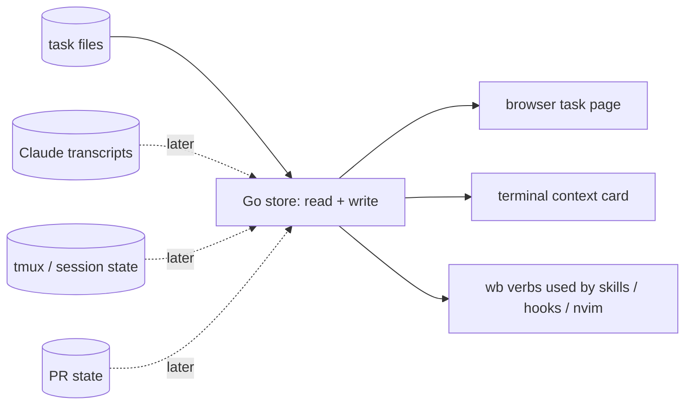

# wb Go store and task page - Plan

## Goal Capsule

**Objective:** Jet runs wb the same way on Linux and macOS. They can open any task or task family in a browser page that already holds its artifacts, decisions, children and current state, instead of rebuilding that picture by hand. And wb's task-store logic is small and typed enough to change without fear.

**Means:** a smaller wb in which a Go component owns reading and writing the task store, with bash kept for the tmux, worktree and fzf glue. The first consumer is a per-task / per-family browser page.

**Product authority:** Jet. Decisions below marked `session-settled` were made by Jet in the 2026-10-17 brainstorm, recorded in `~/code/tasks/dotfiles--wb-future-direction.md` § Decisions.

**Open blockers:** none. Outstanding questions are all deferred to planning.

## Product Contract

### Summary

Shrink wb with a deletion pass. Then move ownership of the task store into a Go component that reads and writes task files and answers in machine-readable form. Build a browser task page for one task or one family as its first consumer.

Work starts with a one-week prototype: the real reader's first slice plus the page, with only the page's layout iterated. Jet's yes or no ends the week. Writes then move to Go behind unchanged wb commands, and the reader grows session, tmux and PR data as the page needs it.

### Problem Frame

Jet runs many Claude sessions in parallel through wb, the bash workbench under `scripts/.config/scripts/tmux/`. Three things work against them:

- **Linux only.** wb depends on Linux-only behaviour in about thirty places. Examples: `flock`, `date -d`, `stat -c`, `/proc/<pid>/cmdline` in the lock layer, and bash 4+ features. macOS ships bash 3.2.
- **Hard to reason about.** `wb.sh` is about 6,400 lines. Three separate awk-based frontmatter writers each encode the task-file format. The board takes about 11 seconds to render over roughly 360 task files.
- **The HTML board doesn't fit how Jet works.** `wb board --html` is a store-wide page that Jet doesn't use. What they actually reach for is one task or one family.

The cost shows up each time Jet returns to a task. They rebuild its picture by hand:

- scrolling back through the Claude window;
- hunting browser tabs for the artifact;
- asking the agent to summarise, which adds more to scroll through.

Several other overview pains came up in the same review. Each already has its own home (see How This Work Fits Together).

### Key Decisions

- **Hybrid: Go owns the task store; bash keeps the tmux, worktree and fzf glue.** (session-settled: user-directed — chosen over a full Go rewrite or staying all-bash: an adversarial read put the bash-induced complexity in the store read/write layer, not the tmux layer.) Governs R3, R8.
- **Delete before building.** (session-settled: user-directed — chosen over porting everything as-is: less to port and less to understand.) Governs R1.
- **Build order B': the prototype is the real reader's first slice.** (session-settled: user-directed — chosen over building the full shared reader first, a throwaway script prototype, Mac-first via bash fixes, and Go-owns-writes up front: a week of prototyping without throwaway work.) Governs R17, R18.
- **Go owns writes too, after the prototype week.** (session-settled: user-directed — chosen over keeping writes in bash: one typed model is simpler, and it removes the Linux-only lock check instead of porting it.) Governs R3, R6, R7.
- **The store-wide `wb board --html` stays, side by side with the task page, for now.** Jet first chose to delete it, then stepped back. (session-settled: user-directed — chosen over deleting it in the deletion pass: Jet will decide later whether a store-wide view has value.) Governs R2.
- **The schema-owner family is retired into this work, and MCP is dropped for now.** (session-settled: user-approved — chosen over keeping `dotfiles--feat-task-store-schema-owner` and `dotfiles--feat-task-store-json-read` as a parallel family: every one of their steps is either this work, a decision it must make, or deferred.) Governs R5.
- **The terminal context card is a separate surface owned elsewhere, reading the same data.** (session-settled: user-directed — chosen over one surface with the card as the page's live strip: the quick answer stays in the terminal.)
- **Testing gaps are resolved during the port, not up front.** (session-settled: user-directed.)

### How This Work Fits Together

<!-- ce-section: work-relationships -->

This plan covers the deletion pass, the Go store (reads, then writes) and the browser task page. The breakdown below is the current understanding, not a committed roadmap.

- **Terminal context card** (`dotfiles--feat-claude-reply-log`). It shares the Go store's data and is enabled by it once sessions are readable. It is planned separately, and its log format should be readable through the store or treated as a cache.
- **Task page requirements** (`dotfiles--wb-board-scoped`). That task holds the seven requirements this plan's page group implements (R9–R15). It has no separate build.
- **Mac port of the bash glue** (`dotfiles--feat-macos-cross-platform`). It depends on this plan's deletion pass, and its scope shrinks once Go owns writes. It can proceed in parallel once the deletion pass lands.
- **Store / Jira / merge drift** (`dotfiles--lanes-store-reconcile`) and **follow-up harvest** (`dotfiles--lanes-followup-harvest`). They can proceed independently, and may later read through the Go store.
- **More automation** (the auto-capture family, e.g. `dotfiles--feat-store-auto-capture`). It can proceed independently.
- **Still to decide:** the store-wide board's fate, once the task page has been in use.

### Requirements

**Deletion pass**
- R1. Remove wb features Jet confirms as unused, one confirmation per feature, before porting anything. The candidate list is assembled during planning.
- R2. Keep the store-wide `wb board --html` working alongside the new task page until Jet decides its fate.

**Go task store**
- R3. One Go component owns parsing and writing task files: frontmatter and `##` sections. No second writer of the format remains once writes have moved.
- R4. The store answers for one task or one family fast enough that the page feels instant on the real store, about 360 files.
- R5. The store produces machine-readable output shaped like the store, not like any one view. It serves agents, the task page, the terminal card and later consumers.
- R6. Every wb verb used by skills, hooks or the nvim plugin keeps its name, arguments and observable behaviour.
- R7. While bash and Go writers coexist, both honour the same per-task lock, so they can never interleave writes to one task file.
- R8. The Go store runs on Linux and macOS with no OS-specific dependency.

**Browser task page** (from `dotfiles--wb-board-scoped`)
- R9. A page for one task, or one family, lists every artifact relevant to it: dossier files, published artifacts, PRs.
- R10. The page shows every decision with its rationale, including decisions later stepped back from, and why.
- R11. For a parent or family, the page shows each child's state and the dependencies between children.
- R12. The page makes follow-ups and deferred work clear.
- R13. The page links each task to its Claude session and tmux session.
- R14. While a session is active, the page shows current state and refreshes more often than a manual rebuild. Current state means: whether a plan exists, what the session is doing now, whether a PR is open, and the latest exchange.
- R15. For an umbrella or parent task, the page helps plan a new family, by showing what is planned, missing or blocked across the children.

**Task-file conventions**
- R16. Task files record artifacts and decision reversals in a form the store can recognise, so R9 and R10 don't depend on guessing from prose.

**Delivery shape**
- R17. The first week is a prototype in which the reader is the real first slice: task files only, covering R9–R13 and R15 from file content. Only the page's layout is iterated. Jet's yes or no ends the week.
- R18. Session, tmux and PR data (R14) are added to the store only after the prototype week, as the page shows each is needed.

### Acceptance Examples

- AE1. **Covers R10.** Earlier the same day, Jet decided to delete the store-wide board, then stepped back from it. The page shows the original decision and the reversal together, with the reason for the reversal, not two unrelated entries.
- AE2. **Covers R6.** After writes move to Go, `/wb-save` runs `wb append <task> Handoffs -`. The resulting task file is the same as it would have been before the move, and the skill needed no change.
- AE3. **Covers R7.** A bash verb and a Go write target the same task file at the same moment. One waits for or reports contention on the shared lock, and no write is lost.
- AE4. **Covers R17.** At the end of the prototype week Jet says no. The work stops, and only the page templates are lost; the reader slice is kept.

### Success Criteria

- wb's day-to-day verbs and the task page work on Jet's Mac.
- Jet says yes at the end of the prototype week, and goes on opening the task page during real sessions instead of scrolling for context.
- The task-store logic lives in one typed component, and `wb.sh` is substantially smaller than its current ~6,400 lines.

### Scope Boundaries

**Deferred for later**
- MCP access to the store.
- Read-only HTTP over the store. It's a candidate way to serve R14's live page, for planning to weigh, not a commitment.
- Deciding the store-wide board's fate (R2).

**Owned by other work** (see How This Work Fits Together)
- The terminal context card.
- Jira, merge and follow-up reconciliation.
- Automation of capture.
- Porting the bash glue to macOS.

**Outside this work**
- Rewriting the tmux, worktree or fzf glue in Go.

### Dependencies / Assumptions

- Claude Code's session transcript format (JSONL under `~/.claude/projects/`) is internal and may change. R14's session data depends on it.
- The tmux pane options set by `claude-notify-hook.sh` (`@claude_blocked`, `@claude_working`, `@claude_session_id`) remain the source of session state.
- PR state comes from `gh` for Sportable repos and `pgh` for personal repos.

### Outstanding Questions

**Deferred to Planning**
- Which commands produce machine-readable output, and its exact shape: mirror the frontmatter exactly, or normalise it with lists, nulls and a version.
- Whether `size`, `priority` and `value` are required with an empty default, or optional.
- Whether `closed:` may be backfilled as an empty key. Today only `wb done` writes it.
- How the `store-specialist` subagent relates to the Go store.
- The deletion candidate list. Starting points from the adversarial read: `unsafe-rewind`, `install-hooks`, `agents --orphans`, the lock orphan auto-clear, the sweep buffer, `wb new`'s flags. `lint-sections` landed in #71 two days ago and is probably not a candidate.
- The R16 convention for recording artifacts and decision reversals.
- How R14's page refreshes: regenerate on change, or a local read-only server.
- Where the Go code lives (this repo or its own module), following the existing Go tools' conventions.

### Sources / Research

- `~/code/tasks/dossiers/dotfiles--wb-future-direction/brainstorm-scratch/adversarial-bash-vs-go.md`: complexity split, deletion candidates, strangler sequencing.
- `~/code/tasks/dossiers/dotfiles--wb-future-direction/brainstorm-scratch/wb-grounding.md`: command surface, skill × verb usage, hooks, locks, portability gaps.
- `~/code/tasks/dossiers/dotfiles--wb-future-direction/brainstorm-scratch/pov-build-order.md`: per-direction assessment behind B'.
- `scripts/.config/scripts/tmux/wb.sh` (frontmatter readers and writers around line 142; the `/proc` lock check around line 609) and `scripts/.config/scripts/tmux/wb-locks.sh` (side-car flock).
- `~/code/tasks/dossiers/dotfiles--spare-token-lanes/tools/build-index.py`: a working per-family page generated from task files.
- Existing Go tools: `~/code/docgen` (Go 1.24, goldmark), `~/code/notes-tui` and `~/code/replay-tui` (Go 1.24, cobra).
