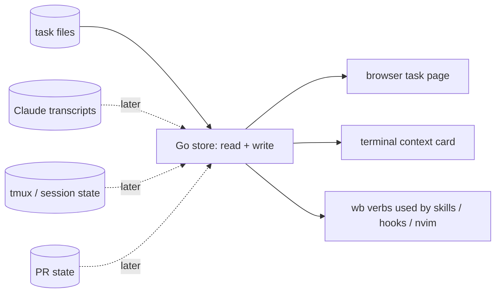
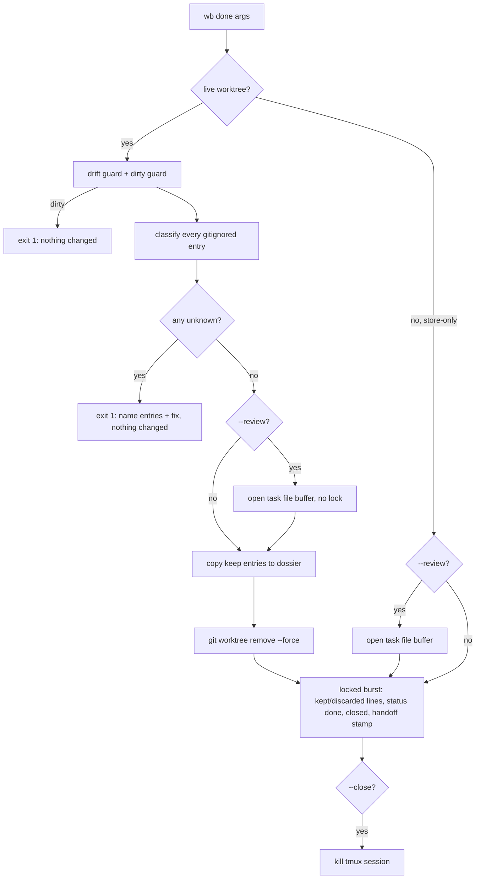
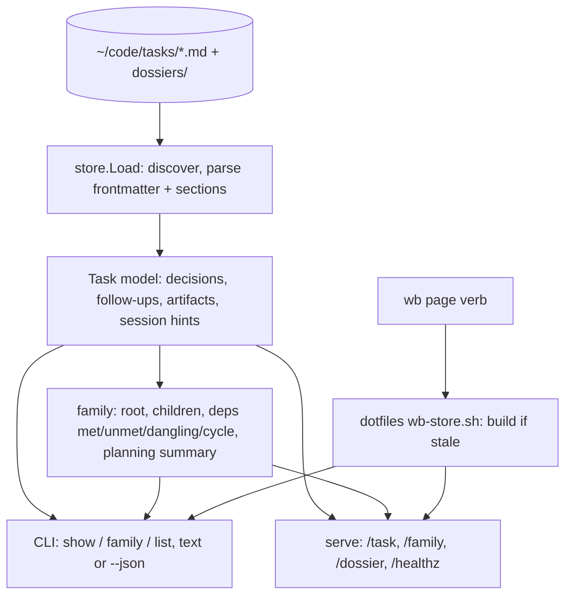
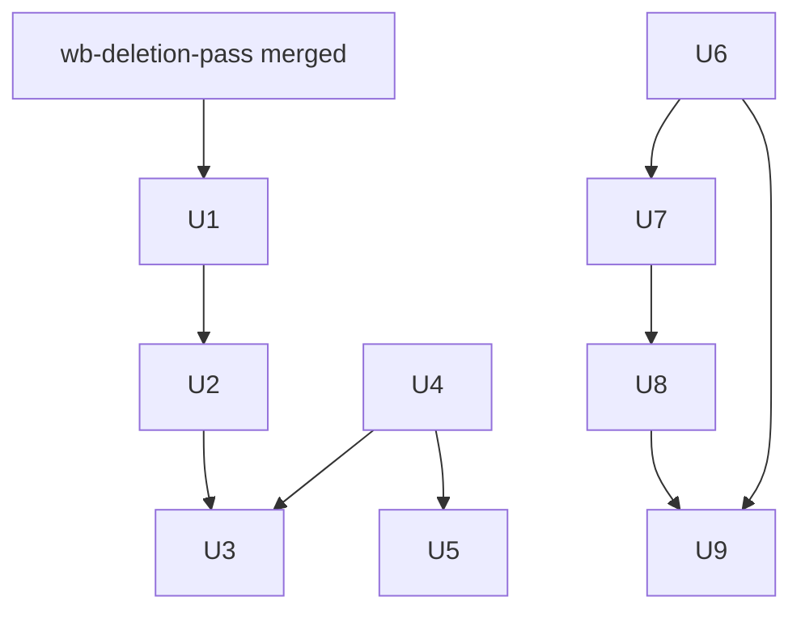

# wb Go store and task page - Plan

## Goal Capsule

**Objective:** Jet runs wb the same way on Linux and macOS. They can open any task or task family in a browser page that already holds its artifacts, decisions, children and current state, instead of rebuilding that picture by hand. And wb's task-store logic is small and typed enough to change without fear.

**Means:** a smaller wb in which a Go component owns reading and writing the task store, with bash kept for the tmux, worktree and fzf glue. The first consumer is a per-task / per-family browser page (KTD9, KTD13).

**Product authority:** Jet. Decisions marked `session-settled` were made by Jet in the 2026-10-17 brainstorm and the 2026-10-18 planning alignment, recorded in `~/code/tasks/dotfiles--wb-future-direction.md` § Decisions.

**Plan scope:** phase 1 is planned in full (U1–U9). Phases 2 and 3 are outlined only (see Phased Delivery); they get their own planning pass after Jet's yes at the end of the prototype week. This plan's share of the Mac objective is that wb-store builds and runs on macOS (R8); the bash glue's macOS port, which the Mac success criterion also needs, is owned by `dotfiles--feat-macos-cross-platform`.

**Stop conditions:**
- Jet says no at the end of the prototype week (R17): stop after U8, keep the reader (U6, U7), drop the page templates.
- Any unit discovers a caller or behaviour that contradicts a settled decision: stop that unit and ask Jet; don't work around it.
- `wb done` work (U1–U3) must not start until [[dotfiles--wb-deletion-pass]] has merged, because both edit `cmd_done`'s neighbourhood and `wb_open_buffer`.

**Execution profile:** each unit is executed by a `/ce-work` session in its own wb worktree, as children produced by `/wb-breakdown`. Implementation can run on Sonnet subagents; the orchestrating session reviews diffs and test output before calling a unit done.

**Who finishes:** each child session opens its own PR (dotfiles PRs go to `development` via `pgh`; the wb-store repo is personal and also uses `pgh`). Jet merges. The prototype-week gate is Jet's yes/no, not a merge.

**Open blockers:** none.

---

## Product Contract

**Product Contract preservation:** changed: Key Decisions gained the 2026-10-18 planning-alignment entries; R19–R23 added from those decisions and Jet's confirmation of the plan scope on 2026-10-18 (`wb done` sweep and review behaviour, `wb page`); AE5–AE6 added; Outstanding Questions resolved into Key Decisions and the Planning Contract. R1–R18 and AE1–AE4 unchanged.

### Summary

Shrink wb with a deletion pass. Then move ownership of the task store into a Go component that reads and writes task files and answers in machine-readable form. Build a browser task page for one task or one family as its first consumer.

Work starts with a one-week prototype: the real reader's first slice plus the page, with only the page's layout iterated. Jet's yes or no ends the week. Writes then move to Go behind unchanged wb commands, and the reader grows session, tmux and PR data as the page needs it.

This plan details the phase-1 work no session owns yet: the `wb done` rework, the task-file conventions for artifacts and reversals, and the prototype week. The mechanical deletions and two bash quick wins are already running as their own children.

### Problem Frame

Jet runs many Claude sessions in parallel through wb, the bash workbench under `scripts/.config/scripts/tmux/`. Three things work against them:

- **Linux only.** wb depends on Linux-only behaviour in about thirty places. Examples: `flock`, `date -d`, `stat -c`, `/proc/<pid>/cmdline` in the lock layer, and bash 4+ features. macOS ships bash 3.2.
- **Hard to reason about.** `wb.sh` is about 6,900 lines. Three separate awk-based frontmatter writers each encode the task-file format, and the bash readers disagree with each other on details such as which duplicate key wins. The board takes about 11 seconds to render over roughly 405 task files.
- **The HTML board doesn't fit how Jet works.** `wb board --html` is a store-wide page that Jet doesn't use. What they actually reach for is one task or one family.

The cost shows up each time Jet returns to a task. They rebuild its picture by hand:

- scrolling back through the Claude window;
- hunting browser tabs for the artifact;
- asking the agent to summarise, which adds more to scroll through.

`wb done` adds its own friction: it opens a blocking review buffer on every run, which is why a separate background-and-relay skill (`wb-done`) exists just to call it from an agent.

Several other overview pains came up in the same review. Each already has its own home (see How This Work Fits Together).

### Key Decisions

- **Hybrid: Go owns the task store; bash keeps the tmux, worktree and fzf glue.** (session-settled: user-directed — chosen over a full Go rewrite or staying all-bash: an adversarial read put the bash-induced complexity in the store read/write layer, not the tmux layer.) Governs R3, R8.
- **Delete before building.** (session-settled: user-directed — chosen over porting everything as-is: less to port and less to understand.) Governs R1.
- **Deletion list decided item by item in the 2026-10-18 audit** (`~/code/tasks/dossiers/dotfiles--wb-future-direction/deletion-audit.html`). (session-settled: user-directed — each row chosen over the alternatives listed on the audit page after independent value audits.) Governs R1.
- **`wb done` stops opening the task file by default; review is opt-in.** (session-settled: user-directed — chosen over keeping the pre-teardown review buffer on every run.) Governs R19.
- **The gitignored-file sweep is automatic, driven by explicit keep and throwaway lists; anything unlisted stops the run for Jet to classify.** (session-settled: user-directed — chosen over the interactive checklist buffer, and over discarding unlisted files silently: be specific first, automate further as the lists mature.) Governs R20, R21, R22.
- **The `wb-done` skill is deleted; close-out runs `wb done` directly.** (session-settled: user-directed — chosen over keeping the background+relay workaround.) Governs R19.
- **Build order B': the prototype is the real reader's first slice.** (session-settled: user-directed — chosen over building the full shared reader first, a throwaway script prototype, Mac-first via bash fixes, and Go-owns-writes up front: a week of prototyping without throwaway work.) Governs R17, R18.
- **Go owns writes too, after the prototype week.** (session-settled: user-directed — chosen over keeping writes in bash: one typed model is simpler, and it removes the Linux-only lock check instead of porting it.) Governs R3, R6, R7.
- **The store-wide `wb board --html` stays, side by side with the task page, for now.** Jet first chose to delete it, then stepped back. (session-settled: user-directed — chosen over deleting it in the deletion pass: Jet will decide later whether a store-wide view has value.) Governs R2.
- **The task page is served by a local process that re-reads the store on each request.** (session-settled: user-directed — chosen over static HTML regenerated by hand: the page must be current on refresh.) Governs R14, R17.
- **Artifact records carry the durable on-disk path as well as the claude.ai link.** (session-settled: user-directed — chosen over URL-only lines: scratch dirs get cleaned and links alone become unrecoverable.) Governs R9, R16.
- **`size`, `priority` and `value` are optional; absent means empty; nothing is backfilled, including `closed:`.** (session-settled: user-approved — chosen over making them required with an empty default.) Governs R5.
- **store-specialist is unchanged in phase 1;** its lookups move to the Go reader once it exists. (session-settled: user-approved — chosen over reworking it alongside the reader.) Governs R5.
- **The schema-owner family is retired into this work, and MCP is dropped for now.** (session-settled: user-approved — chosen over keeping `dotfiles--feat-task-store-schema-owner` and `dotfiles--feat-task-store-json-read` as a parallel family: every one of their steps is either this work, a decision it must make, or deferred.) Governs R5.
- **The terminal context card is a separate surface owned elsewhere, reading the same data.** (session-settled: user-directed — chosen over one surface with the card as the page's live strip: the quick answer stays in the terminal.)
- **Testing gaps are resolved during the port, not up front.** (session-settled: user-directed.)

### How This Work Fits Together

<!-- ce-section: work-relationships -->

This plan covers the deletion pass, the `wb done` rework, the task-file conventions, the Go store (reads, then writes) and the browser task page. The breakdown below is the current understanding, not a committed roadmap.



- **Already running children of this task:** [[dotfiles--wb-deletion-pass]] (the mechanical deletions from the audit) and [[dotfiles--wb-bash-glue-quickwins]] (`prefix+t` opens the task file; ctrl-x leaves the doomed worktree). This plan references them and does not re-plan them.
- **Terminal context card** (`dotfiles--feat-claude-reply-log`). It shares the Go store's data and is enabled by it once sessions are readable. It is planned separately, and its log format should be readable through the store or treated as a cache.
- **Task page requirements** (`dotfiles--wb-board-scoped`). That task holds the seven requirements this plan's page group implements (R9–R15). It has no separate build.
- **Decision-page skill** (`dotfiles--feat-decision-artifact-skill`). It publishes decision pages and records answers in Decisions, so it is the writer that most needs the R16 conventions. It is coordinated by a note appended to its task file (U5), not by code here.
- **Mac port of the bash glue** (`dotfiles--feat-macos-cross-platform`). It depends on this plan's deletion pass, and its scope shrinks once Go owns writes. It can proceed in parallel once the deletion pass lands.
- **Store / Jira / merge drift** (`dotfiles--lanes-store-reconcile`) and **follow-up harvest** (`dotfiles--lanes-followup-harvest`). They can proceed independently, and may later read through the Go store.
- **More automation** (the auto-capture family, e.g. `dotfiles--feat-store-auto-capture`). It can proceed independently.
- **Still to decide:** the store-wide board's fate, once the task page has been in use.

### Requirements

**Deletion pass**
- R1. Remove wb features Jet confirms as unused, one confirmation per feature, before porting anything.
- R2. Keep the store-wide `wb board --html` working alongside the new task page until Jet decides its fate.

**Go task store**
- R3. One Go component owns parsing and writing task files: frontmatter and `##` sections. No second writer of the format remains once writes have moved.
- R4. The store answers for one task or one family fast enough that the page feels instant on the real store, about 405 files.
- R5. The store produces machine-readable output shaped like the store, not like any one view. It serves agents, the task page, the terminal card and later consumers.
- R6. Every wb verb used by skills, hooks or the nvim plugin keeps its name, arguments and observable behaviour.
- R7. While bash and Go writers coexist, both honour the same per-task lock, so they can never interleave writes to one task file.
- R8. The Go store runs on Linux and macOS with no OS-specific dependency.

**Browser task page** (from `dotfiles--wb-board-scoped`)
- R9. A page for one task, or one family, lists every artifact relevant to it: dossier files, published artifacts, PRs.
- R10. The page shows every decision with its rationale, including decisions later stepped back from, and why.
- R11. For a parent or family, the page shows each child's state and the dependencies between children.
- R12. The page makes follow-ups and deferred work clear.
- R13. The page links each task to its Claude session and tmux session.
- R14. While a session is active, the page shows current state and refreshes more often than a manual rebuild. Current state means: whether a plan exists, what the session is doing now, whether a PR is open, and the latest exchange.
- R15. For an umbrella or parent task, the page helps plan a new family, by showing what is planned, missing or blocked across the children.
- R23. `wb page` opens the task page for the current session's task, or for a named task, so the page is one command away from any wb session.

**Task-file conventions**
- R16. Task files record artifacts and decision reversals in a form the store can recognise, so R9 and R10 don't depend on guessing from prose.

**`wb done`**
- R19. `wb done` closes without opening any editor by default; `--review` opens the task file for review before teardown.
- R20. Before removing a worktree, `wb done` sorts every gitignored entry into keep, throwaway or unknown. Keep entries are copied to the task's dossier, throwaway entries are deleted with the worktree, and any unknown entry stops the run before anything changes, naming the entries and how to resolve them.
- R21. A credential-shaped file is never copied into the task store.
- R22. The task file records which gitignored entries were kept and which were discarded.

**Delivery shape**
- R17. The first week is a prototype in which the reader is the real first slice: task files only, covering R9–R13 and R15 from file content. Only the page's layout is iterated. Jet's yes or no ends the week.
- R18. Session, tmux and PR data (R14) are added to the store only after the prototype week, as the page shows each is needed.

### Acceptance Examples

- AE1. **Covers R10.** Earlier the same day, Jet decided to delete the store-wide board, then stepped back from it. The page shows the original decision and the reversal together, with the reason for the reversal, not two unrelated entries.
- AE2. **Covers R6.** After writes move to Go, `/wb-save` runs `wb append <task> Handoffs -`. The resulting task file is the same as it would have been before the move, and the skill needed no change.
- AE3. **Covers R7.** A bash verb and a Go write target the same task file at the same moment. One waits for or reports contention on the shared lock, and no write is lost.
- AE4. **Covers R17.** At the end of the prototype week Jet says no. The work stops, and only the page templates are lost; the reader slice is kept.
- AE5. **Covers R20, R21.** A be--monorepo worktree holds `config.hjson`, copied in at `wb new` from the repo's `.worktree-bootstrap`. If the worktree copy is byte-identical to the main checkout's, `wb done` treats it as throwaway and closes normally. If Jet edited it inside the worktree, `wb done` stops before removing anything, names `config.hjson`, and never offers to copy it into the dossier.
- AE6. **Covers R20, R22.** A worktree holds an unlisted `scratch/notes.txt`. `wb done` stops and names it. Jet re-runs with `--keep scratch/notes.txt`; the file lands in `~/code/tasks/dossiers/<task>/scratch/notes.txt`, the task file gains a `kept:` line for it, and the worktree is removed.

### Success Criteria

- wb's day-to-day verbs and the task page work on Jet's Mac.
- Jet says yes at the end of the prototype week, and goes on opening the task page during real sessions instead of scrolling for context.
- The task-store logic lives in one typed component, and `wb.sh` is substantially smaller than its current ~6,900 lines.
- An agent can run `wb done` in the foreground and get a result or a clear stop message in the same turn, with no buffer to wait on.

### Scope Boundaries

**Deferred for later**
- MCP access to the store.
- Deciding the store-wide board's fate (R2).
- Phase 2 (Go-owned writes) and phase 3 (session, tmux and PR data; the live page, R14, R18): outlined under Phased Delivery, planned after Jet's yes.

**Owned by other work** (see How This Work Fits Together)
- The terminal context card.
- Jira, merge and follow-up reconciliation.
- Automation of capture.
- Porting the bash glue to macOS.
- The mechanical deletions (wb-deletion-pass) and the `prefix+t` / ctrl-x quick wins (wb-bash-glue-quickwins).

**Outside this work**
- Rewriting the tmux, worktree or fzf glue in Go.

**Considered and not built** (each with what would change the call)
- A confirmation popup before every picker ctrl-x close. Jet asked for "don't open, just close"; the kept/discarded record (R22) and the stop-on-unknown rule (R20) cover the loss case. Revisit if an unlisted file Jet wanted is ever discarded via a throwaway pattern that was too broad.
- Per-repo sweep lists. One global list file starts; `.worktree-bootstrap` already covers the per-repo config files. Revisit when a repo needs a pattern that would be wrong for others.
- A dated-suffix rule for dossier name collisions. Kept files overwrite their earlier dossier copy, as today. Revisit if a kept file is ever clobbered by a later session's copy and that matters.
- A `wb done` warning when an `## Artifacts` path points inside the worktree being removed. The convention (KTD9) forbids such paths instead. Revisit if dead artifact links show up on pages.
- A repo filter on the page server to hide employer tasks. It binds to 127.0.0.1 only and checks the Host header. Revisit if the page is ever exposed beyond loopback.
- A sandboxing Content-Security-Policy on `/dossier/` responses. Dossier HTML pages legitimately run scripts (the lanes family `INDEX.html` renders its Markdown client-side), and every dossier file is Jet's or an agent's own output. Revisit if dossier files ever come from outside the store's own writers.
- Content scanning of kept files for secrets (token prefixes, private-key headers). Kept files are a short explicit list of wb's own files plus what Jet names with `--keep`; the filename guard (KTD4) covers the common leaks. Revisit if a secret is ever found in a dossier.
- Re-recording kept/discarded lines after a `wb done` killed between teardown and its final write. The kept files are already in the dossier, where the page lists them. Revisit if killed runs become common.

#### Deferred to Follow-Up Work
- A tmux key binding for `wb page` (likely next to `prefix+t` from [[dotfiles--wb-bash-glue-quickwins]]), once the page earns daily use.
- A store-wide index page on the server, decided together with the store-wide board's fate (R2).
- A one-line addition to the handoff skill so seeded task files can carry `## Artifacts` lines for context artifacts.
- Moving store-specialist's lookups to `wb-store show` / `family` (phase 2).
- goreleaser for wb-store, once it is installed anywhere other than by the shim.

### Dependencies / Assumptions

- Claude Code's session transcript format (JSONL under `~/.claude/projects/`) is internal and may change. R14's session data depends on it.
- The tmux pane options set by `claude-notify-hook.sh` (`@claude_blocked`, `@claude_working`, `@claude_session_id`) remain the source of session state.
- PR state comes from `gh` for Sportable repos and `pgh` for personal repos.
- Go 1.24 is installed on Jet's machines; the shim builds wb-store from source on first use.

### Sources / Research

- `~/code/tasks/dossiers/dotfiles--wb-future-direction/brainstorm-scratch/adversarial-bash-vs-go.md`: complexity split, deletion candidates, strangler sequencing.
- `~/code/tasks/dossiers/dotfiles--wb-future-direction/brainstorm-scratch/wb-grounding.md`: command surface, skill × verb usage, hooks, locks, portability gaps.
- `~/code/tasks/dossiers/dotfiles--wb-future-direction/brainstorm-scratch/pov-build-order.md`: per-direction assessment behind B'.
- `~/code/tasks/dossiers/dotfiles--wb-future-direction/planning-research.md`: deletion candidates with usage counts, store conventions survey, Go placement and lock compatibility.
- `~/code/tasks/dossiers/dotfiles--wb-future-direction/wb-components.md`: component map of what moves to Go, stays bash, or is deleted.
- `~/code/tasks/dossiers/dotfiles--wb-future-direction/deletion-audit.html`: the item-by-item deletion decisions.
- `scripts/.config/scripts/tmux/wb.sh`: `cmd_done` (sweep, buffer, bursts), `wb_bootstrap`, `wb_credential_shaped`, `wb_safe_rel`, `wb_task_files`, `_wb_append_under_heading`, `_ctrl_x`; `scripts/.config/scripts/tmux/wb-board.sh` (`wb_board_v2_read_file`, deps, family root) and `scripts/.config/scripts/tmux/wb-locks.sh` (side-car flock).
- `scripts/.config/scripts/docgen.sh`: the build-on-demand shim pattern.
- `claude/.claude/skills/review-page/scripts/review-page.py`: the only localhost-server precedent (loopback bind, port fall-forward, browser open, Origin check).
- Existing Go tools: `~/code/docgen` (Go 1.24, goldmark, `html/template`), `~/code/notes-tui` and `~/code/replay-tui` (Go 1.24, cobra, `cmd/` + `internal/`, `embed.FS` in replay-tui).

---

## Planning Contract

### Key Technical Decisions

**`wb done` rework**

- KTD1. **Classify every gitignored entry first, mutate only after the whole set is classified.** `wb done` reads `git status --porcelain --ignored`, sorts each entry into keep / throwaway / unknown, and exits non-zero before any copy, worktree removal or task-file write if an unknown remains. Why: `git worktree remove --force` is irreversible, and a stop halfway through a copy would leave a half-swept dossier. Governs R20.
- KTD2. **Sweep lists live in one stowed file, read through `wb.sh`'s resolved path.** The file is `scripts/.config/scripts/tmux/wb-sweep.list`, with `keep:` and `throwaway:` glob lines, located via `readlink -f` on `wb.sh` (the way `wb-board.sh` loads `wb-board-dag.sh`), so a missing restow can't hide it. Patterns use gitignore-style matching: a pattern without a `/` matches at any depth (`node_modules/` matches `apps/web/node_modules/`), and a trailing `/` matches a directory or a symlink to one. Seed keep: `.claude-queue.md`, `CLAUDE.local.md`. Seed throwaway: `node_modules/`, `dist/`, `build/`, `.venv/`, `venv/`, `__pycache__/`, `target/`, `coverage/`, `logs/`, `*.log`. (session-settled: user-directed — chosen over discarding unlisted entries silently: a small explicit list first, fine-tuned toward automation over time.) Governs R20.
- KTD3. **Bootstrap copies identical to main are throwaway.** An entry listed in the repo's `.worktree-bootstrap` is throwaway when it is a symlink, or when it is a file byte-identical (`cmp -s`) to the main checkout's copy. A differing copy is unknown, so an edited `config.hjson` stops the run. Git reports a fully ignored directory as one collapsed entry (be--monorepo tracks nothing under `.claude/`, so `.claude/settings.local.json` arrives as `.claude/`). A collapsed entry that no list pattern matches is therefore expanded to its files (`find -P`) and each file is classified on its own. Why: those files exist only because `wb new` copied them in; deleting an unchanged copy loses nothing. Governs R20 (AE5).
- KTD4. **Credential-shaped entries can never be kept.** `wb_credential_shaped` grows to cover `config.hjson`, `*.env.json`, `.npmrc`, `.netrc`, `*.tfvars`, `.pgpass`, `id_ecdsa*`, `*.keystore`, `*.kdbx`, `*token*` and `*password*`. A credential-shaped entry matched by a keep pattern or named in `--keep` is reported as unknown with a "credential-shaped, copy it yourself" note. Directories being kept are walked without following symlinks. Any credential-shaped file inside one also stops the run, and so does any symlink inside one that resolves outside the worktree, because `cp -a` would plant it in the dossier. Vendor directories on the throwaway list are never walked. Governs R21.
- KTD5. **One-off resolution is a re-run flag; there is no prompt.** `--keep <path>` and `--throwaway <path>` are repeatable flags that classify a named entry for this run only. A flag naming a path that is no longer present warns and continues. Why: agents run `wb done` in background Bash, and the picker runs it inside an fzf binding, so neither has a TTY to answer a prompt. Governs R20 (AE6).
- KTD6. **One locked burst after teardown; `--review` is the only buffer.** Every keep copy must succeed before teardown: a failed `cp -a` exits 1 with the worktree, status and task file unchanged, because `git worktree remove` would otherwise destroy the only copy. The default path holds no lock until after `git worktree remove`, then writes `kept:` / `discarded:` lines, `status done`, `closed`, `claude_sessions ""` and the `wb done (auto)` handoff stamp in a single locked burst. `--review` calls the existing `wb_open_buffer` on the task file after classification and before teardown, with no lock held, and also applies to store-only closes. The `## Sweep` append/strip machinery and `wb_sweep_section` are removed. (session-settled: user-directed — chosen over keeping the pre-teardown review buffer on every run.) Governs R19, R22.
- KTD7. **Picker ctrl-x shows a stop in a tmux popup.** `_ctrl_x` captures `cmd_done`'s output and, on a non-zero exit, shows it with `tmux display-popup` (falling back to `display-message`), so a stop doesn't vanish in the fzf redraw. Governs R20.
- KTD8. **close-out runs `wb done` in the foreground and relays its output verbatim.** The `--close` self-kill hazard and the "never retry or force after a stop" rule move from the deleted `wb-done` skill into close-out's own text. (session-settled: user-directed — chosen over keeping the wb-done background+relay skill.) Governs R19.

**Task-file conventions (R16)**

- KTD9. **`## Artifacts` uses a positional em-dash grammar.** Each line is `- <title> — <durable path> — <claude.ai URL>`. The URL is optional, and an optional fourth field carries a note such as `retired`. Fields are classified by shape (`https://` is the URL; anything else is the path), so a field-order slip degrades gracefully. The durable path is store-relative (`dossiers/...`), `~/...`, or absolute, and never inside a `.worktrees/` directory. The section sits between `## Handoffs` and `## Decisions` in TEMPLATE, matching where `wb append` already inserts a missing heading. Dedupe is by path. Path plus URL is session-settled (see the Key Decision governing R9, R16); the grammar itself is this plan's choice. Governs R9, R16.
- KTD10. **A reversal is a new Decisions entry carrying `(supersedes: <date> "<title fragment>")`.** The marker names the earlier entry by its date and a quoted substring of its title, because decisions have no ids today and the store is append-only, so ids can't be backfilled. An entry's title is the first line of its text after `<date> — `, bold lead included; most real entries have no other title (for example `2026-10-17 — Probe 6 (Jet): delete the store-wide …`). A reader resolves the pointer among entries carrying that date by a case-insensitive substring match on the title only. Zero matches or several matches both resolve to unresolved, with the candidate count, never a guess. The writer reads `## Decisions` first so the fragment is quoted from the real text. Governs R10, R16 (AE1).

**Go store (prototype week)**

- KTD11. **wb-store is its own repo, built on demand by a dotfiles shim.** The repo is `~/code/wb-store` (module `github.com/jetnoli-sportable/wb-store`, Go 1.24, cobra, `cmd/` + `internal/`, following replay-tui). The shim `scripts/.config/scripts/wb-store.sh` follows `docgen.sh`, with three differences: a recursive source `find` that prunes `.git` and `.worktrees` and counts embedded templates; building to a temp file and then `mv`; and `TASKS_DIR` passed through as `--store`. Test data is `dotfiles--*` task files plus synthetic files only, never employer tasks. (session-settled: user-approved — chosen over putting Go inside dotfiles, where stow would symlink it into `$HOME`.) Governs R3, R8.
- KTD12. **One canonical reader rule set, deliberately not copying any single bash reader.** The bash readers disagree with each other, so wb-store applies these rules:
  - a task file is a `<repo>--<slug>.md` file whose line 1 is exactly `---`;
  - the first duplicate frontmatter key wins;
  - ` # comment` is stripped from scalars, and the value is split on the first colon;
  - absent and empty values are null; lists are never null;
  - `##` section detection is fence-aware, copying the rules from `_wb_lint_sections_records` before wb-deletion-pass deletes it;
  - duplicate canonical sections are merged in file order, with a `copies` count.

  Today's store has no file where these rules disagree with the bash readers, and a test pins each rule. Governs R3, R5.
- KTD13. **Output is plain text by default, with `--json` as a normalised document carrying `schema_version: 1`.** `show`, `family` and `list` share one model. Lists are always arrays, absent scalars are null, and dates are strings. (session-settled: user-approved — chosen over mirroring frontmatter exactly: consumers shouldn't re-implement the format's quirks.) Governs R5.
- KTD14. **Task resolution order:** exact stem, then `<query>.md`, then a literal path, then a unique case-insensitive substring. Several substring matches list the candidates and exit 2. Why: putting the exact stem first fixes the known "parent whose name prefixes its children" ambiguity, and it only turns some of today's errors into answers. Governs R5.
- KTD15. **The page server re-reads the whole store on every request, with no cache.** It is Go `net/http`:
  - bound to `127.0.0.1`, defaulting to port 8766 and falling forward up to 10 ports;
  - a Host-header check;
  - templates in `embed.FS`;
  - dossier files served through `/dossier/<stem>/<path>`, so snap Chromium never needs `file://`. The stem must be a plain task stem, and the file is served only if its symlink-resolved path stays inside the real dossier root;
  - `serve` runs in the foreground until interrupted. `wb page` first probes `/healthz` on ports 8766–8775 and reuses a server reporting the current build id, starting a new detached one only when none answers;
  - the build id shown on `/healthz` and in the page footer;
  - the browser opened with snap chromium, `xdg-open` or macOS `open` unless `--no-open`.

  The store is 3.3 MB, and a warm read of it takes about 0.02 s. (session-settled: user-directed — chosen over static HTML regenerated by hand.) Governs R4, R14, R17.

### High-Level Technical Design

**`wb done` after the rework.** Every path that changes anything sits below the classification gate.



**Sweep classification**, applied per `git status --ignored` entry (directories arrive collapsed with a trailing `/`). The first matching row wins.

| Order | Condition | Class |
|---|---|---|
| 1 | named by `--throwaway <path>` | throwaway |
| 2 | named by `--keep <path>` and not credential-shaped | keep |
| 3 | listed in `.worktree-bootstrap` and a symlink, or `cmp -s` identical to main | throwaway |
| 4 | credential-shaped, or a kept dir contains a credential-shaped file | unknown (credential note) |
| 5 | matches a `keep:` glob | keep |
| 6 | matches a `throwaway:` glob | throwaway |
| 7 | anything else | unknown |

**wb-store components**, prototype week. Every request starts from a fresh `store.Load`.



**R16 grammar** (directional):

```text
## Artifacts

- Deletion audit — dossiers/dotfiles--wb-future-direction/deletion-audit.html — https://claude.ai/artifact/6fN1Y47WNVtEUFF4DPdinp
- wb component map — dossiers/dotfiles--wb-future-direction/wb-components.html — https://claude.ai/artifact/7zMMMFpAzqWGN81cCqadCb
- Planning research — dossiers/dotfiles--wb-future-direction/planning-research.md

## Decisions

2026-10-17 — **Store-wide board kept, not deleted.** (supersedes: 2026-10-17 "Probe 6") It lives side by side with the task page; Jet decides its fate once the page has been used.
```

**`--json` shape** (directional; the golden files in U6/U7 are authoritative):

```text
{ schema_version: 1,
  task: { stem, repo, title, status, path[], parent, depends_on[{stem, state, status}],
          size, priority, value, tags[], jira, created, closed, reviewed, mtime,
          sections[{name, copies, body}],
          decisions[{date, title, body, supersedes{raw, target|null, resolved}, superseded_by[]}],
          follow_ups[{text, done, refs[]}],
          artifacts{ declared[{title, path, url, note}], dossier_files[{path, kind}],
                     published[], prs[], docs[] },
          session{ expected_tmux, worktree, branch, claude_sessions[{id, at, primary}], resume_cmd } },
  family: { root, children[], unblocks[], planning{ startable[], blocked[], missing[] } },
  warnings[{kind, detail}] }
```

**Unit order.** U4 lands first because it is small and defines the grammar the skill edits cite. U1→U2→U3 wait for wb-deletion-pass. U6→U7→U8 run in the wb-store repo, in parallel with the dotfiles work. U9 joins them.



### Output Structure

The new repo, `~/code/wb-store`:

```text
wb-store/
  go.mod
  README.md
  cmd/wb-store/main.go
  internal/store/        frontmatter.go sections.go task.go resolve.go discover.go
                         family.go decisions.go artifacts.go followups.go session.go
                         *_test.go
                         testdata/store/   (dotfiles--* copies + synthetic files)
                         testdata/golden/  (show/family/list text + json)
  internal/render/       text.go json.go *_test.go
  internal/web/          server.go open.go *_test.go
                         templates/        layout.html task.html family.html
```

### Phased Delivery

- **Phase 1 (this plan, U1–U9).** The `wb done` rework, the task-file conventions, and the prototype week. It runs alongside the deletion pass and the bash quick wins, which are already in flight. Phase 1 ends with Jet's yes/no on the page.
- **Phase 2: Go owns writes (outline only).** `wb-store` gains `set`, `status`, `jira-set`, `append`, `new` (seeding) and `breakdown --apply`. Each wb verb keeps its name, arguments and messages (R6), and becomes a thin bash wrapper that runs its tmux-aware checks, such as refusing a live task, and then calls the binary. Go takes the same side-car lock file through `syscall.Flock`, with the same 1-second wait and exit-75 contention message (R7, AE3). This retires the three awk writers. Its proof is byte-identical output against today's writers on the fixture store (AE2). store-specialist's reads move to `show`/`family`.
- **Phase 3: session, tmux and PR data plus the live page (outline only).** The reader adds:
  - transcript tail and open questions from `~/.claude/projects/` JSONL;
  - live `@task` / `@claude_*` pane state from tmux;
  - PR state from `gh` / `pgh`, with a short cache.

  The page gains R14's live strip, refreshed on a short poll. Each source is added only once the page shows it is needed (R18). The terminal context card reads the same model.
- **Under consideration for phase 3: an inbox in the picker.** This would be a queue of the sessions waiting on Jet. The picker already knows which ones are blocked from the `@claude_blocked` pane flag. Each entry would show the reply being waited on and the relevant earlier responses, so Jet works through responses in order instead of hopping between sessions. It reads the same transcript and tmux data as the live strip and the context card ([[dotfiles--feat-claude-reply-log]]). It extends the picker, which is wb's most-used tool, rather than adding a new surface. Its size and shape get decided when phase 3 is planned.

### Assumptions

- wb-deletion-pass merges before U1 starts, and keeps `wb_open_buffer`'s signature (its plan says so).
- `wb append <task> Artifacts` needs no `wb.sh` change: `cmd_append` accepts any heading and inserts a missing one before `## Decisions`.

---

## Implementation Units

### U1. Sweep classifier and lists

- **Goal:** a pure, testable classifier that sorts a worktree's gitignored entries into keep / throwaway / unknown, plus the seeded list file.
- **Requirements:** R20, R21; KTD1–KTD5.
- **Dependencies:** wb-deletion-pass merged.
- **Files:**
  - `scripts/.config/scripts/tmux/wb.sh` (new classifier helpers near `wb_credential_shaped`; extend `wb_credential_shaped`; keep `wb_safe_rel`)
  - `scripts/.config/scripts/tmux/wb-sweep.list` (new)
  - `scripts/.config/scripts/tmux/tests/wb-sweep.test.sh` (new)
- **Approach:**
  1. Add a list loader that reads `wb-sweep.list` from `wb.sh`'s resolved directory (KTD2), ignoring blanks and `#` comments. Mirror `wb_bootstrap`'s manifest-reading style.
  2. Add a classifier function that takes the worktree, the main checkout and the one-off `--keep`/`--throwaway` paths. It prints one `class<TAB>path<TAB>note` line per entry, applying the classification table in order (KTD3, KTD4, KTD5).
  3. Extend `wb_credential_shaped` with the KTD4 patterns. It stays basename-based and case-insensitive.
  4. The walk of a directory being kept uses `find -P` (no symlink following) and checks each file with `wb_credential_shaped`.
- **Patterns to follow:** `wb_bootstrap` (manifest parse); `wb-board.sh`'s `readlink -f` load of `wb-board-dag.sh`; `wb_safe_rel` containment.
- **Test scenarios:**
  - `.claude-queue.md` in the worktree classifies as keep.
  - `node_modules/` and `app.log` classify as throwaway, and `node_modules/` is not walked even if it contains `aws-credentials.js`.
  - A bootstrap-listed `config.hjson` identical to main classifies as throwaway; the same file with one byte changed classifies as unknown with the credential note. (Covers AE5.)
  - A bootstrap-listed directory that is a symlink into main classifies as throwaway.
  - Nested `apps/web/node_modules/` and a symlinked `node_modules` both classify as throwaway.
  - A collapsed `.claude/` entry holding only a bootstrap-listed `settings.local.json` identical to main classifies as throwaway; with an extra unlisted file beside it, that file classifies as unknown.
  - A kept directory holding a symlink to a file outside the worktree classifies as unknown.
  - Unlisted `scratch/notes.txt` classifies as unknown; with `--keep scratch/notes.txt` it classifies as keep. (Covers AE6.)
  - `--keep .env` still classifies as unknown with the credential note.
  - A kept directory holding a nested `.env` classifies the directory as unknown.
  - `--throwaway gone.txt` for an absent path prints a warning and doesn't fail.
  - A list file with comments, blank lines and trailing spaces parses cleanly.
  - An entry escaping the worktree via `..` or a symlink is rejected by `wb_safe_rel`.
- **Verification:** the new test passes in the Docker sandbox, and shellcheck reports nothing new.

### U2. `wb done` rewired: stop before change, keep, discard record, `--review`

- **Goal:** `cmd_done` uses the classifier, stops before any change on unknowns, copies keep entries, records kept/discarded entries, and opens a buffer only under `--review`.
- **Requirements:** R19, R20, R22; KTD1, KTD5, KTD6, KTD7.
- **Dependencies:** U1; [[dotfiles--wb-bash-glue-quickwins]] (its PR also edits `_ctrl_x`; rebase onto its `cd "$HOME"` line rather than replacing it).
- **Files:**
  - `scripts/.config/scripts/tmux/wb.sh` (`cmd_done`, the usage header, `_ctrl_x`; remove `wb_sweep_section` and the `## Sweep` awk; update comments that describe the sweep)
  - `scripts/.config/scripts/tmux/tests/wb-done.test.sh`
  - `scripts/.config/scripts/tmux/tests/wb-queue.test.sh`
  - `scripts/.config/scripts/tmux/tests/wb-breakdown.test.sh`
  - `scripts/.config/scripts/tmux/tests/wb-lock-integration.test.sh`
  - `scripts/.config/scripts/tmux/tests/wb-schema.test.sh` (verify only)
- **Approach:**
  1. Parse `--review`, `--keep <path>`, `--throwaway <path>` alongside `--close`, and add usage lines so `wb help` shows them.
  2. After the existing drift and dirty guards, run the classifier. On any unknown, print the stop message and exit 1. The message names each entry and its note, and suggests the list file and the one-off flags. Nothing has changed at that point.
  3. Under `--review` (live or store-only), call `wb_open_buffer "$task_file"` with no lock held.
  4. Copy keep entries into `$TASKS_DIR/dossiers/<stem>/<rel>` with `cp -a`, preserving today's destination. Any failed copy exits 1 before step 5 (KTD6).
  5. Run the existing `git worktree remove --force` guarded by `[ -d ]`, so a retry after a killed run is safe.
  6. Write one locked burst (KTD6) holding a `- kept:` line per kept entry, one `- discarded:` line listing the throwaway entries, and the existing status/closed/claude_sessions/handoff writes.
  7. In `_ctrl_x`, capture `cmd_done`'s output. On non-zero exit, show it in `tmux display-popup` (fallback `display-message`) (KTD7).
- **Execution note:** start from wb-deletion-pass's merged `wb.sh`. If it hasn't merged, stop (Goal Capsule stop condition).
- **Patterns to follow:** today's bursts and `kept:` note format in `cmd_done`; `wb_task_lock_acquire_guarded` usage; `_wb_git_dirty_guard` for stop-message style.
- **Test scenarios:**
  - Default `wb done` on a clean worktree never calls `wb_open_buffer` (the stub fails the test if invoked). The worktree is removed, status is done, `closed` is stamped, the `wb done (auto)` handoff entry is present and `claude_sessions` is blank.
  - `.claude-queue.md` lands in the dossier, and the task file gains `- kept:` for it (rewrite of wb-queue §7).
  - `node_modules/` and `app.log` are removed, and the task file gains one `- discarded:` line naming them.
  - An unknown `scratch/notes.txt` gives exit 1. The worktree still exists, status is unchanged, no dossier file is created, the task file is byte-identical to before, and the message names the file and the flags. (Covers AE6.)
  - A re-run with `--keep scratch/notes.txt` succeeds, with the file in the dossier and a `kept:` line. (Covers AE6.)
  - A keep copy forced to fail (read-only dossier directory) exits 1 with the worktree present, status unchanged and the task file byte-identical.
  - An edited bootstrap `config.hjson` stops the run, and an identical one is discarded. (Covers AE5.)
  - `--review` calls `wb_open_buffer` exactly once, the task lock can be acquired while it is open, and an edit made in the buffer survives the final burst (rewrite of wb-lock-integration's probe as a `--review` scenario).
  - `--review` on a store-only close opens the buffer, and the task is marked done.
  - A dirty worktree fails before classification, as today.
  - A retry after the worktree is already gone skips the sweep and still flips status.
  - wb-breakdown's migrated-family fixture: `scratch-notes.txt` is classified via a `--keep` flag in the test and lands in the child's dossier.
  - `--close` is still the only `kill-session` in `cmd_done` (wb-schema source guard).
  - ctrl-x on a worktree with an unknown entry leaves the session alive and shows the stop text via the popup path (stubbed tmux).
- **Verification:** the touched test files pass in the Docker sandbox. The full suite shows no new failures against a clean-room baseline of development. `wb help` lists the new flags.

### U3. Retire the `wb-done` skill; close-out runs `wb done` directly and records artifacts

- **Goal:** remove the background+relay skill, and make close-out call `wb done` synchronously, carry the `--close` hazard itself, and record artifacts and reversals per R16.
- **Requirements:** R19, R16; KTD8, KTD9, KTD10.
- **Dependencies:** U2, U4.
- **Files:**
  - `claude/.claude/skills/wb-done/SKILL.md` (delete the directory)
  - `claude/.claude/skills/close-out/SKILL.md`
  - `claude/.claude/skills/decision-buffer/references/mechanism.md` (caller list)
  - `claude/.claude/skills/decision-buffer/scripts/open-buffer.sh` (header caller list)
  - `scripts/.config/scripts/tmux/tests/parked-items-retirement.test.sh` (drop the wb-done live-file entry)
  - `docs/wb-guide.md` (done section, Known rough edges marked resolved, the sweep list next to the bootstrap section)
  - `docs/where-we-are.md` (End-a-session card, done bullet, skill-usage row)
  - `docs/docgen.json` (drop the `wb-done` skill→guide mapping)
  - `docs/guide-format.md` (only if its example is a live mapping)
  - `docs/roadmap.md` (a changelog line)
- **Approach:**
  1. Rewrite close-out's description, scope bullets, step 5 and step 6. Run `wb done` in the foreground, relay stdout/stderr verbatim, and on a stop relay the message and end the turn with no retry and no flags added. Inline the `--close` self-kill warning, including the unsaved-buffer-in-another-window hazard.
  2. Extend close-out step 4. Every artifact published or written to a dossier this session gets an `## Artifacts` line via `wb append <task> Artifacts` (KTD9), skipping paths already present. A decision that reverses an earlier one is appended with the `(supersedes: …)` marker after reading `## Decisions` for the exact title (KTD10).
  3. Add close-out test scenarios: the stop relay, an artifact line appended once, and a supersedes entry.
  4. Delete the wb-done skill and update every live reference listed under Files. Leave historical plans, archive and ideation untouched.
  5. Regenerate docs with docgen. Commit `docs/*.md` edits in their own commit (the pre-commit hook stages pending docs edits).
  6. After merge, restow `claude` and confirm `~/.claude/skills/wb-done` no longer exists. Update the memory note `wb-done-sweep-buffer-stall-recovery.md` to say it now applies only to `wb done --review`.
- **Patterns to follow:** close-out's existing step structure; the "relay verbatim" posture from the wb-done skill being deleted.
- **Test scenarios:**
  - `parked-items-retirement.test.sh` passes without the wb-done entry.
  - A repo-wide search for `wb-done` outside `docs/plans`, `docs/archive`, `docs/ideation` and generated files finds nothing.
  - docgen regenerates without diffs on a second run.
  - Skill walkthrough: close-out on a task whose worktree holds an unknown file relays the stop message and does not re-run `wb done`.
  - Skill walkthrough: close-out on a session that published one artifact appends exactly one `## Artifacts` line, and running it again appends none.
- **Verification:**
  - tests pass;
  - `wb help` and `/help wb done` describe the new behaviour;
  - after restow, `ls ~/.claude/skills/wb-done` fails.

### U4. Task-file conventions: TEMPLATE, README, guide, and the ghost-row fix

- **Goal:** define `## Artifacts` and the supersedes marker where every writer reads the format, record the optional-frontmatter rule, and make wb list only real task files.
- **Requirements:** R16, R5; KTD9, KTD10, KTD12 (shape rule).
- **Dependencies:** none.
- **Files:**
  - Target repo, tasks store (`~/code/tasks`): `TEMPLATE.md` (add `## Artifacts` between `## Handoffs` and `## Decisions`); `README.md` (Task body: the Artifacts bullet with grammar and path roots; Authoring discipline: the supersedes marker and the "read Decisions first" rule; frontmatter schema: `size`/`priority`/`value` optional, absent means empty, no backfill of those or `closed:`)
  - `docs/wb-guide.md` (embedded template block, and the sentence after it)
  - `claude/.claude/agents/store-specialist.md` (documentation only: name `## Artifacts` as an append target and cite the marker; its lookups and verbs stay unchanged, per the store-specialist Key Decision)
  - `claude/.claude/CLAUDE.md` (the "HTML artifacts → durable landing path first" rule gains "and record it as a line in the task file's `## Artifacts`")
  - `scripts/.config/scripts/tmux/wb.sh` (`wb_task_files`: accept only stems containing `--`, so `AGENTS.md` and `CLAUDE.md` stop showing as tasks)
  - `scripts/.config/scripts/tmux/tests/wb-task-files.test.sh` (new)
- **Approach:**
  1. Commit the tasks-repo edits in `~/code/tasks`, staging only TEMPLATE.md and README.md. The dotfiles edits go in a dotfiles PR.
  2. Document the grammar once in README and have every other place cite it (store-specialist, the CLAUDE.md line, the skills in U3/U5), rather than restating it.
  3. Replace `wb_task_files`' denylist with the `<repo>--<slug>.md` shape rule, keeping the regular-file check.
- **Test scenarios:**
  - `wb_task_files` over a fixture store with `README.md`, `TEMPLATE.md`, `AGENTS.md`, a `CLAUDE.md` symlink, `RECOVERY-NOTES-2026-07-10.md` and two `repo--slug.md` files returns only the two task files.
  - `wb new --planned` from a fixture TEMPLATE containing `## Artifacts` produces a file with exactly one `## Artifacts`, after Handoffs and before Decisions.
  - `wb append <old file without Artifacts> Artifacts "- x — dossiers/a/b.html"` creates the heading before `## Decisions`. A second append lands under the same heading with no duplicate. A file with no `## Decisions` gets the section at EOF.
- **Verification:** the new and touched tests pass. The plain-text `wb board` on the real store no longer shows AGENTS or CLAUDE rows. docgen is idempotent.

### U5. Writers: wb-save records artifacts; AE1 fixture; decision-page coordination

- **Goal:** the end-of-session snapshot records artifacts, the real store holds a resolvable reversal for AE1, and the decision-page work knows the conventions.
- **Requirements:** R16, R10; KTD9, KTD10.
- **Dependencies:** U4.
- **Files:**
  - `claude/.claude/skills/wb-save/SKILL.md` (new step after the Handoffs append: append missing `## Artifacts` lines, deduped by path, and only for artifacts that exist in this conversation; omit the step when there are none)
  - Target repo, tasks store: `dotfiles--wb-future-direction.md` (via `wb append … Decisions`: the AE1 entry `(supersedes: 2026-10-17 "Probe 6")` with its reason; the old paragraph untouched); `dotfiles--feat-decision-artifact-skill.md` (via `wb append … Follow-ups`: a pointer to the README grammar and marker for its SKILL.md)
- **Approach:**
  1. Add the wb-save step and its scenarios, following the skill's "never Edit/Write task files, only `wb append`" rule.
  2. Write both store entries with `wb append`, never by hand-editing.
- **Test scenarios:**
  - Skill walkthrough: a session that published one artifact appends exactly one line with title, dossier path and URL.
  - Skill walkthrough: a session with no artifacts appends nothing.
  - Skill walkthrough: a path already listed is not re-added.
  - Covers AE1. The appended entry is a new dated entry whose marker resolves (date 2026-10-17 plus title substring "Probe 6") to exactly one earlier entry. U7's golden test uses a copy of it.
- **Verification:** both store entries are present and the old text is unchanged (`git -C ~/code/tasks diff` shows additions only). wb-save's scenario list names the new step.

### U6. wb-store: repo, reader core, `list` and `show`

- **Goal:** a buildable wb-store repo whose reader parses the real store's shapes, with `list` and `show` in text and `--json`.
- **Requirements:** R3 (read side), R4, R5, R8, R17; KTD11–KTD14.
- **Dependencies:** none (runs in parallel with the dotfiles units).
- **Files** (target repo `wb-store`, created at `~/code/wb-store` with a personal GitHub remote; confirm with Jet before creating the remote):
  - `go.mod`, `README.md`, `cmd/wb-store/main.go`
  - `internal/store/discover.go`, `frontmatter.go`, `sections.go`, `task.go`, `resolve.go`
  - `internal/render/text.go`, `json.go`
  - `internal/store/*_test.go`, `internal/render/*_test.go`, `cmd/wb-store/cli_test.go`
  - `internal/store/testdata/store/` (copies of `dotfiles--feat-family-dag-view-render`, `dotfiles--audit-tmux-jump-to`, `dotfiles--fix-tasks-store-dedupe-headings`, `dotfiles--wb-future-direction`, plus synthetic files)
  - `internal/store/testdata/golden/`
- **Approach:**
  1. Scaffold following replay-tui's layout. README states the "dotfiles--* or synthetic test data only" rule.
  2. `store.Load(dir)` reads every candidate file once and returns tasks plus warnings. Its parsing functions are pure, so table tests need no disk.
  3. Implement the KTD12 rules, the KTD14 resolution order, and the KTD13 schema for the fields this unit owns (frontmatter, title, sections, mtime).
  4. Golden tests use an `-update` flag.
- **Execution note:** before wb-deletion-pass deletes `_wb_lint_sections_records`, copy its fence rules into `sections.go`'s doc comment. Take them from git history if the deletion has already merged.
- **Patterns to follow:** `~/code/docgen/frontmatter.go` and its tests (plain `Test<Thing><Case>`, inline sources); replay-tui's cobra root and `testdata/` use.
- **Test scenarios:**
  - Frontmatter is recognised only when line 1 is `---`. A body `---` in a frontmatter-less synthetic file does not open frontmatter, and the file is skipped by `list` and is an error for `show`.
  - Duplicate frontmatter key: the first wins.
  - `status: doing  # planned|…` gives `doing`, and a URL value containing `#` without a preceding space is kept whole.
  - Empty `jira:` gives JSON `null`, and `tags:` absent gives `[]`.
  - Discovery skips `README.md`, `TEMPLATE.md`, `AGENTS.md`, a `CLAUDE.md` symlink, `RECOVERY-NOTES-…`, `*.md.buffer-state`, directories and an illegal stem like `foo bar--x.md`.
  - Resolution: an exact stem beats a substring; a unique substring resolves; an ambiguous substring lists candidates and exits 2; `<stem>.md` and a literal path both resolve.
  - Sections: the real dag-view-render file's two `## Follow-ups` merge in order, with `copies: 2`. A `## Decisions` line inside a fenced block (backtick and tilde) is not a heading. Heading-shaped prose mid-paragraph is not a heading. `## Follow-ups (superseded …)` stays a separate section.
  - `show` text and `--json` match the goldens. Every list in the JSON is an array, never null, and `schema_version` is 1.
  - `list` over a generated 400-file store finishes under 200 ms (logged, generous budget).
- **Verification:** `go test ./...`, `go vet ./...` and `gofmt -l` are clean. `wb-store show dotfiles--feat-family-dag-view-render` against the real store prints every section with the duplicate merged.

### U7. wb-store: family, dependencies, decisions, artifacts, follow-ups, session hints

- **Goal:** the model the page needs for R9–R13 and R15, exposed through `family` and enriched `show`.
- **Requirements:** R9, R10, R11, R12, R13, R15, R16 (reader side); KTD9, KTD10, KTD13.
- **Dependencies:** U6.
- **Files** (target repo `wb-store`):
  - `internal/store/family.go`, `decisions.go`, `artifacts.go`, `followups.go`, `session.go`
  - matching `*_test.go`
  - `internal/render/` (family text and JSON)
  - `cmd/wb-store/main.go` (the `family` command)
  - testdata: the `dotfiles--feat-family-dag-view` family (parent plus children), `dotfiles--feat-board-build`, `dotfiles--feat-weekly-review`, a copy of the U5 AE1 entry, and synthetic cycle, dangling, phantom-parent, self-parent, 51-hop chain and `claude_sessions` files
- **Approach:**
  1. **Family:** the root is found by walking `parent` up to 50 hops, with a cycle guard that fails open. Children come from reverse `parent` edges. Phantom parents are allowed as roots. Port the semantics from `wb-board.sh`'s deps/family code, not its awk.
  2. **Deps:**
     - comma-separated bare stems, with duplicates dropped;
     - state is met, unmet, dangling (with a warning), or cycle; cycle members are never counted as unmet;
     - `unblocks` comes from reverse edges.
  3. **Planning summary (R15):** each child is `startable`, `blocked` or `missing`. Missing means no `## Plan` body, no size, or no deps declared on a planned task.
  4. **Decisions:**
     - an entry starts at a line matching an optional `- `, a date and ` — `, or a `###` heading in the same form;
     - the title and the supersedes marker are parsed per KTD10, and `superseded_by` is filled by reverse lookup;
     - prose "supersedes" without the marker is left as plain text.
  5. **Artifacts:**
     - `## Artifacts` lines are parsed per KTD9;
     - the dossier listing is recursive and sorted, skipping side-cars;
     - regex extraction covers claude.ai URLs (trailing punctuation trimmed), all PR URLs, `docs/...` paths and `dossiers/...` paths;
     - entries are deduped by path, as KTD9 specifies; a regex-found URL already carried by a declared line is not listed twice.
  6. **Follow-ups:** bullet and checkbox items, with `[[stem]]` refs. `###` blocks are excluded.
  7. **Session hints:** the expected tmux name is `repo--sanitize(worktree minus .worktrees/)`, or the stem slug when `worktree:` is blank. `claude_sessions` is parsed with `@primary`, and the resume command is derived from it. Everything is labelled "expected", not live.
- **Test scenarios:**
  - The dag-view family: the root and all children are found, the `-size-capture` dep is met, and a child depending on an unfinished sibling is unmet and listed under `blocked`.
  - Synthetic a→b→a cycle: both are flagged `cycle`, neither counts as unmet, and the normalised loop string is stable.
  - A dangling dep `owning-org-stamp-recovery` produces a warning, and the task is not blocked.
  - Phantom parent: the child's root is the phantom stem.
  - Self-parent is dropped.
  - A 51-hop chain stops at 50 with a warning.
  - Covers AE1. The AE1 copy yields two decisions: the original carries `superseded_by` pointing at the new one, and the new one carries `supersedes.resolved: true` plus its reason text.
  - A marker whose fragment matches nothing yields `resolved: false` and the raw text, with no guess.
  - Using the real `Probe 6` and `Build order` entries (both dated 2026-10-17), `"Probe 6"` resolves to the Probe 6 entry only, because "Stepped back from probe 6" sits in the body of the Build order entry, not its title line. A fragment matching two titles that day yields `resolved: false` with a candidate count of 2.
  - `## Artifacts` with one three-field line and one path-only line yields two declared artifacts, with the URL null on the second. A file without the section yields `declared: []`, and regex extraction still finds both PR URLs in `dotfiles--feat-board-build`.
  - A URL at the end of a sentence (`…/abc.`) is captured without the trailing dot.
  - Follow-ups: checkbox state and `[[stem]]` refs are parsed, and handoff `###` blocks inside Follow-ups are excluded.
  - Session: `.worktrees/feat/x` with repo `dotfiles` gives `dotfiles--feat-x`; blank worktree falls back to the stem slug; `@primary` is parsed.
  - `family` text and `--json` match the goldens.
- **Verification:** the tests are clean. On the real store, `wb-store family dotfiles--feat-family-dag-view --json` lists the same children and blocked set as the bash board's Family tab for that family.

### U8. wb-store: page server and the prototype-week gate

- **Goal:** a local page server for one task or one family, iterated on layout only, ending in Jet's yes/no.
- **Requirements:** R4, R9–R13, R15, R17; KTD15.
- **Dependencies:** U7.
- **Files** (target repo `wb-store`):
  - `internal/web/server.go`, `open.go`, `templates/layout.html`, `task.html`, `family.html`
  - `internal/web/*_test.go`
  - `cmd/wb-store/main.go` (the `serve` command)
- **Approach:**
  1. **Server:** `serve [--port N] [--no-open] <task>` binds, opens the browser at the task page, and runs in the foreground until interrupted (KTD15). Each handler calls `store.Load` afresh.
  2. **Routes:**
     - `/task/<stem>` and `/family/<stem>` are the pages; pages link to each other, so one server covers every task;
     - `/dossier/<stem>/<path>` serves dossier files after the symlink-resolved containment check (KTD15);
     - `/healthz` reports the build id.
  3. **Layout:**
     - central content at about 80–85% of viewport width, with an always-visible section nav;
     - light and dark modes; inline CSS, no external assets;
     - a header with a status pill and size;
     - a session card with copyable `tmux switch-client -t =<name>` and `claude --resume <id>` commands;
     - Decisions as a timeline with supersession pairs shown together;
     - Follow-ups as a checklist, then Artifacts, the latest Handoff, and Done;
     - on the family page, a child table with state chips and dependency edges, plus the Planned / Missing / Blocked / Startable box.
  4. **Iteration:** during the week only the templates and CSS change. Data-model changes go back to U7.
  5. **Gate:** a short checklist page in the task's dossier for Jet's yes/no.
- **Execution note:** use the `visual-explore` skill for layout rounds if Jet wants side-by-side variants. Run the gate as a tickable HTML checklist in the dossier, per Jet's verification-checklist convention.
- **Patterns to follow:** `review-page.py` (loopback bind, fall-forward, browser-open order, quiet logging); replay-tui `config/embed.go` (embed package beside its files).
- **Test scenarios** (`httptest`):
  - `GET /task/<stem>` returns 200 and contains the title, a decision, an artifact link and the expected tmux command.
  - Editing a fixture task file on disk between two requests changes the second response (current on refresh).
  - `GET /family/<root>` lists every child with its state.
  - Unknown stem returns 404.
  - `/dossier/<stem>/../../etc/passwd` and an absolute-path variant return 404.
  - A dossier symlink pointing outside the dossier root returns 404, and a `<stem>` segment that isn't a plain task stem returns 404.
  - A request with `Host: evil.example` is rejected.
  - `/healthz` returns the build id, and the page footer shows the same id.
  - Port fall-forward: with 8766 occupied, the server binds 8767 and prints that URL.
- **Verification:** tests are clean. Jet opens their real task and family pages during the week, and the gate checklist records the yes/no. On no, stop per AE4.

### U9. dotfiles: `wb-store.sh` shim and `wb page`

- **Goal:** wb-store is one command away from any wb session, and builds itself when stale.
- **Requirements:** R23, R8; KTD11.
- **Dependencies:** U6 for the shim; U8 for `wb page`.
- **Files:**
  - `scripts/.config/scripts/wb-store.sh` (new)
  - `scripts/.config/scripts/tmux/wb.sh` (the `page` verb: dispatch, usage line, `cmd_page`)
  - `scripts/.config/scripts/tmux/tests/wb-page.test.sh` (new)
  - `docs/wb-guide.md` (a `wb page` row, and a wb-store section with the source repo, shim and port)
- **Approach:**
  1. **Shim:** follow `docgen.sh`, using `WB_STORE_SRC` (default `~/code/wb-store`) and the binary `~/.local/bin/wb-store`. Rebuild when the binary is missing or any `*.go`, `go.mod`, `go.sum` or template is newer, using a recursive find that prunes `.git` and `.worktrees`. Build to a temp file and `mv -f`, then exec with `--store "$TASKS_DIR"`. Use no `stat -c` or `date -d`.
  2. **`wb page [<task>]`:**
     - with no argument, it resolves the current session's task via `wb_session_task_file` (`@task` first);
     - it reuses a running same-build server (the `/healthz` probe in KTD15) and opens `/task/<stem>` on it; otherwise it starts `wb-store.sh serve <stem>` detached, logging to wb's state directory, so the calling pane isn't blocked;
     - outside tmux with no argument, it errors with usage;
     - the shim is found through `wb.sh`'s resolved directory, so a missing restow gives a clear "run stow" message rather than a crash.
  3. Restow `scripts` once after merge so `~/.config/scripts/wb-store.sh` exists.
- **Test scenarios:**
  - `wb page` inside a session whose `@task` points at a child task resolves to the child's stem (stub the shim and capture its args).
  - `wb page dotfiles--foo` passes the stem through.
  - With a stub `/healthz` answering the current build id on 8766, `wb page` opens the URL on it and starts no new server; with a different build id answering, it starts a new one.
  - `wb page` outside tmux with no argument prints usage and exits 1.
  - A missing shim prints the stow hint and exits 1.
  - The shim against a stub source dir rebuilds when a `.go` file is newer than the binary, and skips the rebuild otherwise.
  - The shim ignores newer files under `.worktrees/`.
- **Verification:** the tests pass. `wb help` lists `page`. In a real session, `wb page` opens the current task's page.

---

## Verification Contract

| Scope | Gate |
|---|---|
| wb bash (U1, U2, U4, U9) | Build the sandbox image from `scripts/.config/scripts/tmux/tests/Dockerfile` and run each touched `*.test.sh` in it; never run wb tests against the real `~/code`. The full suite has an environment-dependent known-failure floor, so compare against a clean-room run of `development` rather than a static list. Docker snap can't mount `/tmp`, so put mounts under `$HOME`. |
| Shell hygiene | `bash -n` and `shellcheck` report nothing new in touched scripts. |
| tmux config | Unchanged in this plan (no new binds). |
| Docs (U3, U4, U9) | Edit `docs/*.md` only, rerun `scripts/.config/scripts/docgen.sh`, confirm a second run is a no-op, and commit doc edits separately. |
| Skills (U3, U5) | Walk each new or changed scenario by hand in a scratch task, and record the result in the PR body. |
| wb-store (U6–U8) | `go test ./...`, `go vet ./...`, `gofmt -l .` (empty). Goldens are updated only via `-update`, with the diff reviewed. |
| Real-store spot checks | Read-only: `wb-store show` / `family` against `~/code/tasks`, and `git -C ~/code/tasks status` clean afterwards (except U4/U5's intended commits). |
| Stow | After the U3 and U9 merges, restow and confirm `~/.claude/skills/wb-done` is gone and `~/.config/scripts/wb-store.sh` exists. |

## Definition of Done

- **Global:**
  - every unit's test scenarios exist and pass under its gate;
  - no new shellcheck findings;
  - docgen is idempotent;
  - dotfiles PRs target `development` via `pgh`;
  - abandoned-attempt code and debug output are removed from every diff;
  - each child task file records what landed under `## Done`, and any published artifacts under `## Artifacts`.
- **U1–U3:** an agent can run `wb done` in the foreground and get either a close or a stop message in the same turn. The `wb-done` skill is gone from the repo and from `~/.claude/skills/`.
- **U4–U5:**
  - TEMPLATE and README carry the grammar and marker;
  - wb-save and close-out write them;
  - the AE1 entry is in the store;
  - wb no longer lists AGENTS or CLAUDE as tasks.
- **U6–U7:** the reader passes its goldens on fixtures, and answers `show`/`family` on the real store with no crash and no warnings beyond known-dangling deps.
- **U8:** Jet's yes/no is recorded in the parent task's Decisions. A yes leads to phase 2 planning; a no applies AE4.
- **U9:** `wb page` opens the current session's task page from any wb session.
