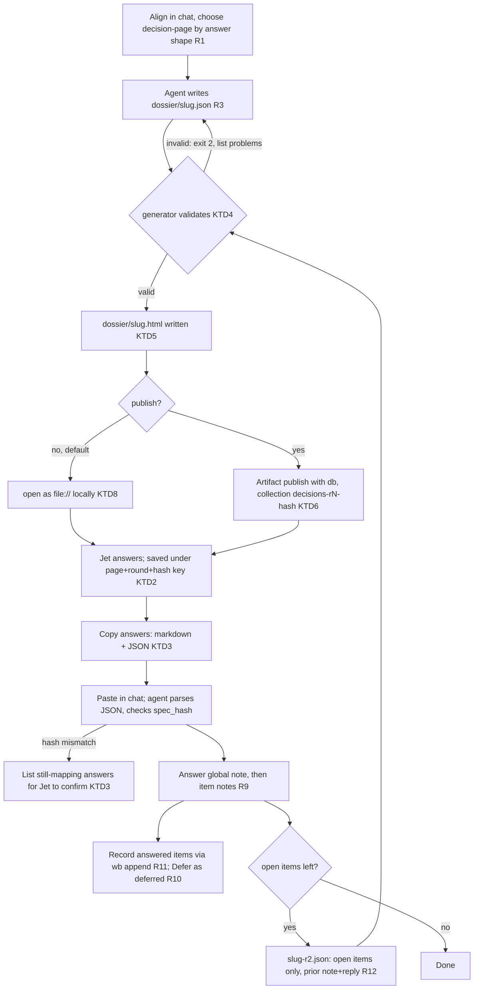

# decision-page skill and review-page refresh - Plan

## Goal Capsule

- **Objective:** When a batch of about 4-25 decisions each needs its own options and evidence, Jet gets one page to work through at their own pace, opened as a plain local file or optionally on claude.ai, and returns every answer to the session with one paste. Any session can produce that page in one step. For a big batch answered from one shared verdict list, the review page gives the same calm, keyboard-driven experience, so the two feel like one family.
- **Means:**
  - a shared page kit (KTD10);
  - a new `decision-page` skill built on it: a JSON spec, a Python generator and an HTML template (KTD1);
  - review-page's page moved onto the same kit, with its local server and Submit flow kept (KTD11).
- **Authority:** the task file's `## Decisions` (dotfiles--feat-decision-artifact-skill, 2026-10-18) outranks this plan. This plan outranks the approved UX mockups (`~/code/tasks/dossiers/dotfiles--feat-decision-artifact-skill/mockups/decision-page-converged.html` and `review-page-converged.html`), which outrank the original deletion-audit page it grew from.
- **Stop conditions:** stop and report if snap Chromium cannot keep localStorage for a `file://` page under `~/code/tasks/dossiers/`, because that would leave the local default with no way to save progress. Stop if any unit would require touching `wb.sh`. Stop and report if review-page's test suite can't be kept passing without breaking `/weekly-review` or `/wb-breakdown`.
- **Execution profile:** `ce-work` in the `feat-decision-artifact-skill` worktree. Commit per unit, in dependency order: U5, U1, U2, U3, U6, U4. One PR to `development`. If the diff passes roughly 1,500 lines, split it into two stacked PRs: U5, U1, U2 and U3 first, then U6 and U4, so the routing edits land once both pages exist. Jet merges, then the main checkout is re-stowed so the new skill goes live.

---

## Product Contract

### Summary

Add a `decision-page` skill. It turns a JSON spec of decisions into a self-contained HTML page in the task dossier, opens it locally, and optionally publishes the same file to claude.ai. Jet returns answers with "Copy answers", and the skill defines how the agent reads them, records them in the task file, and runs a second round for open items. review-page, decision-buffer and the global instructions gain the same rule for choosing between the three tools. review-page's page is rebuilt on the same shared kit with the UX Jet approved, while its server, Submit flow and close contract keep working.

### Problem Frame

The wb deletion audit (2026-10-18) showed that a page beats both existing tools for one kind of batch. That batch had ten decisions. Each had evidence and options written for that item alone, a recommended choice, and a notes box. A decision-buffer doc with ten such decisions is a long markdown file. review-page forces every row onto one shared verdict list and treats silence as agreement, which is wrong when each item needs thought.

review-page has the opposite problem. It serves the big shared-verdict batches well, but its page is a dense table with no overview, no keyboard control and an answer bar fixed to the screen, and its template is an inline Python string with every brace doubled. The mockup rounds on 2026-10-18 settled one look for both pages. Building the shared parts once avoids writing them twice and letting the two pages drift apart.

The decision page was hand-built for that one audit, so the next batch would mean writing it again. The way answers came back was improvised: copy the text, paste it into chat, answer three "I need more context" notes, re-ask. That loop worked, but nothing records it, so the next session would have to rediscover it.

### Key Decisions

- **A new skill, not a second mode of review-page.** (session-settled: user-directed — chosen over adding a mode to review-page: the mechanisms differ and the two have opposite rules for untouched items) Governs R1, R9.
- **The shape of each item's answer picks the kind of tool; item count only sets the size band within that shape; trigger phrases never override the shape.** (session-settled: user-approved — chosen over count- or keyword-based triggers: "audit page" currently triggers review-page, yet the deletion audit was a decision-page job) Governs R1, R2.
- **A plain local `.html` file is the default, and publishing to claude.ai is optional.** (session-settled: user-directed — chosen over requiring an Artifact: Jet "doesn't want this to have to work through artifacts") Governs R5, R6.
- **The review-page refresh ships in the same sweep, on a kit shared with decision-page.** (session-settled: user-directed — chosen over a separate follow-up task: the two pages reuse most of their building blocks) Governs R15, R16, R17, R18.
- **review-page's contract may change if that improves the flow, provided its callers are updated in the same sweep.** (session-settled: user-directed — chosen over freezing the current contract: Jet is "not married to the current review page contract") Governs R17.
- **Copy-answers is the only return path in v1.** (session-settled: user-directed — chosen over a Send-to-Claude button using `comments.sendToClaude`: Jet is happy pasting for now) Governs R7.

### Requirements

**Choosing the tool**

- R1. `decision-page` has a `SKILL.md` whose when-to-use section states this rule. When every item is answered from the same short verdict list and most suggestions are expected to be right, use review-page (roughly 15 or more items) or a decision-buffer findings-review doc (fewer). When each item has options written for it, use a decision-buffer choice doc for 1-3 decisions and decision-page for about 4-25. decision-page also takes a batch of any size whose evidence needs tables or code, or that Jet will answer away from the terminal. More than 25 such items are split by group into separate pages, each its own slug at round 1. If a trigger phrase and the answer shape disagree, the shape wins and the agent says so in chat.
- R2. review-page, decision-buffer and the global instructions file state the same rule, or point to R1's statement of it, so no skill routes a batch to a different tool than the others would.

**Building the page**

- R3. The agent writes a JSON spec into the task dossier. One generator command validates it and writes a self-contained HTML page beside it. When the session has no task and Jet declines to create one, the spec and page go to `~/code/tasks/dossiers/<repo>--<slug>/` without a task file, and the agent says so in chat.
- R4. The page matches the converged mockup Jet approved on 2026-10-18 (`~/code/tasks/dossiers/dotfiles--feat-decision-artifact-skill/mockups/decision-page-converged.html`):
  - **An overview band at the top.** It has three parts:
    - a strip showing where this batch sits in the parent task's plan, with done, current and upcoming stages;
    - an at-a-glance table listing each open item, its short question, the recommended option and Jet's live pick;
    - already-decided items as compact one-liners with their dates, plus the answered counter.
  - **A collapsible sticky left index** with a progress dot per item, so Jet can widen the content to focus on it.
  - **One card per open item:** title and tag, "The question", optional artifact chips, why it matters, how it works today, an evidence summary with the full evidence collapsed, the optional shift note, the optional earlier note and reply, the recommendation with its reason, the options, and a notes box.
  - **Options:** exactly one marked RECOMMENDED, real alternatives, and Defer. Each option shows Pros, Cost, Risk and Trade-off lines, with a muted "None stated" where the spec gives nothing. A Clear choice control returns the item to unanswered.
  - **A closing block** with global notes and Copy answers.

  It uses a wide layout, works in light and dark themes, and works at phone width.
- R14. The page can be driven from the keyboard without losing the full-page view:
  - `j`/`k` step through the overview, then each card, then the closing block.
  - `1`–`9` pick an option and `a` takes the recommended one. `c` clears and `n` focuses the notes box.
  - `e` expands or collapses the current card's evidence, and `E` does it for every card.
  - `[` collapses the index and `?` lists the keys.
  - Enter on the overview jumps to the first unanswered item. Enter on the closing block copies the answers.
  - No key fires while Jet is typing in a text box.
- R5. Opened as a local `file://` page with no network, the page works fully. Answers survive a reload in the same browser, and no two pages or rounds share saved answers.
- R6. The same file can be published to claude.ai as an Artifact. Answers then also save to the artifact's database, so Jet can answer from another device.

**Returning answers**

- R7. Copy answers produces text Jet can read, plus a machine-readable block that identifies the page, round and spec version, and keys every answer by item id and option id.
- R8. An item Jet did not touch is unanswered. It is never filled in from the recommendation.
- R9. The global note is answered before anything is acted on, and an item's note is answered before that item's choice is recorded. A choice whose note asks a question that could change it is confirmed with Jet before it is recorded. A choice whose note adds a condition is recorded with that condition.
- R10. Defer is an answer. It is recorded as deferred, with a follow-up, and is not re-asked unless Jet asks.
- R11. Resolved decisions are recorded in the task file's `## Decisions` through `wb append`. The spec and page stay in the dossier. If the session has no task, decisions stay in chat, and the agent offers to create a task before writing the spec.

**Follow-up rounds**

- R12. A second round contains only the open items. It is a new file, earlier answers never pre-fill it, and each re-asked item shows Jet's earlier note and the agent's reply.
- R13. The skill has a learnings ledger that records Jet's feedback on decision pages, in Jet's own words.

**Review page**

- R15. The review page matches the converged mockup Jet approved on 2026-10-18 (`~/code/tasks/dossiers/dotfiles--feat-decision-artifact-skill/mockups/review-page-converged.html`):
  - **An overview band at the top:** a "where this sits" strip, compact at-a-glance counts with verdict chips, a plain statement that untouched rows accept their suggestion, and the intro with the rest collapsible.
  - **A collapsible left sidebar,** trimmed to five things: progress, "needs you" remaining with a jump to the next one, overrides, verdict tallies you can click to filter, and search with an area filter. It has no per-row list.
  - **Rows grouped by area,** each area with "Agree to all in this area". Each row shows its task as a chip, a one-line summary, the suggested verdict with its reason always visible, the verdict control, Agree, and Note/Group toggles. Evidence and details are collapsed.
  - **"Needs you" rows are flagged in place.** Rows whose spec gives a `prior` note carry an earlier-note marker.
  - **A close-out block at the end of the content column,** never fixed to the screen and never overlapped by the sidebar. It holds accept-remaining-defaults, global questions, Submit and Copy JSON.
  - **Calm buttons.** Accent colour is kept for the selected verdict, Submit and progress. Every other button is neutral and readable.
- R16. The review page can be driven from the keyboard:
  - `j`/`k` step through the overview, each visible row, then the close-out block.
  - `a` agrees, `1`–`9` pick a verdict, `n` opens the note, and `g` opens the group tag (`t` is an alias).
  - `e`/`E` expand or collapse evidence, `u` jumps to the next "needs you" row, `[` collapses the sidebar and `?` lists the keys.
  - Enter on the overview jumps to the first "needs you" row, and Enter on the close-out block submits.
  - No key fires while Jet is typing.
- R17. review-page keeps its job, and every feature its callers rely on carries over (KTD11's list). An untouched row accepts its suggestion while accept-defaults is ticked, a row with no suggestion is never defaulted, and Submit returns the answers to the waiting agent. Any change to its spec or answers format updates `/weekly-review`, `/wb-breakdown` and review-page's reference doc in the same sweep.
- R18. The two pages share one look and one key map. They use the same tokens, sidebar behaviour, overview band and closing-block placement, and a key never means different things on the two pages.

### Scope Boundaries

Considered and not built:

- **Reading the claude.ai database as the source of answers.** The pasted text is the only authority in v1 (KTD6). This would change if a Send-to-Claude return path lands.
- **A "spec changed" banner that keeps the answers that still match.** Keying saved answers by spec hash, both in the browser (KTD2) and in the claude.ai database (KTD6), means a changed spec starts clean, so a stale answer can't attach to a different item. The cost is losing in-progress answers if a page is regenerated after Jet opened it. The skill tells agents not to do that, and KTD3 salvages answers already pasted.
- **Refusing to overwrite an existing page, or warning when it happens.** The agent checks the hash in pasted answers (KTD3), which catches answers made against a replaced page.
- **Live reload of an open tab when the file changes.** The hash check above covers the risk.
- **`depends_on` between items.** The agent judges dependencies when acting on partial answers. It would be worth adding if partial pastes start causing wrong recordings.
- **Any change to `wb.sh` or the Go-store work** in dotfiles--wb-future-direction.
- **Moving review-page off its local server onto claude.ai or copy-paste.** Its Submit wakes the waiting agent, which decision-page can't do. Revisit together with the Send-to-Claude follow-up.

#### Deferred to Follow-Up Work

- A "Send answers to Claude" button using the `comments` capability's `sendToClaude()`, for published pages.
- Deciding whether review-page should also move to claude.ai, after decision-page has been used two or three times.

---

## Planning Contract

### Key Technical Decisions

- KTD1. **Separate template file, with the spec rendered in the browser.** `templates/page.html` holds the page. The generator replaces one placeholder with the spec as JSON, and the page's script renders cards from it, as the reference page does from `ITEMS`. This departs from review-page's inline `.format()` template string (`claude/.claude/skills/review-page/scripts/review-page.py`, `PAGE_TEMPLATE`), which forces every CSS and JS brace to be doubled. The embedded JSON escapes `</`, `<!--`, U+2028 and U+2029 so spec text can't break out of the script tag.
- KTD2. **Saved answers are keyed by page, round and spec version.** The localStorage key is `decision-page:<slug>:r<round>:<spec_hash8>`, where `spec_hash8` is the first 8 hex characters of a SHA-256 of the canonical spec JSON. Chromium may give every `file://` page the same storage origin, so a fixed key like the reference's `wb-del-audit` would collide across pages. Every read and write is wrapped in try/catch, and the page still renders when storage is unavailable.
- KTD3. **Copy answers emits readable markdown followed by one fenced JSON block, and the JSON is authoritative.**
  - The markdown lists each item's title, the chosen option's display name and the note, for Jet to read.
  - The JSON carries `slug`, `round`, `spec_hash`, `global_note`, `fixed` (the ids of the `decided[]` entries), and `items: [{id, choice, note}]`, where `choice` is the option id or null.
  - The agent parses only the JSON, matches by id, and compares `spec_hash` with the spec file in the dossier.
  - On a mismatch the page was regenerated after Jet opened it, so a reloaded page would start empty. The agent records nothing yet. It lists the pasted answers whose item id and option id still exist in the current spec for Jet to confirm in chat, and names the answers that no longer map.
  - Notes appear in full only inside the JSON. In the markdown they are indented, so a note that contains newlines can't forge a sibling item.
- KTD4. **The generator refuses an invalid spec, exiting 2 with every problem listed.** Rules:
  - `slug` and every item and option id match `[a-z0-9][a-z0-9-]*`.
  - Item ids are unique, option ids are unique within an item, and `_global` is reserved.
  - `round` is an integer of at least 1.
  - Every open item has exactly one `rec` option, the recommended option is not the Defer option, and an option with id `defer` is present.
  - Every open item has `question`, `why_it_matters` and `recommendation`, and every option has `name`.
  - `decided[]` entries carry `decision` and `date` and have no options.
  - `context.stages[]` states are each one of done, current, upcoming or later, with at most one current.

  These are optional and never refused when missing: `artifacts`, `today_full`, `evidence_full`, `shift` and `prior`, plus each option's `pros`, `cost`, `risk` and `trade`. A missing option field renders as "None stated", so a spec writer never has to invent a risk to satisfy the generator.

  This enforces the code-review-triage-needs-options rule (recommended choice plus real alternatives plus Defer) in code rather than by instruction.
- KTD5. **The spec is the source, kept in the dossier.** The agent writes `<dossier>/<slug>.json`, or `<slug>-r<N>.json` for round N of 2 or more. By default the generator writes the HTML beside it with the same stem. This meets the task-store rule that pages are generated from a source in the dossier, and lets a later session regenerate the page.
- KTD6. **Publishing is the same file plus `capabilities: {db: {}}`.** In the browser the page asks for `db` only when `window.claude` exists. It saves to a collection named `decisions-r<round>-<spec_hash8>` and loads only from that collection, so a republish with a changed spec can't load old answers. When the database has a document for an item, it wins over localStorage on load, because the database is what carries answers across devices. Round 2 gets its own Artifact URL. The database is a backup for cross-device answering, never the record (see Scope Boundaries). After publishing, the skill does the artifact-capabilities functional check: one `ArtifactData` list of the collection.
- KTD7. **No external requests.** The template uses system font stacks instead of the reference's Google Fonts link, so the page works offline and stays self-contained.
- KTD8. **Opening the page reuses review-page's browser launch order** (`/snap/bin/chromium`, then `xdg-open`, then `webbrowser`; see `open_browser` in `review-page.py`). The generator refuses to open the page itself, but still writes it and prints the path, when the path is under `/tmp` or has a hidden directory component. Snap Chromium can't read either location (memory: snap-chromium-hidden-dirs). A `--no-open` flag serves tests.
- KTD9. **Round-2 items can carry a `prior: {note, reply}` field**, shown as a callout under the title, so a re-asked item shows Jet's earlier note and the agent's reply (R12). The skill's reference doc says the agent may also write a companion explainer when a reply is too long for a callout.
- KTD10. **One shared page kit, copied into each page at build time.** `claude/.claude/skills/decision-page/kit/` holds `kit.css` and `kit.js`. It can't sit in a folder of its own under `skills/`: docgen's skill parser fails the pre-commit hook on any folder there without a `SKILL.md`. That was reproduced on 2026-10-18. review-page reads the kit from decision-page's folder. Both generators read them and paste them into the page, so every page is still a single self-contained file (KTD7). The kit owns:
  - the colour tokens for light and dark themes;
  - the wide layout and the collapsible sidebar;
  - the overview band: the stage strip and the at-a-glance container;
  - artifact chips, callouts, collapsible evidence blocks and the closing block;
  - storage helpers wrapped in try/catch, and copy with a textarea fallback;
  - the keyboard engine: navigation stops across the overview, items and closing block; the typing guard; the legend; and the shared keys `j`/`k`, Enter, `e`/`E`, `n`, `[` and `?`.

  Each page registers its own keys on top: decision-page adds `1`–`9`, `a` and `c`; review-page adds `1`–`9`, `a`, `g`/`t` and `u`. The kit refuses a page key that's already taken, which is how R18's one-meaning rule is enforced in code.

  Both generators find their template and the kit through `os.path.realpath(__file__)`, which resolves to the repo copy behind the stow symlink. Each script is installed as its own symlink (`stow --no-folding`), so a new template or kit file isn't linked until Jet re-stows. Resolving the real path means the live `/weekly-review` and `/wb-breakdown` keep working in that gap. If a file is still missing, the generator fails with a message naming `stow --no-folding -t "$HOME" claude`.
- KTD11. **review-page keeps its server, CLI and answers format. The page is rewritten to render in the browser on the kit.** These stay exactly as they are:
  - the Submit POST and its `spec_hash` 409 check, `answers.json`, the state file, and `--reattach`/`--timeout`;
  - the answers payload `{spec_hash, accept_defaults, global_note, untouched_count, items[{id, verdict, suggested, touched, group, note, fields, fields_changed}]}`. An untouched row carries `verdict = suggested` and `touched: false`, and the agent applies `accept_defaults`.

  The mockup's own `answers()`/`eff()` shape and its hard-coded stages, round and first-area marker are dropped in favour of the real contract and spec fields.

  Today's page is built in Python on the server. The new page builds itself in the browser from the embedded spec, like decision-page, so it shares the kit. That makes this a rendering rewrite, and these features carry over:
  - `description` rendered as block markdown inside the collapsed details. Port `md_block`/`esc` to the page script;
  - editable `fields`, returned as `item.fields` and `fields_changed`, where editing marks the row touched;
  - spec-level `sections` as collapsible context panels;
  - `links` as real anchors;
  - the existing "needs you" rule: no suggestion, or a reason containing "unclear".

  `hide_columns` is retired if a grep of the callers shows nothing sets it. Otherwise it maps onto hiding the matching row control.

  New spec fields are optional and additive:
  - `context`, with the same shape as decision-page's, for the stage strip;
  - item-level `prior: {note, reply}` for the earlier-note marker, matching KTD9. With no `prior`, no marker renders.

  So `/weekly-review` needs no edit. `/wb-breakdown` needs none either, provided `fields` and `description` carry over as listed. Jet allowed contract changes (R17): if a breaking change proves clearly better, U6 updates those callers in the same unit.
- KTD12. **review-page's template moves out of the inline Python string** into `review-page/templates/page.html`, using the same single-placeholder substitution as KTD1. This removes the doubled braces.


### High-Level Technical Design

The lifecycle of one decision batch, and where each requirement acts:



The spec and the copied answers are the two contracts other code and other sessions depend on. Their shape, as directional guidance:

~~~text
spec (dossier/<slug>[-rN].json)  — the converged mockup's header comment is the full field reference
  title, slug, round, lede (html), stats? (list of html strings)
  context?: {task, here, stages[]: {name, state, note?}}   # state: done|current|upcoming|later
  decided[]: {id, title, decision, date, evidence?}        # compact one-liners in the overview band
  items[]:
    id, group, title, tag?: {label, tone}
    question, short_q, why_it_matters, today, today_full?
    evidence_summary, evidence_full?, shift?, prior?: {note, reply}
    recommendation, artifacts?: [{label, path, kind}]       # kind: file|skill|task|dossier|pr|doc
    options[]: {v, name, short, changes, pros?, cost?, risk?, trade?, rec?}
                                        # exactly one rec; one v == "defer"; missing pros/cost/risk/trade = "None stated"

copied answers (tail of the clipboard text)
  ```json
  {"slug": ..., "round": N, "spec_hash": "ab12cd34",
   "global_note": "" , "fixed": ["id", ...],
   "items": [{"id": ..., "choice": "v-or-null", "note": ""}, ...]}
  ```
~~~

### Assumptions

- Jet uses snap Chromium as the local browser. Verification checks localStorage and clipboard on `file://` there (see Verification Contract).

---

## Output Structure

```text
claude/.claude/skills/review-page/
  templates/page.html            (new; replaces the inline PAGE_TEMPLATE)
  scripts/review-page.py         (modified)
  scripts/review-page.test.sh    (modified)
claude/.claude/skills/decision-page/
  kit/kit.css, kit/kit.js, kit/page-kit.test.sh   (shared with review-page, KTD10)
  SKILL.md
  learnings.md
  references/spec-and-answers.md
  templates/page.html
  scripts/decision-page.py
  scripts/decision-page.test.sh
  fixtures/example-spec.json
docs/guides/decision-page.md
```

---

## Implementation Units

Build order: U5 → U1 → U2 → U3 → U6 → U4. Unit numbers are stable ids, not the order.

### U5. Shared page kit

**Goal:** the building blocks both pages share, written once (R18, KTD10).

**Requirements:** R4, R14, R15, R16, R18; KTD7, KTD10.

**Dependencies:** none.

**Files:**
- Create `claude/.claude/skills/decision-page/kit/kit.css`.
- Create `claude/.claude/skills/decision-page/kit/kit.js`.
- Create `claude/.claude/skills/decision-page/kit/page-kit.test.sh`.

**Approach:**
1. Extract the parts the two converged mockups share (`mockups/decision-page-converged.html`, `mockups/review-page-converged.html`):
   - colour tokens for light and dark;
   - the wide two-column layout and the collapsible sidebar, with its persisted state;
   - the overview band frame and the stage strip;
   - artifact chips, callouts and collapsible evidence blocks;
   - the closing-block frame, placed in the content column. This is the fix for the sidebar overlap found in round 3.
2. `kit.js` exposes a small API that each page calls:
   - storage get and set, wrapped in try/catch;
   - copy with a textarea fallback;
   - `stops(overview, items, closing)` navigation;
   - `registerKey(key, handler, label)`, which refuses a key that's already registered;
   - the typing guard and the legend.
   Keep its DOM-free functions (the stop arithmetic and the key registry) separately callable, so the test can run them under node.
3. Check the kit's location with a clean-room docgen run (memory: clean-room-regen-in-shared-worktree). The decision-page folder will have a `SKILL.md` after U3. Until then, commit the kit together with U3's SKILL.md, or confirm that docgen tolerates a skill folder whose `SKILL.md` lands later in the same PR.

**Test scenarios:** (`page-kit.test.sh`, under node, skipped with a note when `node` is absent)
- Stop arithmetic: from the overview, `j` goes to item 0; from the last item, `j` goes to the closing block; from the closing block, `j` stays put; from item 0, `k` goes to the overview.
- Registering `g` twice throws, naming the key.
- A keydown whose target is a textarea is ignored by the guard, except Escape.
- The storage helpers return the fallback value, without throwing, when `localStorage` throws.

**Verification:** `page-kit.test.sh` passes, and both page templates build on the kit with no duplicated token or keyboard code.

### U1. Page template

**Goal:** a reusable page that renders any valid spec with the approved UX (R4, R14), saves answers locally, and builds the copy-answers text.

**Requirements:** R4, R5, R6, R7, R8, R12, R14, R18; KTD1, KTD2, KTD3, KTD6, KTD7, KTD9, KTD10.

**Dependencies:** U5.

**Files:**
- Create `claude/.claude/skills/decision-page/templates/page.html`.
- Tests live in `claude/.claude/skills/decision-page/scripts/decision-page.test.sh` (U2) and the browser checklist (Verification Contract).

**Approach:**
1. Start from the converged mockup (`~/code/tasks/dossiers/dotfiles--feat-decision-artifact-skill/mockups/decision-page-converged.html`), which is the approved UX. It already has these, and the template keeps them as they are:
   - the overview band, the collapsible index, the card order and the option trade-off lines;
   - the keyboard handler covering the overview, the cards and the closing block;
   - the light and dark tokens and the system fonts.
2. Take the shared parts out of the template in favour of the kit (U5). The template keeps only what is decision-page-specific: the cards, options, at-a-glance table, and the `1`–`9`, `a` and `c` keys. Replace the mockup's embedded `SPEC` constant with the generator placeholder (KTD1). Point its localStorage key and copy output at the KTD2 and KTD3 shapes.
3. Build DOM ids from the item's index rather than by joining the raw ids. The reference's `c-<id>-<v>` scheme collides when ids contain `-`.
4. Count progress only from choices that match an option in the current spec.
5. Add a per-item "Clear choice" control that unsets the radio, removes the saved choice, and empties the progress dot (R4, R8).
6. Keep the logic with no DOM access in its own clearly delimited script block, so U2's test can run it under node: the DOM id builder, the answered count, and the copy-answers builder.
7. Save to and load from the KTD2 key, then layer the `db` path from the reference's `persist`/`onSnapshot` on top, pointed at the KTD6 collection. Show the reference's save-state wording, so Jet can see whether answers stay in this browser only or are saved to the page.
8. Build the copy-answers text in the KTD3 shape, with a fallback that selects a read-only textarea when clipboard writing fails.
9. A `<title>` and a meta description placeholder are filled by the generator.

**Patterns to follow:** the converged mockup above, and the original deletion-audit page (`~/code/tasks/dossiers/dotfiles--wb-future-direction/deletion-audit.html`) for its `persist`/`onSnapshot` db path. The memory rule html-docs-use-wide-layout.

**Test scenarios:** (run under node by U2's test script against the core script block, except where marked browser checklist)
- With the fixture (1 decided and 4 open items), the answered-count total is 4, and the decided item is absent from the copy-answers `items` and listed in `fixed`.
- An option with no `cost` renders "None stated" in its Cost line.
- Browser checklist: `j` from the last card lands on the closing block, `k` from the first card lands on the overview, Enter on the overview jumps to the first unanswered item, `a` takes the recommended option, and `[` collapses the index.
- An item with id `a-b` and option `c`, beside an item `a` with option `b-c`, gets distinct DOM ids from the id builder.
- A saved choice whose option id is no longer in the spec doesn't count toward "answered", and copies as `choice: null`.
- Copy answers with nothing answered still gives `items` with `choice: null` for every open item, plus an empty `global_note`.
- A note containing a newline and `- fake: x` appears indented in the markdown, and verbatim only inside the JSON, which round-trips through `JSON.parse`.
- Browser checklist: with localStorage blocked, the page still renders and Copy answers still works. Clear choice returns an item to unanswered and empties its dot.

**Verification:** a generated fixture page passes U2's structural checks and the browser checklist items for rendering, persistence, and copying.

### U2. Generator, validation, fixture and tests

**Goal:** one command turns a dossier spec into a page, refusing invalid specs and opening the result.

**Requirements:** R3, R5; KTD1, KTD4, KTD5, KTD8.

**Dependencies:** U1.

**Files:**
- Create `claude/.claude/skills/decision-page/scripts/decision-page.py`.
- Create `claude/.claude/skills/decision-page/scripts/decision-page.test.sh`.
- Create `claude/.claude/skills/decision-page/fixtures/example-spec.json`.

**Approach:**
1. Use stdlib-only Python 3 and `argparse`.
2. Take `--spec`, plus optional `--out` (default: the spec path with `.html`), `--no-open` and `--force-open`. The script finds the template and the kit through `os.path.realpath(__file__)` (KTD10).
3. Validate per KTD4, collecting every problem before exiting 2. Messages start with `decision-page.py:`, as review-page's do.
4. Compute `spec_hash` over the canonical JSON (sorted keys, compact). Paste in the kit's CSS and JS (KTD10), escape the JSON per KTD1, substitute it into the template, and HTML-escape the `<title>`.
5. Open the page per KTD8, then print the output path and the hash.
6. Fixture: lift the converged mockup's embedded `SPEC` (1 decided item and 4 open items from the deletion audit, with shift, prior, artifacts and trade-off fields) into `fixtures/example-spec.json`. It is both the test input and proof that the generator reproduces the page Jet approved.
7. Test harness style matches `claude/.claude/skills/review-page/scripts/review-page.test.sh`: `set -uo pipefail`, a mktemp dir with an EXIT trap, `pass`/`fail` helpers, and final "ALL TESTS PASSED" or "SOME TESTS FAILED".
8. The test extracts U1's core script block from the generated page and runs U1's node scenarios against it. All node checks are skipped with a printed note when `node` is absent.

**Execution note:** write the validation tests first. The rules in KTD4 are the contract, and they are cheap to pin down before the generator exists.

**Patterns to follow:** `review-page.py` for CLI shape, exit-code style and `open_browser`. `review-page.test.sh` for harness style.

**Test scenarios:**
- The fixture spec generates with `--no-open`, exits 0, and prints the output path and an 8-character hash.
- The generated HTML contains the spec's `<title>`, the embedded spec, and every item id from the fixture.
- The page's inline script passes `node --check`. This is skipped with a printed note when `node` is absent.
- Generating the same spec twice gives an identical file and hash.
- Rejections, each exiting 2 with a message naming the item:
  - an open item with no `rec`;
  - an open item with two `rec` options;
  - an open item with no `question` or no `recommendation`;
  - a `context` with two `current` stages;
  - an open item with no `defer` option;
  - `rec` on the `defer` option;
  - duplicate item ids;
  - duplicate option ids within one item;
  - an item id `_global`;
  - an id with an uppercase letter or a space;
  - `round: 0`;
  - a `decided[]` entry that has options.
- A spec whose items have no `artifacts` and no option `cost`/`risk` generates without error.
- A spec with three separate problems reports all three in one run.
- A spec whose text contains `</script><script>alert(1)</script>` is embedded so that the generated file has no second script element, checked by counting `<script` occurrences.
- Missing `--spec`, an unreadable file, or invalid JSON each exit 2.
- U1's node scenarios pass against the fixture page's core script block.
- An output path under `/tmp` without `--no-open` writes the file, skips opening, and prints why.

**Verification:** `decision-page.test.sh` prints ALL TESTS PASSED, and the fixture page opened from a non-hidden path under `$HOME` looks like the converged mockup.

### U3. Skill instructions, reference and ledger

**Goal:** a session that loads the skill knows when to use it and how to align, write a spec, generate, publish, read answers, record decisions, and run round 2.

**Requirements:** R1, R6, R8, R9, R10, R11, R12, R13; KTD3, KTD5, KTD6.

**Dependencies:** U2, because the skill documents the generator's real flags.

**Files:**
- Create `claude/.claude/skills/decision-page/SKILL.md`.
- Create `claude/.claude/skills/decision-page/references/spec-and-answers.md`.
- Create `claude/.claude/skills/decision-page/learnings.md`.

**Approach:**
1. Frontmatter has `name`, and a `description` whose first line works as the docgen one-liner. It lists trigger phrases ("decision page", "put these decisions on a page", "publish this for me to answer", "I'll answer later") and ends with a NOT-for clause pointing to review-page and decision-buffer.
2. Sections mirror review-page's: When to use (the R1 rule in full, since this skill owns it), Align first (decision-buffer §1's rule), Build the spec, Generate and open, Publish (optional), Close contract, Round 2, Afterwards, Learnings ledger.
3. The close contract states R8-R11 in order:
   - global note first;
   - a note blocks its own item;
   - a choice plus a question note is confirmed first;
   - a choice plus a condition note is recorded with the condition;
   - Defer is recorded as deferred plus a follow-up;
   - partial pastes are acted on only for answered items without notes that don't depend on an open item;
   - zero answers is reported as "nothing decided";
   - a spec-hash mismatch follows KTD3's salvage step instead of recording.
4. Say plainly that untouched means unanswered here, the opposite of review-page.
5. Spell out the agent rule: never regenerate a page Jet has opened for a change that affects answers. Give the changed page a new slug (for example `<slug>-v2`) and say so in chat. Round numbers are only for follow-ups on open items (R12).
6. Cover the no-task path from R3 and R11: offer to create a task first, and otherwise use the task-store dossier folder without a task file.
7. `references/spec-and-answers.md` is the field-by-field spec, the validation rules, the copy-answers JSON, and a worked round-2 example. It is the source of truth that SKILL.md summarises, matching how review-page splits its SKILL.md and `references/spec-and-close-contract.md`.
8. `learnings.md` has the review-page-style header only, with no seeded entries.

**Patterns to follow:**
- `claude/.claude/skills/review-page/SKILL.md` for structure and tone.
- `claude/.claude/skills/review-page/learnings.md` for the ledger header.
- The memory rules feedback-decision-context-depth (each item's facts must stand alone) and one-readable-reply-per-turn (the page link and the pending question go in the final message).

**Test expectation:** none. These are instruction documents with no executable behaviour; U2's tests cover the generator flags they cite.

**Verification:** every flag, field and exit code named in SKILL.md and the reference matches `decision-page.py`. A fresh reader can write a valid spec from the reference alone.

### U6. review-page on the kit, with the approved UX

**Goal:** review-page renders the approved page (R15, R16) while its server, Submit flow and close contract keep working (R17).

**Requirements:** R15, R16, R17, R18; KTD10, KTD11, KTD12.

**Dependencies:** U5, plus U2 for the template-loading and kit-pasting pattern.

**Files:**
- Create `claude/.claude/skills/review-page/templates/page.html`.
- Modify `claude/.claude/skills/review-page/scripts/review-page.py`: render from the template and paste in the kit. The CLI, server, state file and answers stay as they are.
- Modify `claude/.claude/skills/review-page/scripts/review-page.test.sh`: update the markup checks and add the new ones.
- Modify `claude/.claude/skills/review-page/fixtures/example-spec.json`: add an optional `context`.
- Modify `claude/.claude/skills/review-page/references/spec-and-close-contract.md`: document `context` and the key map.
- Modify `claude/.claude/skills/review-page/SKILL.md`: add a short "The page" section with the keys.
- Only if step 4 finds a breaking change worthwhile: modify `/weekly-review`'s and `/wb-breakdown`'s `SKILL.md` and their reference docs.

**Approach:**
1. Start from `mockups/review-page-converged.html`, which is the approved UX, and swap its shared parts for the kit, as in U1.
2. Move rendering out of the inline `PAGE_TEMPLATE` string (KTD12) and into the page script.
   - Port `md_block`/`esc`, and render every feature on KTD11's carry-over list.
   - Replace the mockup's `answers()`/`eff()` with the existing payload builder. Keep the submit payload shape, `spec_hash` and the 409 check unchanged.
   - Find the template and kit through `os.path.realpath(__file__)` (KTD10).
3. Add the optional `context` and item-level `prior` fields (KTD11). A spec without them renders with no strip and no markers.
4. Before treating the change as additive, re-read how `/weekly-review` and `/wb-breakdown` use the spec and answers. If a breaking change turns out to be worth it, update both skills and the reference doc in this unit (R17).

**Execution note:** run the existing `review-page.test.sh` before touching anything, and keep it passing throughout. It is the safety net for the server and close-contract behaviour.

**Test scenarios:**
- The server, submit, 409/403/415, reattach and timeout tests pass unchanged.
- These page-markup greps no longer apply, because those elements are now built in the browser: `details-item-1`, `data-field-key`, `meta-k`, the `md-*` classes, the `&#39;` escape, `page-section`, and the `.col-group` hide rule. They are replaced by node tests of the extracted page functions, run against the fixture:
  - the markdown renderer produces lists, code blocks and headings, and escapes `'` and `<`;
  - editable `fields` are rendered, and editing one sets `fields_changed` and `touched`;
  - `sections` render as context panels;
  - `links` render as anchors.
- A node test of the page's payload builder: with every row untouched and accept-defaults ticked, each row carries `verdict = suggested` and `touched: false`, `untouched_count` equals the row count, and a no-suggestion row has `verdict = ""`. It is never defaulted.
- A row whose reason contains "unclear" is flagged "needs you".
- A spec with `context` and a `prior` renders the stage strip and the marker, and one without them renders neither and raises no error.
- The generated page's script passes `node --check`.
- Browser checklist: `g` opens the group tag; `j` from the last row lands on the close-out block; the sidebar never overlaps the close-out block at the bottom of the page; and "Agree to all in this area" agrees only that area's rows.

**Verification:** `review-page.test.sh` passes, and a page served from the fixture looks like the converged mockup.

### U4. One routing rule across skills and docs

**Goal:** every place that routes a batch to a tool gives the same answer.

**Requirements:** R1, R2.

**Dependencies:** U3, U6.

**Files:**
- Modify `claude/.claude/skills/decision-buffer/SKILL.md` (the §2 shape table's review-page row: add a decision-page row).
- Modify `claude/.claude/skills/decision-buffer/references/mechanism.md` (the table row naming review-page: add decision-page with "no state file, no wait, copy-answers return").
- Modify `claude/.claude/skills/review-page/SKILL.md` (the "When to use (vs decision-buffer)" section and the frontmatter description's NOT-for clause).
- Modify `claude/.claude/CLAUDE.md` ("Design decisions → decision-buffer" section: one sentence naming decision-page and review-page as the page-based options).
- Modify `docs/where-we-are.md` (the skill cards near `/decision-buffer` and `/review-page`: add a `/decision-page` card).
- Modify `claude/.claude/skills/review-page/references/spec-and-close-contract.md`: replace its "more than ~25 rows" and "under ~25 items" routing sentences with a pointer to `decision-page/SKILL.md`.
- Modify `docs/guides/review-page.md` (its "How it differs from decision-buffer" table and the sentence after it, which carry the ≳25-row figure). The decision-buffer guide has no routing statement and stays unchanged.
- Create `docs/guides/decision-page.md` (frontmatter as in `docs/guides/review-page.md`, with `group: skills`).

**Approach:**
1. Each edit states the rule briefly and points to `decision-page/SKILL.md` as its owner, rather than restating every threshold, so the copies can't drift. Existing figures that conflict with R1 are removed, not left beside the pointer: the "≳25 rows" and "under ~25" thresholds in review-page's `SKILL.md` (description, when-to-use section), its guide, and the decision-buffer shape table row.
2. `claude/.claude/CLAUDE.md` is Jet's global instructions file (stowed to `~/.claude/CLAUDE.md`). Keep that edit to one sentence and call it out in the PR description.
3. Generated docs (`docs/INDEX.md`, `docs/HUB.html`, `docs/*.html`) are never hand-edited. The `.githooks/pre-commit` docgen run regenerates and stages them. Commit the `docs/*.md` edits in their own commit (memory: docgen-hook-stages-docs-md).

**Patterns to follow:** the existing review-page row in the decision-buffer shape table, and `docs/guides/review-page.md` for the guide format.

**Test expectation:** none. These are documentation edits. Docgen regeneration in the pre-commit hook is the check.

**Verification:** a grep for `review-page` across `claude/.claude/` and `docs/*.md` finds no routing statement that contradicts R1. After commit, docgen has added a `skill-decision-page` entry to `docs/INDEX.md` and a guide tile to `docs/HUB.html`.

---

## Verification Contract

| Check | How | Done signal |
|---|---|---|
| Page kit | `bash claude/.claude/skills/decision-page/kit/page-kit.test.sh` | ALL TESTS PASSED, exit 0 |
| Generator and validation | `bash claude/.claude/skills/decision-page/scripts/decision-page.test.sh` | ALL TESTS PASSED, exit 0 |
| review-page behaviour | `bash claude/.claude/skills/review-page/scripts/review-page.test.sh` | ALL TESTS PASSED, exit 0 |
| Docgen | the `.githooks/pre-commit` run on the U3, U4 and U6 commits. To re-check, use a `git archive` clean-room, never a checkout or reset in this shared worktree (memory: clean-room-regen-in-shared-worktree) | `docs/INDEX.md` lists `skill-decision-page`. No hook failure |
| Browser checks (Jet, manual) | Generate the fixture into a non-hidden path under `$HOME` (for example the task dossier). Hand off as a tickable HTML checklist in `~/code/tasks/dossiers/dotfiles--feat-decision-artifact-skill/` (memory: verification-checklist-html-norm) | Jet ticks every item |
| Optional publish smoke | Publish the fixture page as an Artifact with `capabilities: {db: {}}`, answer one item, then run one `ArtifactData` list of `decisions-r1` | The doc for that item is present |

Browser checklist items:
- Both pages render like their converged mockups, in light and dark themes and at phone width.
- review-page: `g` opens the group tag, the sidebar never overlaps the close-out block, and Submit returns the answers to the waiting agent.
- An answer survives a reload.
- Two different generated pages don't share answers.
- With site data blocked, the page still renders and Copy answers still works.
- Clear choice returns an item to unanswered.
- Copy answers works on `file://`, either through the clipboard or by selecting the fallback textarea.
- The pasted JSON parses.

---

## Definition of Done

- U1–U6 landed. `page-kit.test.sh`, `decision-page.test.sh` and `review-page.test.sh` pass. The docgen hook ran clean on the commits that touched `SKILL.md` and `docs/*.md`.
- The browser checklist is published to the task dossier, and Jet has been asked to tick it. The local-storage stop condition in the Goal Capsule didn't fire, or it was reported.
- No dead code from abandoned approaches remains in the diff, and no file outside the Files lists changed except U6's conditional caller edits and generated docs.
- The task file's `## Done` records what shipped, through `wb append`. After merge, Jet is asked about re-stowing the main checkout.
