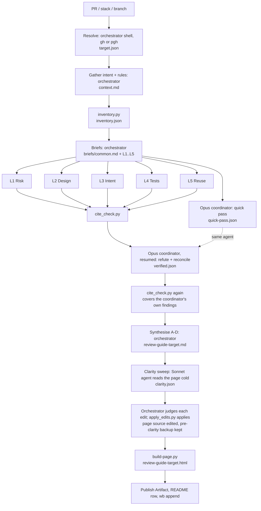
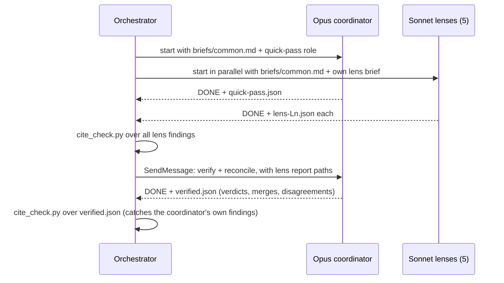

# Review Guide Skill - Plan

## Goal Capsule

- **Objective:** When Jet faces a large PR or a stack of PRs, one published page tells them what changed, how risky it is, where to spend review time and in what order, what to skim, and whether each design decision holds up against its alternatives. Every finding on the page cites code that a script has confirmed is really there.
- **Means:** a `/review-guide` skill that runs script stages, five Sonnet review lenses and one Opus coordinator, then renders a Markdown page in the task dossier and publishes it as an Artifact (KTD1, KTD3).
- **Authority:** the task file `dotfiles--skill-review-guide` (its Decisions section) and the pipeline design page in its dossier (`pipeline.md`) own the design. This plan owns how it gets built. Where they disagree, the task file's Decisions win.
- **Stop conditions:** stop and ask if the coordinator cannot be resumed and `quick-pass.json` is missing or unreadable (the KTD6 fallback needs it). Also stop and ask before dispatch when a run would use more than 10 agents, which means a stack of more than 5 PRs.
- **Execution profile:** small, local, single repo. Scripts are tested with bash smoke tests in the style of the existing `review-page` and `decision-page` skills; the skill as a whole is proven by two trial runs (U6).
- **Who finishes:** the implementing session builds U1–U5 and runs U6. Jet judges the PR #95 page against the hand-written recap.

---

## Product Contract

### Summary

Build `/review-guide` in `claude/.claude/skills/review-guide/`. Given a PR, a stack of PRs or a local branch, it produces a review guide page with four parts:
- A. Overview and risk.
- B. Review focus, reading order, skim list, proportion check and simplify notes.
- C. An explainer of the critical design decisions, with diagrams.
- D. A design evaluation against the alternatives.

Before it's rendered for publishing, a clarity sweep (one more Sonnet agent) reads the page cold and proposes rewrites for anything not explained where it's used; a script applies the accepted ones. The page lands in the task dossier and is published as an Artifact.

### Problem Frame

Large PRs and stacks hand a reviewer thousands of changed lines with no map. Attention goes evenly to generated files, fixtures and the few lines that can break something. PR #95 (the decision auto-capture feature, merge `1c96d77`) is the motivating case: 5,720 changed lines, of which about a third needed close reading. The hand-written recap for it (`pr95-recap.md` in the auto-capture dossier) took a full session to produce. Existing skills don't cover this:
- `/ce-code-review` does a full multi-persona review.
- `sportable:pr-review` checks Sportable conventions.
- `ce-explain` explains why code has its shape, but doesn't weigh risk or direct review time.

### Requirements

**Input**
- R1. Accepts a PR number or URL, an ordered list of stacked PRs, a `base..tip` range of branches, or a local branch with no PR (compared against `git merge-base`).
- R2. Uses `gh` for Sportable-owned repos and `pgh` for every other owner, judged by the `origin` remote. A broken stack chain (a PR whose base isn't the previous PR's head branch) stops the run with a message naming the break. A PR whose base is the default branch still continues the chain when the previous PR in the list has merged, because GitHub moves the next PR's base there on merge.

**Review**
- R3. A script buckets every changed line (rename only, generated, tests, agent instructions, docs, logic), sets hot flags (migrations, auth, `*.tf`, CI workflows, locking, destructive commands), and computes the proportion of explanation to logic lines.
- R4. Five Sonnet lenses run in parallel from one shared brief: L1 risk, L2 design, L3 intent, L4 tests, L5 reuse. Each follows the shared depth rules (whole files, one hop out, every finding as cited evidence, a checked-and-clean list, no style nits, a finding cap).
- R5. One Opus coordinator runs on every review. It does a rough quick pass of the whole change alongside the lenses. Then it verifies every medium-or-higher finding adversarially and reconciles: it merges duplicates, checks quick-pass spots that no lens covered, and flags disagreements.
- R6. Every finding on the page cites `file:line` at the pinned head commit with a verbatim excerpt that a script has confirmed is within three lines of that line. Findings that fail the check are fixed or dropped.
- R7. For a stack, L1 runs once per PR on that PR's own diff. L2–L5 run once over the whole range and tag each finding with its PR.

**Output**
- R8. The page has the four parts A–D. Part C has at least one diagram per critical decision and real code excerpts. Part D gives at least two real alternatives per decision.
- R9. The page follows Jet's explaining rules (why first, terms defined at first use, real excerpts, a conclusion and recommendation per point) and the wide layout with always-visible navigation.
- R10. The page's source is Markdown in the dossier of the task whose `branch:` matches. If no task matches, it goes in `dossiers/<repo>--pr<N>/`, or `dossiers/<repo>--<branch-slug>/` for a branch with no PR (the slug sanitised like task filenames: `/` and `.` become `-`). Sportable work never goes in dotfiles `docs/`. The HTML is generated from the Markdown, published as an Artifact, and both the path and the URL are named in chat, in the dossier's `tools/README.md` and in the task file.
- R11. Working files (`target.json`, `context.md`, `inventory.json`, `briefs/`, lens reports, `quick-pass.json`, `verified.json`, `clarity.json` and the page's `.pre-clarity.md` backup) stay in `<dossier>/review-guide/<target>/`.
- R12. Once the page source is written, one Sonnet agent (the clarity sweep) reads it cold and proposes exact rewrites for every identifier or term not explained where it's used (a bare "R1", "KTD7", ticket key or SHA) and every jargon-heavy sentence. It never edits the page. The orchestrator judges each proposed edit, and a script applies the accepted ones, refusing any that touch code, figures, headings, frontmatter or a renderer form, drop a code span, number or finding id, or were already applied, so cited excerpts (R6) are never rewritten. Added 2026-10-22, after this plan was first written.

### Key Decisions

- **Name `/review-guide`.** (session-settled: user-approved — chosen over `pr-guide` and `pr-explain`: names the job, not the input)
- **A fifth lens, L5 Reuse, does a small simplify sweep.** Governs R4. (session-settled: user-directed — chosen over the four-lens design with no simplify pass: Jet asked for duplication and existing-helper checks)
- **One Opus coordinator on every run, all lenses on Sonnet.** Governs R5. (session-settled: user-directed — chosen over Opus for L1 only on hot-flagged paths with a Sonnet verifier: one strong agent judges every run's findings and adds an independent read)
- **Working files are kept.** Governs R11. (session-settled: user-approved — chosen over deleting them after publishing: re-runs reuse stages and every claim stays traceable)
- **A clarity sweep runs before the page is published.** Governs R12. (session-settled: user-directed — chosen over publishing pages as synthesised: Jet asked, after the trial pages, for a pass that catches anything not self-describing, such as a bare "R1", plus a plain-language jargon pass)
- **The PR-recap habit stays separate.** (session-settled: user-approved — chosen over folding recap sections into this page now: keeps the skill small; the review guide is used before merge, the recap after)

### Success Criteria

- On PR #95, part B ranks the logic in `wb-capture.sh` and `wb-capture-sweep.sh` and the hook wiring as the focus, and puts the docgen outputs (`docs/guides/wb-decide.html`, `docs/HUB.html`, `docs/INDEX.md`) in the skim list.
- Jet judges the PR #95 page at least as useful for reviewing as `pr95-recap.md`.
- No finding on any trial page fails the cite check, and no REJECTED finding appears on a page.
- On the `lib--algorithms` stack trial, each finding is tagged with its PR, and the page and working files land in that task's dossier, not on a personal surface.

### Scope Boundaries

- Not a line-by-line review: that stays with `/ce-code-review`. L1 reads the repo's `AGENTS.md`, but the skill doesn't run `sportable:pr-review`.
- No PR comments are posted; the page is the only output.
- Considered and not built: auto-discovering a stack from the branch graph when given one branch. Explicit lists and ranges cover the cases seen so far. This changes if Jet starts handing over single tip branches.
- Considered and not built: caching lens results across runs by hunk hash. Kept working files already let a re-run skip unchanged stages by hand. This changes if re-runs on large stacks become routine.

#### Deferred to Follow-Up Work

- Adding the proportion check and a review-focus header to `/wb-breakdown` proposals and `spec-doc`. Parked in the weekly capture doc for the weekly review.
- The `skill-plan-review` task (reviewing a plan's intent before code exists) stays a separate, deferred task.

---

## Planning Contract

### Key Technical Decisions

- KTD1. **Five Sonnet lenses plus one Opus coordinator, dispatched with the Agent tool's model override.** The lenses start together with `run_in_background`. The coordinator starts at the same time with the quick-pass brief. Implements R4, R5. (session-settled: user-directed — chosen over Opus for L1 only on hot-flagged paths with a Sonnet verifier: one strong agent judges every run's findings and adds an independent read)
- KTD2. **Lens and coordinator briefs live in one reference file with a fixed finding schema.** `references/briefs.md` holds the shared depth rules, the finding schema, the `checked_clean` and `rulings` fields, and one section per lens and coordinator role. The orchestrator copies the shared part into `briefs/common.md` word for word. Each agent returns DONE, DONE_WITH_CONCERNS, NEEDS_CONTEXT or BLOCKED plus its report path, per the delegation protocol Jet approved on 2026-10-18.
  - **Finding fields:** `id`, `lens`, `pr`, `file`, `line`, `side`, `excerpt`, `claim`, `scenario`, `severity`, `confidence`.
  - **`severity`** is `high`, `medium` or `low`. "Medium or higher" in R5 means `high` or `medium`.
  - **`side`** is `head` (the default) or `base`, for findings about code the PR removed.
  - **`file`** may be `context.md`, for L3 findings about something stated but not done, which have no line in the code.
  - **The coordinator's verdict per finding** is `CONFIRMED`, `PLAUSIBLE` or `REJECTED`, with a one-line reason, in `verified.json`. Findings the coordinator raises itself are `PLAUSIBLE` at most, because no second agent checked them.
  - **A ruling** is one line: `Ruling: <decision> — <why> — <cost if wrong>`.
- KTD3. **Counting, cite checks and rendering are scripts; judgement stays with models.** `inventory.py` and `cite_check.py` use only `git` against the pinned SHAs, so they are repeatable and free. (session-settled: user-approved — chosen over having a lens work out the skim list and line checks: a model guess is neither repeatable nor free)
- KTD4. **Target resolution is the orchestrator's job, done in its own shell; scripts never call `gh` or `pgh`.** `pgh` is a zsh function defined in `~/.zshrc`, so a Python or bash subprocess can't see it. The orchestrator runs `gh`/`pgh pr view …` through the Bash tool, writes `target.json`, and passes SHAs to the scripts.
  - **Fetch first.** For each PR it runs `git fetch origin pull/<n>/head` and fetches the base branch, so a teammate's commits exist locally.
  - **Base is the merge-base.** Every input records `base` as `git merge-base <base-ref> <head>`, not `baseRefOid`. An open PR whose base branch has moved on would otherwise show other merged work, reversed, in its diff.
  - **`target.json` maps each PR to its own base and head.** L1 and the cite check use that PR's pair. L2–L5 use the range ends.
- KTD8. **Agents read code from a detached worktree at each pinned head, never the session's checkout.** The orchestrator creates one with `git worktree add --detach` under the target repo's `.worktrees/review-guide-<target>[-<pr>]` and records its path in `target.json`. These stay in the target repo, so Sportable code never lands in the task store. Every brief names its worktree, and lenses and the coordinator read files and run tests only there. Without this, a lens reviewing a teammate's PR would read Jet's own branch. The chat summary lists the worktrees and offers to remove them; the skill doesn't remove them unasked.
- KTD9. **SKILL.md finds its scripts relative to its own file, not a hard-coded `~/.claude/skills/...` path.** The skill only appears under `~/.claude/skills` after merge and `stow`. Before that, a session can run it by reading the worktree's `SKILL.md` and following it, which U6 relies on.
- KTD5. **The page generator is a skill-local copy of the auto-capture dossier's `build-page.py` and `page.template.html`, taking the dossier path as an argument.** It includes the figure and SVG styles added for the pipeline page. The `decision-page` kit isn't reused: it builds interactive answer pages (`kit.js`, Copy answers), which is a different job from a read-only Markdown page.
- KTD6. **Coordinator continuity uses `SendMessage` to the same agent.** After the lenses finish, the orchestrator resumes the coordinator with the lens report paths, so it keeps what it read in its quick pass. If `SendMessage` isn't available or the agent has gone, a fresh Opus agent gets `quick-pass.json` plus the lens reports. The run notes this in the chat summary.
- KTD7. **`disable-model-invocation: true`.** One run costs seven or more agents (five lenses, the coordinator and the clarity sweep), including an Opus one, so the skill runs only when Jet types `/review-guide`. This matches the existing `research` skill.

### High-Level Technical Design

Data flow and who does each stage:



Coordinator lifecycle (one agent, two jobs):



### Output Structure

```text
claude/.claude/skills/review-guide/
  SKILL.md
  learnings.md
  references/briefs.md
  references/clarity.md          (U7)
  scripts/inventory.py
  scripts/inventory.test.sh
  scripts/build-briefs.py        (added in U6: writes each agent's brief)
  scripts/build-briefs.test.sh
  scripts/cite_check.py
  scripts/cite_check.test.sh
  scripts/apply_edits.py         (U7)
  scripts/apply_edits.test.sh
  scripts/build-page.py
  scripts/build-page.test.sh
  templates/page.template.html
  fixtures/example-finding.json
docs/guides/review-guide.md
```

---

## Implementation Units

### U1. Inventory script

- **Goal:** bucket every changed line between two commits and report hot flags and the proportion number as JSON.
- **Requirements:** R3, KTD3, KTD4.
- **Dependencies:** none.
- **Files:** `claude/.claude/skills/review-guide/scripts/inventory.py`, `claude/.claude/skills/review-guide/scripts/inventory.test.sh`.
- **Approach:**
  1. Takes a repo path, base SHA, head SHA and an optional count of explanation words (PR body); runs `git diff --numstat -M` and `--name-status -M`.
  2. Applies the bucket rules in the order the pipeline page gives them (rename only, generated, tests, agent instructions, docs, logic). "Generated" includes `linguist-generated` in `.gitattributes`, lockfiles, a "do not edit" banner in the first five lines, and a repo-local list of built outputs. For dotfiles that list is `docs/**/*.html` (recursive, so `docs/guides/*.html` matches), `docs/INDEX.md` and `docs/HUB.html`.
  3. Hot flags come from path patterns plus added lines matching the destructive and locking patterns.
  4. Outputs per-file rows, bucket totals, hot flags and the proportion ratio. Plan docs added by the PR count as explanation.
- **Patterns to follow:** `claude/.claude/skills/review-page/scripts/review-page.test.sh` (a `mktemp -d` fixture, PASS/FAIL lines, cleanup trap).
- **Test scenarios:**
  - A fixture repo with one logic file, one test file, one `SKILL.md`, one Markdown doc and one file marked `linguist-generated`: each lands in its bucket and the totals equal the diff's numstat.
  - A pure rename (100% similarity) is bucketed rename-only, with zero lines counted for review.
  - An added line containing `rm -rf` or `flock` sets the matching hot flag; the same text in a doc file doesn't.
  - Binary files (`-` in numstat) are listed with zero lines and don't crash the totals.
  - Run against the real dotfiles range `1c96d77^..1c96d77`: totals are 1,501 logic, 402 agent instructions, 2,463 tests, 715 docs and 639 generated.
- **Verification:** the test script prints all PASS, and the PR #95 numbers match the pipeline page's bar.

### U2. Cite-check script

- **Goal:** confirm that every finding's excerpt exists within three lines of its cited line at the right commit, correcting the line when it's off.
- **Requirements:** R6, KTD2, KTD3, KTD4.
- **Dependencies:** U3 (the finding schema).
- **Files:** `claude/.claude/skills/review-guide/scripts/cite_check.py`, `claude/.claude/skills/review-guide/scripts/cite_check.test.sh`, `claude/.claude/skills/review-guide/fixtures/example-finding.json`.
- **Approach:**
  1. Reads `target.json` plus either lens reports or `verified.json` (the same finding shape).
  2. Picks the commit per finding. An L1 finding uses its `pr`'s own base or head; any other lens uses the range's. `side` picks base or head.
  3. Runs `git show <commit>:<file>` once per commit and file pair, or reads the run's `context.md` when `file` is `context.md`.
  4. Matches the excerpt after trimming whitespace and sets `cite: ok | moved | missing`, with the corrected line for `moved`. It writes the result next to the input, so the original is kept.
- **Patterns to follow:** U1's test style.
- **Test scenarios:**
  - An excerpt at the exact cited line: `ok`.
  - An excerpt two lines below the cited line: `moved` with the corrected line.
  - An excerpt ten lines away or absent: `missing`.
  - A finding with `side: base` on a file the PR deleted, quoting the base: `ok`.
  - A two-PR stack fixture where the second PR inserts lines above an L1 finding on the first PR: still `ok` against the first PR's head.
  - A finding with `file: context.md` whose excerpt is in that file: `ok`.
  - A `verified.json` input with a coordinator-raised finding: checked like any other.
  - The real L1 example from the pipeline page (`wb-capture-sweep.sh:172` at `a9540a8`): `ok`.
- **Verification:** the test script prints all PASS.

### U3. Lens and coordinator briefs

- **Goal:** one reference file that every lens and the coordinator receive their instructions from.
- **Requirements:** R4, R5, R7, KTD1, KTD2.
- **Dependencies:** none.
- **Files:** `claude/.claude/skills/review-guide/references/briefs.md`.
- **Approach:**
  1. A shared section: the depth rules, the finding schema, the status protocol and the Ruling line format.
  2. One section per lens (L1–L5): its question, method, finding cap and what goes in `checked_clean`. L5 carries the "usable from here" check, and the pipeline page's `_wb_lifecycle_trim` example as a worked case of a non-finding.
  3. A coordinator section with two parts: the quick pass (rough, one read, at most 5 spots) and verify-and-reconcile (refute medium-or-higher findings, merge duplicates, check uncovered quick-pass spots, flag disagreements).
  4. A stack note: L1 is told its PR's diff range; the others get the whole range and must tag each finding with its PR.
  5. Every brief names its worktree (KTD8). Agents read files and run tests only there, and set `side: base` when quoting removed code.
- **Test expectation:** none. This is prompt text; U6's trial runs prove it.
- **Verification:** a lens given only `briefs/common.md` plus its own section has everything it needs, with no reference back to the pipeline page.

### U4. Page generator

- **Goal:** render `<dossier>/<name>.md` to `<dossier>/<name>.html` with the wide layout, nav rail and SVG figure styles.
- **Requirements:** R9, R10, KTD5.
- **Dependencies:** none.
- **Files:** `claude/.claude/skills/review-guide/scripts/build-page.py`, `claude/.claude/skills/review-guide/templates/page.template.html`, `claude/.claude/skills/review-guide/scripts/build-page.test.sh`.
- **Approach:** a copy of the auto-capture dossier's generator with two changes. The dossier path becomes the first argument, and the template is found next to the script through its realpath, so the stow symlinks resolve. The template is the pipeline dossier's version, which already has the figure and SVG classes. It runs through `uv run -q --with markdown`, as the dossier tools do.
- **Patterns to follow:** `dossiers/dotfiles--skill-review-guide/tools/build-page.py` (task store); `claude/.claude/skills/decision-page/kit/pagekit.py` for realpath-based file lookup.
- **Test scenarios:**
  - A fixture `.md` with frontmatter, two `##` sections and a `<figure><svg>` block: the HTML has two nav entries, two sections, and the SVG passes through unescaped.
  - A missing `.md`: exits non-zero with the path in the message.
  - Run through a symlinked script path: the template is still found.
- **Verification:** the test script prints all PASS, and rebuilding the pipeline page with it gives the same HTML as the dossier copy.

### U5. SKILL.md and guide

- **Goal:** the orchestration instructions for stages 1–9, plus the user guide that docgen indexes.
- **Requirements:** R1, R2, R7, R8, R9, R10, R11, KTD1, KTD4, KTD6, KTD7, KTD8, KTD9.
- **Dependencies:** U1, U2, U3, U4.
- **Files:** `claude/.claude/skills/review-guide/SKILL.md`, `claude/.claude/skills/review-guide/learnings.md`, `docs/guides/review-guide.md`.
- **Approach:**
  1. Frontmatter: name, a description with trigger phrases, and `disable-model-invocation: true`.
  2. Stages in order:
     - Resolve: gh/pgh rule, fetch, merge-base, stack chain check, worktrees, `target.json` (KTD4, KTD8).
     - Gather: task file by `branch:`, Jira via the Atlassian connector when a ticket key appears, `AGENTS.md`, existing PR comments, CI.
     - Inventory (U1), then Briefs (U3), then Dispatch (KTD1).
     - Cite check over the lens reports (U2), then resume the coordinator (KTD6), then cite check again over `verified.json`.
     - Synthesise A–D, with the source table from the pipeline page. Then the clarity sweep (U7, added later), then Render (U4).
     - Deliver: Artifact publish, `tools/README.md` row, `wb append` to the task, and the worktree list with an offer to remove them.
     Script paths are resolved from SKILL.md's own directory (KTD9).
  3. The landing path rule and the Sportable boundary (R10).
  4. Target to stay under about 150 lines. The page's section rules point at Jet's explaining rules rather than restating them.
  5. The guide follows the `docs/guides/decision-page.md` frontmatter (`title`, `status`, `tile`, `group: skills`, `kind: guide`, `updated`).
- **Patterns to follow:** `claude/.claude/skills/decision-page/SKILL.md` (frontmatter, length, references split), `claude/.claude/skills/research/SKILL.md` (`disable-model-invocation`).
- **Test expectation:** none. This is instruction text; U6 proves it end to end.
- **Verification:** the docgen pre-commit hook regenerates `docs/INDEX.md` and `docs/HUB.html` with a `review-guide` skill row and guide tile, and the commit goes through.

### U6. Trial runs and fixes

- **Goal:** prove the skill on the small and big targets and fold what breaks back into U1–U5.
- **Requirements:** all; Success Criteria.
- **Dependencies:** U5.
- **Files:** `claude/.claude/skills/review-guide/learnings.md`, plus whichever U1–U5 files the trial shows need fixing.
- **Approach:**
  0. Before merge, `/review-guide` doesn't resolve yet (KTD9). Run each trial by having the session read the worktree's `claude/.claude/skills/review-guide/SKILL.md` and follow it.
  1. Run it on `fix/capture-handback-none`, the branch with three fixes to the capture hooks. It has no PR, so this exercises the local-branch path and the `pgh` decision.
  2. Fix what breaks, then run on PR #95 (the whole decision auto-capture feature, merged as `1c96d77`). The page lands in the auto-capture dossier, since its task's branch matches.
  3. Run it on the `lib--algorithms` stack for the post-processor stage runner (SW-6698): #541, then #543, then #544, which sit on #537. This is the first real test of the stack path, the `gh` path for Sportable repos, the Sportable landing rule, the per-PR worktrees and a Python codebase. It uses 8 agents.
  4. Record agent count, wall-clock time and anything surprising in `learnings.md`, then add the token cost to the pipeline page's agents section.
  5. Put the PR #95 page and `pr95-recap.md` in front of Jet for the comparison in Success Criteria.
- **Test expectation:** none. The trial is the test.
- **Verification:** both pages are published with path and URL named, every finding passes the cite check, and Jet has made the PR #95 comparison.

### U7. Clarity sweep

Added 2026-10-22, after U6. Jet saw the trial pages and asked for a pass that catches anything not self-describing (a bare "R1") plus a plain-language jargon pass.

- **Goal:** before publishing, every label and term on the page is explained where it's used, without changing what any finding claims.
- **Requirements:** R12, R6 (excerpts are never rewritten), R9.
- **Dependencies:** U4, U5.
- **Files:** `claude/.claude/skills/review-guide/references/clarity.md`, `claude/.claude/skills/review-guide/scripts/apply_edits.py`, `claude/.claude/skills/review-guide/scripts/apply_edits.test.sh`, `claude/.claude/skills/review-guide/SKILL.md` (end of stage 7, and the agent count in stage 9), `docs/guides/review-guide.md`.
- **Approach:**
  1. The page is rendered once so its anchors exist. Then one Sonnet agent gets `references/clarity.md`, the page source and HTML, and `context.md` to look labels up in. It writes `clarity.json`: one `{id, old, new}` edit per fix, with `"guess": true` on any description it inferred. It dry-runs `apply_edits.py` on its own proposals, and never edits the page.
  2. The orchestrator judges each edit: it rejects any that change a finding's claim or soften a caveat, and checks every guess against the task file or plan.
  3. `apply_edits.py` applies the accepted edits. It refuses edits that aren't unique or were already applied, edits that touch frontmatter, fences, figures, headings or part of an inline code span, edits that drop a code span, number or finding id, edits that add or remove a fence, heading or figure line, and edits that break a renderer form. It keeps the original page from its first run at each reviewed head as `.pre-clarity.<head>.md`.
  4. Re-render, then deliver as in U5.
- **Test scenarios:** each refusal kind; a re-run against the same `clarity.json` changes nothing and keeps the first backup; `--dry-run` writes nothing.
- **Verification:** `apply_edits.test.sh` passes. The first run, over the three trial pages and the pipeline page: 55 edits proposed, 9 corrected by the orchestrator, none rejected outright.

---

## Verification Contract

| Gate | Command or check | Proves |
|---|---|---|
| Inventory | `bash claude/.claude/skills/review-guide/scripts/inventory.test.sh` | U1 buckets, flags, and PR #95 totals |
| Cite check | `bash claude/.claude/skills/review-guide/scripts/cite_check.test.sh` | U2 ok / moved / missing |
| Page generator | `bash claude/.claude/skills/review-guide/scripts/build-page.test.sh` | U4 rendering and symlinked lookup |
| Docs platform | the docgen pre-commit hook (`.githooks/pre-commit`) on the U5 commit | skill and guide are indexed |
| Clarity edits | `bash claude/.claude/skills/review-guide/scripts/apply_edits.test.sh` | U7 applies safe edits and refuses unsafe ones, including on a re-run |
| End to end | U6 trial runs on `fix/capture-handback-none`, PR #95 and the `lib--algorithms` #541/#543/#544 stack | R1–R11 and Success Criteria |

---

## Definition of Done

- U1, U2 and U4 test scripts print all PASS.
- `/review-guide` appears in `docs/INDEX.md` and as a guide tile on `docs/HUB.html`.
- All three trial pages are published, each with its Markdown source and working files in the dossier, and path and URL named in the task file.
- Jet has compared the PR #95 page with `pr95-recap.md`.
- After merge, fast-forward and `stow --no-folding -t "$HOME" claude`, typing `/review-guide` resolves to the stowed skill and its scripts are found.
- No experimental or abandoned code from the trial fixes is left in the skill directory.
