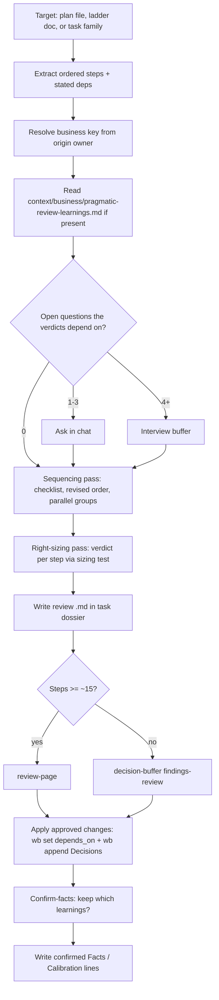

# pragmatic-review skill - Plan

## Goal Capsule

- **Objective:** When Jet hands over a long-term plan, they get back a revised order that ships real use first. He also gets a short verdict on every step (needed now, needed later and what would trigger it, not needed), judged against how big the business really is and what actually goes wrong in it. Each run asks only what it needs and remembers the answers, so later runs need fewer questions.
- **Means:** a new prose skill, `pragmatic-review`, in `claude/.claude/skills/`, with learnings kept per business in the task store (KTD2, KTD3).
- **Authority:** the task file's `## Decisions` (`dotfiles--skill-pragmatic-plan-review`, 2026-10-22) outranks this plan.
- **Stop conditions:**
  - Stop and report if any file under `claude/` or `docs/` would need to hold a fact about a specific business (team size, users, incidents, ticket numbers). That content belongs in the task store (R7). KTD2's owner-to-key map is the one exception: it names only which owner maps to which key.
  - Stop if a unit would require changing `wb.sh`.
- **Execution profile:** `ce-work` in the `skill-pragmatic-plan-review` worktree. Commit per unit in order U1, U2, U3, then the U4 live run. Commit U2 in the `~/code/tasks` repo and the rest in dotfiles. One PR to `development`. After Jet merges, re-stow the main checkout so the skill goes live.

## Product Contract

### Summary

Add a `pragmatic-review` skill. It takes a plan, a version ladder, or a wb task family and turns it into an ordered list of steps. Its main pass reorders those steps around what unblocks real use first. Its second pass gives each step a verdict using a two-condition sizing test, weighed against business context. The skill starts with no business context. It asks for what each run's verdicts depend on and keeps the confirmed answers in a per-business learnings file in the task store. Verdicts go back to Jet through a decision buffer or the review page, depending on plan size. Approved ordering changes land as `depends_on` edits and a recorded decision.

### Problem Frame

Plans written by agents (ce-plan output, epic ladders, breakdown families) tend to follow "best practice" order rather than the order the work actually ships in. Hardening comes before first users, a generic abstraction comes before its second consumer, and a step needs the output of a later step. They also add mechanisms that a business of this size doesn't need yet. `ce-doc-review`'s scope-guardian already checks plans for over-built mechanisms, but it judges against the plan's own goals, not the business. Its only ordering check is whether unit dependencies make sense. It never proposes a new order or says what would trigger deferred work. `ce-doc-review` is an upstream plugin with no way to add a lens, so this has to be its own skill.

### Key Decisions

- **A new standalone skill, not a `ce-doc-review` lens.** (session-settled: user-approved — chosen over a lens on `ce-doc-review` or a fork of the plugin: its personas are fixed files in the plugin cache, and Compound Packs only flag contradictions with repo rules.) Governs R1, R2.
- **Sequencing is the main pass; right-sizing comes second and reuses scope-guardian's test.** (session-settled: user-approved — chosen over a sizing-first review: ordering is where these plans go most wrong.) Governs R2, R3, R4.
- **No baseline business context; the skill asks at use time and keeps its own learnings.** (session-settled: user-directed — chosen over a pre-seeded context file and an interview now: Jet wants the skill to ask what it needs when used.) Governs R6, R7, R8.
- **Separate from the plan-diff skill (`dotfiles--skill-plan-review`).** (session-settled: user-approved — chosen over folding the two together: one reviews order and size, the other shows what a plan changes.) Governs R1.

### Requirements

**Input**

- R1. The skill accepts a plan file (`.md` or `.html`), a ladder doc in a task dossier, or a wb task family named by its parent slug. It turns any of these into an ordered list of steps, each with its stated dependencies and a pointer to where it came from (`file#section` or task slug).

**Sequencing pass**

- R2. Every step is checked against the sequencing checklist (KTD5). Each flagged step names the pattern it matches and the step it wrongly blocks or waits on.
- R3. The pass proposes one revised order. It gives one line on why each moved step moves, and names the groups of steps that can run in parallel.

**Right-sizing pass**

- R4. Every step gets one verdict: needed now, needed later (naming the trigger that would make it needed), not needed, or move (pointing at its new place in R3's order). The sizing test (KTD6), weighed against business context, decides the verdict.
- R5. A foundation or abstraction counts as justified only when its next variant is already named on the roadmap, or when adding it later would be expensive (stored data or its format, a shared interface, money, security). Before cutting a step that looks like hardening, the pass checks two traps: a survival need that looks like polish (the feature is silently wrong without it), and trust work whose need is timed to when something starts relying on it.

**Context and learnings**

- R6. Before giving verdicts, the skill reads the business's learnings file if one exists. It then asks only the questions that the verdicts depend on and the file doesn't answer. Each question names the steps it affects and the default used if Jet leaves it blank.
- R7. Learnings live at `~/code/tasks/context/<business>/pragmatic-review-learnings.md`, keyed by business (KTD2). The skill never writes a fact about a business into the dotfiles repo.
- R8. At the end of a run, the skill shows the facts and calibration lines it proposes to keep and writes only the ones Jet confirms.

**Output and applying**

- R9. The review is written as Markdown in the target's task dossier. Each step is sent to Jet with a recommended verdict first, the other verdicts as alternatives, and Defer and Skip as options. Plans with about 15 or more steps go to the review page; smaller ones go to a decision-buffer findings-review.
- R10. Once Jet approves, ordering changes are applied as `depends_on` edits through `wb set`, and the decision is recorded in the coordinating task's `## Decisions` through `wb append`. The skill never edits the reviewed plan document itself.

### Scope Boundaries

- Not built: editing or forking `ce-doc-review`.
- Not built: pre-seeded business context.
- Not built: applying any change without Jet's approval. The review's whole value is Jet's judgment on business scale, and an automatic apply would harden the agent's guesses into the dependency graph.
- Not built: rewriting the reviewed plan (KTD8). Owners revise their own plans, for example with a `ce-plan` deepen pass using the review as input.
- ~~Not built: a generated HTML companion page for the review.~~ Retired 2026-10-22: the second live run's 41-step review proved too long to read as Markdown (the trigger this line named), so `scripts/build-page.py` now renders it, on review-guide's shared `mdpage.py` core (task Decisions, 2026-10-22).

#### Deferred to Follow-Up Work

- Sharing `references/sequencing-checks.md` with `/wb-breakdown` proposals and `spec-doc`, together with the proportion check the review-guide task parked.
- A Sonnet subagent that extracts steps from a large task family (KTD7). Build it if a first run shows that extracting steps crowds the main session's context.

## Planning Contract

### Key Technical Decisions

- KTD1. **Name: `pragmatic-review`.** It uses Jet's own word from the request and the task slug, and it covers both passes. `right-size` only names the second pass. The name is cheap to change before merge.
- KTD2. **The business key is worked out from the target repo's origin owner.** `sportabletech` maps to `sportable`; `jetnoli-sportable` maps to `personal`. For a task family, the repo comes from the parent's `repo:` frontmatter, resolved to `~/code/<repo>`. With no repo, or an owner not in the map, the skill asks once and records the mapping as a fact. (session-settled: user-approved — chosen over one learnings file per repo: one business's repos share the same scale and risks.) Governs R7.
- KTD3. **The learnings file has two sections.**
  - `## Facts` holds the business's current truth: scale, users, what failure costs and who notices, deploy rhythm, which consumers are near. It is rewritten in place, and a correction names what it supersedes, the same rule `CONCEPTS.md` follows.
  - `## Calibration` is an append-only list of dated lines, one per verdict Jet overrode and why, in the form `YYYY-MM-DD — observation — source`, like `quick-wins/learnings.md`.

  When a calibration pattern repeats, it graduates into a Fact. If it holds no business-specific content, it can instead graduate into the skill's references as a deliberate, business-neutral edit. Governs R7, R8.
- KTD4. **Learnings are written only after confirmation.** At the end of a run, the facts and calibration lines go to Jet as a confirm-facts list, in chat when there are three or fewer and in a decision buffer otherwise. Only confirmed lines are written. (session-settled: user-approved — chosen over saving every answer: a one-off answer such as "this epic is urgent" must not become a standing rule.) Governs R8.
- KTD5. **The sequencing checklist lives in `references/sequencing-checks.md`**, one entry per pattern, each with a recognition test and an example:
  - an abstraction before its second consumer
  - hardening or scaling before first real use
  - a step that needs a later step's output
  - best-practice order winning over unblock-real-use order (CI, observability, or test infrastructure placed first by habit)
  - work forced into a sequence that could run in parallel
  - a prerequisite buried late
  - a step with no consumer at all

  It is a separate file so it can later be shared (see Deferred to Follow-Up Work). Governs R2, R3.
- KTD6. **The sizing test is restated in `references/sizing-test.md`, attributed to scope-guardian's mechanism-sizing rule, not linked to it.** The plugin's cache path includes its version number (`…/compound-engineering/3.30.4/…`), so a link would break on the next update. The file also holds the foundation rule and the two traps (R5), written as general rules with no business facts. Governs R4, R5.
- KTD7. **One agent, no subagents in v1.** The review is all judgment, and the model-tiering rule keeps judgment in the orchestrator. Reading a plan or a family of about 12 tasks fits in one session.
- KTD8. **The skill changes the dependency graph and the decision record, never the plan text.** Ordering belongs in the wb `depends_on` graph plus reasoning in the dossier, not in repo docs. Editing another session's plan doc would also clash with its owner. When the target is a standalone plan file with no task family, R10 has no graph to change, so the review document is the whole output. Governs R10.
- KTD9. **Interview size follows question count.** Three or fewer questions are asked in chat. More use the decision-buffer interview shape (`claude/.claude/skills/decision-buffer/references/shapes/interview.md`), which already states each question's default. Governs R6.

### High-Level Technical Design



### Output Structure

```text
claude/.claude/skills/pragmatic-review/
  SKILL.md
  references/
    sequencing-checks.md
    sizing-test.md
docs/guides/pragmatic-review.md        (+ generated .html)
~/code/tasks/context/README.md        (tasks repo)
```

---

## Implementation Units

### U1. Skill file and references

- **Goal:** the runnable skill: frontmatter, run steps in the order of the High-Level Technical Design, and the two reference files.
- **Requirements:** R1–R10; KTD1, KTD2, KTD3, KTD4, KTD5, KTD6, KTD7, KTD8, KTD9.
- **Dependencies:** none.
- **Files:**
  - `claude/.claude/skills/pragmatic-review/SKILL.md`
  - `claude/.claude/skills/pragmatic-review/references/sequencing-checks.md`
  - `claude/.claude/skills/pragmatic-review/references/sizing-test.md`
- **Approach:**
  1. The frontmatter `description` carries triggers ("pragmatic review", "is this plan over-engineered", "sanity-check this ladder's order", "right-size this plan", `/pragmatic-review`). It also carries NOT-for lines: plan coherence and feasibility (`ce-doc-review`), what a plan changes (plan-review), and splitting one task (`/wb-breakdown`).
  2. The SKILL.md body states each run step once. It cites the references rather than restating them, and gives the store paths and `wb` commands exactly.
  3. The review doc template is in SKILL.md, in four parts: the revised order (with parallel groups), one verdict line per step (verdict, trigger or reason, source pointer), the context used (which facts and which answers), and changes to apply.
  4. The verdict buffer follows the findings-review shape with per-option checkboxes, each on its own line, with Defer and Skip as options (the code-review-triage-needs-options memory rule).
  5. Where the review doc goes (R9): the dossier of the task named in the plan's `task:` frontmatter, or the parent's dossier for a task family. Failing those, the dossier of the current tmux session's `@task`. Failing that, ask Jet for the path. Never guess a path.
  6. The apply step (R10) starts with a preflight. It lists every task whose `depends_on` will change, with old and new values. If any of those tasks has a live session, it stops before the first `wb set` and names them, because `wb set` refuses live-session tasks (`_wb_refuse_if_live_session` in `wb.sh`). Each `wb set … depends_on` writes the full comma-joined list, since the command replaces the field. The `wb append` Decisions entry records only the edits that actually landed. A standalone plan with no task family skips both commands, and the review doc's changes section is the record.
- **Patterns to follow:** `claude/.claude/skills/quick-wins/SKILL.md` (a ledger read first and written last); `claude/.claude/skills/review-page/SKILL.md` and `claude/.claude/skills/decision-buffer/SKILL.md` for how to call the verdict surfaces; `claude/.claude/skills/decision-buffer/references/shapes/confirm-facts.md` for KTD4.
- **Test scenarios:** prose skills here have no automated suite. U4's live runs are the scenarios that matter. Before U4, check the following by reading SKILL.md cold:
  - A cold reader can name, from SKILL.md alone, where learnings are written for a target in `~/code/be--monorepo` and for one in `~/code/dotfiles`.
  - A target whose repo has no origin remote leads to a single question about the business key, not a guess.
  - A standalone plan file with no task family produces a review doc and no `wb set` calls.
  - A target with 16 steps routes to review-page; one with 8 steps routes to the buffer.
- **Verification:** `grep -riE 'sportable|SW-[0-9]|SFB-[0-9]|be--monorepo'` over the new skill directory matches only the owner-to-key map line (KTD2).

### U2. Task-store `context/` area

- **Goal:** the store documents what `context/` is, so other agents and `wb` tooling treat it as part of the store and not stray files.
- **Requirements:** R7; KTD2, KTD3.
- **Dependencies:** none (can land alongside U1).
- **Files:** `~/code/tasks/context/README.md` (new, tasks repo), and a short entry in `~/code/tasks/README.md` under "What goes where", in the tasks repo.
- **Approach:**
  1. The README states that `context/<business>/` holds per-business standing context that skills learn over time. It names the first file (`pragmatic-review-learnings.md`), the two-section shape (KTD3), and the confirm-before-write rule (KTD4).
  2. No learnings file is created here. The first run creates it (no baseline, per the Key Decisions).
  3. Before committing, check that `wb` scans (`wb board`, `wb reconcile`, the picker) skip a non-task directory at the store root, as they already skip `weeks/` and `dossiers/`.
- **Patterns to follow:** the existing `weeks/` top-level directory; the "What goes where" table in `~/code/tasks/README.md`.
- **Test expectation:** none, since this is documentation only. Verify by checking that `wb board` and `wb reconcile` output is unchanged once `context/` exists.
- **Verification:** `wb board` and `wb reconcile` run clean with `context/README.md` present.

### U3. Guide page and docgen

- **Goal:** a guide page so `/help` and the Hub can find the skill.
- **Requirements:** discoverability of R1–R10.
- **Dependencies:** U1.
- **Files:** `docs/guides/pragmatic-review.md`, plus the `docs/guides/pragmatic-review.html` and `docs/INDEX.md` that docgen generates.
- **Approach:**
  1. Follow the five-section single-skill shape in `docs/guide-format.md`.
  2. The "Try it now" example uses a dotfiles plan (for example `docs/plans/2026-10-17-2223-feat-wb-go-store-and-task-page-plan.md`), never a work plan.
  3. Commit the guide on its own, so the docgen pre-commit hook doesn't pull unrelated `docs/*.md` edits into it (the docgen-hook-stages-docs-md memory).
- **Patterns to follow:** `docs/guides/decision-page.md`, `docs/guides/review-page.md`.
- **Test expectation:** none, since this is a generated doc. docgen's second run must be a no-op.
- **Verification:** `docgen.sh` runs clean, a second run changes nothing, and the INDEX contains a `pragmatic-review` skill row and a doc row.

### U4. First live runs

- **Goal:** prove the skill on two real targets and leave the first learnings behind.
- **Requirements:** R1–R10 end to end.
- **Dependencies:** U1, U2.
- **Files:** no repo files. Outputs are review docs in each target's task dossier, the first `~/code/tasks/context/<business>/pragmatic-review-learnings.md` files, and any `depends_on` edits Jet approves.
- **Approach:**
  1. Run on a personal target first, the wb Go-port plan in dotfiles, which tests a standalone plan file with no graph to change.
  2. Then run on the first-test subject named in the task file, a work task family's version ladder, which tests task-family input, the interview, and `depends_on` application.
  3. Invoke the skill by its worktree path, since the skill isn't stowed until merge.
  4. Record whatever breaks as SKILL.md fixes before the PR.
- **Execution note:** run each live review in its own target context. The work-family run must leave no trace in dotfiles.
- **Test scenarios:**
  - The first run on a business with no learnings file asks its questions, writes a review, and creates the learnings file containing only the lines Jet confirmed.
  - A second run on the same business asks fewer questions than the first, because the confirmed facts answer some.
  - On the task family, an approved reorder changes the children's `depends_on` through `wb set` and adds one dated entry to the parent's `## Decisions`. No child's plan text changes.
  - The `git diff` of dotfiles after both runs contains only U1 and U3 files.
- **Verification:** Jet reads both reviews and judges whether the revised orders are ones they would act on. That judgment is the success criterion, and it goes into the task file's `## Decisions`.

---

## Verification Contract

| Check | How | Applies to |
|---|---|---|
| No business facts in dotfiles | `grep -riE 'sportable\|SW-[0-9]\|SFB-[0-9]\|be--monorepo'` over `claude/.claude/skills/pragmatic-review/` and `docs/guides/pragmatic-review.md` matches only KTD2's owner map | U1, U3 |
| Docs regenerate cleanly | `docgen.sh` twice; the second run is a no-op | U3 |
| Store tooling unaffected | `wb board` and `wb reconcile` with `context/` present | U2 |
| Skill works end to end | U4's two live runs and their scenarios | U4 |

## Definition of Done

- U1–U3 are committed (U2 in the tasks repo) and U4's two runs have completed, with any fixes they surfaced folded into SKILL.md.
- No business-specific content in the skill directory or the guide page (Verification Contract row 1).
- The task file's `## Decisions` records Jet's verdict on the two live reviews.
- No leftover experimental files from abandoned approaches in either repo's diff.
