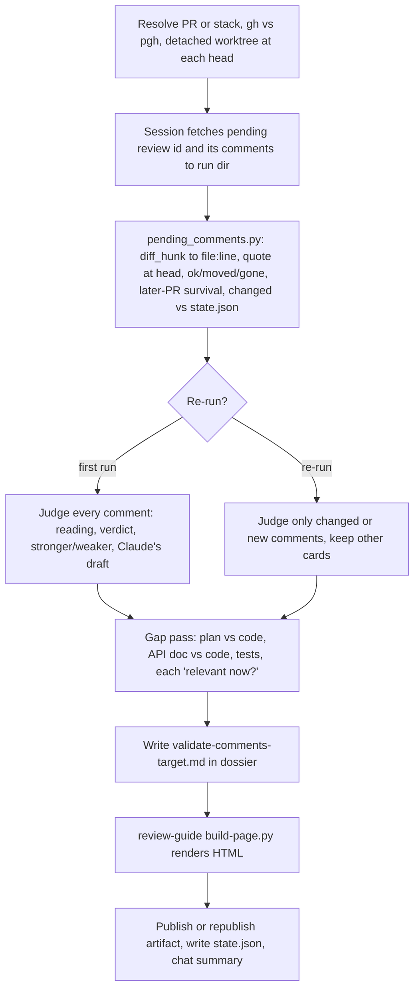

# validate-review-comments skill - Plan

## Goal Capsule

- **Objective:** before Jet submits a PR review, one command gives a published page that says, for each of Jet's unsubmitted draft comments, what it is taken to mean, whether the code at the PR head backs it up, and what Jet may have missed, with no manual steps beyond reading the page.
- **Means:** a standalone personal skill (KTD1) that reads the pending review over `gh`/`pgh`, maps comments to code with one script (KTD3), judges each comment in this session, and renders the page through review-guide's page builder (KTD4).
- **Authority:** Jet's global instructions (`~/.claude/CLAUDE.md`) > this plan's Requirements > KTDs > unit Approach. The task file `~/code/tasks/dotfiles--skill-validate-review-comments.md` holds the Decisions.
- **Stop conditions:** stop and ask if the pending-review API returns line data in a shape the diff-hunk mapping can't read (KTD3), or if adding verdict chips changes any existing review-guide page's HTML beyond the new CSS.
- **Execution profile:** one SKILL.md of about 150 lines, one script with a test, a small renderer change, a guide doc, one dry run. About half a day.
- **Finishes and ships:** the implementing session commits on branch `skill-validate-review-comments`; push and PR via `pgh` (repo `jetnoli-sportable/dotfiles`) only after Jet's OK; review runs in a fresh context per Jet's rule.

---

## Product Contract

### Summary

A `/validate-review-comments <PR | stack>` skill. It finds Jet's pending review, ties each draft comment to the code it sits on, states a reading of each comment and then a verdict with code evidence, runs a short "is this relevant now?" gap pass, and publishes the result as a claude.ai HTML page built from a Markdown source in the task's dossier. A re-run re-checks only comments edited since the last run and republishes to the same URL. It never posts, edits or submits anything on GitHub.

### Problem Frame

On a recent work PR review, the most useful step was checking Jet's nine draft comments against the code before submitting, plus a short pass for what they missed. That was hand-built as a full review page in the work task's dossier. Two lessons came out of it. The agent misread one comment ("player" meant the word, not the stored value) and only Jet caught it, so the reading has to be stated before the verdict. And two gap findings were set aside for context the code couldn't show (a feature that doesn't work yet; a point already raised on the base PR), so gap findings must be framed as questions of relevance, not defects. `/review-guide` doesn't fit this moment: it orients a reviewer before reviewing, with six agents.

### Key Decisions

- **Standalone skill, not a stage inside review-guide.** It runs at a different moment (after drafting, before submitting) and needs no lens agents. (session-settled: user-directed — chosen over a review-guide stage: different moment, no six-agent pipeline.) Governs R1, R10.
- **Output is a published HTML artifact, not a chat table.** (session-settled: user-directed — chosen over a chat table with a page later: Jet asked for the artifact.) Governs R7, R8.
- **No manual steps for Jet.** The agent fetches, sets up worktrees and runs the script itself. (session-settled: user-directed — chosen over Jet pasting or fetching comment JSON: Jet flagged manual work as unnecessary.) Governs R2.
- **Dry run on a synthetic pending review the agent creates on a dotfiles PR and deletes afterwards.** (session-settled: user-approved — chosen over waiting for Jet's next real Sportable draft review: makes the dry run possible now, and a pending review is visible only to its author.) Governs R12.

### Requirements

**Fetch and map**
- R1. `/validate-review-comments` accepts a PR number or URL, or an ordered stack of PRs, in any repo Jet can read, and resolves `gh` vs `pgh` from the origin owner.
- R2. The skill fetches the pending review and its comments itself; Jet supplies nothing beyond the invocation.
- R3. Each comment is tied to a file, a line and a quoted excerpt: a head-side comment quotes the file at the PR head, a comment on a deleted line quotes the file at the base and its card says so; file-level comments are tied to the file only.
- R4. A head-side comment drafted against an older commit is flagged when its line moved or no longer exists at the head.

**Judge**
- R5. Each comment gets, in order: the skill's reading of what it asks; a verdict of agree, partly or drop with code evidence; whether the point is stronger or weaker than worded; and an optional rewording in a code block labelled as Claude's draft.
- R6. For a stack, each comment says whether the commented code survives the later PRs, so a rename lands where it's cheapest.
- R7. A short gap pass covers plan vs code, API doc vs code, and test gaps, each item framed as "is this relevant now?" rather than as a defect.

**Deliver**
- R8. The result is a Markdown source in the matching task's dossier, rendered to HTML and published as a claude.ai artifact; the chat reply names the path, the URL and the verdict counts.
- R9. A re-run re-checks only comments that are new, whose `updated_at` changed, or whose file changed between the previously checked head and the current head; it keeps the other comments' cards as they were, notes removed comments, and republishes to the same URL.
- R10. The skill never posts, edits or submits a review or comment, and never writes text as Jet; GitHub calls it makes are reads, except the dry run's own synthetic review (R12).
- R11. Every identifier on the page or in chat carries a plain description, and Sportable comment text, code and run state stay in the task store, never in dotfiles.

**Prove**
- R12. A dry run on a synthetic pending review covering a new file, a changed file, a deleted line and a file-level comment produces a correct page, after which the synthetic review is deleted.

### Success Criteria

- On the dry run, every comment's file, line and quoted code match what the GitHub PR page shows for it.
- Jet can decide what to change in a draft review from the page alone, without opening the diff for the comments the page marks agree.

### Scope Boundaries

- Not a code review of the PR (that's `/ce-code-review`) and not a pre-review orientation (that's `/review-guide`).
- No lens or verifier agents; the session judges each comment itself.
- No clarity sweep (review-guide's stage 7 Sonnet pass). The skill's writing rules carry R11 instead.
- Not built: a guard against Jet submitting the review mid-run. A run that finds no pending review just says so, which is cheap to notice.

#### Deferred to Follow-Up Work

- Clarity sweep support for the new verdict-chip form in `apply_edits.py`, if a later run wants the sweep.
- A "replied threads" mode covering already-submitted comments.

### Sources

- Worked example: the hand-built review page in the work task's dossier, linked from this skill's task file in the task store (sections "Do your nine comments hold up?" and "Worth raising"), and that work task's Decisions.
- review-guide (merged in PR #99, `51a46ee`): `claude/.claude/skills/review-guide/SKILL.md` stages 1–2 and 8–9, `scripts/build-page.py`, `scripts/cite_check.py`, `templates/page.template.html`.

---

## Planning Contract

### Key Technical Decisions

- KTD1. **New skill directory `claude/.claude/skills/validate-review-comments/`, built on `development`.** Review-guide merged in PR #99, so its page builder is already on the base branch. (session-settled: user-directed — chosen over stacking on the unmerged review-guide branch: the branch merged before work started.) Implements R1.
- KTD2. **The script never calls `gh`/`pgh`.** `pgh` is a zsh function a subprocess can't see, so SKILL.md has the session fetch the pending review id and comments into the run directory, and the script reads that JSON plus git at pinned SHAs. Same split as review-guide's `cite_check.py`.
- KTD3. **Lines come from `diff_hunk`, not `position`.** A pending comment's `line` is null, but its `diff_hunk` ends on the commented line. Parse the last `@@ -a,b +c,d @@` header in the hunk and count lines to the end. The comment's own `side` field (`LEFT` or `RIGHT`) decides base or head when present; otherwise a last line starting `-` gives a base-side line, else head-side. The last hunk line's text is the code as drafted. Check it against the file on the comment's own side (base SHA for base-side, head SHA for head-side): exact line first, then the whole file, matching the drafted line together with the hunk line before it. One match at the line gives `ok`; a match elsewhere gives `moved` with the nearest match as the corrected line, marked `ambiguous` when more than one candidate fits; no match anywhere gives `gone`. (session-settled: user-approved — chosen over mapping `position`: one rule for new and changed files.)
- KTD4. **Render with review-guide's `build-page.py`, found through this skill's realpath.** The script lives at `<skills>/review-guide/scripts/build-page.py`, where `<skills>` is the parent of this skill's resolved directory, so it works from a worktree and after stow. Add one form to it: `**Comment N** agree|partly|drop` renders a comment label plus a verdict chip. This edits a shared file rather than copying 137 lines and the template. (session-settled: user-approved — chosen over a separate copy of the builder: no duplicated renderer.)
- KTD5. **Run state is a JSON file in the run directory, keyed by GitHub comment id.** `<dossier>/validate-comments/<target>/state.json` records each comment's id, its stable page number (assigned in file then line order on the first run, new comments take the next number), `updated_at`, and the head SHA checked. A re-run diffs the fresh fetch against it and, when the head moved, asks git which commented files changed between the two heads (R9). This puts Sportable data in the task store only (R11).
- KTD6. **Landing path and target naming follow review-guide stage 2.** The dossier of the task whose `branch:` matches the PR head, else `dossiers/<repo>--pr<N>/`. Target is `pr<N>` or `stack<first>-<last>`; page is `validate-comments-<target>.md`.
- KTD7. **Model-invocable, unlike review-guide.** A run is one session and no subagents, so phrases like "check my draft comments" may trigger it. Its writes are the dossier files (including a row in `<dossier>/tools/README.md`), one `wb append` to the matched task's Handoffs, and a private artifact.

### High-Level Technical Design



Directional shape of one record from `pending_comments.py`:

```json
{"id": 123, "n": 4, "path": "pkg/x.go", "side": "head", "line": 88,
 "cite": "moved", "drafted_line": 86, "excerpt": ["..."],
 "later": [{"pr": 2319, "survives": true}], "changed": true, "body": "..."}
```

### Output Structure

```text
claude/.claude/skills/validate-review-comments/
  SKILL.md
  learnings.md
  scripts/
    pending_comments.py
    pending_comments.test.sh
docs/guides/validate-review-comments.md
```

---

## Implementation Units

### U1. Comment mapping script

- **Goal:** turn the fetched pending-review comments into records tied to code, with moved/gone checks, later-PR survival and re-run change flags.
- **Requirements:** R3, R4, R6, R9; KTD2, KTD3, KTD5.
- **Dependencies:** none.
- **Files:** `claude/.claude/skills/validate-review-comments/scripts/pending_comments.py`, `claude/.claude/skills/validate-review-comments/scripts/pending_comments.test.sh`.
- **Approach:**
  1. Inputs: the raw comments JSON, the repo path, base and head SHAs, optional later-head SHAs for a stack, optional previous `state.json`. Document the shapes in the module docstring, as `cite_check.py` does.
  2. Map each comment's line from its `diff_hunk` per KTD3; a comment with `subject_type: file` or no hunk gets `line: null`.
  3. Read file text with `git show <sha>:<path>` on the comment's side; a path missing there gives `gone`.
  4. For each later head, report whether the drafted line's text still appears in that file, or the file is gone.
  5. Number comments and set `changed` per R9 and KTD5; list ids in the previous state that are absent now as `removed`.
  6. Write the records and a new `state.json` to the run directory; exit 0 whenever the check ran.
- **Execution note:** before writing the script, create U4's synthetic pending review (U4 steps 1–2) and save its raw comments JSON; confirm the real fields (`line`, `side`, `subject_type`, `start_line`, `commit_id`) against KTD3 and shape the test fixtures on that capture. Stop per the Goal Capsule if the shape doesn't fit.
- **Patterns to follow:** `claude/.claude/skills/review-guide/scripts/cite_check.py` (pinned-SHA git reads, docstring contract); `cite_check.test.sh` (temp git repo fixture, `pass`/`fail` helpers, `/usr/bin/grep`).
- **Test scenarios:** all from a synthetic temp git repo and hand-written `diff_hunk` strings shaped like the captured JSON, with no real PR content (R11).
  - A comment on a line of a file new in the PR maps to the right head line, `cite: ok`.
  - A comment on an added line inside a changed file, with context lines and a second hunk header in the same `diff_hunk`, maps using the last header.
  - A comment whose hunk ends on a `-` line maps to the base side with the base line number, quotes base text, and is checked against the base, giving `ok`.
  - A file-level comment (`subject_type: file`) gives `line: null` and no excerpt, without error.
  - A multi-line comment maps to its end line and keeps the start line when the API gives one.
  - A head where two lines were inserted above the drafted line gives `moved` with the corrected line and `drafted_line` kept; the same with twenty lines inserted still gives `moved`, not `gone`.
  - A drafted line reading `}` that appears several times near the target is matched by its preceding hunk line, or marked `ambiguous` when that still leaves more than one candidate.
  - A head where the drafted line's text was deleted gives `gone`; a head without the file gives `gone`.
  - With a later head that renamed the identifier on the drafted line, `later[].survives` is false; unchanged, true.
  - With a previous state where one comment's `updated_at` is older and one id is missing, the edited and new comments are `changed: true`, the rest false, the missing id is in `removed`, and existing numbers are kept.
  - With a previous state at an older head where one commented file changed between the heads and another didn't, only the comment on the changed file is `changed: true`.
  - Empty comments array writes an empty record list and exits 0.
- **Verification:** the test script passes, and the script's output on the U4 dry run matches the GitHub PR page for each comment.

### U2. Verdict chips in review-guide's page builder

- **Goal:** the page shows each comment's verdict as a coloured chip, without changing any existing review-guide page.
- **Requirements:** R5, R8; KTD4.
- **Dependencies:** none.
- **Files:** `claude/.claude/skills/review-guide/scripts/build-page.py`, `claude/.claude/skills/review-guide/templates/page.template.html`, `claude/.claude/skills/review-guide/scripts/build-page.test.sh`, `claude/.claude/skills/review-guide/SKILL.md` (the stage 7 forms table gets one row).
- **Approach:**
  1. Add a form, matching `<strong>Comment N</strong> agree|partly|drop`, rendered as a label span plus a chip with classes `v-agree`, `v-partly`, `v-drop`. Run it beside `finding_chips`.
  2. Add the three chip colours to the template from its existing theme tokens, light and dark, next to the `v-confirmed`/`v-plausible` rules.
- **Patterns to follow:** `finding_chips` and `chips()` in `build-page.py`; case 4 of `build-page.test.sh`.
- **Test scenarios:**
  - `**Comment 3** partly` in a paragraph renders a `chip v-partly` span; `agree` and `drop` render theirs.
  - `**Comment 3**` with no verdict word renders the bold text unchanged.
  - The word "drop" elsewhere in prose is not turned into a chip.
  - Every existing case in `build-page.test.sh` still passes.
- **Verification:** rebuilding the four existing review-guide pages (the three trial pages and the pipeline page, sources in `~/code/tasks/dossiers/`) gives HTML that differs from the current files only by the added CSS lines.

### U3. SKILL.md, learnings ledger and guide

- **Goal:** the orchestration instructions, from resolve to deliver, plus the docgen-indexed guide.
- **Requirements:** R1, R2, R5, R6, R7, R8, R9, R10, R11; KTD1, KTD2, KTD5, KTD6, KTD7.
- **Dependencies:** U1, U2.
- **Files:** `claude/.claude/skills/validate-review-comments/SKILL.md`, `claude/.claude/skills/validate-review-comments/learnings.md`, `docs/guides/validate-review-comments.md`.
- **Approach:**
  1. Stages:
     - **Resolve:** cite review-guide stage 1 for CLI choice, the merge-base rule, the stack chain check and detached worktrees, then restate only the deltas.
     - **Fetch:** the pending review id filtered by `state == "PENDING"`, then its comments, both saved to the run dir. No pending review means stop and say so.
     - **Map:** run the U1 script.
     - **Judge:** per R5, reading first, evidence from the worktree.
     - **Gap pass:** per R7; findings Jet set aside before (from the task's Decisions) are not raised again.
     - **Write:** the page shape below.
     - **Render:** U2's builder via KTD4's path.
     - **Deliver:** publish or republish; a `tools/README.md` row; `wb append` to the matched task's Handoffs; chat summary.
     - **Re-run:** per R9.
  2. Page shape: an "At a glance" section with verdict counts and the comments most worth changing; "Your comments" with one `### Comment N · file:line` card each (quoted code, **My reading:**, the verdict line, evidence, stronger or weaker, Claude's draft in a fenced block, later-PR survival for a stack); "Worth raising"; "Checked and fine". On a re-run, a "Changed since last check" line opens the page.
  3. Hard rules section: R10 and R11 verbatim, plus Jet's explaining rules (why first, define terms, real excerpts, conclusion).
  4. Learnings ledger rule copied from review-guide: Sportable runs log in their dossier; only scrubbed, skill-changing lessons go in `learnings.md`.
  5. Guide `docs/guides/validate-review-comments.md` with `group: skills`, `kind: guide` frontmatter, mirroring `docs/guides/review-guide.md`'s shape.
- **Patterns to follow:** `claude/.claude/skills/review-guide/SKILL.md` (stage layout, `<skill>` realpath note, deliver step, ledger); `docs/guides/review-guide.md`.
- **Test expectation:** none -- instructions and docs; U4 exercises them end to end.
- **Verification:** the docgen pre-commit hook indexes the skill and guide on commit, and the U4 dry run follows SKILL.md as written without improvising a step.

### U4. Dry run and fold-back

- **Goal:** prove the whole skill on a synthetic pending review, fix what breaks, then remove the review.
- **Requirements:** R12, and through it R2–R9.
- **Dependencies:** U1, U2, U3.
- **Files:** `claude/.claude/skills/validate-review-comments/learnings.md`, plus any fixes to U1–U3 files.
- **Approach:**
  1. Pick an open dotfiles PR on which Jet has no pending review (GitHub allows one per user per PR); check the PR's reviews for `state == "PENDING"` first and pick another PR if one exists.
  2. Create one pending review via `pgh api` (a review with comments and no `event`) with synthetic line comments: a new file, an added line in a changed file, a deleted line, and one comment deliberately wrong so the verdict should be drop. Add the file-level comment with the GraphQL `addPullRequestReviewThread` mutation (`subjectType: FILE`, the pending review's node id), since the REST create-review comments take no `subject_type`. Record the created review's id; step 5 deletes only that id.
  3. Run the skill from the worktree's SKILL.md (it resolves as `/validate-review-comments` only after merge and stow).
  4. Edit one synthetic comment and re-run to exercise R9.
  5. Delete the pending review by its recorded id; confirm it's gone.
  6. Page lands in `~/code/tasks/dossiers/dotfiles--skill-validate-review-comments/`; record agent time and anything that broke in `learnings.md`.
- **Test expectation:** none -- this unit is the end-to-end check.
- **Verification:** Success Criteria hold on the dry-run page; the synthetic review no longer exists.

---

## Verification Contract

| Gate | Command or check | Proves |
|---|---|---|
| Mapping | `bash claude/.claude/skills/validate-review-comments/scripts/pending_comments.test.sh` | U1 |
| Renderer | `bash claude/.claude/skills/review-guide/scripts/build-page.test.sh` | U2, including existing cases |
| Existing pages | rebuild the four review-guide dossier pages and diff against the current HTML | U2 changes nothing but CSS |
| Docs platform | the docgen pre-commit hook (`.githooks/pre-commit`) on the U3 commit | skill and guide are indexed |
| End to end | U4 dry run and re-run | R12, Success Criteria |

## Definition of Done

- All U1–U4 verification checks pass, and the test scripts exit 0.
- The dry-run page is published, with its `.md` source and HTML in the task's dossier, and its URL recorded in the task's Handoffs.
- The synthetic pending review is deleted.
- No Sportable names, code or comment text appear in any dotfiles file added or changed.
- No dead-end or experimental code is left in the diff.

### Assumptions

- GitHub lets the agent's personal token create and delete a pending review on a dotfiles PR (open PRs exist today); if none is usable, U4 opens a throwaway draft PR only after Jet's OK.
