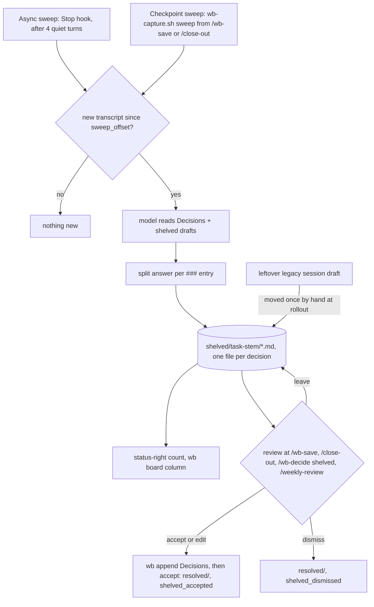
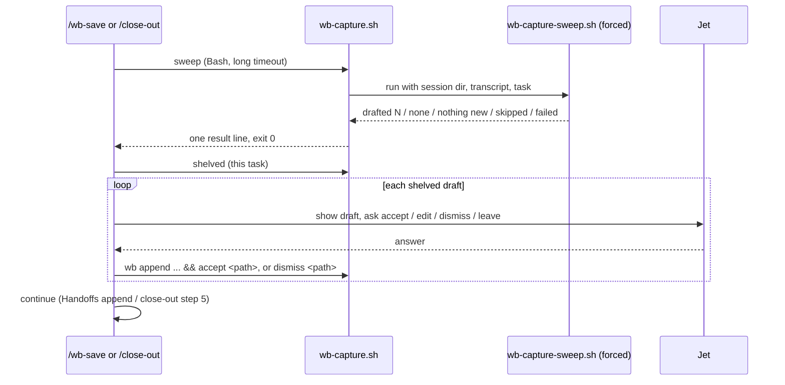

# Capture nudge rework - Plan

## Goal Capsule

- **Objective:** every decision the background sweep drafts reaches Jet at a moment Jet is already reviewing work (a save, a close-out, the weekly review), with a visible count of what is waiting in between, so drafted decisions end up in the task's `## Decisions` instead of being ignored mid-request.
- **Means:** drafts go straight to the existing shelf, the agent-facing nudge and phrase matching are deleted, and the checkpoint skills run one sweep and then review the shelf (KD1, KD2, KTD1, KTD3).
- **Authority:** Jet's global instructions (`~/.claude/CLAUDE.md`) > the task file's Decisions N1-N3 (`~/code/tasks/dotfiles--feat-capture-nudge-rework.md`) > this plan's Requirements > KTDs > unit Approach.
- **Stop conditions:** stop and ask if tmux won't expand the session's `@task` inside the status-bar command and no cheap fallback exists (U3), if a checkpoint sweep can't finish inside the Bash tool's maximum timeout (U2), or if [[dotfiles--feat-decision-propagation]] has already landed edits to `/wb-decide` step 5 or `/close-out` step 4 that this plan would overwrite.
- **Execution profile:** about 1-1.5 days. Mostly deletion in `wb-capture.sh` and its tests, one new verb, one status script, five skill edits, one guide rewrite.
- **Finishes and ships:** the implementing session commits on `feat/capture-nudge-rework`, doc edits in their own commits (the docgen pre-commit hook stages `docs/*.md`). Push and PR only after Jet's OK. Code review runs in a fresh context per Jet's rule, after `/wb-save`.

---

## Product Contract

### Summary

The sweep keeps drafting decisions, but each drafted decision is written as its own file on the shelf and nobody is nudged. A count of waiting drafts shows in the tmux status bar and on `wb board`. `/wb-save` and `/close-out` run one sweep, then walk Jet through the shelf. `/weekly-review` catches drafts left waiting more than a week. Phrase matching and the whole nudge, follow and strike machinery are removed. The graduation review switches to drafts accepted out of drafts reviewed.

### Problem Frame

Decision auto-capture shipped on 2026-10-19 (PR #95, the wb-capture plugin) with two halves: a background sweep that drafts unrecorded decisions, and a one-line nudge that asks the working agent to record them. The capture log from 2026-10-19 to 2026-10-24 shows the halves performing very differently. 38 nudges fired and 3 were genuinely followed, two of those in the session that built the mechanism. When a person reviewed a draft, it was accepted 10 times out of 12. The soccer-metrics session ignored 17 nudges and then accepted 5 of its 7 shelved drafts in under two minutes.

The nudge arrives in the agent's context at the start of Jet's next request, competes with that request, and asks for a detour and a judgment call, so it loses. Phrase matching was worse: 10 nudges, 1 real follow, and every examined match was a recap of an old decision. The full case is in the dossier page `nudge-mechanism.html` (`~/code/tasks/dossiers/dotfiles--feat-capture-nudge-rework/`).

### Key Decisions

- KD1. **Drafts go to Jet, not the agent.** The agent receives no draft nudge of any kind. (session-settled: user-directed — chosen over keeping the nudge to 2026-11-02, D17's "mention the draft" line, auto-recording drafts as "proposed", and blocking the turn: only person-reviewed drafts were ever accepted.) Governs R1, R2.
- KD2. **Remove phrase matching; checkpoints run one sweep instead.** (session-settled: user-directed — chosen over turning a match into an early sweep: drafts wait for the checkpoint anyway and matches were nearly all recaps.) Governs R3, R7.
- KD3. **A pending-draft count in the status bar.** (session-settled: user-directed — chosen over relying on checkpoint review alone.) Governs R4, R5.
- KD4. **`/wb-save` reviews the shelf, not just offers to.** (session-settled: user-directed — chosen over an optional offer.) Governs R7.
- KD5. **Graduation judged on drafts accepted out of drafts reviewed, plus coverage, with a minimum sample, and the change ships before 2026-11-02.** (session-settled: user-approved — chosen over the nudge follow rate, which measures obedience to a nudge that no longer exists.) Governs R11.

### Requirements

**Drafting and the shelf**

- R1. Every decision the sweep drafts lands on the task's shelf (`<state>/wb/capture/shelved/<task-stem>/`) as its own file, one decision per file.
- R2. No hook injects anything about drafts or phrases into the agent's context.
- R3. Phrase detection is removed: no phrase list, cooldown, marker or phrase nudge.
- R6. The sweep is told which drafts are already waiting on the shelf for that task, so it does not draft the same decision again.

**Seeing what is waiting**

- R4. The tmux status bar shows the number of shelved drafts for the current session's task, and shows nothing when there are none or the session has no task.
- R5. `wb board` shows each task's shelved-draft count, in the text view and the HTML view.

**Reviewing at checkpoints**

- R7. `/wb-save` and `/close-out` each run one sweep covering turns not yet swept, then present every shelved draft for the task one at a time: accept (optionally edited), dismiss, or leave.
- R8. An accepted draft is appended to the task's `## Decisions` via `wb append` and moves to `resolved/`. A dismissed one moves to `resolved/`. Nothing is deleted unseen.
- R9. `/weekly-review` lists every shelved draft older than seven days, whatever the task's status, alongside the drafts of finished tasks it lists today.
- R10. `/wb-decide` keeps recording a decision on the spot exactly as today.

**Measurement**

- R11. The graduation review task ([[dotfiles--capture-graduation-review]]) is updated to judge on R12's figures.
- R12. The capture log records, per drafted decision, when it was shelved and whether it was accepted or dismissed, so "accepted out of reviewed" and "waiting longer than a week" can be computed from the log alone (KTD12).

### Success Criteria

- At the 2026-11-02 review (or a week later, per KTD9), drafts accepted out of drafts reviewed is computed from the log without hand-correction, over drafts shelved after rollout.
- No task closed after rollout has an unmarked empty `## Decisions` section.
- Jet does not see draft-related text in agent replies unless Jet ran a checkpoint skill or `/wb-decide`.

### Scope Boundaries

- `/wb-decide`'s on-the-spot record path and its step 5 are unchanged in behavior. Removing the now-meaningless `clear` calls there is in scope. The family messaging that [[dotfiles--feat-decision-propagation]] adds to step 5 is not.
- No change to the sweep's model, effort, cadence (`sweep_every`), or prompt beyond adding the shelf section (R6).
- No auto-recording of drafts into task files. Hooks still never write the task store (KTD5 of the auto-capture plan).
- Considered and not built: a per-draft "seen in status bar" tracker. The count already disappears when drafts are reviewed. Build it only if Jet reports the count going stale.
- Considered and not built: a lock that blocks `/wb-decide` from recording while a sweep runs. The shelf-in-prompt (R6) plus stale detection already covers a decision recorded mid-sweep.
- Considered and not built: a lock between the async sweep and a checkpoint sweep. If they overlap, the worst case is a duplicate draft (dismissed in one step at the review) or an async draft landing just after the review (it stays on the shelf and in the count). Both are visible to Jet at once. Build it if duplicates show up in practice.
- Considered and not built: automatic migration of drafts left in the old per-session slot by the reaper or `hook-end`. Nothing writes that slot after U2, so the few left at rollout are moved once by hand (U6).

#### Deferred to Follow-Up Work

- Moving this task under the wb future-direction parent with `wb set` once this session has no live tmux session (refused while live).
- Re-stowing the main checkout after merge so the live hooks, scripts and skills pick up the change (Jet's stow rule).

### Sources

- Capture log `~/.local/state/wb/capture/log.jsonl`. Counts in Problem Frame were verified on 2026-10-24.
- Flow review `~/code/tasks/dossiers/dotfiles--fix-capture-handback-none/review/flow-quality-2026-10-20.md` (phrase false positives, the soccer-metrics shelf review).
- Planning research dossiers: engine (wb-capture.sh, the sweep and the tests) and surfaces (skills, tmux, board, docs). These were written to session scratch and summarised into the KTDs below.

---

## Planning Contract

### Key Technical Decisions

- KTD1. **Delete the nudge machinery outright rather than switch it off.**
  - What goes: nudge delivery in `hook-prompt`, the phrase/marker/cooldown/recorded path in `hook-stop`, `hook-posttool`'s follow detection, follow/ignore resolution and strikes, the `reviewing` engagement marker, the verbs `clear`, `review`, bare `dismiss`, `dismiss --expect` and `accept --begin` with its `shelved_accept` flag, the config keys `phrases` and `cooldown`, and the events `nudge_fired`, `followed`, `ignored`, `dismissed`, `pending_at_end` and `pending_orphaned`.
  - Why: with no nudge, these pieces protect or measure nothing, and leaving them dormant keeps about half of `wb-capture.sh` and most of `wb-capture-hooks.test.sh` alive for no behavior.
  - (session-settled: user-approved — chosen over leaving the machinery behind a setting: going back is a git revert.)
- KTD2. **`hook-posttool` stays as a silent no-op verb, and its `hooks.json` entry is removed.** Sessions started before the change keep calling it until restarted. An unknown-verb error would print on every Bash call in those sessions.
- KTD3. **One shelf file per drafted decision.**
  - The sweep splits its answer (up to 3 `### ` entries) and shelves each with the existing atomic `shelve_answer`/`shelved_dest` path, logging `draft_shelved {"reason":"sweep","draft":"<file>"}` per file (KTD12).
  - Per-file is what makes R12's per-draft counts, the status count and one-at-a-time review all mean "decisions".
- KTD4. **A checkpoint sweep is a new agent verb, `wb-capture.sh sweep`, that runs the sweep script in forced mode and waits for it.**
  - It finds the session via the pane's `@wb_capture_sid` like the other agent verbs.
  - It honors the kill switch, `WB_CAPTURE_SWEEP`, `sweep=off` and `muted`. It ignores the four-quiet-turns cadence and the outage backoff, because one attempt at a checkpoint is the point.
  - It skips the model call when nothing was written since `sweep_offset`.
  - It always exits 0 with one result line (`drafted N`, `none`, `nothing new`, `skipped: <reason>`, `failed: <reason>`), so the calling skill always proceeds to the review.
  - It keeps the sweep's own ceiling (child timeout 60 s, doubled on its one rerun), so the call finishes well inside the skills' 300000 ms Bash timeout. It does not wait on an async sweep (see Scope Boundaries).
  - (session-settled: user-approved — the checkpoint waits for the sweep, roughly up to two minutes and about $0.12, rather than reviewing only what earlier sweeps drafted.)
- KTD5. **The transcript path is persisted per session by the hooks.** `hook-stop` and `hook-prompt` write the payload's `transcript_path` to `<session dir>/transcript`, and the forced sweep reads it from there. Deriving it from the cwd breaks when the agent has changed directory. This file was the one real blocker the research found.
- KTD7. **Shelf queries stay behind `wb-capture.sh` verbs.**
  - `shelved --count [--task <stem>]` prints a number. Its count path runs no guard chain and no tmux call, so it stays cheap when the status bar calls it every 5 seconds.
  - `shelved --all --min-age-days <N>` filters by the filename's timestamp.
  - `pending-for-task` returns only shelved paths.
  - `wb.sh` and the status script never learn the capture layout, the same rule `pending-for-task` already follows.
- KTD8. **The status count is a new `capture-status.sh` segment prepended to the theme's `status-right`, set after the `run tpm` line.**
  - The catppuccin theme overwrites `status-right` when tpm loads it. The live value is the theme's window and session modules, not the clock line at the top of `tmux.conf`. So the segment is added after tpm, next to the existing `status-left` override, and prepends to whatever the theme left.
  - `status-left` is capped at 25 characters and already holds `claude-status.sh`.
  - `status-right` passes the expanded `#{@task}` as the script's argument. The script derives the stem (strip the directory and `.md`, as `tmux_task` does) and calls `shelved --count --task <stem>` (KTD7).
  - (session-settled: user-approved — the count is the current session's task, not a total across tasks.)
- KTD9. **Proposed graduation thresholds, for Jet to confirm at plan review:**
  - At least 70% of reviewed drafts accepted, over at least 10 reviewed drafts shelved after rollout.
  - Zero tasks closed after rollout with an unmarked empty `## Decisions`.
  - Fewer than 10 reviewed drafts by 2026-11-02 moves the review out one week.
  - Drafts waiting longer than seven days are reported as a health number, not a pass/fail gate.
- KTD10. **A draft left in the old per-session slot is moved to the shelf once, by hand, at rollout (U6).** One exists today (the unowned-sessions auth session, 08a822a6). After U2 nothing writes that slot, and the `wb done` guard stops looking at it. An unmoved draft would be invisible to every surface. Permanent migration code was considered and not built (Scope Boundaries).
- KTD11. **Accepting a shelved draft becomes one step:** `wb append <task> Decisions - … && wb-capture.sh accept <path>`. The two-phase `accept --begin` existed only to stop a shelf accept from counting as a follow (KTD1).
- KTD12. **Every draft event names its draft.** `draft_shelved`, `shelved_accepted` and `shelved_dismissed` carry a `draft` field holding the shelf file's basename. That basename's timestamp gives the draft's age, so a resolve can be joined to its shelving, and drafts shelved before rollout (no `draft` field) are excluded without hand-correction.

### High-Level Technical Design

Draft lifecycle after the change. The per-session `draft` slot, the nudge and the strikes are gone. A draft has one waiting state, on the shelf.

Checkpoint sequence inside `/wb-save` and `/close-out`:

### Assumptions

- tmux expands `#{@task}` inside a `#()` status command. U3 verifies this first. The fallback is the script resolving the session from `#{session_name}` and reading `@task` with `show-options`.
- The Bash tool accepts a timeout of up to 600000 ms. A checkpoint sweep is bounded by the child timeout (60 s, doubled on its one rerun), so the skills call it with a 300000 ms timeout.

---

## Implementation Units

### U1. Remove the nudge machinery and phrase matching

- **Goal:** the hooks stop talking to the agent, and every piece of state, verb and log event that existed only for nudges is gone.
- **Requirements:** R2, R3, R12. KTD1, KTD2, KTD11.
- **Dependencies:** none.
- **Files:**
  - `scripts/.config/scripts/tmux/wb-capture.sh`
  - `claude/.claude/skills/wb-capture/hooks/hooks.json`
  - `claude/.claude/skills/wb-capture/.claude-plugin/plugin.json`
  - `scripts/.config/scripts/tmux/tests/wb-capture-hooks.test.sh`
  - `scripts/.config/scripts/tmux/tests/wb-capture-core.test.sh`
  - `scripts/.config/scripts/tmux/tests/wb-capture-plugin.test.sh`
- **Approach:**
  1. `hook-prompt` keeps the `@wb_capture_sid` stamp, the `ended` removal on resume, synthetic (hand-back) detection and the hourly reaper call. It loses nudge composition and delivery.
  2. `hook-stop` keeps the taskhash/`unchanged` counter, `taskpath` and the `synthetic` handling. It loses phrase matching, cooldown, `recorded`, and the `outstanding`/`reviewing` resolution.
  3. `hook-posttool` becomes a no-op that exits 0 (KTD2), and its `hooks.json` entry is removed.
  4. `hook-end` keeps only the `ended` tombstone. Legacy-draft shelving lands in U2 (KTD10).
  5. Remove the verbs and events KTD1 lists. Make `accept <path>` single-phase (KTD11). `dismiss` now requires a path or `--task`. `shelved_accepted` and `shelved_dismissed` gain the `draft` field (KTD12).
  6. `status` drops the marker and draft lines and keeps mute state, log path and shelved list.
  7. `load_config` ignores `phrases` and `cooldown` silently, so an existing `capture.conf` still loads.
  8. Rewrite the header comment blocks (Draft strikes, Engagement marker, Two-phase accept) to describe the shelf-only model.
- **Patterns to follow:** the existing guard chain and `quiet_exit` idiom; the `tmux_task` and `pane_sid` helpers.
- **Test scenarios:**
  - A prompt submitted in a session with a shelved draft and a matching phrase in the last reply: no `additionalContext` is emitted, and `@wb_capture_sid` is still stamped.
  - The last reply contains "we decided to": no `marker` file is written, nothing is logged.
  - `hook-posttool` called with a `wb append … Decisions` payload: exits 0, writes nothing, logs nothing.
  - `accept <path>` on a shelved draft: the file moves to `resolved/`, `shelved_accepted` is logged once with `draft` set to the file's basename, no flag file remains.
  - `dismiss <path>`: `shelved_dismissed` is logged with the same `draft` field.
  - Bare `dismiss` with no path: usage error, exit 1, nothing removed.
  - `capture.conf` containing `phrases=` and `cooldown=3`: the config loads, and `_config` prints no phrase or cooldown keys.
  - Plugin test: `hooks.json` registers UserPromptSubmit, Stop (two hooks) and SessionEnd, and no PostToolUse.
  - Kept behavior still passes: unchanged/taskhash counting, synthetic turns not counting, hook-end tombstone, reaper session-dir and log rotation, resolved pruning.
- **Verification:** the three test files pass. A whole-word `grep` finds no `nudge_fired`, `followed`, `marker`, `cooldown` or `shelved_accept` (the flag, not the kept `shelved_accepted` event) in `wb-capture.sh`.

### U2. Sweep writes to the shelf; checkpoint sweep verb

- **Goal:** each drafted decision lands on the shelf as its own file, the sweep sees what is already waiting, and a skill can run one sweep on demand and wait for it.
- **Requirements:** R1, R6, R7 (sweep half), R12. KTD3, KTD4, KTD5, KTD12.
- **Dependencies:** U1.
- **Files:**
  - `scripts/.config/scripts/tmux/wb-capture-sweep.sh`
  - `scripts/.config/scripts/tmux/wb-capture.sh`
  - `scripts/.config/scripts/tmux/tests/wb-capture-sweep.test.sh`
  - `scripts/.config/scripts/tmux/tests/wb-capture-hooks.test.sh`
- **Approach:**
  1. `hook-stop` and `hook-prompt` persist `transcript_path` to `<session dir>/transcript` (KTD5).
  2. The sweep script gains a forced mode. When forced, it takes session id, task and transcript from arguments or the session dir instead of stdin, skips the cadence gate, the backoff gate and the startup sleep, and never reads stdin (run it with stdin from `/dev/null`).
  3. The prompt gains a labelled section listing the task's shelved drafts as "already drafted, awaiting review: do not draft these again" (R6).
  4. Replace the overlap/draft-write block with: split the answer on `### `, then one `shelve_answer` per entry (KTD3), each logging `draft_shelved` with its `draft` field (KTD12). Keep the stale/rerun logic, writing the re-snapshot's entry count into each file's `.stale` sidecar.
  5. Drop the `draft_pending`, `superseded`, `reviewing` and `outstanding` checks.
  6. New `wb-capture.sh sweep` verb runs the forced sweep and prints the one-line result (KTD4).
- **Execution note:** start from the sweep test file's existing fake-`claude` fixtures. Change the draft assertions to shelf assertions before deleting the slot code, so the kept behaviors stay pinned.
- **Patterns to follow:** `shelve_answer` and `shelved_dest` in `wb-capture.sh`; the sweep's existing `sweep_ran`/`sweep_skipped` logging.
- **Test scenarios:**
  - Fake model returns two `### ` entries: two files appear in `shelved/<stem>/`, two `draft_shelved {"reason":"sweep"}` lines are logged, each with a `draft` field naming its own file, and no `<session>/draft` exists.
  - Fake model returns `NONE`: no file, `sweep_ran {"result":"none"}`.
  - Two drafts already shelved for the task: the prompt handed to the fake model contains both drafts' headings in the "already drafted" section.
  - `wb-capture.sh sweep` with three unchanged turns (below cadence): the sweep runs and prints `drafted 1`.
  - `wb-capture.sh sweep` with nothing written since `sweep_offset`: no model call, prints `nothing new`.
  - `wb-capture.sh sweep` while muted: prints `skipped: muted`, exit 0, no model call.
  - `wb-capture.sh sweep` after three consecutive failures (backoff active): the sweep still runs.
  - Fake model times out on both the run and its rerun: prints `failed: timeout`, exit 0, total time under 300 s.
  - Stop payload carries `transcript_path`: `<session dir>/transcript` holds it after `hook-stop`.
  - `## Decisions` changes twice while the model runs: the files are written with `.stale` sidecars holding the re-snapshot's entry count.
- **Verification:** the sweep and hooks test files pass. A forced sweep against a fixture transcript finishes well inside 300 s.

### U3. Pending-draft count in the status bar and on the board; wb done guard

- **Goal:** Jet can see how many drafts are waiting without asking anyone.
- **Requirements:** R4, R5, R9 (query half). KTD7, KTD8.
- **Dependencies:** U1. It doesn't need U2, but its counts are only meaningful once U2 lands.
- **Files:**
  - `scripts/.config/scripts/tmux/wb-capture.sh`
  - `scripts/.config/scripts/tmux/capture-status.sh` (new)
  - `tmux/.config/tmux/tmux.conf`
  - `scripts/.config/scripts/tmux/wb.sh`
  - `scripts/.config/scripts/tmux/wb-board.sh`
  - `scripts/.config/scripts/tmux/tests/wb-capture-core.test.sh`
  - `scripts/.config/scripts/tmux/tests/capture-status.test.sh` (new)
  - `scripts/.config/scripts/tmux/tests/wb-board.test.sh`
  - `scripts/.config/scripts/tmux/tests/wb-board-model.test.sh`
  - `scripts/.config/scripts/tmux/tests/wb-board-render.test.sh`
  - `scripts/.config/scripts/tmux/tests/wb-done.test.sh`
- **Approach:**
  1. Add `shelved --count` and `--min-age-days` to the store verb (KTD7).
  2. `capture-status.sh <task-path>` prints a short coloured segment (e.g. `✎2`) and a trailing space when the count is above 0, and nothing otherwise. It is prepended to `status-right` after the `run tpm` line (KTD8).
  3. Verify `#{@task}` expansion first; use the fallback in Assumptions if needed.
  4. Text `wb board` gains a DRAFTS column beside FOLLOW-UPS. HTML board gains a chip near the PR chip, with its model array appended at the end of `WB_BOARD_MODEL_ARGS`. Counts come from one `shelved --all` call, not one call per task.
  5. The `wb done` guard drops the live-session-draft branch and keeps the shelved check and `--leave-shelved`.
  6. Seed `wb-done.test.sh`'s end-to-end case by writing a shelf file directly, since `hook-end` no longer produces one from a live draft.
- **Patterns to follow:** `claude-status.sh` (prints nothing at zero, `#[fg=…]` styling); the board's FOLLOW-UPS column (awk count); `pending-for-task` as the guard's only capture call.
- **Test scenarios:**
  - `shelved --count --task <stem>` with 3 files: prints `3`. With an empty or missing dir: prints `0`.
  - `shelved --all --min-age-days 7`: lists a file stamped 8 days ago, omits one stamped today, and keeps `<stem>:` grouping.
  - `capture-status.sh` with 2 shelved drafts for the task: output contains `2`. With 0: empty output. With an empty task argument: empty output, exit 0.
  - Text `wb board` with one task holding 2 drafts: that row's DRAFTS cell is 2, and the others are blank or 0 per the column convention.
  - HTML board model: the drafts count is in the task's model record. The render shows the chip only when the count is above 0.
  - `wb done` on a task with a shelved draft: refuses with the shelved path listed. With `--leave-shelved`: proceeds and logs `shelved_left`.
  - `wb done` on a task whose only leftover is a stray `<session>/draft` file: not blocked (the reaper migrates it per KTD10).
- **Verification:** the listed tests pass. In a live tmux session after stow, `tmux show -gv status-right` contains `capture-status.sh` and the theme's modules, and the bar shows the count for this task and clears after review.

### U4. Checkpoint review in the skills

- **Goal:** `/wb-save` and `/close-out` sweep and review the shelf. `/weekly-review` catches old drafts. `/wb-decide` and `/wb-done` stop describing nudges.
- **Requirements:** R7, R8, R9, R10. KTD4, KTD11.
- **Dependencies:** U2, U3.
- **Files:**
  - `claude/.claude/skills/wb-save/SKILL.md`
  - `claude/.claude/skills/close-out/SKILL.md`
  - `claude/.claude/skills/wb-decide/SKILL.md`
  - `claude/.claude/skills/weekly-review/SKILL.md`
  - `claude/.claude/skills/wb-done/SKILL.md`
- **Approach:**
  1. **One shared review procedure**, written once in `/wb-decide` (the `shelved` path, step 2b) and cited by `/wb-save` and `/close-out`:
     - Run `wb-capture.sh sweep` with a 300000 ms Bash timeout and report its result line in one sentence.
     - List the task's shelved drafts.
     - For each draft, read it, show it and ask accept, edit, dismiss or leave. Compare `(stale)` drafts against the newest Decisions entries first.
     - Accept runs `wb append <task> Decisions - … && wb-capture.sh accept <path>`. Dismiss runs `wb-capture.sh dismiss <path>`.
  2. **`/wb-save`:** a new step between locating the task and the Handoffs append, so the entry can say how many decisions were recorded or left. Widen its Scope note to allow the Decisions append and the capture verbs. Skip silently only when the session has no `@task`. When capture is disabled the sweep prints its `skipped:` line and the review of existing shelved drafts still runs (KTD4).
  3. **`/close-out` step 4:**
     - Replace the live-draft block and the `dismiss --expect none` sequence before the "no decisions" marker with the shared procedure.
     - Keep the marker path. With no outstanding nudge to inflate, the pre-marker dismiss is no longer needed.
     - Touch only the draft paragraphs, leaving the rest of step 4 for [[dotfiles--feat-decision-propagation]].
  4. **`/wb-decide`:**
     - The description and intro drop the `[wb-capture]` nudge triggers.
     - Step 2's live-draft review path is removed.
     - Step 0 keeps `status`, `shelved`, `mute`/`unmute` (mute now silences sweeps for the session) and `dismiss <path>`, and loses bare `dismiss`.
     - Step 5 loses the `clear` calls.
     - Steps 3-4 (the record path) are unchanged.
     - The Notes drop the phrase and cooldown config.
  5. **`/weekly-review`:** add `shelved --all --min-age-days 7` beside the existing done-task listing, de-duplicated, and switch its accept path to the single-step form.
  6. **`/wb-done`:** drop its live-draft wording.
- **Test expectation:** none in the bash suites. These are skill prose. Behavior is proven by U6's live checklist.
- **Verification:** no skill mentions `accept --begin`, `--expect`, `clear --draft`, the phrase nudge or "draft: present". `/wb-decide`'s record path diff is limited to the step 5 `clear` removal.

### U5. Docs and the graduation review task

- **Goal:** the guide and READMEs describe the shelf-only model, and the graduation review judges the new measure.
- **Requirements:** R11, R12. KD5, KTD9.
- **Dependencies:** U1-U4 (describes their result).
- **Files:**
  - `docs/guides/wb-decide.md`
  - `claude/README.md`
  - `claude/.claude/skills/wb-capture/.claude-plugin/plugin.json` (description, if not already changed in U1)
  - generated `docs/guides/wb-decide.html` and `docs/INDEX.md` (via docgen, never by hand)
- **Approach:**
  1. Rewrite `docs/guides/wb-decide.md` around the lifecycle diagram in this plan: sweep, shelf, count, checkpoint review, weekly catch-all. Update its `tile:` frontmatter.
  2. Fix `claude/README.md`'s capture paragraph.
  3. Re-run docgen.
  4. Append to the graduation review task through the store's locked verbs (`wb append`, or the store-specialist agent): the new headline measure, KTD9's thresholds as Jet confirmed them, the rollout date that splits the log, and the events to count (`draft_shelved` with reason `sweep`, `shelved_accepted`, `shelved_dismissed`, joined on their `draft` field per KTD12).
- **Test expectation:** none -- documentation and a task-store note.
- **Verification:** docgen runs clean with no hand-edited `.html`. The graduation task's file shows the appended criteria.

### U6. Rollout and live verification

- **Goal:** the change runs in real sessions, and its first live behavior is checked by hand.
- **Requirements:** all. This is the behavioral proof for U4.
- **Dependencies:** U1-U5, merged and re-stowed.
- **Files:**
  - `~/code/tasks/dossiers/dotfiles--feat-capture-nudge-rework/live-verification.html` (outside the repo: task dossier)
- **Approach:**
  1. Build a tickable HTML checklist in the dossier (Jet's verification-checklist norm), splitting what the suites already proved from what needs a live run:
     - status count appears and clears
     - `/wb-save` runs a sweep and reviews
     - `/close-out` reviews and still writes the marker
     - old sessions log no hook errors before restart
     - `/weekly-review` lists drafts older than seven days
  2. Right after re-stowing, move every leftover `<session>/draft` (one exists today, in session 08a822a6) to its task's shelf. The task comes from that session's `taskpath` file. Split multi-entry files into one file per `### ` entry, named like sweep-written ones. Then confirm `ls <state>/wb/capture/*/draft` is empty (KTD10).
  3. Note that open sessions need a restart to drop the `hook-posttool` registration (KTD2).
- **Test expectation:** none -- manual verification artifact.
- **Verification:** Jet ticks the checklist, or failures become follow-ups in the task file.

---

## Verification Contract

| Gate | Command / action | Applies to |
|---|---|---|
| Capture suites | `bash scripts/.config/scripts/tmux/tests/wb-capture-{core,hooks,sweep,plugin}.test.sh`, each exits 0 | U1, U2, U3 |
| Board, done and status suites | `bash scripts/.config/scripts/tmux/tests/{wb-board,wb-board-model,wb-board-render,wb-done,capture-status,wb-help}.test.sh` | U3 |
| Full wb suite | Docker suite (`scripts/.config/scripts/tmux/tests/Dockerfile`), compared per-file against a clean-room baseline of `origin/development` under `~/.cleanroom/capture-nudge-rework-baseline/`. Judge by per-file FAIL sets, not the last line or the wrapper's exit code (about 12 env-dependent files fail on clean dev). | all code units |
| Docs | docgen run after `.md` edits; no hand-edited `.html` | U5 |
| Review | fresh-context `/ce-code-review` after `/wb-save` and `/clear`, then `wb reviewed` | all |
| Live | the dossier checklist (U6) | U4, U6 |

## Definition of Done

- U1-U5 are committed. Doc edits are in their own commits.
- The capture, board, done and status suites pass. The full Docker suite's per-file FAIL set equals the clean-room baseline's.
- No hook emits agent-facing text. `grep` for the removed verbs and events in scripts and skills finds nothing outside migration notes.
- The graduation review task carries the new criteria with Jet's confirmed thresholds.
- The task file's Decisions records any departure from this plan's KTDs.
- No experimental or abandoned code is left in the diff.
- U6's checklist is published in the dossier for Jet.
