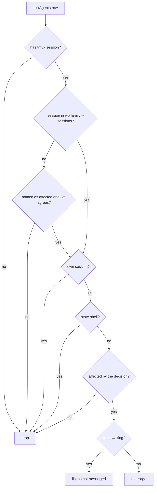

# Decision propagation stop gap - Plan

## Goal Capsule

- **Objective:** when a decision is recorded in one wb task, the few running Claude sessions in that task's family that it affects hear about it straight away, and later sessions in the family start with the settled facts already loaded. Idle sessions don't get flooded. Live-session messages carry only decisions already recorded in a task file, and nothing is written into the family's shared `CONCEPTS.md` without Jet's approval.
- **Means:** a `wb family` verb that is read-only except for `--reseed` (KTD1), one propagate step in `/wb-decide` that checkpoint skills call once per batch (KTD3), and a gated promotion into the family's `CONCEPTS.md` (KTD6).
- **Authority:** Jet's global instructions (`~/.claude/CLAUDE.md`) > the task file's Decisions P1–P6 (2026-10-24 15:39) > this plan's Requirements > KTDs > unit Approach. The capture-nudge rework's Decisions N1–N3 (`~/code/tasks/dotfiles--feat-capture-nudge-rework.md`) govern the shelf and checkpoint behaviour this plan builds on.
- **Stop conditions:**
  - Stop and ask if the capture-nudge rework changes `/wb-decide`'s record path (step 4–5), contradicting its N1.
  - Stop and ask if ListAgents rows for wb sessions stop carrying a tmux session name.
- **Execution profile:** bash in `wb.sh` with one new test file, edits to four SKILL.md files, two doc edits in this repo and one in the task store, and an HTML live checklist. About a day.
- **Finishes and ships:** the implementing session commits on branch `feat-decision-propagation`. U1–U3 don't depend on the rework and can land first. U4 waits until the rework's skill edits merge to `development`. Push and PR (repo `jetnoli-sportable/dotfiles`) happen only after Jet's OK. Code review runs in a fresh context, per Jet's rule.

---

## Product Contract

### Summary

A new `wb family <task>` verb lists a task's family, and with `--sessions` the live tmux sessions working on it. After any successful Decisions append, `/wb-decide` runs a propagate step. It matches the family's live sessions against ListAgents, sends a one-line `[wb-propagate]` message to the ones the decision affects (default nobody), and names them in its confirmation line. `/wb-save`, `/close-out` and `/weekly-review` call the same step once per batch of drafts they accept. Fact-shaped decisions can be promoted into the family's `CONCEPTS.md`, but only with Jet's approval. The main offer comes at `/close-out`. Creating a new `CONCEPTS.md` re-links the family's worktrees with `wb family --reseed`.

### Problem Frame

Decision auto-capture (stage 4 of the closed living-task-store umbrella, PRs #95, #98 and #105) now records decisions in their own task file. Nothing carries them to *other* sessions in the same family.

That gap is real in the post-processor family. It has 33 tasks, 11 in progress and about 10 with a live Claude session. A decision in one of them can overturn an assumption another live session is still building on. A session started tomorrow imports the family's `CONCEPTS.md`, but that file only changes when someone edits it by hand.

Stage 5, the cross-agent sync task (`dotfiles--feat-store-cross-agent-sync`), was meant to close this gap. It now waits on the Go store reader (`dotfiles--wb-future-direction`). This plan is the stop gap until then.

Messaging every session in the family is not the answer. On 2026-10-18 there were 15 live sessions. Each message starts a turn in the session that receives it. Most of those sessions are days old and idle, and their prompt cache has expired, so every message re-reads a large context for nothing.

A running session also never reloads `CLAUDE.local.md` or `CONCEPTS.md` once it has started. A message is the only way to reach it, and promotion is the only way to reach the sessions that come after.

### Key Decisions

- **Recipients are picked by relevance from the live family; the default is nobody.** (session-settled: user-approved — chosen over messaging every live family session: about 10 sessions in the post-processor family, each turn costly on a cold cache.) Governs R4, R5, R7.
- **The rule for recipients travels in the message, and the full text lives in `/wb-decide`.** (session-settled: user-approved — chosen over the global CLAUDE.md: it reaches sessions started before this ships and repos that never load the skill.) Governs R6.
- **Promotion goes into the nearest existing `CONCEPTS.md`, else a new one in the top parent's dossier, followed by a re-seed.** (session-settled: user-approved — chosen over always using the top parent's file, or waiting for the next `wb new`: a new file would otherwise reach no existing worktree.) Governs R12.
- **The weekly review runs the same relevance check per family and sends nothing when no live session is affected.** (session-settled: user-directed — chosen over the proposed "weekly review offers promotion only and never messages": Jet wants late-accepted decisions to reach live sessions they affect.) Governs R10.
- **Promotion always needs Jet's approval; nothing is promoted automatically.** A wrong fact in `CONCEPTS.md` spreads to every session in the family, which is the failure stage 1 was built to prevent (origin task file, Part 2). Governs R13.

### Requirements

**Family lookup**

- R1. `wb family <task>` prints the stems of the task's family: the top parent first, then every descendant, one per line. It is read-only and never calls tmux.
- R2. `wb family <task> --sessions` prints one line per live tmux session working on a family task. Each line carries the stem, the session name and the task title. A session is matched by its `@task` option first, and by session name only when `@task` is unset.
- R3. `wb family <task> --reseed` rewrites the concepts pointer block in `CLAUDE.local.md` for every family worktree that exists on disk. It reports one line per worktree and never writes the task store.

**Messaging live sessions**

- R4. After a successful Decisions append, the propagate step builds its candidates by matching ListAgents rows to R2's sessions by tmux session name. It excludes its own session, rows in state `shell`, and rows with no tmux session.
- R5. The deciding agent messages only the candidates the decision affects, and the default is nobody.
  - A candidate in state `waiting` is not messaged. It is listed as "not messaged (waiting on its user)".
  - A session outside the family is messaged only when the decision names it as affected and Jet agrees.
- R6. Each recipient gets one message per batch. The message carries:
  - the `[wb-propagate]` marker;
  - the deciding task's stem with a plain description;
  - the entry titles (at most five) and any `supersedes` line;
  - the task-file path to read;
  - the rule suffix: act only if it affects your task, act within your own task, don't reply or forward, tell your user only if it matters to them.
- R7. The confirmation line names each session messaged and why, or says that no live family session is affected.
- R8. Propagation runs only after a Decisions append succeeds. It never runs for drafts, dismissals or a failed append.
- R9. A decision recorded in response to a `[wb-propagate]` message is not propagated again unless the user asks.
- R10. `/wb-save`, `/close-out` and `/weekly-review` run the propagate step once per batch, for the entries that run itself recorded. `/weekly-review` runs it once per family in the batch.
- R11. If ListAgents or SendMessage is unavailable, or a send fails, the step says so in one line and the recorded entry stands.

**Promotion to CONCEPTS.md**

- R12. A promotion targets the nearest `CONCEPTS.md` in the task's parent chain. If none exists, it creates one in the top parent's dossier and then runs `wb family <task> --reseed`.
- R13. A promotion offer shows four things before anything is written: the exact lines, the target file, which family tasks that file reaches, and what each line supersedes. Only the lines Jet approves are applied.
- R14. `/close-out` offers promotion for the task's fact-shaped Decisions entries. `/wb-decide` offers it only when the decision changes how the system behaves, the family already has a `CONCEPTS.md`, *and* another family session is live. Creating a family's first `CONCEPTS.md` is offered only at `/close-out`.
- R15. A promoted line that contradicts an existing line replaces it in place and names what it supersedes, following the store README's `CONCEPTS.md` discipline.

**Docs**

- R16. The wb guide and the task store README describe `wb family`, the propagate step, the `[wb-propagate]` message rule and promotion.

### Acceptance Examples

- AE1. Covers R4, R5, R7.
  - **Given:** a post-processor child records "stage runner retries go through the job entrypoint". Three family sessions are live: the job-entrypoint session (idle), the BigQuery-loader session (idle), and the v02-diff session (waiting).
  - **When:** the agent propagates.
  - **Then:** it messages only the job-entrypoint session and says why. It lists the v02-diff session as not messaged (waiting on its user) and sends nothing to the BigQuery loader.
- AE2. Covers R2. A session created for a parent task was moved to a child by `wb breakdown --apply`. Its name is still the parent's stem, but its `@task` points at the child. `--sessions` reports it under the child's stem.
- AE3. Covers R9. A recipient reads a `[wb-propagate]` message and records a follow-on decision in its own task. Its `/wb-decide` run records the entry and sends no messages unless its user asks.
- AE4. Covers R10.
  - **Given:** `/weekly-review` accepts shelved drafts from two families. One family has no live sessions. In the other, a live session is affected.
  - **When:** the weekly review propagates.
  - **Then:** it sends nothing for the first family and one message for the second.
- AE5. Covers R12, R13. A dotfiles family has no `CONCEPTS.md`. At `/close-out` Jet approves one line. The skill creates the file in the top parent's dossier, runs `--reseed`, and reports which worktrees now import it.

### Scope Boundaries

- Not stage 5. There is no hook, daemon or automatic delivery, and nothing here writes the store from a hook (KTD5 of `docs/plans/2026-09-22-002-feat-store-auto-capture-plan.md`).
- No reply channel. Recipients never message back.
- No change to how drafts are captured, nudged or shelved. That belongs to the capture-nudge rework.
- Considered and not built:
  - **A lock around `CONCEPTS.md` edits.** Every edit already passes Jet's approval and re-reads the file just before a minimal Edit. Two concurrent promotions into one family's file would have to land in the same minute, and the Edit fails loudly on a stale match. Revisit if a lost update is ever seen.
  - **A per-session "already propagated" log.** Each skill propagates only the entries its own run recorded (R10), so a `/clear` can't cause a double send. Revisit if checkpoint skills start recording entries from earlier runs.
  - **Messaging the whole family.** This was rejected under Key Decisions.

#### Deferred to Follow-Up Work

- Stage 5's re-plan (`dotfiles--feat-store-cross-agent-sync`) should replace the propagate step rather than run alongside it.
- Promotion offers for tasks that pause or crash before `/close-out`. Their fact-shaped decisions are never offered for promotion. Revisit at the weekly review if this turns out to matter.

---

## Planning Contract

### Key Technical Decisions

- KTD1. **A public `wb family` verb with `--sessions` and `--reseed` flags. It is read-only except for `--reseed`, which writes only the untracked pointer block in worktree `CLAUDE.local.md` files and never the task store.**
  - The verb has three consumers: the propagate step (`--sessions`), promotion (`--reseed`) and debugging by hand. That answers the concepts-hook plan's earlier rejection of a single-consumer public verb (`docs/plans/2026-09-21-001-feat-task-family-concepts-hook-plan.md`, its rejected `wb concepts-path`).
  - (session-settled: user-approved — chosen over a store-specialist lookup per decision, or ad-hoc store reads in the skill: deterministic and unit-testable, and only the model can call ListAgents.)
  - Folding the re-seed into the same verb was not part of that decision. It was chosen over re-running `wb new`, which also creates or attaches tmux sessions.
- KTD2. **Sessions are matched by `@task` first, and by session name only as a fallback.**
  - The original design assumed a session name equals its task stem. After `wb breakdown --apply`, a continuing child session keeps the parent's name while its `@task` points at the child (`wb_session_task_file` comment, `scripts/.config/scripts/tmux/wb.sh`).
  - The scan follows the loop in `_wb_refuse_if_live_session`.
- KTD3. **One propagate step, defined in `/wb-decide` and called once per batch.**
  - The step lives in the skill, not in a hook or in `wb.sh`, because only the live agent can call ListAgents and SendMessage and judge relevance. That also keeps KTD5 of the auto-capture plan intact.
  - (session-settled: user-approved — chosen over per-entry messages at checkpoints, or copies of the logic in each checkpoint skill: less noise, and one place to change.)
- KTD4. **The `[wb-propagate]` marker closes the feedback loop.** "Don't reply or forward" alone doesn't stop a recipient from recording its own decision in response and propagating that onwards. The marker lets `/wb-decide` recognise that case and stay quiet (R9).
- KTD5. **Sessions in state `waiting` are skipped.** A message delivered to a session waiting on a permission prompt or a question could be taken as its user's answer. Skipping is cheap. The session is still named in the confirmation line, so Jet can relay the decision by hand.
- KTD6. **Promotion edits `CONCEPTS.md` with a fresh re-read and a minimal Edit, never a whole-file Write.**
  - The file has no wb lock and lives in the task store.
  - A stale Edit match fails loudly, and the skill re-offers against the new text.
  - Promotion never edits `CLAUDE.local.md`. That file stays a pointer (KTD4 of the concepts-hook plan).
- KTD7. **Testing is unit tests for `wb family` plus an HTML live checklist for the model-driven steps.** (session-settled: user-approved — chosen over unit-testing SendMessage behaviour: it is a model tool.)

### High-Level Technical Design

The propagate step runs after a successful append:

```mermaid
sequenceDiagram
  participant A as Deciding agent (/wb-decide step 6)
  participant W as wb family --sessions
  participant L as ListAgents
  participant R as Recipient session
  A->>A: wb append succeeded (R8); entry came from a [wb-propagate] prompt? stop (R9)
  A->>W: family stems + live sessions (by @task, KTD2)
  W-->>A: stem, session, title per live family session
  A->>L: list running Claude sessions
  L-->>A: rows with name, state, tmux session
  A->>A: candidates = rows whose tmux session is in W's list, minus self, shell, no-tmux (R4)
  A->>A: judge relevance per candidate (default none); drop waiting (KTD5)
  A->>R: SendMessage "[wb-propagate] ..." one per recipient per batch (R6)
  A->>A: confirmation line naming who and why (R7)
```

Candidate filtering:



Promotion picks its target like this: walk the chain nearest-first (the existing `_wb_concepts_paths` walk). If a `CONCEPTS.md` is found, use it and tell Jet which tasks it reaches: a child-level file does not reach cousins. If none is found, create the file in the top parent's dossier and run `wb family <task> --reseed`.

### Sequencing

U1–U3 don't touch the files the capture-nudge rework edits, apart from `/wb-decide`. U3 adds a new step after step 5 and rebases onto the rework if the rework has merged by then. U4 edits `/close-out`, `/wb-save` and `/weekly-review`, which the rework also rewrites, so it starts only after the rework merges to `development`.

---

## Implementation Units

### U1. `wb family` verb: family enumeration and live sessions

- **Goal:** a read-only verb that prints a task's family, and with `--sessions` the live sessions working on it.
- **Requirements:** R1, R2; KTD1, KTD2.
- **Dependencies:** none.
- **Files:**
  - `scripts/.config/scripts/tmux/wb.sh` (new helper, `cmd_family`, dispatch arm, usage line in the header block)
  - `scripts/.config/scripts/tmux/tests/wb-family.test.sh` (new)
- **Approach:**
  1. Resolve the argument with `_wb_append_resolve_task`, labelled `wb family`, and exit 1 on failure. This follows `cmd_append`.
  2. Climb to the top parent, reusing the guards from `_wb_concepts_paths`: a seen-set, a depth cap of 20, `wb_task_own_parent`, and a break when a parent file is missing.
  3. Build a parent-to-children map in one pass over `wb_task_files`, as the board does. Walk it depth-first from the root, with a seen-set to guard against cycles. Print the root first.
  4. `--sessions`: list tmux sessions and read each session's `@task`. Map its basename to a stem, or fall back to the session name when `@task` is unset. Print `stem<TAB>session<TAB>title` for each family member, taking the title from the task file's first `# ` heading.
  5. Add the usage line to the header block. `tests/wb-help.test.sh` checks that every dispatch arm has one.
- **Patterns to follow:**
  - `cmd_task_file` for a quiet, script-friendly stdout.
  - `_wb_refuse_if_live_session` for the tmux `@task` scan.
  - `tests/tasks-concepts-seed.test.sh` for fixtures: `mk_task`, the parent chain, cycles, a self-parent, and the stub tmux on a private `-L` socket.
- **Test scenarios:**
  - A three-level chain (umbrella → child → grandchild) plus a sibling and a cousin. Asked from the grandchild, it prints the umbrella first and then the other four stems, each once.
  - Asked from the umbrella, it prints the same set.
  - A task with no parent and no children prints only itself and exits 0.
  - A mutual cycle (`cyclea` ↔ `cycleb`) terminates and prints each stem once.
  - A self-parent task prints itself once.
  - A missing parent file stops the climb at the last stem that exists, and that stem is the root.
  - Prefix-substring stems (`proj--foo` and `proj--foo-bar`): the exact stem resolves to `proj--foo`; an ambiguous fuzzy query exits 1 with the candidates on stderr.
  - An unknown task exits 1 with nothing on stdout.
  - Without `--sessions`, the stub tmux records no calls.
  - `--sessions` with three stub sessions:
    - one whose `@task` points at the child;
    - one whose name is the umbrella's stem but whose `@task` points at the grandchild, the migrated-breakdown case;
    - one outside the family.

    Expected: two lines. The migrated session is reported under the grandchild (covers AE2), and each line carries its task's title.
  - `wb help` lists `wb family`, so `wb-help.test.sh` passes.
- **Verification:** the new test file passes in the Docker suite, and the per-file FAIL set of the full suite is unchanged against a clean `development` baseline.

### U2. `wb family --reseed`

- **Goal:** re-link every existing worktree of the family to its `CONCEPTS.md` files without re-running `wb new`.
- **Requirements:** R3, R12.
- **Dependencies:** U1.
- **Files:**
  - `scripts/.config/scripts/tmux/wb.sh`
  - `scripts/.config/scripts/tmux/tests/wb-family.test.sh`
- **Approach:**
  1. For each family stem, read the task's `repo:` and `worktree:`, validate the field with `_wb_safe_worktree_field`, and build the path with `wb_repo_dir`.
  2. When the directory exists, call `_wb_seed_concepts_file`. Print `reseeded <stem> <path>` or `skipped <stem> (<reason>)`.
  3. Decide "skipped (no concepts file)" by calling `_wb_concepts_paths` directly. `_wb_seed_concepts_file` returns 0 both when it seeds and when there is nothing to seed, so its exit code can't tell the two apart.
  4. Keep it best-effort, like the seed in `cmd_new`: continue after a per-worktree error, and exit non-zero only if any seed failed.
  4. Never call tmux, and never take the task lock (the seed writes only an untracked file).
- **Patterns to follow:** the seed call in `cmd_new`, and the worktree-path fallback in `cmd_down`.
- **Test scenarios:**
  - After a `CONCEPTS.md` is created in the umbrella's dossier, `--reseed` from the grandchild writes the managed block into each fixture worktree that exists. A hand-written line outside the block survives.
  - A family member with no `worktree:` field, or with a directory that doesn't exist, is reported as `skipped` and the run exits 0.
  - An unsafe `worktree:` value (`../escape`) is skipped and nothing is written outside the fixture.
  - An unwritable worktree directory makes that seed fail. The other worktrees are still seeded and the exit code is non-zero.
  - The family has no `CONCEPTS.md` anywhere. Nothing is written, every member is reported as skipped (no concepts file), and the run exits 0.
- **Verification:** the U2 scenarios pass in Docker, and every test writes only under `mktemp` directories (the repo is mounted read-only).

### U3. `/wb-decide`: the propagate step and the promotion offer

- **Goal:** after every successful record, the deciding agent informs the live family sessions the decision affects, and offers promotion when it is warranted.
- **Requirements:** R4–R9, R11, R12–R15; KTD3–KTD6.
- **Dependencies:** U1, U2 (promotion's `--reseed`). If the capture-nudge rework has merged by now, rebase onto it first.
- **Files:** `claude/.claude/skills/wb-decide/SKILL.md`
- **Approach:**
  1. Add a new `### 6. Propagate` after step 5. It runs only after a successful `wb append` and after the capture clear.
  2. **Calling contract.** The step takes the task file and the batch of entry titles just recorded. Checkpoint skills call it with their own batch (U4).
  3. **Recipients.** Run `wb family <task> --sessions`, then ListAgents, then filter per the HTD flowchart. Before judging relevance, read each candidate's task file (`## Plan` and its latest `## Handoffs` entry) so the judgement rests on what that session is building, not on its title alone. The confirmation line says the judgement was made from those sections, so a wrong "nobody" can be checked.
  4. **Message.** Use one template with the `[wb-propagate]` marker and the rule suffix (R6). Every task named in it gets a plain description, per Jet's rule on identifiers.
  5. **Loop guard.** State R9's rule. Skip step 6 only when the entry being recorded was made in response to a received `[wb-propagate]` message, and say so in the entry's Why line. A `[wb-propagate]` message received earlier in the conversation does not suppress later, unrelated decisions.
  6. **Failures.** Handle missing tools and failed sends per R11.
  7. **Promotion procedure.** Define it once here, and `/close-out` uses the same procedure (U4). It:
     - applies the README's rule of thumb for what counts as a fact;
     - picks the target per R12;
     - shows R13's four items;
     - writes per KTD6;
     - runs `--reseed` when it created the file.

     `/wb-decide` invokes it only under R14's condition, so it never creates a file there.
  8. **Scope.** Add one Scope bullet: propagation is the one cross-session action this skill takes, and it never writes another task's file.
  9. **Notes.** Add a line saying stage 5 replaces this step.
  10. **Test scenarios list.** Extend the skill's checklist with the propagate cases below.
- **Patterns to follow:**
  - The skill's existing step and test-scenario style.
  - The store README's "What goes where" discipline for `CONCEPTS.md` lines: imperative, present tense, no rationale, and a correction names what it supersedes.
- **Test scenarios** (skill checklist items; checked live through U5):
  - A decision affects one live family session. One message is sent, and the confirmation names it and why (covers AE1).
  - No family session is affected. Nothing is sent, and the confirmation says so.
  - The only candidate is waiting on its user. Nothing is sent, and the confirmation lists it as not messaged.
  - The decision came from a `[wb-propagate]` message. It is recorded and nothing is sent (covers AE3).
  - A draft is dismissed, or the append fails. The propagate step doesn't run.
  - ListAgents is unavailable. One notice is shown and the entry stays recorded.
  - A behaviour-changing decision with a live family session triggers a promotion offer showing the lines, target, reach and supersedes. A decision that only explains *why* gets no offer.
  - The family has no `CONCEPTS.md`. A behaviour-changing decision gets no promotion offer at `/wb-decide`; that waits for `/close-out`.
  - The decision names a session outside the family as affected. The agent asks Jet first, and messages that session only on a yes.
- **Verification:** the skill text covers every Requirement it cites, and the U5 checklist exercises each scenario.

### U4. Checkpoint skills call propagate once per batch

- **Goal:** decisions accepted from the shelf at a checkpoint reach live family sessions just like on-the-spot records, and `/close-out` becomes the main place where promotion is offered.
- **Requirements:** R10, R14; KTD3.
- **Dependencies:** U3. The capture-nudge rework's skill edits must be merged to `development` first.
- **Files:**
  - `claude/.claude/skills/close-out/SKILL.md`
  - `claude/.claude/skills/wb-save/SKILL.md`
  - `claude/.claude/skills/weekly-review/SKILL.md`
- **Approach:**
  1. **`/close-out`.** At the end of step 4, after the last Decisions append, run `/wb-decide` step 6 once for the entries accepted in this run. Then review the task's whole `## Decisions` section for fact-shaped entries and run the promotion offer. Both happen before the exit step, because `wb down` and `wb done` end the session.
  2. **`/wb-save`.** After the shelf review that the rework adds, run step 6 once for the entries that review accepted. Add a narrow exception to the "never touch tmux state" note: reading ListAgents and sending messages are not tmux writes. Promotion stays at `/close-out`.
  3. **`/weekly-review`.** After shelved drafts are accepted, group the accepted entries by top parent (`wb family`'s first line). Run step 6 once per family. The weekly-review agent didn't make these decisions, so before judging relevance it reads each accepted entry in full and its source task file's `## Plan`. A family with no live session sends nothing (covers AE4).
- **Patterns to follow:** how each skill already calls into `/wb-decide` for draft accepts, as left by the rework.
- **Test scenarios** (skill checklist items; checked live through U5):
  - `/close-out` accepts two shelved drafts. One propagate run happens, and it comes before `wb down`/`wb done`.
  - `/close-out` with a behaviour-changing Decisions entry offers promotion. An entry that only gives a rationale gets no offer.
  - `/close-out` in a family with no `CONCEPTS.md`: Jet approves a line, the file is created in the top parent's dossier and `--reseed` runs (covers AE5).
  - `/wb-save` accepts one draft. One propagate run. A `/clear` followed by another `/wb-save` doesn't send it again.
  - `/weekly-review` across two families, one with no live sessions. Nothing is sent for that family, and one propagate run happens for the other.
- **Verification:** each skill names the step once, at the right place, and the U5 checklist exercises each scenario.

### U5. Docs and live verification checklist

- **Goal:** Jet and future agents can find out how propagation works, and the model-driven behaviour is checked in real sessions.
- **Requirements:** R16; KTD7.
- **Dependencies:** U1–U4. The docs can land with U3, and the U4 lines follow when U4 lands.
- **Files:**
  - `docs/wb-guide.md` (add `wb family` to the verb table near "Keeping the task store safe", and a short "Decision propagation" subsection near the task store's `## Decisions` text)
  - `docs/where-we-are.md` (the verb usage table)
  - `~/code/tasks/README.md` "What goes where" (outside this repo: promotion from a Decisions entry, the reach of a child-level file, and the `[wb-propagate]` rule)
  - `~/code/tasks/dossiers/dotfiles--feat-decision-propagation/verification.md` and the `verification.html` generated from it (outside this repo)
- **Approach:**
  1. Edit only the docs' `.md` sources and rerun docgen; never hand-edit generated HTML or `INDEX.md`. Commit the doc edits separately, because the pre-commit hook stages pending `docs/*.md` edits.
  2. Build the checklist as a tickable HTML page with saved progress, split into "automated, done" and "to verify live", from a Markdown source in the dossier. Publish it as an Artifact, and name the dossier path alongside the link.
  3. The live checks are:
     - delivery to idle and busy sessions;
     - skipping a waiting session;
     - a recipient obeying the rule suffix;
     - the feedback-loop case;
     - a migrated breakdown session being found;
     - no double send after `/clear`;
     - a weekly batch across two families;
     - promotion creating a `CONCEPTS.md`, re-seeding, and a fresh family session using the promoted fact.
- **Test expectation:** none — documentation, plus a checklist that is itself the test for U3 and U4.
- **Verification:** docgen runs clean, the guide renders `wb family`, and the checklist is published with its source in the dossier.

---

## Verification Contract

| Gate | Command or check | Applies to |
|---|---|---|
| Unit tests | `docker build -t wb-tests -f scripts/.config/scripts/tmux/tests/Dockerfile .`, then `docker run --rm -v "$(pwd)":/repo:ro -w /repo wb-tests bash scripts/.config/scripts/tmux/tests/wb-family.test.sh` | U1, U2 |
| Help parity | the same container runs `tests/wb-help.test.sh` | U1 |
| Full suite, no regressions | the default container CMD. Compare per-file FAIL sets against a clean-room `development` baseline (the known env-dependent floor is about 12 files), not the final exit code | U1, U2 |
| Docs | `docgen.sh` regenerates without error. No hand edits to generated `.html` or `INDEX.md` | U5 |
| Live behaviour | every item on the dossier's verification checklist is ticked in real wb sessions | U3, U4 |

## Definition of Done

- `wb family`, `--sessions` and `--reseed` behave as R1–R3 describe, and the U1–U2 test scenarios pass.
- `/wb-decide` step 6 and its promotion offer are in place (U3). The checkpoint skills call the step once per batch (U4), and that work landed after the capture-nudge rework merged.
- The docs and the store README describe the feature, and the live checklist is published with its source in the dossier and every item ticked.
- The full Docker suite's per-file FAIL set matches the `development` baseline.
- No leftover code from abandoned approaches is in the diff.
- The task file's Decisions carry any decision made during the build, recorded via `/wb-decide`.

---

## Appendix

### Sources

- Origin and settled decisions: `~/code/tasks/dotfiles--feat-decision-propagation.md` (Plan, and Decisions P1–P6).
- Shelf and checkpoint design this plan builds on: `~/code/tasks/dotfiles--feat-capture-nudge-rework.md`, Decisions N1–N3.
- Family walk, seed and session lookup: `scripts/.config/scripts/tmux/wb.sh` (`_wb_concepts_paths`, `_wb_seed_concepts_file`, `_wb_refuse_if_live_session`, `wb_session_task_file`, `_wb_append_resolve_task`, `cmd_task_file`).
- Board children map (the idiom, not callable): `scripts/.config/scripts/tmux/wb-board.sh`, `wb_board_v2_build`.
- Prior constraints:
  - `docs/plans/2026-09-22-002-feat-store-auto-capture-plan.md` (KTD5, hooks never write the store; stage 5 owns cross-agent sync).
  - `docs/plans/2026-09-21-001-feat-task-family-concepts-hook-plan.md` (pointer-only seed; no single-consumer public verb).
- `CONCEPTS.md` discipline: `~/code/tasks/README.md`, "What goes where".
