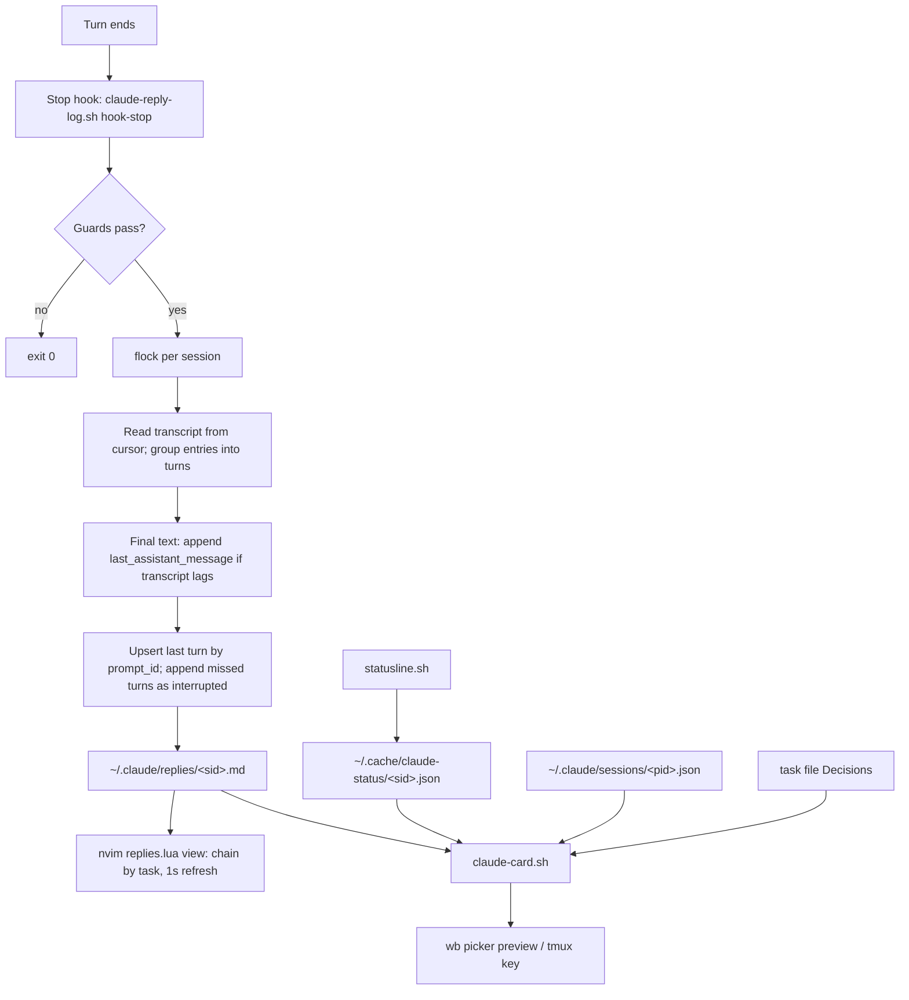

# Claude reply log and session context card - Plan

## Goal Capsule

- **Objective:** When Jet switches into any Claude Code session, they can read what Claude last said and asked, with the prompts that led there, in a clean markdown view beside the session. They don't scroll past thinking or tool output and don't prompt the agent. From the wb picker or a key inside the session, they see at a glance where that session stands.
- **Means:**
  - Phase 1: a Stop hook that reconciles each session's turns into a markdown reply file (KTD1-KTD6), and an nvim view that follows a task's reply files live (KTD8, KTD9).
  - Phase 2: a standalone card script fed by those files, a status-line cache and Claude Code's live session registry (KTD10-KTD13).
- **Authority:** the task file `~/code/tasks/dotfiles--feat-claude-reply-log.md` `## Decisions` outranks this plan. This plan outranks the research pages in `~/code/tasks/dossiers/dotfiles--feat-claude-reply-log/` (`research-similar-tools-2026-10-24.md`, `tools-compared-2026-10-25.md`).
- **Stop conditions:**
  - Stop and report if U1 shows that a Stop hook cannot get the turn's reply text at all, from either the transcript or `last_assistant_message`.
  - Stop and report if registering the plugin changes the behaviour of the existing Stop hooks (`claude-notify-hook.sh`, the wb-capture hooks).
  - Never enable the plugin in Jet's live config without Jet's go-ahead.
- **Execution profile:**
  - Phase 1 is U1-U5 and ships as PR 1.
  - Jet then runs `/wb-save` and `/clear`.
  - Phase 2 is U6-U8 and ships as PR 2.
  - Code review runs in a fresh context after each phase's commits, not in the build session.
- **Who finishes:** `ce-work` in worktree `.worktrees/feat/claude-reply-log`. Jet approves going live. After each merge, Jet is asked to re-stow the `claude` package in the main checkout and restart Claude so the plugin loads.

---

## Product Contract

### Summary

Every main-session turn of every Claude Code session lands in `~/.claude/replies/<session-id>.md`. The file holds Jet's prompt, Claude's reply text and the turn's artifacts, with headings Jet can navigate. A tmux key opens that file, joined with the task's earlier sessions, in an nvim split that follows new turns. Phase 2 adds a context card: the last exchange, the open questions, the artifacts, the task's recent decisions, context use, model, cost and whether the session is busy, waiting, idle or stalled. It shows in the wb picker preview and on a second tmux key.

### Problem Frame

Jet runs many Claude sessions in parallel tmux panes, and finds the one that needs them through the wb picker. Coming back to a session means rebuilding its context: what Claude is responding to, what it last said and asked, which artifacts belong to this chat, and what was already decided. The Claude window mixes all of that with thinking and tool output. Scrolling works for one or two messages, and gets confusing beyond that. Asking the agent to summarise or find an artifact adds more output to wade through.

Success, in Jet's words from the task file: after switching into a session, Jet can answer without scrolling past the last exchange, can open the session's artifacts without prompting the agent, and nothing new is added to the chat to get there.

### Key Decisions

- **One task in two phases, with one PR per phase.** Splitting into a follow-up task adds overhead in a personal repo. The card reads plain files and does not wait for the wb rework's Go store reader. (session-settled: user-approved — chosen over a separate follow-up task for the card: the card has no blocking dependency, so a split is paperwork.) Governs R11-R15.
- **Reply files are local and untracked, under `~/.claude/replies/`.** Sportable replies must never reach the task store's remote or the soon-to-be-public dotfiles repo. (session-settled: user-approved — chosen over a per-task file in the task store's dossier: keeps work content out of synced and public surfaces.) Governs R7.
- **Every reply text block of a turn is logged, not only the last.** (session-settled: user-approved — chosen over logging only the final block: short status lines between tool calls carry context.) Governs R1.
- **Background-agent turns are logged and marked, not dropped.** (session-settled: user-approved — chosen over skipping them.) Governs R5.
- **The context card is a standalone script that wb's picker calls.** wb is being ported to Go, so logic in the bash picker would be thrown away. (session-settled: user-approved — chosen over building the card into the bash picker.) Governs R12.
- **Logging starts when the plugin is installed; earlier sessions aren't backfilled.** (session-settled: user-approved — chosen over a backfill from old transcripts: cheap to add later if wanted.) Governs R1.
- **A "waiting on Jet" record for the wb picker inbox is not part of this task.** It comes with the inbox work in the wb rework. (session-settled: user-approved — chosen over adding it to this hook now.)

### Requirements

**Reply log (Phase 1)**

- R1. After each main-session turn, the session's reply file holds that turn: Jet's full prompt, every assistant text block in order, and the turn's artifacts (claude.ai artifact URLs and files written or edited). Thinking, tool calls and tool output never appear.
- R2. Each turn has one heading stating its time and the start of its prompt, followed by a machine-readable anchor carrying `prompt_id`, `session_id` and `ts`. A turn appears exactly once, however many times the hook runs for it.
- R3. Headings inside a reply nest under the turn heading; text inside code blocks is never changed.
- R4. A reply file opens with YAML frontmatter naming the session, its task (empty outside wb), its working directory, its branch and when it was created.
- R5. A turn started by something other than Jet typing is headed by what started it: "(background agent finished)" or "(message from another session)".
- R6. A turn that ended without a Stop event, such as one Jet interrupted with Esc, still appears, marked "(interrupted)", once the next turn completes.
- R7. Reply files stay on this machine: never in the dotfiles repo, the task store or generated docs, and readable only by Jet's user.
- R8. The hook never blocks, fails or noticeably slows a turn, and never changes what other Stop hooks do. Any error is swallowed.
- R9. Subagent turns and headless `claude -p` children write nothing.

**Viewer (Phase 1)**

- R10. From a Claude pane, one tmux key opens a split showing the session's replies in nvim with markdown rendering. The view follows new turns as they land, and shows the task's earlier sessions (before any `/clear`) above the current one.

**Context card (Phase 2)**

- R11. Phase 2 opens by establishing what Claude Code's own session recap (`/recap`, and the automatic one after 3 unfocused minutes) provides and whether a script can read it. The card reuses it where it can, rather than duplicating it.
- R12. The card for a session shows: the last prompt or two, the last reply, the open questions in that reply, the session's recent artifacts, the task's recent decisions, context % used, model, cost, and a state of busy, waiting, idle or stalled.
- R13. The card appears in the wb picker preview for live sessions and for dormant tasks. A dormant task gets a reduced card built from its reply files. A tmux key shows the card from inside a session.
- R14. The card renders fast enough for a picker preview that refreshes on every cursor move. A missing source leaves its line out or marks it stale; it never breaks the card.
- R15. Every figure that can go stale (context %, cost, state) shows how old it is.

### Scope Boundaries

- Full-text search across sessions, the picker's preview-and-soft-delete habits, and the "waiting on Jet" inbox record belong to the wb rework (`dotfiles--wb-future-direction`), as recorded in `tools-compared-2026-10-25.md`.
- The browser task page (`dotfiles--wb-board-scoped`) is not built here. It will read the same reply files.
- Codex, Aider and other agents are not covered.

**Considered and not built:**

- *A retention reaper for reply files.* They hold a subset of what Claude Code already keeps in `~/.claude/projects/`, so they add no new exposure. Their size is small. Revisit if `~/.claude/replies/` passes a few hundred MB.
- *A cap on how much of the prompt is echoed.* Jet asked for the full prompt. Revisit if huge pasted prompts make the view unusable in practice.
- *Collapsing repeated `/loop` turns.* They are logged like any other turn. Revisit if a loop floods a view.
- *An async hook with retries to wait for the transcript.* Reconciling at the next Stop, plus `last_assistant_message`, covers the lag without a background process (KTD4).

---

## Planning Contract

### Key Technical Decisions

- KTD1. **One script, `scripts/.config/scripts/tmux/claude-reply-log.sh`, with verbs**: `hook-stop` (the hook), `chain` (list a task's reply files) and `view` (open the viewer). Phase 2 adds a separate `claude-card.sh`. This follows `wb-capture.sh`: verb dispatch guarded by a `BASH_SOURCE` check so tests can source it, `set -uo pipefail` without `-e`, a tty-guarded stdin read, and `fail_open`/`quiet_exit` helpers that always exit 0. The `claude-` prefix matches `claude-notify-hook.sh`; neither name collides with an existing script in that directory.
- KTD2. **The writer reconciles and upserts; it does not blindly append.** A sidecar cursor holds the `prompt_id` of the last turn written and the byte offset of its anchor. Each Stop cuts the file at that anchor, then re-renders from the transcript the cursor's turn, every later turn, and the current turn. One `flock` on a per-session lock file serialises the hook against itself.
  - **First Stop for a session** (no reply file, no cursor; for example a session resumed with `claude --resume` after go-live): write only the current turn and seed the cursor there. Earlier history is not rendered, which keeps the no-backfill decision. Earlier turns are never marked interrupted.
  - **Stop firing twice for one prompt** (a `stop_hook_active` continuation, or wb-capture's blocking Stop): the second run re-renders that turn in place.
  - **Hooks running in parallel:** the lock serialises them.
  - **Transcript lag:** a turn written short is re-rendered at the next Stop, because the reconcile starts at the cursor's turn inclusive.
  - **Turns that never got a Stop:** recovered here (R6).
- KTD3. **Turn boundaries come from the transcript's user entries, not from `prompt_id` alone.**
  - A turn starts at a `user` entry whose message content is a string and that carries a `promptId` and an `origin`.
  - Tool-result `user` entries share the prompt's `promptId` but have array content, so they never start a turn.
  - Assistant entries carry no `promptId`. Each holds one content block, and belongs to the turn that started before it.
  - Only entries with `isSidechain` false are used.
  - `origin.kind` sets the heading: `human` gives a normal turn, `task-notification` gives "(background agent finished)", and `peer` gives "(message from another session)". The last two show a one-line summary instead of the raw XML body.
  - **Batched prompts:** a turn-start entry followed directly by another turn-start entry, with no assistant entry between them, joins the following turn. Several peer messages or notifications often arrive at once and get one answer. The Prompt section lists each injected prompt in order. The anchor uses the `prompt_id` that Stop reports.
  - **Queued prompts:** a string `user` entry carrying the running turn's `promptId` (`promptSource: queued`) stays inside that turn.
  - **Interrupted:** this label applies only to a turn that has assistant output and is followed by a new prompt with no Stop in between.
  - **Skill turns:** a human-origin entry whose content starts with `<command-message>` is a real turn. Its heading and Prompt show `/<command-name> <command-args>`, parsed from the markup.
  - **Skipped entries:** compaction summaries, and origin-less `<command-name>`, `<local-command-…>` and `<bash-…>` entries.
  - The exact field values are confirmed against real shapes in U1.
- KTD4. **A synchronous hook with a 5-second timeout, and `last_assistant_message` as the source of the final text.** The Claude Code docs say the transcript "may lag" at Stop and point hooks to `last_assistant_message`. If the current turn's last transcript text block differs from `last_assistant_message`, the hook appends `last_assistant_message`. U1 settles whether it is the last block or all blocks joined. Synchronous keeps writes in turn order and matches wb-capture's sync Stop hook (timeout 5).
- KTD5. **Rendering rules.**
  - The turn heading is `## <YYYY-MM-DD HH:MM> · <first ~60 chars of the prompt>`, so the nvim outline reads as a list of prompts.
  - The anchor `<!-- turn {"prompt_id":…,"session_id":…,"ts":…} -->` sits on the next line, with `ts` from the transcript entry.
  - Then `### Prompt` (the full prompt as a blockquote), `### Reply` and `### Artifacts`. The artifacts section is left out when empty.
  - Reply headings are pushed down two levels, capped at `######`, by an awk pass that tracks fences by marker and length and closes an unclosed fence at the turn's end.
  - Any `<!-- turn` in body text is escaped, so anchors stay unique.
  - Frontmatter is only ever parsed from line 1.
- KTD6. **Artifacts come from the turn's own entries and from its subagents' transcripts.**
  - From the turn: claude.ai URLs in successful Artifact tool results, and `file_path` from Write, Edit and NotebookEdit tool-use blocks, paired to their results by tool-use id.
  - From subagents: for each Agent tool result in the turn, the same artifacts are read from `<session-dir>/subagents/agent-<toolUseResult.agentId>.jsonl`. Subagents do much of the writing and publishing, so leaving them out would hide most of a session's artifacts.
  - Subagent reply text is never logged (R9).
  - Failed calls are dropped. The list is unique, in order of first use.
- KTD7. **Guards run before any work**, in this order:
  1. a kill-switch file `~/.claude/replies/.disabled`;
  2. the `WB_CAPTURE_SWEEP` recursion flag (the wb-capture sweep's headless child fires Stop hooks too);
  3. a non-interactive entrypoint;
  4. a missing or empty `transcript_path`;
  5. a session id that doesn't match `^[A-Za-z0-9-]+$`;
  6. a missing `jq`.

  Files are created under `umask 077`. `REPLY_LOG_DIR` overrides the output directory, for tests and the sandbox.
- KTD8. **Sessions are joined across `/clear` by the reply file's own `task:` frontmatter.** At file creation the hook records `task:` (the tmux session option `@task`, found through `TMUX_PANE`; empty outside wb), `cwd` and `created`. `chain` returns every reply file with the same `task:`, oldest first, plus any session ids from the task file's `claude_sessions:` field. A reply file with an empty `task:` chains to nothing and is viewed alone. Matching on `cwd` would stack unrelated non-wb sessions that share a checkout. The `claude_sessions:` field is a snapshot written by `wb down`/`wb pause` and is empty for live tasks, so it can't be the main key. (session-settled: user-approved — chosen over joining only through `claude_sessions:`; this conflicts with that wording, which research shows is empty for live tasks, so the join key moves to reply-file frontmatter and `claude_sessions:` becomes the fallback.)
- KTD9. **The viewer is a small Lua module, `nvim/.config/nvim/lua/claude-tmux/replies.lua`**, beside the existing `claude-tmux` modules.
  - It builds one read-only markdown buffer from the chain: each session's file minus its frontmatter, under a `#` heading with the session's start time.
  - A 1-second timer re-runs `chain` and rebuilds the buffer when any file's mtime changes, so a new session file after `/clear` appears without action.
  - It stays pinned to the bottom if the cursor was at the bottom.
  - render-markdown.nvim is already installed and attaches through the `markdown` filetype.
  - The tmux key passes the originating pane's id (`#{pane_id}`). `view` maps the pane to a session through `~/.claude/sessions/<pid>.json` (its `tmux` field), falling back to `@claude_session_id`, which only updates on the next prompt after `/clear`. It shows a message instead of an empty split when the pane runs no Claude session.
  - Pressing the key again focuses the existing viewer instead of opening a second one.
- KTD10. **Context %, model and cost come from a cache that `statusline.sh` writes.** The file is `${XDG_CACHE_HOME:-$HOME/.cache}/claude-status/<session_id>.json`, holding those three fields plus `ts`. It is written with one jq call to a temp file, then moved into place. All of this is wrapped so that a failed write can never stop the status line printing, since the script runs with `set -e`. The docs list the fields (`session_id`, `model`, `cost.total_cost_usd`, `context_window.used_percentage`); U6 confirms them against a real payload.
- KTD11. **State comes from `~/.claude/sessions/<pid>.json`.** Its `status` values are `busy`, `waiting`, `idle` and `shell`. An entry counts only if `kill -0 <pid>` succeeds and the process start time matches `procStart`; `.key` files in that directory are ignored.
  - `shell` displays as "no Claude running".
  - The stalled state means `busy` with no change to the transcript's mtime or `statusUpdatedAt` for 10 minutes. The card displays it as "quiet 12m" rather than a hard alarm, since long tools and background tasks can look the same. The registry is undocumented, so the card treats a missing or unreadable entry as "state unknown".
- KTD12. **Open questions are taken from the last reply.**
  - If the reply has a heading containing "Needs you", the card shows that section.
  - If the reply follows the heading-per-point layout (point-stating headings, each with its question in italics) but has no "Needs you" heading, the card shows "no open questions". The italic questions in that layout are already answered.
  - Otherwise it shows lines outside code blocks that end in `?`, at most five, under the label "possibly open". It skips lines that are wholly italic or sit directly under a heading.
  - Jet's reply-structure rule is per-project memory in dotfiles today, so sessions in other repos mostly take the fallback.
- KTD13. **`claude-card.sh` takes a pane id, a task file or a session id**, and prints plain ANSI text sized to `FZF_PREVIEW_COLUMNS` or `COLUMNS`. It reads only local files: no network, no `gh`, and it never sources `wb.sh`. Its target is under 150 ms. The wb picker's `--preview` string becomes a call to it for both live rows (`{7}`, the pane) and dormant rows (`{9}`, the task file), keeping the existing `capture-pane` fallback when the card prints nothing.

### High-Level Technical Design



A reply file, directionally:

```markdown
---
session_id: ab743664-…
task: ~/code/tasks/dotfiles--feat-claude-reply-log.md
cwd: ~/code/dotfiles/.worktrees/feat/claude-reply-log
branch: feat/claude-reply-log
created: 2026-10-25T01:41:00Z
---

# claude-reply-log-32 · 2026-10-25 01:41

## 2026-10-25 01:44 · plan
<!-- turn {"prompt_id":"…","session_id":"ab743664-…","ts":"2026-10-25T01:44:12Z"} -->
### Prompt
> plan
### Reply
#### The four-tool comparison is on a page
…
### Artifacts
- https://claude.ai/artifact/…
- wrote: docs/plans/2026-10-25-0141-feat-claude-reply-log-plan.md
```

---

## Output Structure

```text
claude/.claude/skills/reply-log/
  .claude-plugin/plugin.json
  hooks/hooks.json
scripts/.config/scripts/tmux/
  claude-reply-log.sh
  claude-card.sh                         (Phase 2)
  tests/claude-reply-log.test.sh
  tests/reply-log-plugin.test.sh
  tests/claude-card.test.sh              (Phase 2)
  tests/fixtures/reply-log/*.jsonl
nvim/.config/nvim/lua/claude-tmux/replies.lua
docs/guides/reply-log.md
```

---

## Implementation Units

### U1. Probe real transcript and hook shapes in a sandbox

- **Goal:** replace guesses about transcript and Stop payload shapes with recorded facts and synthetic fixtures before any writer code exists.
- **Requirements:** R1, R2, R5, R6, R9.
- **Dependencies:** none. The branch is already rebased onto `origin/development` (da590ea, the wb-capture shelf-only capture merge, #110).
- **Files:**
  - `scripts/.config/scripts/tmux/tests/fixtures/reply-log/*.jsonl`
  - findings in `~/code/tasks/dossiers/dotfiles--feat-claude-reply-log/probe-2026-10-25.md` (outside the repo).
- **Approach:**
  1. Load a throwaway probe plugin with `claude --plugin-dir` in a scratch directory. Its Stop and UserPromptSubmit hooks dump stdin and the transcript's tail to a scratch log. Jet's live config is not touched.
  2. Drive one short session through:
     - a plain turn;
     - a turn with tool calls and text between them;
     - an Esc interrupt;
     - a `stop_hook_active` continuation;
     - `/compact`;
     - `/clear` then a prompt;
     - `--resume`;
     - a slash command;
     - a queued prompt;
     - a background-agent notification;
     - a `/loop` tick;
     - a `claude -p` run.
  3. Record the answers:
     - Is the final text block in the transcript at Stop?
     - Is `last_assistant_message` the last block or all blocks joined?
     - What `origin.kind` and content shapes does each prompt type have?
     - Does `~/.claude/sessions/<pid>.json` update `sessionId` in place on `/clear`?
     - Does the `claude -p` payload carry a transcript path or an entrypoint marker?
     - When two peer messages arrive together, which `prompt_id` does Stop report?
     - What shape do a queued prompt and a skill invocation (`<command-message>`) have?
     - How does an Agent tool result link to its subagent transcript under `<session-dir>/subagents/`?
  4. Hand-write small synthetic fixtures with the same shapes. Never copy real content.
- **Execution note:** this is an evidence-gathering unit; it ends when every KTD3/KTD4 assumption is confirmed or corrected in the findings file.
- **Test expectation:** none. The fixtures it produces are consumed by U2's tests.
- **Verification:** the findings file answers each question above, and there is a fixture for each turn type U2 must handle.

### U2. Reply-log writer

- **Goal:** `claude-reply-log.sh hook-stop` turns a Stop payload plus transcript into the reply file, per R1-R9.
- **Requirements:** R1-R9.
- **Dependencies:** U1.
- **Files:**
  - `scripts/.config/scripts/tmux/claude-reply-log.sh` (new, mode 100755; its first comment line becomes its docgen INDEX entry);
  - `scripts/.config/scripts/tmux/tests/claude-reply-log.test.sh`.
- **Approach:**
  - Guards per KTD7, then the lock, cursor and upsert per KTD2.
  - Turn grouping per KTD3, the final-text rule per KTD4, rendering per KTD5 and artifacts per KTD6.
  - Frontmatter is written once, when the file is created, with `task:` from `tmux show -t "=<session>:" -v @task`, resolved from `TMUX_PANE`.
  - The cursor sidecar sits beside the reply file, as `.<sid>.cursor`.
- **Patterns to follow:**
  - `scripts/.config/scripts/tmux/wb-capture.sh`: `read_input`, `jq_in`, `fail_open`, session-id validation and flock on fd 9.
  - `scripts/.config/scripts/tmux/tests/wb-capture-hooks.test.sh`: feeding JSON with `jq -nc` and asserting exit 0 and silent stdout.
  - The fake tmux on PATH from `tests/claude-notify-hook.test.sh`.
- **Test scenarios:**
  - A plain turn fixture produces frontmatter, one turn heading starting with the prompt's opening words, an anchor with the right `prompt_id`, the full prompt and the reply text, and no thinking or tool text.
  - A turn with three text blocks between tool calls logs all three in order.
  - A transcript missing its final block, with `last_assistant_message` set, logs the final text once. Running the hook again after the transcript catches up leaves exactly one copy.
  - Turn 1 is written while the transcript lacks its last two blocks. The Stop for turn 2, with the transcript caught up, leaves turn 1 complete and turn 2 present, each exactly once.
  - A transcript with three completed earlier turns and no reply file produces a file containing only the current turn, with nothing marked interrupted.
  - Two peer messages arriving back to back, answered once, produce one turn listing both messages under its Prompt.
  - A queued prompt carrying the running turn's `promptId` stays inside that turn, and the file has one anchor for it.
  - A skill invocation is headed `/<name> <args>`, not `<command-message>` markup. Origin-less local-command and bash entries produce no turn.
  - A turn whose only Write happens inside a subagent still lists that file under Artifacts, and none of the subagent's text appears.
  - Two Stop runs for the same `prompt_id` (a continuation) leave one turn holding the full reply.
  - Two hook runs in parallel for the same session leave a well-formed file, with no interleaved or duplicated turns.
  - A turn with no Stop (an interrupt), followed by a normal turn, gives the interrupted turn marked "(interrupted)" and then the new turn.
  - A task-notification prompt is headed "(background agent finished)" with a one-line summary. A peer message is headed "(message from another session)".
  - Compaction and slash-command-only entries produce no turn.
  - A reply with `#` and `##` headings comes out as `###` and `####`. A `#` inside a fenced block, including a `~~~` fence and a four-backtick fence, is untouched. An unclosed fence is closed at the turn's end.
  - Reply text containing `<!-- turn {…} -->` is escaped, and the file still has one anchor per turn.
  - Artifacts list a URL from a successful Artifact result and the written and edited paths, de-duplicated. A failed Write is not listed.
  - With `WB_CAPTURE_SWEEP=1`, an empty `transcript_path`, the kill-switch file, a bad session id or no `jq`, the hook exits 0, prints nothing and writes nothing.
  - Run inside a fake tmux session with `@task` set, the frontmatter `task:` is that path. Outside tmux it is empty and a file is still written.
  - New files and directories are not readable by group or others.
  - Any internal failure, such as an unreadable transcript, exits 0 with empty stdout.
- **Verification:** the test file prints `ALL PASSED`, and the hook run against the largest fixture finishes in well under 1 s.

### U3. Hooks-only plugin registration

- **Goal:** register `hook-stop` as a Stop hook through a sibling plugin that sits beside wb-capture's hooks without changing them.
- **Requirements:** R8, R9.
- **Dependencies:** U2.
- **Files:**
  - `claude/.claude/skills/reply-log/.claude-plugin/plugin.json`
  - `claude/.claude/skills/reply-log/hooks/hooks.json`
  - `scripts/.config/scripts/tmux/tests/reply-log-plugin.test.sh`
  - `claude/README.md` (the "Tracked" list, plus a note that the hook must not also go in `settings.recommended.json`).
- **Approach:**
  - The manifest has exactly `name`, `description` and `author`.
  - `hooks.json` has one Stop entry: `"${REPLY_LOG_BIN:-$HOME/.config/scripts/tmux}/claude-reply-log.sh" hook-stop`, timeout 5, synchronous.
  - There is no SubagentStop entry (R9).
  - It loads as `reply-log@skills-dir` after `stow --no-folding -t "$HOME" claude`, like wb-capture.
- **Patterns to follow:** `claude/.claude/skills/wb-capture/` and `scripts/.config/scripts/tmux/tests/wb-capture-plugin.test.sh`.
- **Test scenarios:**
  - The manifest key set is exactly `author`, `description`, `name`.
  - `hooks.json` has the top-level `hooks` wrapper, a single Stop entry and no SubagentStop.
  - Each command resolves through the `REPLY_LOG_BIN` form to an executable file and a verb that script dispatches.
  - The timeout is 5 and the hook is not async.
  - `claude/.claude/settings.recommended.json` does not also register the reply-log hook.
- **Verification:**
  - Tests pass.
  - In the U1 sandbox (`claude --plugin-dir` with `REPLY_LOG_BIN` and `REPLY_LOG_DIR` pointing at the worktree and a scratch directory), a real session writes a correct reply file.
  - The notify hook's pane flags and wb-capture's shelf still behave as before.

### U4. Viewer and its tmux key

- **Goal:** one key opens a live, chained view of the session's replies beside the Claude pane (R10).
- **Requirements:** R10.
- **Dependencies:** U2.
- **Files:**
  - `scripts/.config/scripts/tmux/claude-reply-log.sh` (the `chain` and `view` verbs);
  - `nvim/.config/nvim/lua/claude-tmux/replies.lua`;
  - `tmux/.config/tmux/tmux.conf`;
  - `scripts/.config/scripts/tmux/tests/claude-reply-log.test.sh` (chain cases).
- **Approach:**
  - `chain` follows KTD8 and prints the paths oldest first.
  - `view <pane-id>` resolves the session per KTD9, then runs `nvim -R` with the Lua module's follow entry point.
  - The binding is `prefix+v`. Check that it is free against `tmux list-keys` and the conf, and pick another free key if not.
  - The binding is `split-window -h -l 45%` with `#{pane_id}` expanded into the command, and a comment block above it, which docgen shows in `prefix+?`.
  - Errors are held with `read -rn1`, following the `prefix+t` binding.
- **Patterns to follow:**
  - the `prefix+t` binding and its comment in `tmux/.config/tmux/tmux.conf`;
  - `nvim/.config/nvim/lua/claude-tmux/output.lua`, a read-only markdown buffer;
  - `transcript.lua`, which slugs a cwd into a projects path.
- **Test scenarios:**
  - Three reply files sharing a `task:` and one with another task: `chain` returns the three, oldest first.
  - A file with an empty `task:` chains to itself alone, even when other files share its `cwd`.
  - A session id that is only in the task file's `claude_sessions:` still joins the chain.
  - `view` on a pane with no Claude session prints a message and opens nothing.
- **Verification:**
  - Chain tests pass.
  - In the sandbox, the key opens the split with rendered headings.
  - A new turn appears within about 2 s.
  - After `/clear` and a new prompt, the new session's turns appear below a new session heading without reopening.
  - Pressing the key again focuses the existing viewer.

### U5. Phase 1 docs and go-live checklist

- **Goal:** Jet can learn, try and switch on the reply log without reading the code.
- **Requirements:** R7, R8, R10.
- **Dependencies:** U3, U4.
- **Files:**
  - `docs/guides/reply-log.md`, new, in the format of `docs/guide-format.md` with Overview and "Try it now" sections;
  - `docs/wb-guide.md`, where hooks are mentioned;
  - a tickable go-live checklist page in `~/code/tasks/dossiers/dotfiles--feat-claude-reply-log/`, outside the repo.
- **Approach:**
  - The guide covers: where the files live, and that they hold work content and stay local; the kill-switch; the key; how sessions chain; and the re-stow plus restart needed after merge.
  - The checklist splits automated checks (done) from live checks Jet ticks after enabling: a real turn, an interrupt, `/clear`, a background-agent turn, and the notify hook and wb-capture unaffected.
  - Commit doc edits separately from script edits; the docgen pre-commit stages `docs/`.
- **Test expectation:** none. This unit is documentation only; the docgen pre-commit validates it.
- **Verification:** the docgen pre-commit passes; the guide's "Try it now" works when followed from the sandbox; PR 1 opens with U1-U5.

### U6. Recap check and status-line cache

- **Goal:** start Phase 2 by establishing what Claude Code's recap gives (R11), and put context %, model and cost where the card can read them (KTD10).
- **Requirements:** R11, R12, R15.
- **Dependencies:** PR 1 merged, or at least U2 committed.
- **Files:**
  - `claude/.claude/statusline.sh`
  - `scripts/.config/scripts/tmux/tests/statusline.test.sh`
  - recap findings appended to the probe file in the dossier.
- **Approach:**
  1. In a sandbox session, trigger `/recap` and an automatic recap, then search the transcript and `~/.claude/` for where each lands.
  2. If a recap is readable from a file, the card shows the latest one at its top (U7). If not, record that and move on.
  3. Add the cache write to `statusline.sh` per KTD10, behind a `CLAUDE_STATUS_CACHE_DIR` override for tests.
- **Test scenarios:**
  - A payload with `session_id`, model, cost and context % writes a cache file holding those values and a `ts`, and the printed line is unchanged.
  - A read-only cache directory still prints the status line and exits 0.
  - A payload without `session_id` writes no cache and prints normally.
- **Verification:** the existing statusline tests still pass alongside the new ones; the recap findings say where the recap lives, or that it can't be read.

### U7. Context card script

- **Goal:** `claude-card.sh` prints the card per R12-R15.
- **Requirements:** R12, R14, R15.
- **Dependencies:** U6.
- **Files:**
  - `scripts/.config/scripts/tmux/claude-card.sh` (new, mode 100755);
  - `scripts/.config/scripts/tmux/tests/claude-card.test.sh`;
  - card fixtures under `tests/fixtures/reply-log/`.
- **Approach:**
  - Input resolution per KTD13 and state per KTD11.
  - Open questions per KTD12.
  - Decisions are the last three `###` entry titles under the task file's `## Decisions`.
  - Artifacts are the last five unique entries across the session's `### Artifacts` sections.
  - Sections print in a fixed order: state line, recap (only when U6 found a readable one), prompt, reply excerpt, open questions, artifacts, decisions. Each is left out when it has nothing.
  - A dormant task (no live pane) prints a "dormant" state line and builds the rest from its newest reply file.
- **Test scenarios:**
  - A live-pane fixture (registry entry for a running pid, statusline cache, reply file and task file) prints every section, with context %, model, cost and "as of" ages.
  - A registry entry whose pid is dead is ignored, and state reads "unknown".
  - A `busy` entry whose transcript and status have been unchanged for 11 minutes shows "quiet 11m". At 9 minutes it shows "busy".
  - A last reply with a "Needs you" section shows that section.
  - A reply in the heading-per-point layout, with italic restated questions and no "Needs you" section, shows "no open questions".
  - A plain reply shows up to five `?` lines from outside code blocks, labelled "possibly open".
  - A registry entry with status `shell` shows "no Claude running".
  - With no statusline cache, the context, model and cost line is left out and nothing errors.
  - A task file with no `## Decisions` section prints no decisions block.
  - A dormant task file with reply files prints the dormant card. With none, it prints one line saying there is no reply history.
  - On the fixture set, the card returns in under 150 ms.
- **Verification:** tests pass; the card is readable at preview widths of 60 and 100 columns.

### U8. Card in the picker and on a key, plus Phase 2 docs

- **Goal:** the card shows in the wb picker preview and on a tmux key (R13).
- **Requirements:** R13, R14.
- **Dependencies:** U7.
- **Files:**
  - `scripts/.config/scripts/tmux/wb.sh` (the picker's `--preview` string only);
  - `tmux/.config/tmux/tmux.conf`;
  - `docs/guides/reply-log.md`;
  - `scripts/.config/scripts/tmux/tests/wb-picker-rows.test.sh`, or the nearest picker test.
- **Approach:**
  - The preview calls `claude-card.sh` with `{7}` when set, otherwise with `{9}`. It falls back to the current `capture-pane`, task-file or `git status` output when the card prints nothing.
  - The card key is `prefix+i` (verify it against `tmux list-keys`), shown in a `display-popup` sized like the existing `prefix+J` popup.
  - No other picker logic changes, since the picker is moving to Go.
- **Test scenarios:**
  - The preview string calls the card script for live and dormant rows and keeps the fallback chain. This is asserted on the generated fzf arguments in the existing picker-test style.
- **Verification:**
  - Picker tests pass.
  - In the sandbox, moving the picker cursor shows cards with no visible lag.
  - The popup key shows the current session's card.
  - PR 2 opens with U6-U8.

---

## System-Wide Impact

- **Stop hook chain:** three hook sources now fire on Stop: the notify hook from the live settings, wb-capture's sync and async entries, and this plugin. They run in parallel. This hook only reads the transcript and writes under `~/.claude/replies/`, and it never prints or blocks, so it cannot change what the others decide.
- **Status line:** `statusline.sh` gains one fail-safe file write on every refresh. Its printed output must not change.
- **wb picker:** only the preview command changes. Row building, keys and reload stay as they are.
- **Privacy:** reply files hold full prompts and replies, including Sportable work. They live outside every repo and synced store, have permissions `0600`/`0700`, and are never referenced by docgen or INDEX.

## Risks & Dependencies

- **Undocumented Claude Code internals.** The transcript entry shapes, `origin.kind`, the `~/.claude/sessions/<pid>.json` registry and part of the status-line payload are undocumented and can change between releases. The tests pin the shapes through fixtures. The card treats missing fields as unknown. The writer falls back to `last_assistant_message`, which is documented.
- **Going live needs manual steps.** After a merge, the `claude` package must be re-stowed in the main checkout and Claude restarted before the plugin loads. New scripts under `scripts/` go live once the main checkout fast-forwards. The U5 checklist covers this.
- **Docker test suite baseline.** The full suite already has about 12 environment-dependent failing files. Judge new tests by their own per-file results.

---

## Verification Contract

| Gate | Command or check | Applies to |
|---|---|---|
| Unit tests | `bash scripts/.config/scripts/tmux/tests/claude-reply-log.test.sh` | U2, U4 |
| Plugin wiring | `bash scripts/.config/scripts/tmux/tests/reply-log-plugin.test.sh` | U3 |
| Status line | `bash scripts/.config/scripts/tmux/tests/statusline.test.sh` | U6 |
| Card | `bash scripts/.config/scripts/tmux/tests/claude-card.test.sh` | U7 |
| Picker | `bash scripts/.config/scripts/tmux/tests/wb-picker-rows.test.sh` | U8 |
| Docker suite | `docker build -t wb-tests -f scripts/.config/scripts/tmux/tests/Dockerfile .` then `docker run --rm -v "$(pwd)":/repo:ro -w /repo wb-tests`; compare per-file FAIL sets with a clean-room run of `origin/development` | before each PR |
| Sandbox | `claude --plugin-dir claude/.claude/skills/reply-log` with `REPLY_LOG_BIN` and `REPLY_LOG_DIR` set; live config untouched | U3, U4, U8 |
| Docs | the docgen pre-commit passes | U5, U8 |

## Definition of Done

- Every unit's test scenarios exist and pass, and no previously passing test file in the Docker suite fails.
- Hook scripts always exit 0, print nothing to stdout, and stay well within the 5 s timeout on the largest fixture.
- No real transcript content appears in fixtures, docs or commits.
- The go-live checklist page exists, and Jet has approved enabling the plugin before anything touches the live config.
- Abandoned attempts and probe scaffolding are removed from the diff; the probe plugin lives only in a scratch directory.
- Each phase ends with its commits on the branch, a PR opened with `pgh`, and a fresh-context code review followed by `wb reviewed`.
