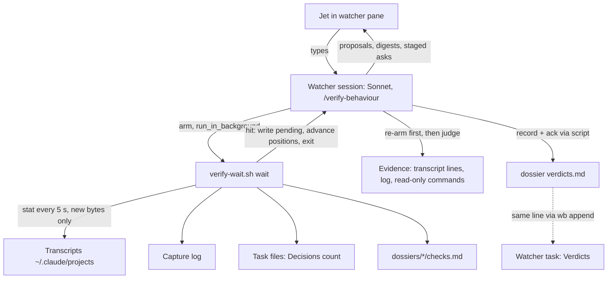
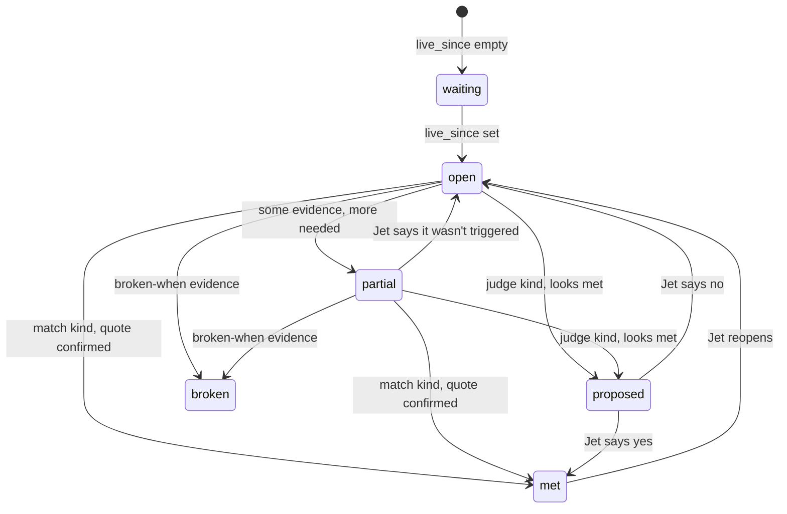

# Verify-behaviour watcher - Plan

## Goal Capsule

- **Objective:** a shipped dotfiles behaviour is confirmed working or flagged broken while Jet works, each verdict quoting its evidence, and what has been verified can be read from disk, without Jet ticking anything.
- **Means:** one standing Sonnet session runs `/verify-behaviour`, sleeps inside a polling wait script that exits only when new content matches an open check's trigger, judges the evidence, records the verdict and re-arms (KTD1, KTD2, KTD3, KTD5).
- **Authority:** Jet's global instructions (`~/.claude/CLAUDE.md`) > the task file's 2026-10-25 Decisions (`~/code/tasks/dotfiles--feat-verify-behaviour.md`) > this plan's Requirements > KTDs > unit Approach.
- **Stop conditions:** stop and ask if the U1 smoke test shows that a background Bash command's exit does not re-invoke an idle interactive session; if `--disallowedTools` cannot deny `Bash(...)` patterns and no `--settings` file fallback works (U3); or if Sonnet with the small auto-compact window cannot finish one wake turn without compacting mid-turn (U6).
- **Execution profile:** about 1.5-2 days. One new skill with one script and its test, one zsh function, two converted check files in the task store, one guide, one memory rewrite, then a live first run.
- **Finishes and ships:** the implementing session commits on `feat-verify-behaviour`, with doc edits in their own commits (the docgen pre-commit hook stages `docs/*.md`). Push and PR only after Jet's OK. Code review runs in a fresh context after `/wb-save`, per Jet's rule.

---

## Product Contract

### Summary

A new skill, `/verify-behaviour`, runs in one long-lived watcher session. Features describe their live checks in a `checks.md` in their task-store dossier. The watcher finds them and waits, at no token cost, until a transcript, the capture log or a task's Decisions shows something a check is waiting for. It then judges the evidence and records "met", "broken" or "not seen yet" beside the checks. Checks that need judgement go to Jet as "looks met, confirm?". Jet can talk to it at any time, and it can ask Jet to stage a check on the spot. The tickable HTML checklist norm is retired in favour of `checks.md`.

### Problem Frame

Live verification of dotfiles features has been handed off as tickable HTML checklists since 2026-07-19 (memory `verification-checklist-html-norm`). In practice they don't get done, and their state can't be seen from disk. PRs #32, #33 and #34 (Jira emit and two follow-ups) merged with their manual gates open, and the live Jira check was never run ([[dotfiles--pr-merge-verification-debt]]). The merge-overseer task ([[dotfiles--chore-merge-overseer]]) found gate status "unknowable from disk", because ticks live in browser localStorage. The capture rework's checklist (`capture-nudge-live-verification.html`) was moved once and has still not run. Jet, 2026-10-25: the checklist is "nice in theory but most of the time it feels like unnecessary work".

The point of a live watcher, rather than an auditor run later, is timing. When a behaviour misfires, the watcher can say so within seconds, while Jet still remembers what was just done, and it can ask Jet to trigger a check right then instead of waiting for real work to produce it.

### Key Decisions

- KD1. **A live watcher replaces hand-ticked checklists.** (session-settled: user-directed — chosen over an on-demand auditor, a scheduled headless auditor and the tickable checklist: the auditor needs remembering, the scheduled one has no conversation and runs up to a day late, and the checklist never gets ticked.) Governs R1, R12, R15.
- KD2. **One shared watcher session for all features.** (session-settled: user-approved — chosen over one watcher per feature: one idle process instead of many.) Governs R1.
- KD3. **Read-only toward other sessions; talks only to Jet.** (session-settled: user-approved — chosen over a watcher that messages sessions: a message starts a turn there and risks feedback loops.) Governs R9.
- KD4. **Checks are a structured `checks.md` per feature, found by glob.** (session-settled: user-approved — chosen over the existing prose `verification.md` items, which the watcher would have to reinterpret on every wake, and over an explicit register step, which is one more thing to forget.) Governs R1, R3.
- KD5. **Judge-kind verdicts need Jet's yes; match-kind checks retire themselves.** (session-settled: user-approved — chosen over the watcher retiring every check itself.) Governs R7, R8.

### Requirements

**Checks**

- R1. One watcher session serves every feature that has checks; a feature takes part by having a `checks.md` in its dossier (`~/code/tasks/dossiers/<task>/checks.md`).
- R2. Every check is in one of these states: waiting (its behaviour is not live yet, R4), open (not seen yet), partial, proposed, met or broken. Every verdict quotes its evidence with the source, the session or task it came from, and a timestamp.
- R3. A check states what wakes the watcher for it, where to look, and what counts as met and as broken, in the fixed field set of KTD3.
- R4. A checks file whose behaviour is not live yet (not merged and stowed) yields no verdicts. Every start digest, and any reply where Jet asks, lists such files with how long they have waited. The session that re-stows the main checkout after a merge sets `live_since` in that feature's `checks.md` in the same step.

**Wakes and cost**

- R5. While nothing relevant happens, the watcher spends no tokens. It wakes only when new content in a watched source matches an open check's trigger, when a checks file appears or changes, or when Jet types to it.
- R6. No relevant event is lost. An event noticed before a crash, an interrupted turn or a restart is still judged afterwards.
- R7. A match-kind check retires on its own once the watcher has confirmed the quoted evidence against its "met when". Every check that retired itself is listed in the watcher's next reply, and Jet can reopen it.
- R8. A judge-kind check goes to Jet as "looks met, confirm?" with its quote. Only Jet's yes retires it.

**Limits**

- R9. The watcher never messages another session, never types into another pane, and never writes another task's file.
- R10. Verdicts are recorded beside the feature's checks in its dossier, and in the watcher's own task file.
- R11. The watcher stays small: Sonnet, a soft memory cap and a small auto-compact window. At start it warns Jet if it was launched without them.

**Conversation and end**

- R12. Jet can ask the watcher anything at any time. The watcher can ask Jet to stage a check, and judges it when Jet says it's done.
- R13. When no open checks remain, the watcher says so and goes dormant, waking again only if a checks file appears or changes.
- R16. When the watcher records "broken" or a new proposal, a marker appears in the tmux status bar of every session and stays until Jet next talks to the watcher.

**Adoption**

- R14. The live checks of the two first consumers exist as `checks.md`: decision propagation (18 checks) and the capture rework (9 checks). Their old checklist pages carry a banner pointing to the new file.
- R15. Guidance that tells agents to hand off tickable HTML checklists is replaced by: write `checks.md`, and the watcher verifies.

### Success Criteria

- Within a working day of the capture rework going live, its match-kind checks have a verdict and its judge-kind checks have been answered by Jet (met or reopened), with no ticking by Jet.
- The watcher's transcript shows no wake turns that lack a trigger hit, a checks-file change or a prompt from Jet, and only a handful per day that end without recording a verdict, partial or proposal.
- Listing `~/code/tasks/dossiers/*/verdicts.md` tells Jet what has been verified, with no browser involved.

### Scope Boundaries

- The watcher does not change how any other session behaves, and the plan adds no hooks to other sessions.
- No `inotify-tools`, no new `wb` verb, and no notifications beyond the status-bar marker (R16).
- Considered and not built:
  - A settle timer for staged, absence and "exactly one" checks. Such checks are held as partial and judged at the next wake or when Jet says "done" (KTD10). Would change if Jet often stages checks and walks away before saying so.
  - A Stop hook that refuses to end a turn while no wait is armed. Re-arming first on every wake, plus a "listening since" line in every reply, covers it (KTD8). Would change if the watcher is found unarmed in practice.
  - Launch settings keyed off a wb-owned marker, so that `wb resume` keeps them. Instead, a session not started by the launch function can't arm and is told to relaunch (KTD9). Would change if restarts through `wb resume` keep happening.
  - A `requires:` command that probes whether a feature is live. A hand-set `live_since:` header does the job (KTD11).
  - Check-to-check dependencies (`after:`). The model reads related checks itself.
  - A liveness heartbeat on `wb board` or the tmux status bar.

#### Deferred to Follow-Up Work

- Setting `live_since:` automatically when a stow lands.
- A `wb verify` shortcut, if the two-step launch (KTD9) proves awkward.
- Rewriting dated plans and the pages in `docs/verification/`. They are history and stay as they are.

### Dependencies

- The capture rework (#110, shelf-only decision capture) is merged to `origin/development`. The main checkout at `~/code/dotfiles` is still one commit behind (`91289c6`, the review-comments fix #109), so the rework is not live until Jet fast-forwards and re-stows. Its checks stay waiting for rollout until then.
- Decision propagation (branch `feat-decision-propagation`) is not merged. Its checks stay waiting for rollout until it merges and is stowed.

### Sources

- Claude Code docs: background commands have no time limit in interactive sessions and survive compaction but end when Claude Code exits (`tools-reference.md`, `context-window.md`, `interactive-mode.md`). The Monitor tool's deadline is at most 30 minutes. Skill `allowed-tools` only pre-approves, so tools are removed with `--disallowedTools`. The model cannot run `/compact` itself, and the auto-compact window is set with `CLAUDE_CODE_AUTO_COMPACT_WINDOW` or `--autocompact` (`model-config.md`). The transcript JSONL format is internal and may change (`sessions.md`).
- The Bash tool contract in this harness says a `run_in_background` command "re-invokes you when it exits". The public docs confirm idle wake-up only for `claude -p`, hence the U1 smoke test.
- `inotify(7)`: lost events and queue overflow, watches tied to inodes, no recursive watching. These are the grounds for KTD2.

---

## Planning Contract

### Key Technical Decisions

- KTD1. **Wake mechanism: one bash wait script run with `run_in_background`, whose exit wakes the idle watcher.** It exits only on:
  - a trigger hit, or pending hits not yet delivered (KTD7);
  - a checks-file change;
  - a refused arm, either a second arm (KTD8) or a session not started by the launch function (KTD9);
  - the parent Claude process being gone (KTD8).

  It never exits on a timer. (session-settled: user-directed — chosen over `ScheduleWakeup` / `/loop` heartbeats, which pay a cold re-read each time, and the Monitor tool, which costs a re-arm turn at least every 30 minutes.) Governs R5.
- KTD2. **Change detection polls every 5 seconds with one `stat` call over all watched files.** The script reads only new bytes since a stored offset, consumes only complete lines, and resets an offset when a file shrinks or its inode changes (the capture log rotates at 5 MB). For task files, which `wb` rewrites whole on every write (`wb.sh:3926`), a changed stat means "recount the `## Decisions` bullets", not "seek to an offset". A `stat` pass over 147 transcripts measured 3 ms. (session-settled: user-directed — chosen over inotify: events land between wakes and are lost, `wb`'s write-then-rename drops file watches, new session folders race a recursive watch, and it adds a `sudo apt` dependency.) Governs R5, R6.
- KTD3. **`checks.md` holds definitions only, in a fixed shape.** A header carries `feature:`, `scope:` (task stems or a family root) and `live_since:`. Each check is a `## <id>. <title>` heading with these fields: `kind:` (match or judge), one or more `trigger:` lines (`<source> /<regex>/`), `evidence:`, `met when:` and `broken when:`. Trigger sources are `transcript`, `capture-log` and `decisions:<task-stem>`. A read-only command may appear under `evidence:` but is never a trigger, because it has no change to poll. The watcher never writes this file. Instantiates KD4. Governs R3.
- KTD4. **Triggers match in two stages.** A cheap regex over the new bytes, then, for transcripts, a `jq` filter keeps only user and assistant message text, plus `type:"attachment"` lines whose `attachment.type` is `hook_additional_context`, matched on `attachment.content`. Hooks inject their output into a session through those attachment lines, so this is where a `[wb-capture]` line reaching an agent would show. The filter drops other attachment types (`skill_listing` also quotes trigger text), subagent hand-backs (`origin.handback`), tool results, and lines from the watcher's own and excluded sessions. The model still checks the quote against `met when` before any verdict. Bare `[wb-propagate]` already matches subagent reports and plan text in three transcripts, and a received peer message is a `type:"user"` line with `origin.kind == "peer"` and a `<cross-session-message ...>` frame. Governs R7.
- KTD5. **Verdicts go to a script-owned `verdicts.md` beside `checks.md`, plus `## Verdicts` in the watcher's task file.** `verdicts.md` is append-only, one line per verdict: time, check id, state, source, quote. A check's current state is its last line. The watcher's task file gets the same line through `wb append`, called inside the script. This revises the confirmed scope, which had verdicts written into `checks.md`. The script, the model and Jet in nvim would race on one file, and the tasks-store guard asks before raw Edit or Write under `~/code/tasks`, which would stall an unattended watcher on a prompt. Governs R10, R2.
- KTD6. **Machine-local state lives in `~/.local/state/wb/verify/`.** It holds the positions (per file: inode, size, offset), the pending hits and the lock. The task Plan had positions kept in the task file. But `wb append` cannot replace text, and every write to the task file would wake the watcher. Governs R6.
- KTD7. **Hits are at-least-once.** The script writes each hit to the pending file before it advances positions, and marks it delivered when it prints it. A new arm exits at once only for hits not yet delivered, so the re-arm at the top of a wake turn (KTD8) waits normally instead of re-delivering the hits being handled. `status` lists every hit not yet acked, delivered or not. The start sequence and every wake turn judge from that list, which is how hits from an interrupted turn are recovered. The model acks each hit through the script after recording its verdict. Hits are deduplicated by file and byte offset, and peer messages also by `origin.msg_id`, because a message received mid-turn also appears as `queue-operation` lines. Governs R6.
- KTD8. **One wait at a time, re-armed first.** A lock holds the process id and start time. A second arm prints `ALREADY-ARMED` and exits, and the skill's rule is to do nothing on that output. Each wake turn re-arms before judging, so an interrupted turn still leaves a wait running, while the pending hits (KTD7) keep the event. The script exits when the parent Claude process is gone, so a stale lock is taken over. Every watcher reply ends with a "listening since …" line. Governs R5, R6.
- KTD9. **Launch through a zsh function `verify-behaviour`, beside the `claude` wrapper in `zsh/.zshrc`.** It sets `WB_AGENT_MEM_HIGH=1G` and a small `CLAUDE_CODE_AUTO_COMPACT_WINDOW`, then calls the `claude` wrapper with `--model sonnet`, `--disallowedTools` and the prompt `/verify-behaviour`. The denied tools are `SendMessage`, `Edit`, `Write`, `NotebookEdit`, `Bash(tmux send-keys:*)`, `Bash(tmux paste-buffer:*)`, `Bash(wb append:*)`, `Bash(wb set:*)` and `Bash(wb status:*)`. The watcher runs in a standing, parentless wb task `dotfiles--verify-behaviour-watcher`. It has no parent so that it never joins a propagation family. Jet starts it with `wb new dotfiles verify-behaviour-watcher` (without `--agent`) and types `verify-behaviour` in the agent window. A restart means typing it again: a fresh session, with all state on disk. The function also exports a marker variable, and the wait script refuses to arm without it, printing `BAD-LAUNCH`. A background command inherits the session's environment, so a session resumed through `wb resume` (which pre-types a plain `claude --resume <id>`, `wb.sh:1884`) cannot arm, and the watcher tells Jet to quit and relaunch with `verify-behaviour`. (session-settled: user-approved — memory cap through `WB_AGENT_MEM_HIGH`, chosen over a `wb` change or setting it by hand with `systemctl`.) Conflict call-out: the settled choice assumed the variable could be passed through `wb new --agent`. But `wb` types only the bare word `claude` (`wb.sh:1290`) and the pane shell is started by the tmux server, so the function sets it instead, keeping "no `wb` change". Governs R9, R11.
- KTD10. **No timers, even for staged, absence and "exactly one" checks.** The model holds such a check as partial, with a note, and re-judges it at the next wake or when Jet says "done" or "check now". Upholds KTD1. A settle timer was considered and not built (see Scope Boundaries). Governs R12.
- KTD11. **A `live_since:` header gates verdicts.** Empty means waiting for rollout. Transcripts of sessions that started before `live_since` don't count as evidence, because skills and hooks are loaded when a session starts. The first time a file is seen live, the script runs a one-off `scan --since` over that file's trigger sources, with at most 20 quoted hits per check, so behaviour that happened before the watcher started is still judged. Governs R4, R6.
- KTD12. **Context stays small without self-compaction.** The model cannot run `/compact` itself, so the launch sets a small auto-compact window, and background commands keep running through compaction. Each wake turn reads the pending hits, judges, records, acks and stops. Long reasoning goes into the verdict line, not the conversation. Governs R11.
- KTD13. **A start-up self-test guards against transcript format drift.** `selftest` parses the newest transcript lines and checks for the keys the filters rely on (`type`, `message`, `origin`, `attachment`). If they are missing, the watcher tells Jet it can't trust transcript triggers instead of quietly seeing nothing. The tests pin today's frame shapes in invented fixtures. Governs R5.

- KTD14. **The status-bar marker is one global tmux user option.** `record` sets `@verify_alert` (for example a count of checks broken or proposed since Jet last looked) with `tmux set -g`, so it shows in every session's status bar, wherever Jet is working. A `seen` subcommand clears it, and the watcher runs `seen` at the start of every turn Jet starts. `tmux.conf` prepends `#{@verify_alert}` to `status-right` with the same run-once guard the capture count uses (`tmux/.config/tmux/tmux.conf:185`). Only this one option is written, and the deny list still blocks `tmux send-keys`. (session-settled: user-directed — chosen over keeping verdicts visible only in the watcher's pane: a misfire must reach Jet while it is fresh.) Governs R16.

### High-Level Technical Design

How the pieces connect, and one wake cycle:



Check states (KD5, KTD10):



Shape of a check (directional sketch, not a spec):

```text
feature: <task-stem>          scope: <family root or task stems>     live_since: <ISO time or empty>

## <id>. <title>
kind: match | judge
trigger: transcript /<regex>/            (one or more; any wakes the watcher)
trigger: capture-log /"event":"<name>"/
trigger: decisions:<task-stem> /.*/
evidence: <where to look; may name a read-only command>
met when: <observable condition>
broken when: <observable condition>
```

### Output Structure

```text
claude/.claude/skills/verify-behaviour/
  SKILL.md
  references/checks-format.md
  scripts/verify-wait.sh
scripts/.config/scripts/tmux/tests/verify-wait.test.sh
docs/guides/verify-behaviour.md
```

The check files themselves live in the task store, not the repo: `~/code/tasks/dossiers/<task>/checks.md` and `verdicts.md`.

### System-Wide Impact

- **Decision capture.** The watcher is a wb session, so the capture sweep also drafts from its transcript at checkpoints. Since the capture rework, sweeps run only at `/wb-save` and `/close-out`, so the cost is small. The watcher's own capture-log lines are excluded from its triggers (U1).
- **`wb board` and the picker.** The watcher's task stays in progress indefinitely. That is intended: it is a standing task, and it is closed with `wb done` only when Jet retires the watcher.
- **Task store git history.** `verdicts.md` files and the watcher's `## Verdicts` section are new writes in the store. They are committed by the store's own flow, like every other store write; the watcher runs no git commands.
- **Propagation.** The watcher task has no parent, so decision propagation never treats it as a family member to message (KTD9). As a received-message recipient it would anyway start a turn, which the read-only rules don't prevent; having no parent is what keeps it out.
- **Memory pressure.** The watcher's scope has the lowest `MemoryHigh` of any agent, so under pressure the kernel reclaims from it first, and its `MemoryMax` is unchanged.

---

## Implementation Units

### U1. The wait script

- **Goal:** one script that does every mechanical part of watching, so that each wake turn only judges.
- **Requirements:** R2, R4, R5, R6, R7, R10, R13, R16; KTD1-KTD9, KTD11, KTD13, KTD14.
- **Dependencies:** none.
- **Files:** `claude/.claude/skills/verify-behaviour/scripts/verify-wait.sh`; test `scripts/.config/scripts/tmux/tests/verify-wait.test.sh`.
- **Approach:**
  1. Subcommands (names directional): `wait`, `status`, `list` (open checks and their last verdict, across all `checks.md`), `ack <hit-id>`, `record <checks-file> <id> <state> <quote> <source>`, `seen` (clears the status-bar marker, KTD14), `scan --since <time> <checks-file>`, `selftest`.
  2. `wait` parses every live `checks.md`, builds the trigger set from open and partial checks, and polls per KTD2. It exits with a short hit list (check id, source, file, offset range, the matching line) per KTD4 and KTD7.
  3. The exclusions of KTD4 are fixed in the script: the watcher's own transcript folder, which is its worktree's encoded path (see `wb_transcript_dir`, `wb.sh:392`), its own task file, the state directory, every `verdicts.md`, and capture-log lines whose `task` is the watcher's.
  4. `record` appends to `verdicts.md` by writing a temp file and renaming it in the same directory, then calls `wb append dotfiles--verify-behaviour-watcher Verdicts`. Calling `wb append` inside the script keeps it off the model's denied list (KTD9).
  5. Paths come from overridable variables (`TASKS_DIR`, `XDG_STATE_HOME`, `CLAUDE_PROJECTS_DIR`), so tests run on fixtures.
- **Execution note:** before writing the script, run a two-minute live check: in an idle interactive session, a `run_in_background` `sleep 20; echo hit` must start a new turn when it exits. If it doesn't, stop (Goal Capsule). Then build the poll and position logic test-first.
- **Patterns to follow:** a single `stat` over many files (`wb.sh:417`); a `stat -c … || stat -f …` fallback (`wb-status.test.sh:120`); write-then-rename (`wb.sh:3926`); the `log_event` field names (`wb-capture.sh:560`); running a skill script from the suite (`decision-buffer-open.test.sh:25`). In hot loops use glob tests, not `${x//[[:space:]]/}` (memory `bash-class-substitution-quadratic`). Use `/usr/bin/grep` or `awk`/`jq` inside the script.
- **Test scenarios:**
  - Happy path: a fixture transcript gains a peer-message line whose body starts with the trigger text; `wait` exits within one poll and the hit names the check id and the quoted line.
  - Happy path: a capture-log line with a matching `event` wakes `wait`; a non-matching line does not.
  - Happy path: a `## Decisions` bullet added to a fixture task file through a write-then-rename wakes a `decisions:<stem>` trigger; an edit under `## Handoffs` alone does not.
  - Edge: a subagent hand-back line and a tool result that quote the trigger text do not wake `wait` (KTD4).
  - Edge: a `hook_additional_context` attachment line carrying the trigger text wakes `wait`; a `skill_listing` attachment with the same text does not (KTD4).
  - Edge: a half-written line (no trailing newline) is not consumed; once the line completes, it is.
  - Edge: the capture log rotates (renamed, then recreated smaller); the offset resets and no line is skipped or read twice.
  - Edge: a new `checks.md` appearing, or an existing one changing, makes `wait` exit with a checks-changed result.
  - Edge: a file with an empty `live_since` contributes no triggers, and `list` shows its checks as waiting for rollout.
  - Edge: transcripts whose first line is older than `live_since` are not scanned for that file's checks.
  - Error: pending hits not yet delivered make a new `wait` exit at once with those hits. Hits already delivered but not acked do not make it exit again, and `status` still lists them until `ack` (KTD7).
  - Error: a second `wait` while one holds the lock prints `ALREADY-ARMED` and exits without touching positions; a lock whose process id is dead is taken over (KTD8).
  - Error: `wait` without the launch marker in its environment prints `BAD-LAUNCH` and exits without touching positions or the lock (KTD9).
  - Integration: the watcher's own transcript folder, its own task file and every `verdicts.md` are written to during a `wait`, and none of them wakes it.
  - Integration: `record` appends one line to `verdicts.md` and, with a stubbed `wb` on PATH, calls `wb append` once with the watcher's task and the `Verdicts` heading.
  - Integration: `scan --since` over a fixture history returns at most 20 hits per check and doesn't move the stored positions.
  - Integration: with a stubbed `tmux` on PATH (one fixed `-L` socket, `-f /dev/null`), `record … broken` and `record … proposed` set the global `@verify_alert` option; `record … met` alone does not; `seen` unsets it (KTD14).
  - Integration: `selftest` passes on a fixture with today's keys and fails loudly when `origin` and `message` are missing.
- **Verification:** the new test file passes in the Docker image on its own; the U1 live check is recorded in the build task's Handoffs.

### U2. The skill: the watcher's brief

- **Goal:** `SKILL.md` and a format reference that make Sonnet a reliable, cheap watcher.
- **Requirements:** R2, R7, R8, R9, R11, R12, R13; KTD3, KTD8, KTD10, KTD12.
- **Dependencies:** U1.
- **Files:** `claude/.claude/skills/verify-behaviour/SKILL.md`; `claude/.claude/skills/verify-behaviour/references/checks-format.md`.
- **Approach:**
  1. Start sequence:
     - Check the launch environment and warn Jet if it's wrong (R11).
     - Run `selftest`.
     - Run `list`, then `scan --since` for any newly live file.
     - Judge any hits `status` still lists as not acked (KTD7).
     - Report open, partial and proposed checks in one short digest, with every file still waiting for rollout and how long it has waited (R4), then arm.
  2. Wake turn: re-arm first, then take every not-yet-acked hit from `status`. For each, read only the cited evidence, judge it against `met when` and `broken when`, then `record` and `ack`.
  3. Reply rules: list the checks that retired themselves this turn (R7) and the numbered proposals for Jet (R8). End with the "listening since" line (KTD8) and one count line: proposals awaiting Jet's answer, and open checks with no hit since `live_since`. On `BAD-LAUNCH`, tell Jet to quit and relaunch with `verify-behaviour`, and don't retry.
  4. Conversation: on every turn Jet starts, run `seen` first (R16); answer Jet; stage checks on request ("record a decision that touches only this task, then tell me done"); re-judge partial checks when Jet says done (KTD10).
  5. Hard rules, stated generically with no work names: never message or type into another session, never write files except through the script, never re-arm on `ALREADY-ARMED`.
  6. Wind-down: with no open checks, say so and arm a wait that watches only the checks files (R13).
  7. `checks-format.md` is the authoring guide for features, with the field set from KTD3, a worked example built on invented names, and how to pick a trigger that won't match quoted text.
- **Patterns to follow:** frontmatter with only `name` and `description` (as in `claude/.claude/skills/wb-decide/SKILL.md`); the rule against Edit or Write on task files checked in `wb-append.test.sh:437-460`.
- **Test scenarios:**
  - Static: `SKILL.md` contains no instruction to Edit or Write a task file, and no `SendMessage` (extend the `wb-append.test.sh` scan to cover this skill).
  - Static: `SKILL.md` contains no work identifiers (no ticket keys, no employer repo names), as a grep over a small deny list in the same test.
  - The judging behaviour itself is model-driven and is proved live in U6.
- **Verification:** a human read-through against R7-R13; the static scan passes.

### U3. Launch function and status-bar marker

- **Goal:** one command that starts a correctly configured watcher, and a status bar that shows its alerts.
- **Requirements:** R9, R11, R16; KTD9, KTD14.
- **Dependencies:** U2.
- **Files:** `zsh/.zshrc`; `tmux/.config/tmux/tmux.conf` (prepend `#{@verify_alert}` to `status-right`, KTD14); test `scripts/.config/scripts/tmux/tests/wb-claude-wrapper.test.sh`.
- **Approach:** define `verify-behaviour` inside the `wb-claude-wrapper:begin`/`:end` markers, so that the existing test extracts it alongside `claude()`. It sets the two variables for that one call and passes `--model sonnet`, the deny list and the prompt. If `--disallowedTools` won't take `Bash(...)` patterns, pass an equivalent deny list through `--settings` with a small JSON file kept beside the skill.
- **Test scenarios:**
  - Happy path: inside a wb tmux pane (stubbed), `verify-behaviour` reaches the stubbed `systemd-run` with `MemoryHigh=1G` and runs the stubbed `claude` with `--model sonnet`, every denied tool, the launch marker in its environment, and the `/verify-behaviour` prompt.
  - Edge: outside tmux, it still passes the model, deny list and prompt (the wrapper falls through to plain `claude`).
  - Edge: the variables don't leak into the calling shell after the function returns.
- **Verification:** the wrapper test passes in Docker. One manual launch shows the watcher's start-up digest with no environment warning, in auto permission mode, so script calls don't wait on prompts. After a tmux reload, `tmux set -g @verify_alert test` shows in the status bar of another session.

### U4. Convert the first consumers' checks

- **Goal:** the two existing checklists become `checks.md` files the watcher can read.
- **Requirements:** R14; KTD3, KTD11.
- **Dependencies:** U2 (the format reference).
- **Files (task store, not the repo):** `~/code/tasks/dossiers/dotfiles--feat-decision-propagation/checks.md` (18 checks, `live_since:` empty); `~/code/tasks/dossiers/dotfiles--feat-capture-nudge-rework/checks.md` (9 checks, `live_since:` empty until Jet re-stows). Add a retire banner to `verification.md` and to `capture-nudge-live-verification.html` pointing to the new files.
- **Approach:**
  1. Classify each check as match or judge using the tallies in the research: about 6 of the 18 propagation checks are match, and 5-6 of the 9 capture checks.
  2. Anchor every propagation trigger on the received-message frame (KTD4).
  3. Checks only Jet can see, such as the status-bar colour, are `judge` with `evidence: Jet`.
  4. The capture rework's four rollout steps are not checks; they become a note in the file header.
  5. The build session writes these files; the tasks-store guard will ask before each write, as expected. The watcher itself never writes them.
- **Test scenarios:**
  - `list` on the two real files parses every check, with no unknown fields and 27 checks in total.
  - `scan --since` with a recent date over the capture file returns only lines from the matching log events.
- **Verification:** `list` shows 27 checks waiting for rollout; both old pages show the banner.

### U5. Guide, norm and docs

- **Goal:** the new way is documented, and the old norm stops being taught.
- **Requirements:** R15.
- **Dependencies:** U2, U3.
- **Files:** `docs/guides/verify-behaviour.md` (sections per `docs/guide-format.md`); `readme.md` (the "Verification checklist" section points to the guide); the memory `verification-checklist-html-norm.md` and its `MEMORY.md` line (outside the repo: rewrite to "write `checks.md`, the watcher verifies", with the date and reason); the memory `feedback-stow-after-dotfiles-merge.md` (add: the re-stowing session sets `live_since` in the merged feature's `checks.md`, R4).
- **Approach:** the guide covers what the watcher is, how to start and restart it (KTD9: never through `wb resume`), how to write a check, what each state means, and the known rough edges (judge quality on fuzzy checks, transcript format drift). Commit the guide separately from code; the docgen hook regenerates `docs/INDEX.md`, `docs/HUB.html` and `docs/try-it.*`.
- **Test expectation:** none, because this unit is documentation. Docgen succeeding in the pre-commit hook is the check.
- **Verification:** the guide tile appears on the Hub, and a search of the memory directory and `claude/` finds no instruction to produce tickable HTML checklists.

### U6. Live rollout and first run

- **Goal:** the watcher runs for real and verifies the capture rework, as proof of R5-R8.
- **Requirements:** R1, R4, R5, R6, R12, R13; Success Criteria.
- **Dependencies:** U1-U5, and Jet fast-forwarding and re-stowing the main checkout (Dependencies).
- **Files:** none in the repo. In the store: `~/code/tasks/dotfiles--verify-behaviour-watcher.md`, created by `wb new`; `live_since:` set in the capture rework's `checks.md`.
- **Approach:**
  1. After Jet re-stows, set `live_since` and start the watcher (KTD9).
  2. Work normally for a day.
  3. Check the watcher's start-up digest, its first hits, one staged check Jet triggers on request, one judge proposal answered, and a restart that picks up pending hits.
  4. Record what happened in the build task's Handoffs. The watcher's own verdicts are the evidence; no checklist is written for the watcher.
- **Test expectation:** none, because the live run is the test.
- **Verification:** at least one self-retired match check and one Jet-confirmed judge check in the capture rework's `verdicts.md`, and no unexplained wake turns in the watcher's transcript.

---

## Verification Contract

| Gate | Command or check | Applies to |
|---|---|---|
| Script tests | `docker build -t wb-tests -f scripts/.config/scripts/tmux/tests/Dockerfile .` then `docker run --rm -v "$(pwd)":/repo:ro -w /repo wb-tests bash scripts/.config/scripts/tmux/tests/verify-wait.test.sh` | U1 |
| Wrapper test | the same `docker run` with `wb-claude-wrapper.test.sh` | U3 |
| Skill scan | the same `docker run` with `wb-append.test.sh` | U2 |
| Full suite | the full Docker run, judged by the per-file FAIL set against a clean-room `development` baseline (12 environment-dependent files are known to fail); clean-room copy under `~/.cleanroom/verify-behaviour-baseline/` | before PR |
| Docs | the pre-commit docgen run succeeds and `git restore --staged docs/` leaves nothing stray | U5 |
| Live | U1's wake check, and U6's first run recorded in the build task's Handoffs | U1, U6 |

---

## Definition of Done

- U1-U5 are committed on `feat-verify-behaviour`, with docs in their own commits, and their gates in the Verification Contract pass.
- Both `checks.md` files exist in the task store, and `list` reads all 27 checks.
- The memory norm is rewritten, and no instruction to produce tickable checklists remains in the memory directory or `claude/`.
- U6 has run, or is recorded as waiting only on Jet's re-stow.
- No experimental or abandoned code is left in the diff; dated plans and `docs/verification/` pages are untouched.
- A `/wb-save` with a run directive for the fresh-context code review is written before the PR.

---

## Risks

| Risk | Mitigation |
|---|---|
| A background command's exit may not wake an idle interactive session (the docs only confirm it for `claude -p`). | The U1 live check runs first; it is a stop condition. |
| The transcript format is internal and may change between Claude Code versions. | `selftest` at start (KTD13); the triggers are kept in one filter in the script. |
| Sonnet misjudges fuzzy checks. | Judge checks need Jet's yes (KD5); every verdict quotes its evidence. |
| `MemoryHigh=1G` throttles the watcher until it stalls (idle Claude processes measured 250-490 MB). | `MemoryMax` stays at the 18G default; raise `MemoryHigh` to 1.5G if U6 shows throttling. |
| A small auto-compact window compacts in the middle of a wake turn. | Turns are kept short (KTD12); U6 checks for it, and it is a stop condition. |
