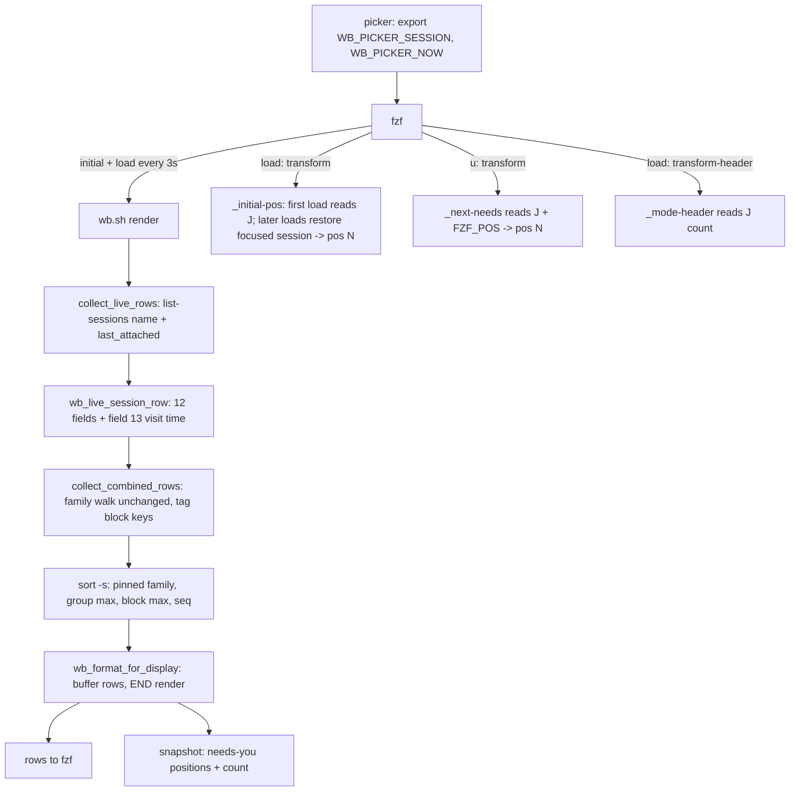

# wb Picker Grouping and Visual Rework - Plan

## Goal Capsule

- **Objective:** When Jet opens the wb picker, rows from one repo sit together in the order Jet last visited them, the session Jet is in heads the list, an agent waiting on Jet is impossible to miss, and the list holds still while it is open.
- **Means:** Re-sort the picker's existing rows by repo group and last-visit time inside `collect_combined_rows`, and slim the display to name, branch and age, with status carried by colour (KTD1, KTD3).
- **Authority:** The task file `~/code/tasks/dotfiles--fix-wb-picker-grouping.md` `## Decisions` section records every product choice. This plan's Requirements restate them with IDs. Where the two disagree, the task file wins and the plan is corrected.
- **Stop conditions:** Stop and report if picker render time rises above the 0.67 s baseline by more than 10% after a unit lands. Also stop if a settled decision proves unbuildable in fzf 0.65.2. One example is the cursor not staying put across refreshes even with KTD5's mitigation.
- **Execution profile:** Bash and awk inside `scripts/.config/scripts/tmux/wb.sh`, tests in the Docker sandbox, live checks by Jet in tmux.
- **Who finishes:** The build session implements U1-U7 with `/wb-save` between phases. U8 waits on other PRs. The final `/ce-code-review` runs in a fresh context after U8.

---

## Product Contract

### Summary

Group the picker's live rows by repo, keeping parent/child families whole, and order groups and rows by when Jet last visited them. The family of the current session is pinned to the top with Jet's own row greyed. Drop the TYPE and STATUS text columns in favour of status colour on the name, a short age column and a colour legend. Make rows that need Jet findable with a highlight, a header count, a jump key and the starting cursor. The preview, header and branch column get the small fixes Jet picked from the visual sweep, and a multi-byte padding bug is fixed.

### Problem Frame

The picker sorts live rows by urgency rank first (`wb.sh` `collect_combined_rows`, `sort -k4,4n -k1,1 -k2,2`). On 2026-10-25, 14 of 21 live rows shared rank 1 ("done"), so the rank told Jet little but still split each repo into a "done" block and a "working" block. The dotfiles rows landed at positions 14-16 and 17, 20, 21. Because the picker re-renders every 3 seconds, rows also moved whenever an agent flipped between working and done. The urgency-first order was chosen on 2026-07-06 (`docs/archive/roadmap-wb-design.md`), when the picker listed every store task. It now shows live sessions only, about 20 rows, with dormant tasks on their own tab.

### Key Decisions

- **Group by repo, order by last visit; no "needs you" band.** (session-settled: user-approved — chosen over keeping urgency first or adding a needs-you band at the top: families with a member needing Jet held 12 of 21 rows, so a band would take over the list and move whole families on every refresh.) Governs R1, R2, R3, R4.
- **Current session's family pinned to the top, Jet's row greyed.** (session-settled: user-directed — chosen over pinning only Jet's row to the bottom: moving just a parent's row would strand its children's nesting.) Governs R5.
- **Status by colour only, on the name; TYPE and STATUS columns dropped.** (session-settled: user-directed — chosen over relabelling "done" to "ready" and colouring only a STATUS cell: the text columns used width, and whole-row colour made 13 of 22 rows green.) Governs R7, R8, R9.
- **AGE column replaces STATUS.** (session-settled: user-approved — chosen over losing age entirely: the dormant tab's only age display was in the STATUS text.) Governs R10.
- **Needs-you findability: start cursor plus magenta group repo, on top of highlight, count and jump key.** (session-settled: user-approved — chosen over showing time-since-blocked, which needs a notify-hook change, and floating needs-you rows within a family, which brings back reshuffling.) Governs R11, R12, R13, R14.

### Requirements

**Grouping and order**

- R1. Live rows are grouped by repo. A parent/child family (including a sibling group anchored on a shared non-live parent) stays contiguous and sits in the group of its root row's repo. Rows from another repo inside a family keep their own repo name.
- R2. Groups are ordered by the most recent visit of any row in the group. Within a group, families are ordered by the most recent visit of any member. Within a family, existing nesting order is kept, with children ordered by most recent visit. Ties break by repo name, then label.
- R3. A visit time is tmux's `session_last_attached` for the row's session. A session never attached sorts as oldest.
- R4. The dormant tab is grouped by repo the same way and ordered by newest transcript time in place of visit time.
- R5. The family containing the current session goes to the top of the live list, outside the R2 order, as a group of its own; the rest of that repo's rows still form their normal group below. The current session's own row is greyed and tagged `(here)`, and the rest of the family renders normally with its nesting. The own row never counts as needing Jet, even when its agent is waiting: it gets no needs-you highlight and is excluded from R11, R12, R13 and R14. Without a known current session (for example `wb render` run outside the picker), no row is pinned or tagged.
- R6. The order does not change while the picker is open unless a session starts, ends or changes family. A status change alone never moves a row.

**Row display**

- R7. The TYPE and STATUS text columns are removed. The visible columns are REPO, NAME, BRANCH and AGE.
- R8. Status is shown by the colour of the NAME cell. REPO, BRANCH and nesting connectors are grey. A row that needs Jet is bold reverse-video. On the dormant tab, NAME is coloured by task status (doing, review, paused) and no row ever counts as needing Jet.
- R9. The fzf header carries a one-line colour legend naming each status colour shown on the current tab (live statuses on LIVE, task statuses on DORMANT).
- R10. AGE is at most 4 characters (`now`, `12m`, `3h`, `4d`): time since last visit on the live tab, age of the newest transcript on the dormant tab. Ages are measured against the moment the picker opened, so they do not tick while it stays open.
- R11. A group's repo name is magenta on the group's first row when any row in the group needs Jet.
- R15. NAME takes the width freed by the dropped columns, sized from the picker's list width.
- R16. A BRANCH value too long for its column shows its end with a leading `...`; a short branch shows whole.
- R17. Names with multi-byte characters (`·`, `—`, accented letters) are truncated and padded by character, never cut mid-character, under the host's mawk.

**Finding rows that need Jet**

- R12. The live-tab header shows how many rows need Jet (`2 need you`), kept current on every refresh. The dormant-tab header has no count.
- R13. On the live tab, `u` moves the cursor to the next row that needs Jet, wrapping to the first. With none, or on the dormant tab, it does nothing.
- R14. When the picker opens, the cursor starts on the first row that needs Jet. If none does, it starts on the first row after Jet's own row. If Jet's row is last or there is no current session, it starts on the first row.

**Header and preview**

- R18. The header drops the follow-up and capture counts, and its keybind hint fits in 120 columns and lists `ctrl-r`, `l`/`h`, `g`/`G` and `u`.
- R19. The preview for a row with an agent pane shows the bottom of that pane.
- R20. The preview for a task row with no pane shows the task's title, one status/branch line and its latest Handoff written by an agent, skipping automatic entries.
- R21. The preview label names what is shown (pane, task, git status). A row with nothing to preview shows `nothing to preview` instead of a git error.

**Follow-through**

- R22. After this rework lands and PRs #111 (decision propagation) and #112 (Claude reply log) have merged, a `/ce-optimize` sweep targets picker render time. PR #96, the wb Go-port planning PR, is not part of this gate.

### Success Criteria

- On Jet's real sessions, apart from the pinned family, every dotfiles family is contiguous within one dotfiles group, and the list opens with the current session's family on top.
- Picker render time (live tab) stays at or below the 0.67 s baseline measured on 2026-10-25.
- The cursor does not move on a 3-second refresh when nothing about the row under it changed.

### Scope Boundaries

- Not porting the picker to Go; the Go store plan (PR #96) leaves the picker in bash.
- Not changing `claude-sessions.sh`'s own `render_rows`, `wb board`, or `wb_pending_counts` (its other caller is the `wb done` nudge).
- Considered and not built: a toggle key between orderings (Jet prefers one default); time-since-blocked on needs-you rows (needs `claude-notify-hook.sh` to record a timestamp); floating needs-you rows within a family (reintroduces reshuffling); a colour-key footer separate from the header legend (the legend in R9 covers it).

---

## Planning Contract

### Key Technical Decisions

- KTD1. **Sort keys travel as one appended field; ordering happens in one final stable sort.** `collect_live_rows` adds `#{session_last_attached}` to its existing `tmux list-sessions` call and `wb_live_session_row` appends it as field 13. `collect_dormant_rows` puts the newest-transcript epoch in the same field. A **block** is the unit R1 keeps contiguous: one family, or one sibling group anchored on a shared non-live parent, with its agent sub-rows. `collect_combined_rows` keeps its root-climb and anchor logic, walks each block's children in visit-time order (not urgency order), tags each emitted row with block keys (pinned flag, group max, block max, sequence), then orders with one `sort -s` and strips the keys. Appending at the end keeps every fzf bind placeholder (`{7}`-`{10}`) and the accept path's field indexes unchanged. Zero added forks. Governs R1-R6.
- KTD2. **The current session and a frozen "now" reach every fzf child through the environment.** `picker()` exports `WB_PICKER_SESSION` (from `tmux display-message -p '#S'`, the repo's idiom) and `WB_PICKER_NOW` (epoch at open) before launching fzf. `render`, `transform` and preview children inherit both. Unset means no pinning and the real clock, which keeps `wb render` and tests working. Governs R5, R10.
- KTD3. **Needs-you comes from urank; colour comes from the field-5 label.** Live urank 0 (per `tmux_claude_panes`) is the only needs-you signal, feeding the highlight, R11's magenta, the count and the jump targets, and never on the current session's row. Urank cannot pick colours by itself: `finished` and `done` share rank 1. So the NAME colour comes from the stored field-5 label (finished cyan, done green, working yellow, anything else grey), and dormant rows map their status word (doing, review, paused) to their own colours. Field 5 keeps its stored shape, so the existing test stubs (`wb_session_urgency` printing `0\t! needs you…`) stay valid. Governs R5, R8, R11, R12.
- KTD4. **The display awk buffers all rows and renders in END.** Group-level facts (repo has a needs-you row, first row of group) need a look-ahead. One awk over all rows keeps the "no per-row forks" pattern of `wb_format_for_display`. On the live tab the same pass writes a snapshot file next to the view file, holding needs-you list positions plus the count, for R12-R14 to read. The snapshot is written to a temp file and moved into place, so a `u` press never reads a half-written file. Governs R11-R14.
- KTD5. **Freeze AGE and restore the cursor by session after each reload.** fzf 0.65.2 has no `--id-nth`, so `--track` matches the whole raw line, and a changed line loses the cursor on reload. Two causes, two fixes. Ages are computed against `WB_PICKER_NOW`, so they never change mid-session. A status flip still changes the line (colour codes and hidden fields 4 and 5), so a `focus:execute-silent` records the focused session to a per-picker file, and the `load` bind runs a `transform` that prints `pos(N)` for that session's new position. Governs R6.
- KTD6. **The initial cursor is a one-shot transform, not a `start` bind.** `load` fires after every 3-second reload, so `pos()` there would yank the cursor each cycle. `start` needs `--sync`, whose interaction with `--select-1` and the reload loop is untested. Instead, the `load` bind runs a `transform` helper that prints `pos(N)` only when a per-picker flag file is absent, then creates it. Governs R14.
- KTD7. **`u` is a `transform` helper reading the render snapshot.** The helper reads `FZF_POS` and the snapshot's needs-you positions and prints the next `pos(N)`, wrapping. Whether `pos()` counts the `--header-lines` legend row is unspecified in the fzf man page, so the first live check settles the offset. Governs R13.
- KTD8. **The header refreshes on every reload, and only cheap sources feed it.** Remove `wb_pending_counts` from `wb_status_line` (it runs a whole-store awk). Add `transform-header` to the `load` bind, reading the count from the snapshot file. Governs R9, R12, R18.
- KTD9. **The preview moves into a `_preview` helper verb.** The inline preview string becomes `"$SELF" _preview {7} {9} {10}`, which tails the pane, summarises a task file or shows git status, and prints the fallback. The label updates via `focus:transform-preview-label`. Governs R19-R21.
- KTD10. **`pad()` counts characters by subtracting UTF-8 continuation bytes, with awk forced byte-wise.** The formatter awk runs under `LC_ALL=C`, so mawk and gawk both count bytes; gawk in a UTF-8 locale would otherwise count characters and the subtraction would undercount. `pad()` counts bytes matching `[\200-\277]` on a copy and walks truncation back off continuation bytes, with no fork. Double-width CJK still miscounts and is accepted. The Docker image gains `mawk` so a test can run the formatter under it. Governs R16, R17.
- KTD11. **List width comes from `FZF_COLUMNS` with a `tput cols` fallback, computed once per render.** NAME width is the list width (45% of the terminal, beside the 55% preview) minus the fixed columns. Governs R15.

### High-Level Technical Design

Render path after the change. Field 13 carries the sort time. The snapshot file is the one new side channel.

Block-key order (directional): a row's key is `pinned? 0 : 1`, then `-group_max`, then repo, then `-block_max`, then the block's first label, then emission sequence. The pinned block is excluded from its repo's group max, so the rest of that repo sorts as if the pinned block were absent. Rows inside a block share every key but the sequence, so the stable sort keeps the walk's own order.

### Assumptions

- `session_last_attached` updates on `switch-client`, not only on a client attach. The 2026-10-25 snapshot showed distinct recent values across sessions reached by switching, which supports this. U2 confirms it with a read-only check before U3 builds on it.
- `FZF_COLUMNS` is exported to `reload` and `transform` children in fzf 0.65.2. If it is absent, KTD11's `tput cols` fallback applies.

### Sequencing

U1 is independent. U2 must land before U3. U4 depends on U2 and U3. U5 depends on U4's snapshot. U6 is independent of U3-U5. U7 follows everything. U8 is gated (R22).

---

## Implementation Units

### U1. Character-aware padding under mawk

- **Goal:** Truncation and padding never cut or miscount multi-byte characters.
- **Requirements:** R17; KTD10.
- **Dependencies:** none.
- **Files:** `scripts/.config/scripts/tmux/wb.sh` (`wb_format_for_display` `pad()`), `scripts/.config/scripts/tmux/tests/Dockerfile` (add `mawk`), `scripts/.config/scripts/tmux/tests/wb-picker-grouping.test.sh` (new).
- **Approach:** Replace `pad()`'s `length`/`substr` with a char count (byte length minus continuation-byte count) and a truncation that steps back off continuation bytes. Add a tail-truncation variant for U4's branch column.
- **Patterns to follow:** The ASCII-only `...` truncation rationale already commented in `pad()`.
- **Test scenarios:**
  - Under mawk (PATH shim pointing `awk` at `mawk`), a name containing `·` truncated at the NAME width renders no `\357\277\275` (replacement char) and no split byte sequence.
  - A short name with `—` pads to the same visible character width as an ASCII name of equal character length.
  - The same two cases under gawk give identical output.
  - A pure-ASCII row renders byte-identical to before the change.
- **Verification:** Both awks produce equal-width rows for the 2026-10-25 snapshot's `/verify-behaviour ·` row.

### U2. Visit time and picker environment

- **Goal:** Every row carries its visit time, and every fzf child knows the current session and the frozen open time.
- **Requirements:** R3, R4, R5, R10; KTD1, KTD2.
- **Dependencies:** none.
- **Files:** `scripts/.config/scripts/tmux/wb.sh` (`collect_live_rows`, `wb_live_session_row`, `collect_dormant_rows`, `wb_agent_subrows`, `picker`, the row-schema comment), `scripts/.config/scripts/tmux/tests/wb-picker-rows.test.sh`, `scripts/.config/scripts/tmux/tests/wb-parent-child.test.sh`.
- **Approach:**
  1. Add a small seam, `wb_session_last_attached` (or an equivalent argument path), that tests can override, since detached test sessions report no attach time.
  2. Append field 13 to live rows, agent sub-rows (the owner's time) and dormant rows (newest transcript epoch). Default to 0 when empty.
  3. Export `WB_PICKER_SESSION` and `WB_PICKER_NOW` in `picker()` before the first render.
  4. Update the schema comment, the `wb_format_for_display` passthrough so it also prints field 13 (hidden field 14 once the display string is prepended), existing tests' end-anchored nest regexes (`\t1$`, `\tc1$`) and the "12 raw fields" count.
- **Patterns to follow:** The `wb_session_urgency` stub pattern in `tests/wb-parent-child.test.sh`; `wb_tsv_split` for every row split (never `IFS=$'\t' read`).
- **Test scenarios:**
  - A live row has 13 fields and field 13 equals the stubbed visit time.
  - A never-attached session yields field 13 = 0.
  - Agent sub-rows carry their owning session's visit time.
  - A dormant row has 13 fields and field 13 equals its newest transcript mtime.
  - Bind placeholders `{7}`-`{10}` still resolve to target, session, ref, kind (source-guard test on `picker()`).
- **Verification:** Existing wb-parent-child and wb-picker-rows assertions pass with only the regex/count updates. Before U3 starts, a read-only `tmux list-sessions -F '#{session_name} #{session_last_attached}'` taken before and after Jet switches sessions confirms the switched-to session's value moved.

### U3. Group, family and pinned ordering

- **Goal:** Live and dormant rows come out in the R1-R6 order.
- **Requirements:** R1, R2, R4, R5, R6; KTD1.
- **Dependencies:** U2.
- **Files:** `scripts/.config/scripts/tmux/wb.sh` (`collect_combined_rows`, `_wb_emit_family`, `_refresh_dormant`), `scripts/.config/scripts/tmux/tests/wb-picker-grouping.test.sh`, `scripts/.config/scripts/tmux/tests/wb-parent-child.test.sh`.
- **Approach:**
  1. At each top-level family emission, record the root (or anchor) repo and accumulate block max and group max over members as `_wb_emit_family` visits them.
  2. Mark the block containing `WB_PICKER_SESSION` as pinned.
  3. Buffer emitted rows with their block keys, then order with one stable sort and cut the keys off.
  4. Children within a family are walked in visit-time order rather than urgency order.
  5. Replace `_refresh_dormant`'s urank sort with group-by-repo on field 13.
- **Patterns to follow:** The existing two-pass buffering in `collect_combined_rows`; the sibling-anchor rule (earliest `created:`) stays as is.
- **Test scenarios:**
  - Two repos whose sessions interleave by visit time come out as two contiguous groups, the group with the most recent visit first.
  - A be--monorepo parent with a lib--algorithms child stays contiguous inside the be--monorepo group, child keeps repo `lib--algorithms`.
  - A sibling group under a non-live parent lands in its anchor's repo group.
  - With `WB_PICKER_SESSION` set to a child row, the whole family is first, and the order below is unchanged.
  - With the pinned family in dotfiles and two other dotfiles families, those two still form one contiguous dotfiles group, ordered as if the pinned family were absent.
  - With `WB_PICKER_SESSION` unset, nothing is pinned.
  - Flipping one row's urgency stub between renders leaves the order identical.
  - Equal visit times order by repo then label, the same on repeated runs.
  - Agent sub-rows stay directly under their owner.
  - Dormant rows from two repos group by repo, newest transcript first.
- **Verification:** The anchor-stability "flap" scenario in wb-parent-child still passes.

### U4. Slim display: colour status, AGE, branch tail, width

- **Goal:** Rows render as REPO, NAME, BRANCH, AGE with colour-carried status.
- **Requirements:** R5, R7, R8, R10, R11, R15, R16; KTD3, KTD4, KTD11.
- **Dependencies:** U1, U2, U3.
- **Files:** `scripts/.config/scripts/tmux/wb.sh` (`wb_format_for_display`, `wb_column_header`, `WB_COL_*`), `scripts/.config/scripts/tmux/tests/wb-picker-grouping.test.sh`, `scripts/.config/scripts/tmux/tests/wb-parent-child.test.sh`.
- **Approach:**
  1. Restructure the awk to buffer rows and render in END, computing per-group needs-you and first-row flags.
  2. Colour NAME by urank, grey repo, branch and connectors, and apply bold reverse-video to needs-you rows. Grey and tag `(here)` on the current session's row.
  3. Compute AGE from field 13 against `WB_PICKER_NOW` (else now). Tail-truncate long branches.
  4. Size NAME from the list width. Update `wb_column_header` in step.
  5. Write the snapshot file (needs-you list positions and count) when a view-file path is given.
- **Patterns to follow:** The existing connector logic for `|-`, `~`, `>`; ASCII-only glyphs.
- **Test scenarios:**
  - Stripped output has no `session`/`both`/`agent` TYPE words and no status labels.
  - Only the `WB_PICKER_SESSION` row contains `(here)`, and its raw ANSI uses the grey code.
  - A needs-you row's raw ANSI contains reverse-video; no other row does.
  - A `finished` row and a `done` row (same urank 1) get different NAME colours.
  - When the `(here)` row's own agent needs Jet, it stays grey, has no reverse-video, is absent from the snapshot and does not turn its group's repo magenta.
  - Dormant rows with status doing, review and paused get three distinct NAME colours, no reverse-video, and no snapshot is written.
  - A group containing a needs-you row has a magenta repo cell on its first row only; a group without one has none.
  - AGE renders `now`, `12m`, `3h`, `4d` for visit times 30 s, 12 min, 3 h, 4 days before `WB_PICKER_NOW`, each at most 4 chars.
  - A 40-char branch shows `...` followed by its last characters; a 6-char branch shows whole.
  - With `FZF_COLUMNS=200` NAME is wider than with `FZF_COLUMNS=100`; header columns line up with data columns in both.
  - The snapshot lists the 1-based positions of needs-you rows and their count.
- **Verification:** Rendered on Jet's live sessions, the dotfiles rows are contiguous and the snapshot count matches the magenta rows.

### U5. Header, legend and needs-you navigation

- **Goal:** The header stays current and short, and `u` plus the starting cursor reach rows that need Jet.
- **Requirements:** R9, R12, R13, R14, R18; KTD6, KTD7, KTD8.
- **Dependencies:** U4.
- **Files:** `scripts/.config/scripts/tmux/wb.sh` (`wb_status_line`, `_mode_header`, `picker`, new `_initial-pos` and `_next-needs` verbs), `scripts/.config/scripts/tmux/tests/wb-picker-grouping.test.sh`, `scripts/.config/scripts/tmux/tests/wb-picker-rows.test.sh`.
- **Approach:**
  1. Drop `wb_pending_counts` from `wb_status_line`, add the legend line and the snapshot-based count, and shorten the hint.
  2. Chain `transform-header(_mode-header …)` and `transform(_initial-pos …)` onto the existing `load` bind, keeping the exact `load:reload(sleep 3` text the source-guard test pins. `_initial-pos` places the R14 cursor on the first load. On every later load it restores the focused session's position (KTD5).
  3. Bind `focus:execute-silent` to record the focused session.
  4. Bind `u:transform(_next-needs …)`. Add `u` only to NORMAL-mode keys, so typing `u` in SEARCH mode still filters.
  5. Clean the flag, focus and snapshot files in `picker()`'s EXIT trap.
- **Patterns to follow:** Existing `transform-header(… _mode-header …)` binds; the source-guard tests in `tests/wb-picker-rows.test.sh`; internal `_verb` naming (check `tests/wb-help.test.sh`'s verb filter).
- **Test scenarios:**
  - `wb_status_line` output contains no `follow-ups pending` and no `capture`, and each line is at most 120 characters.
  - `_next-needs` with snapshot positions 3,7 and `FZF_POS=3` prints `pos(7)`; with `FZF_POS=7` prints `pos(3)`; with an empty snapshot prints nothing.
  - `_initial-pos` prints the first needs-you position on its first call and nothing on its second.
  - `_initial-pos` with no needs-you rows prints the position after the `(here)` row, and `pos(1)` when the `(here)` row is last or `WB_PICKER_SESSION` is unset.
  - After the first load, `_initial-pos` with a recorded focus session prints that session's current position, and prints nothing if the session is gone.
  - `_next-needs` on the dormant tab prints nothing.
  - The dormant-tab header has no need-you count and its legend names doing, review and paused.
  - Source guard: `u:transform` is bound, `u` is in the NORMAL key list, and the `load:reload(sleep 3` and ctrl-x bind strings are unchanged.
  - `wb_pending_counts` output is unchanged (`tests/wb-week.test.sh` stays green).
- **Verification:** Live: on open, the cursor lands on a needs-you row; `u` cycles through them; the cursor stays on its row across refreshes, including when that row's status changes.
- **Execution note:** Check by hand whether `pos()` counts the header-lines legend row before fixing the snapshot's position base.

### U6. Preview helper

- **Goal:** The preview shows the latest relevant thing for each row kind.
- **Requirements:** R19, R20, R21; KTD9.
- **Dependencies:** none.
- **Files:** `scripts/.config/scripts/tmux/wb.sh` (`picker` preview flags, new `_preview` verb), `scripts/.config/scripts/tmux/tests/wb-picker-grouping.test.sh`.
- **Approach:** `_preview <target> <ref> <kind>` branches on pane, task file, git dir, else fallback. The pane branch strips trailing blank lines and tails to `FZF_PREVIEW_LINES`. The task branch prints title, status/branch, then the last `## Handoffs` entry not marked automatic. Wire `focus:transform-preview-label`.
- **Patterns to follow:** `wb_task_title`, `wb_get_frontmatter`; the automatic Handoff header shape written by `wb_append_handoff`.
- **Test scenarios:**
  - A task file with two rich Handoffs and a later automatic one previews the second rich Handoff, not the automatic one.
  - A task file with no Handoffs shows title and status line only.
  - A ref that is neither a file nor a git dir prints `nothing to preview` and exits 0.
  - Pane capture output with 20 trailing blank lines and `FZF_PREVIEW_LINES=10` returns the last 10 non-blank-tail lines (pane capture stubbed).
- **Verification:** Live: focusing an agent row shows its latest reply; a dormant row shows its handoff summary.

### U7. Guide update and live checks

- **Goal:** Jet's guide describes the new picker, and the live behaviour is handed off for checking.
- **Requirements:** R1-R21.
- **Dependencies:** U3, U4, U5, U6.
- **Files:** `docs/wb-guide.md`, `~/code/tasks/dossiers/dotfiles--fix-wb-picker-grouping/checks.md` (task store, outside the repo).
- **Approach:** Rewrite the guide's picker section, including the stale "picker's status line shows follow-up counts" line. Regenerate docs with docgen in a separate commit. Write `checks.md` covering grouping, pinning, cursor start, `u`, refresh stability and preview, per the verify-behaviour norm.
- **Test expectation:** none -- documentation and a live-check handoff.
- **Verification:** docgen regenerates cleanly, and `checks.md` lists one check per live-only behaviour.

### U8. Render-time optimisation sweep (gated)

- **Goal:** Picker render time drops measurably below the post-rework figure.
- **Requirements:** R22.
- **Dependencies:** U1-U7 merged; PRs #111 and #112 merged.
- **Files:** determined by `/ce-optimize`'s attribution; expected `scripts/.config/scripts/tmux/wb.sh` (`wb_live_session_row`'s per-session `tmux show` and `list-panes` calls).
- **Approach:** Run `/ce-optimize` with live-tab render time as the metric and the U2-U5 tests as the correctness gate.
- **Test expectation:** none -- the existing picker tests are the guard; the metric is the outcome.
- **Verification:** A before/after render-time table on Jet's real session set.

---

## Verification Contract

| Gate | Command or check | Applies to |
|---|---|---|
| Image rebuild | `docker build -t wb-tests -f scripts/.config/scripts/tmux/tests/Dockerfile .` | U1 onward |
| Picker tests | `docker run --rm -v "$(pwd)":/repo:ro -w /repo wb-tests bash scripts/.config/scripts/tmux/tests/<file>.test.sh` for `wb-picker-grouping`, `wb-parent-child`, `wb-picker-rows`, `wb-week`, `wb-breakdown`, `wb-help` | each unit |
| Full suite | `docker run --rm -v "$(pwd)":/repo:ro -w /repo wb-tests`, compared per failing file against a clean-room run of `development` under `~/.cleanroom/fix-wb-picker-grouping-baseline/` | before PR |
| Render time | Time `wb.sh render` (live tab) on the real session set, 5 runs, median, against 0.67 s | U2, U3, U4, U5 |
| Live checks | `checks.md` in the task dossier, verified in tmux | after U7 |

Picker tests start tmux servers on a private quoted `-L "$SOCK"` socket only. Never run them, or any ad-hoc tmux experiment, against the default socket.

## Definition of Done

- U1-U7 merged in one PR with every Verification Contract gate met; the full suite's failing-file set equals the clean-room baseline's.
- Live-tab render time at or below 0.67 s median.
- `checks.md` written and Jet's live checks pass.
- No abandoned-attempt code (for example an unused `--sync` path) remains in the diff.
- The task closes only after U8 has run once its gate opens (R22), followed by a final `/ce-code-review` in a fresh context. The U1-U7 PR may merge before then.
