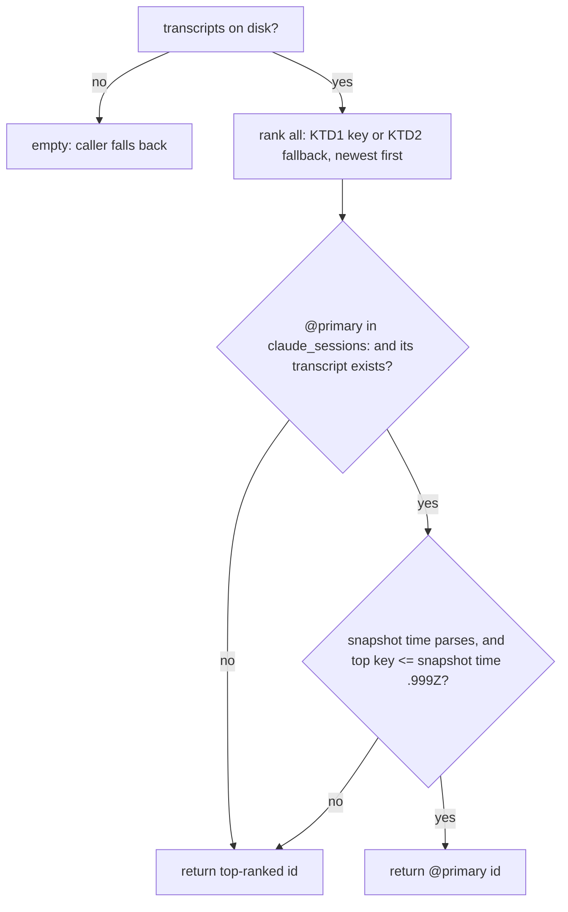

# wb resume stale transcript - Plan

## Goal Capsule

- **Objective:** after a mass session kill, `wb resume` pre-types `claude --resume <id>` for the conversation Jet was actually in, never one from before their last `/clear`. Pressing Enter on the pre-typed line can't quietly bring back stale context.
- **Means:** `wb_resume_id` ranks a worktree's transcripts by the last `"timestamp"` written inside each file, falling back to mtime (KTD1, KTD2). It trusts an `@primary` mark only while nothing has happened since the `wb down` snapshot that wrote it (KTD4).
- **Authority:** Jet's global instructions (`~/.claude/CLAUDE.md`) > the task file's Decisions (`~/code/tasks/dotfiles--fix-wb-resume-stale-transcript.md`) > this plan's Requirements > KTDs > unit Approach.
- **Stop conditions:** stop and ask in any of these cases:
  - An existing `wb_resume_id` or U4 warm-relaunch assertion changes outcome. The one exception is the U1 assertion that U2 replaces by name.
  - Real transcripts turn out to get `{"parentUuid":` activity lines written into a stale conversation at shutdown, which would undo KTD1.
  - A `claude_sessions:` writer other than `cmd_down` turns up, since KTD4 assumes the snapshot time is when `wb down` ran.
- **Execution profile:** U1 (shipped in commit 46f5438) was under half a day. U2 is about 20 lines in `wb.sh` plus about 6 test assertions.
- **Finishes and ships:** the implementing session commits on `fix/wb-resume-stale-transcript`. Draft PR #116, the wb resume stale-transcript fix, is already open. After U2: the Docker suite against the clean-room baseline, then a new check in the test guide and an update to the PR body's "Still to land" section. Code review then runs in a fresh context after `/wb-save`, per Jet's rule. Marking the PR ready waits for Jet's OK.

## Product Contract

### Summary

`wb_resume_id` stops trusting file mtime. It reads the last `"timestamp"` from the end of each transcript and picks the newest, falling back to mtime when a file has none. An `@primary` mark from the last `wb down` still wins, but only while no conversation has activity newer than that snapshot. The picker and `wb_sessions_snapshot` keep their cheap mtime sort. Regression tests pin the exact tie and the inversion that misfired.

### Problem Frame

All 21 wb sessions died at once on 2026-10-25 at 18:07:43, when a subagent's test ran `tmux kill-server` against Jet's real tmux server. When the sessions were rebuilt with `wb resume`, 3 of the 21 (claude-reply-log, verify-behaviour, gnome-tiling) pre-typed the conversation from before Jet's last `/clear`. In claude-reply-log, pressing Enter would have abandoned a code review partway through.

`wb_resume_id` (`scripts/.config/scripts/tmux/wb.sh`) prefers the `@primary` id in `claude_sessions:`. That field was empty in all three task files because only `wb down` writes it. The function then took the head of `wb_transcripts`, which sorts by whole-second mtime. At shutdown Claude Code writes bookkeeping lines into older transcripts in the same folder too (`artifact-autoreact-ledger`, `artifact-comment-monitor`, `cost-state`, `last-prompt`), so every file got mtime 18:07:43. On a tie, GNU `sort -k2,2nr` falls back to comparing whole lines in ascending order, so the alphabetically lower id won. In all three tasks that was the stale conversation: 09088195 < 234a16c8, ee9a679b < faea8d10, 9ae11eaf < b2cf4a13.

The code review of U1 found a second route to the same wrong pick. `claude_sessions:` is written only by `wb down` (`cmd_down`), and nothing refreshes it afterwards. Suppose Jet runs `wb down`, resumes the task, runs `/clear`, and then every session dies. The snapshot still marks the pre-`/clear` conversation `@primary`. Because `wb_resume_id` returned an `@primary` whose transcript existed before any ranking, it pre-typed that stale conversation. 8 task files carried an `@primary` on 2026-10-25.

### Key Decisions

- KD1. **Pick the conversation with the latest real activity, not the latest file write.** (session-settled: user-approved — chosen over fractional `%.Y` mtime: shutdown bookkeeping can land on an old transcript after the live one, so sub-second order is not guaranteed either.) Governs R1, R2.
- KD2. **Don't make the notify hook's `@claude_session_id` a live source.** (session-settled: user-approved — chosen over plan step 2: it is a tmux pane option, so `tmux kill-server` wipes it in exactly the crash this fixes, and R1 already covers the `/clear` case.) Governs R4.
- KD3. **Fix the stale-`@primary` route in this PR.** (session-settled: user-directed — chosen over a separate follow-up task and PR: it is the same wrong pick by another path.) Governs R3.

Product Contract preservation: changed R3 per KD3. It used to say "an `@primary` whose transcript still exists keeps winning, as today", which let a stale snapshot override R1.

### Requirements

**Resume choice**

- R1. With no usable `@primary`, `wb_resume_id` returns the transcript whose last timestamped entry is newest, whatever the files' mtimes are.
- R2. A transcript with no timestamped entry near its end is ranked by its mtime, on the same time scale as timestamped files.
- R3. An `@primary` id in `claude_sessions:` whose transcript still exists wins only when no transcript has activity after the snapshot was taken. Otherwise R1 picks.

**Unchanged surfaces**

- R4. `wb_transcripts` output and its callers (the picker's dormant rows, `wb-board.sh`, `wb_sessions_snapshot`) are unchanged.

### Scope Boundaries

- Not built: a durable record of the live conversation written on every hook event (KD2). Two Claude panes active in the same worktree at once may still resume whichever spoke last. That's rare, and evidence it bites would change the call.
- Not built: re-ranking the picker's age-in-days by timestamp. Age only needs day resolution, and that path runs once per dormant row per render.
- Accepted tradeoff: a conversation reopened via `/resume` (in-session or `claude --resume`) with no new turn before a mass kill ranks below the conversation it replaced. Nothing in the files separates "stale from before `/clear`" from "reopened and idle"; "newest activity" means where Jet last typed.
- Accepted tradeoff: an `@primary` is distrusted more often than strictly needed. Two cases, both falling back to R1's ranking: a transcript with no activity line in its tail gets its mtime bumped by shutdown bookkeeping, or a stray line lands between the snapshot and the session kill. Wrongly distrusting a fresh `@primary` costs at most the KD2 two-pane case. Wrongly trusting a stale one is the bug this fixes.
- Not built: refreshing `claude_sessions:` on `/clear` or other events, for the same reason as KD2. A tmux kill wipes the pane state such a writer would read from.
- Not built: millisecond tie-breaking between two timestamped files. Real entries carry millisecond timestamps, so an exact tie needs two conversations writing in the same millisecond.

## Planning Contract

### Key Technical Decisions

- KTD1. **Rank key = last `"timestamp":"…"` on an activity line in the final 256 KiB of the file, read with `tail -c` and fixed-string patterns.** (session-settled: user-approved — chosen over parsing each line with `jq`: no new dependency, and `jq` aborts on the partial first line a byte-offset `tail` produces.) Governs R1.
  - An activity line is one that starts with `{"parentUuid":` (user, assistant, system, attachment).
  - Bookkeeping lines start with `{"type":` and are skipped. Some carry no timestamp. Others (`frame-link`, `queue-operation`, `api-request`, `pr-link`) carry one and can be written at shutdown into conversations idle for days: the 16:07:43Z crash stamped a `frame-link` line into a conversation whose last turn was 2026-10-19.
  - Drop the partial first line that a byte-offset `tail` produces before filtering.
  - `tail -c` seeks, so a 15 MB transcript costs the same as a small one: about 38 ms measured for a 4-file folder.
  - A `"timestamp"` inside message content is JSON-escaped (`\"timestamp\"`), so the pattern doesn't match it.
- KTD2. **Fallback key = mtime rendered in the same shape as a real timestamp (`YYYY-MM-DDTHH:MM:SS.000Z`), via bash's builtin `printf '%(…)T'` with `TZ=UTC` as a command prefix.** One string shape lets a plain reverse sort order timestamped and untimestamped files together without a `date` fork per file. It also keeps every existing fixture (empty `{}` files ranked by `touch -d`) behaving as before.
  - The `.000` fractional part matters. Without it, `Z` sorts above `.`, so an mtime key would beat real activity later in the same second.
  - Only the prefix form (or `local -x TZ=UTC`) renders UTC. A plain `local TZ=UTC` is not exported, so `printf` silently renders local time, verified on bash 5.2. That would rank fallback files 1-2 hours ahead on Jet's CET/CEST host.

  Governs R2.
- KTD3. **Ranking lives only in `wb_resume_id`.** `wb_transcripts` keeps its one-`stat` contract because the picker calls it once per dormant-row candidate. `wb_resume_id` runs once per `wb new`/`wb resume`. Governs R4.
- KTD4. **Trust `@primary` only while the newest rank key across all transcripts is no later than the snapshot time.** The snapshot time is the latest `@<iso>` among the `claude_sessions:` entries. Each entry's `@<iso>` is that transcript's mtime when `wb down` ran, so the latest one is when the snapshot was taken, to the second. Governs R3.
  - The check reuses U1's ranking. Rank once, look at the top key, then return `@primary` or the top id. That's one string comparison, with no extra file reads.
  - Render the snapshot time as `…SS.999Z` before comparing it with rank keys. Activity in the snapshot's own second was written before the stat that produced it.
  - When no entry carries a well-formed `YYYY-MM-DDTHH:MM:SSZ`, there is no snapshot time, so `@primary` is not trusted. Ranking is the safe default.
  - Chosen over the reviewer's rule, "trust `@primary` only when every on-disk transcript is listed in `claude_sessions:`". That rule catches a `/clear` after the snapshot. It misses a later turn in a conversation that is already listed, for example resuming into an older listed conversation and working there. KTD4 catches both with one rule.
  - What `@primary` still adds: it wins only when nothing has been typed since `wb down`. Then it picks the agent window's conversation over a second pane that spoke later (the KD2 gap). On a warm resume with no turn yet, it also picks a reopened conversation over the one it replaced.

### High-Level Technical Design

How `wb_resume_id` decides after U2:

### Assumptions

- Claude Code writes conversation turns as lines starting `{"parentUuid":` with a `"timestamp":"<ISO-8601 Z>"`, and only into the conversation they belong to. Bookkeeping lines start `{"type":` and may carry crash-time timestamps, which KTD1 ignores. Checked on 2026-10-25: all 170 transcripts on disk have an activity-line timestamp in their last 256 KiB. If a future Claude Code version changes the line prefix, ranking degrades to the mtime fallback and the tie bug can return.
- Only `cmd_down` writes a non-empty `claude_sessions:`, and `cmd_done` blanks it (checked against `wb.sh` on 2026-10-25). KTD4's snapshot time therefore means "when `wb down` ran".
- Reopening a conversation can write an activity line before Jet types anything. The claude-reply-log conversation 234a16c8 got a synthetic assistant line, "No response requested.", at 16:24:45Z, when it was resumed after the crash. KTD4 counts that as activity after the snapshot and hands the choice to ranking. Ranking then picks that same reopened conversation, which is correct.

## Implementation Units

### U1. Rank resume candidates by last in-file timestamp

**Goal:** `wb_resume_id`'s non-primary branch returns the transcript with the newest real activity.

**Requirements:** R1, R2, R4. KTD1, KTD2, KTD3.

**Dependencies:** none.

**Files:**
- `scripts/.config/scripts/tmux/wb.sh` (modify: new small helper near `wb_transcripts`, plus the fallback branch of `wb_resume_id`)
- `scripts/.config/scripts/tmux/tests/wb-schema.test.sh` (test)

**Approach:**
1. Add a helper that takes a transcript path and its mtime epoch and prints the rank key from KTD1, or the KTD2 fallback when no timestamp is found.
2. In `wb_resume_id`, keep the `@primary` check exactly as is. Replace the final `head -n1` of the mtime-sorted list with a pass over the same ids: build "key<TAB>id" per transcript, reverse-sort on the key, take the first id.
3. Update the header comments on `wb_transcripts` and `wb_resume_id`, plus the U2 block comment above them, to say mtime is not trusted for the resume choice and why (shutdown bookkeeping writes). Match the existing comment density.

**Patterns to follow:** `wb_transcripts`'s single-pass loop and its no-fork rationale. The `CLAUDE_PROJECTS_DIR` override for fixtures.

**Test scenarios** (beside the existing `wb_resume_id` block in `wb-schema.test.sh`, with fixture lines shaped like the real ones: activity lines starting `{"parentUuid":` and carrying `"timestamp":"…Z"`, followed by `{"type":"cost-state",…}` / `{"type":"artifact-comment-monitor",…}` lines with no timestamp):
- Tie: `aaa-stale` (last activity 15:24Z) and `bbb-live` (last activity 16:07:41Z), both touched to the same second, no `claude_sessions:` → returns `bbb-live`. This is the incident shape: the lower id is the stale one.
- Crash-stamped bookkeeping: as Tie, but `aaa-stale` ends with `{"type":"frame-link",…,"timestamp":"…T16:07:43.267Z"}` and `{"type":"queue-operation",…,"timestamp":"…T16:07:43.279Z"}` after its last activity line → still returns `bbb-live`.
- Inversion: `bbb-live` has the older mtime, `aaa-stale` the newer one, timestamps as above → returns `bbb-live`.
- Mixed fallback: a timestamped file with last activity 2026-09-01 and an empty `{}` file touched 2026-09-05 → returns the empty file's id. With the dates swapped → returns the timestamped id. Run both under `TZ=XXX-2` (a POSIX TZ string, which needs no tzdata in the Docker image) so a fallback key rendered in local time fails.
- Window edge: a file whose last 256 KiB has no timestamp (one long bookkeeping line after the last activity line) → ranked by mtime, without error.

**Verification:** the new assertions report `ok`. The existing `wb_resume_id` and `wb_transcripts` assertions in `wb-schema.test.sh` keep their outcomes, as do the U4 warm-relaunch assertions in `wb-new.test.sh`. The real-data check in the Verification Contract passes.

### U2. Trust `@primary` only while the snapshot is fresh

**Goal:** after `wb down`, a resume, and then a `/clear` or a turn in another conversation, a mass kill no longer brings back the conversation the old snapshot marked `@primary`.

**Requirements:** R3, R1. KTD4. KD3.

**Dependencies:** U1, which supplies the rank keys KTD4 compares.

**Files:**
- `scripts/.config/scripts/tmux/wb.sh` (modify `wb_resume_id`, plus the header comments of `wb_resume_id` and `wb_sessions_snapshot`)
- `scripts/.config/scripts/tmux/tests/wb-schema.test.sh` (test)

**Approach:**
1. While reading the `claude_sessions:` entries for `@primary`, also take the latest well-formed `@<iso>` as the snapshot time (KTD4).
2. Rank every transcript first, using U1's existing pass. Keep the top key and the top id instead of piping straight to `head -n1 | cut -f2`.
3. Return the `@primary` id only when its transcript is on disk, a snapshot time exists, and the top key is not later than that time with `.999` added. Otherwise return the top id.
4. Comments:
   - In `wb_resume_id`, say why a snapshot can go stale (only `wb down` writes it) and what `@primary` still adds.
   - In `wb_sessions_snapshot`, change "only wb_resume_id's primary-preference hint" to say the hint holds only while the snapshot is fresh.
   - Match the existing comment density.

**Patterns to follow:** U1's rank pipe in `wb_resume_id`. The existing `_wb_sessions_entries` parse loop.

**Test scenarios** (in `wb-schema.test.sh`, reusing U1's `WT_TIE` fixture: `aaa-stale` with last activity 2026-10-25T15:24:00.000Z, `bbb-live` with last activity 2026-10-25T16:07:41.000Z, same mtime second):
- Replace the U1 assertion "`@primary` still wins over newer activity" with: snapshot `aaa-stale@2026-10-25T15:24:05Z@primary` (taken before `bbb-live` existed) → returns `bbb-live`. This is the review finding: `/clear` after `wb down`.
- Listed but active since: snapshot `aaa-stale@2026-10-25T15:24:05Z@primary,bbb-live@2026-10-25T15:00:00Z` → returns `bbb-live`. The reviewer's "every transcript listed" rule would return `aaa-stale` here.
- Fresh snapshot: snapshot `aaa-stale@2026-10-25T15:24:05Z@primary,bbb-live@2026-10-25T16:07:45Z` → returns `aaa-stale`, because nothing has activity after the snapshot.
- Same-second boundary: its own worktree fixture, not `WT_TIE`. `aaa-stale` has last activity 2026-10-25T15:24:00.000Z, and `bbb-live` has last activity 2026-10-25T16:07:41.500Z. Snapshot `aaa-stale@2026-10-25T15:24:05Z@primary,bbb-live@2026-10-25T16:07:41Z` → returns `aaa-stale`. The `.500` sits inside the snapshot's own second, so this fails if the snapshot time is rendered `.000Z` instead of `.999Z`. `WT_TIE`'s `.000Z` activity would tie and pass either way.
- No usable snapshot time: snapshot `aaa-stale@primary` → returns `bbb-live`.
- Existing assertion "primary id with a live transcript wins over newest": it uses two `{}` files ranked by fallback mtime keys and must still return `older-id`. Add ` UTC` to that fixture's two `touch -d` dates. Otherwise a host west of UTC shifts the fallback keys past the snapshot's `Z` times and the test fails for the wrong reason. The `wb_transcripts` assertions sharing those files keep their outcomes.
- Existing "primary whose transcript is gone" and the `wb-new.test.sh` "claude_sessions: set, no surviving transcript" assertion keep their outcomes, with no change.

**Verification:** U2's assertions report `ok`. Every other `wb_resume_id`, `wb_transcripts`, `wb-down` snapshot-shape and U4 warm-relaunch assertion keeps its outcome. The U2 real-data row in the Verification Contract passes.

## Verification Contract

| Gate | How | Pass signal |
|---|---|---|
| New and existing resume tests | `wb-schema.test.sh` and `wb-new.test.sh`, run **only inside the Docker sandbox** (`docker run --rm -v "$(pwd)":/repo:ro -w /repo wb-tests`), never on the host tmux server | New assertions print `ok - …`, and no previously passing assertion turns to `FAIL` |
| No regression across the suite | Full Docker suite on the branch vs. the same suite on a clean-room `development` copy under `~/.cleanroom/wb-resume-stale-transcript-baseline/`. That folder was gone by the end of 2026-10-25, so rebuild it from `origin/development` with `git archive` | Identical per-file `^FAIL` line sets (both currently sit on a ~12-file environment floor). Judge by `grep '^FAIL'`, never by the wrapper's exit code or a final `ALL PASS` line |
| Real-data check, with the crash tie rebuilt | Copy the three affected transcript folders (claude-reply-log, verify-behaviour, gnome-tiling) into `~/.cleanroom/wb-resume-stale-transcript-realdata/`, leaving the originals untouched. `touch -d '2026-10-25 18:07:43'` every copied `.jsonl` to rebuild the shutdown tie. The live files have been resumed since the crash, so without this the old code already picks them and the check proves nothing. Call `wb_resume_id` with `CLAUDE_PROJECTS_DIR` pointed at the copy and a fixture task file with no `claude_sessions:` | The branch returns 234a16c8, faea8d10 and b2cf4a13. The same call with `development`'s `wb.sh` returns the alphabetically lowest id in each folder, all stale: 09088195, adfbcda8 and 9ae11eaf |
| U2 real-data check | The U1 copy was also gone by the end of 2026-10-25, and the live claude-reply-log folder has since gained two newer conversations (532d86cd, 9bf8f709). Copy only the four conversations that existed at the crash (09088195, 234a16c8, ab743664, ed380968) into `~/.cleanroom/wb-resume-stale-transcript-realdata/`, leaving the originals untouched. Run the container as the host uid: as uid 1001 it can't read the 600-mode copies, and every file silently drops to the mtime fallback. Use two fixture task files listing the four ids, with 09088195 marked `@primary`. **Stale:** every entry at `2026-10-25T15:25:00Z`, a snapshot from before Jet's `/clear` into 234a16c8. **Fresh:** every entry at `2026-10-25T23:59:59Z`, later than any copied conversation's last activity | Stale: the branch returns 234a16c8, and the branch head before U2 returns 09088195. That head is commit 1a7e64f: U1's fix commit 46f5438 plus its comment-only follow-up. Fresh: the branch returns 09088195 |

## Definition of Done

- U1's and U2's test scenarios exist and pass in the Docker sandbox, and the suite's FAIL set matches the rebuilt clean-room baseline.
- A stale `@primary` (any transcript with activity after the snapshot time) never wins, and a fresh one still does (R3).
- `wb_transcripts` output is byte-for-byte unchanged for the same inputs (R4).
- Comments in `wb.sh` no longer call mtime the newest-conversation signal for resume.
- No leftover experimental code or debug output in the diff.
