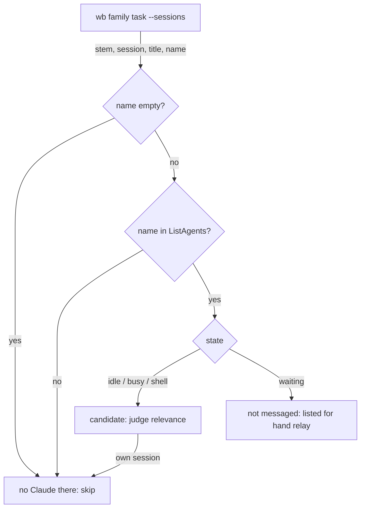

# Propagation Peer Filter and Descendant-Aware Close Hint - Plan

## Goal Capsule

- **Objective:** When a decision is recorded, every live session in the task family that it affects gets the `[wb-propagate]` message (or, when that session is waiting on its user, is named for hand relay), and `wb done` only suggests closing a parent once every task beneath it is done.
- **Means:** `wb family --sessions` resolves each family session's SendMessage name from Claude Code's session registry (KTD1). `/wb-decide` matches ListAgents rows by that name and messages `shell` rows (KTD2). The close hint walks all descendants (KTD4).
- **Authority:** this plan, then the task file `~/code/tasks/dotfiles--fix-propagation-peer-filter.md` (Plan section) for background evidence.
- **Stop conditions:** stop and ask if the registry's `tmux` field turns out not to end in the pane id the Claude runs in, or if `wb family --sessions` has a consumer outside `/wb-decide` that a 4th column would break.
- **Execution profile:** one session, three units, one PR against `development`.

---

## Product Contract

### Summary

`wb family <task> --sessions` gains a 4th column holding the name SendMessage takes for each Claude running in a family tmux session. `/wb-decide`'s propagation step matches ListAgents rows by that exact name instead of by ListAgents' tmux field, and it messages sessions in state `shell` instead of skipping them. Separately, `wb done`'s "all children are done" hint checks every descendant, not just direct children.

### Problem Frame

On 2026-10-26, `/close-out` in the SFB-1338 averages session reported "no live family session" while two family sessions were live. The PR-merge notice had to be relayed by hand.

Two rules in `/wb-decide` step 6 dropped them:

- ListAgents leaves out its `tmux <session>:@w.%p` field whenever that string is longer than 64 characters. wb session names are `<repo>--<slug>`, so long slugs lose the field, and the skill drops any row without it.
- The skill drops rows in state `shell`, believing Claude isn't running there. In fact `shell` means a live Claude is blocked in a foreground command, such as a decision buffer, and messages queue until its next tool round.

The same day, `wb done` on the averages task said its parent could be closed. The averages task was the parent's only direct child, but it had two open children of its own. `wb_family_all_done` only looks one level down.

### Requirements

**Propagation recipients**

- R1. A live family session reaches the candidate list whatever the length of its tmux session name.
- R2. A session in ListAgents state `shell` is messaged, and the confirm line names it as "busy in a shell command, message queued".
- R3. These existing rules are unchanged: skip the calling session, default to messaging nobody, apply the loop guard, and never message a `waiting` session (list it for hand relay instead).
- R4. A family tmux session with no running Claude is never messaged and never causes an error.

**Close hint**

- R5. `wb done` prints "all children of `<parent>` are done" only when the parent has at least one descendant and every descendant at every depth has `status: done`.

### Scope Boundaries

- The 64-character display limit in ListAgents itself is out of scope. It is Claude Code's limit and is reported upstream through /feedback.
- Not built: falling back to name-prefix matching when the registry is missing. The registry is what ListAgents' own tmux field is read from, so if it's gone the ListAgents data is suspect too. Revisit if a Claude Code release moves the registry.
- Not changed: the original decision-propagation task (`dotfiles--feat-decision-propagation`). The reversal of its `shell` rule is recorded in this task's Decisions.

---

## Planning Contract

### Key Technical Decisions

- KTD1. **`wb` resolves the SendMessage name from the session registry.** For each family tmux session, read `~/.claude/sessions/*.json` (overridable with `CLAUDE_SESSIONS_DIR`, the same variable `claude-reply-log.sh` uses). Keep entries whose `tmux` value ends in `.<pane_id>` for one of that session's panes (`tmux list-panes -s`) and whose `pid` passes `kill -0`, and print each entry's `name`. The join is on the pane id, as in `pane_session`, because Claude Code writes the `tmux` field once at startup and the picker's `r` binding can rename a session later, while pane ids survive renames. (session-settled: user-approved — chosen over matching ListAgents names against the worktree folder name, which collides when two panes share a worktree, breaks after `/rename`, and can't predict the random 2-character suffix; and over using the registry only as a fallback when ListAgents lacks the tmux field, which keeps two code paths for one answer.) Governs R1, R4.
- KTD2. **`shell` rows are messaged like `busy` ones.** (session-settled: user-approved — chosen over skipping them: on 2026-10-26 the SFB-1338 unowned-sessions auth fix session showed `shell` while its Claude was alive and waiting on a decision buffer, and SendMessage's own docs say messages queue and drain at the receiver's next tool round.) Governs R2.
- KTD3. **The 4th column is appended, one line per Claude.** The existing three columns keep their order, so readers that take fields 1-3 still work. A family session with two Claudes prints two lines that differ only in the name. A session with no live registry entry prints one line with an empty 4th field. ListAgents stays the source of liveness and state: a name missing from ListAgents is treated as not live.
- KTD4. **Registry parsing uses `jq`, like `pane_session` in `claude-reply-log.sh`.** This corrects the chat proposal, which said "jq-free to match wb.sh": wb.sh already uses `jq` in `install-hooks`, and the closest precedent for reading this registry uses it. The pass reads each file as one input line through `fromjson?`, so a half-written or corrupt file is skipped instead of stopping `jq` before the files after it (checked against jq 1.7). Any registry failure (no `jq`, a moved directory, renamed fields) shows up the same way: the caller's own SendMessage name, which ListAgents prints in its header, is missing from the 4th column even though the caller's tmux session is in the family. `/wb-decide` then reports "not propagated: session registry unreadable" and lists the family sessions for hand relay, instead of "no live family session".
- KTD5. **The close hint uses the same descendant walk as `wb family`.** Factor the descent half of `_wb_family_stems` (the parent → children map with its seen-set) into a helper that lists every descendant of a stem. Both `_wb_family_stems` and `wb_family_all_done` use it, so the cycle guard isn't written twice. Governs R5.

### High-Level Technical Design

How step 6's candidate list is built after the change. This is directional and the prose above is authoritative.

---

## Implementation Units

### U1. `wb family --sessions` prints each session's SendMessage name

- **Goal:** each `--sessions` line carries a 4th tab-separated field, the SendMessage name of a live Claude in that tmux session.
- **Requirements:** R1, R4; KTD1, KTD3, KTD4.
- **Dependencies:** none.
- **Files:** `scripts/.config/scripts/tmux/wb.sh` (`cmd_family`'s `--sessions` branch, its header comment, and the usage block near the top), `scripts/.config/scripts/tmux/tests/wb-family.test.sh`.
- **Approach:**
  1. Read the registry once per `--sessions` call, not once per tmux session: print each file on its own line and pipe them to one `jq -rR 'fromjson? | …'` that emits `pane<TAB>pid<TAB>name` (KTD4), then filter by pid liveness in bash.
  2. For each family session found by the existing `@task` / session-name matching, list its pane ids and print one line per live registry name on one of those panes, or one line with an empty 4th field when there's none.
  3. Update the two comments that describe the output shape.
- **Patterns to follow:** `pane_session` in `scripts/.config/scripts/tmux/claude-reply-log.sh` for the registry read, the `jq` guard and the `kill -0` liveness check.
- **Test scenarios:** registry fixtures go in a mktemp dir passed through `CLAUDE_SESSIONS_DIR`, and the test shell's own `$$` is a pid known to be alive.
  - A family session whose name is longer than 64 characters, with a live registry entry: the line's 4th field is that entry's `name`.
  - A registry entry whose pid is dead (a reaped background job's pid) for a family session: the 4th field is empty.
  - Two live entries naming the same tmux session: two lines with the same first three fields and different names.
  - A family session with no registry entry at all: one line, empty 4th field.
  - An entry for a non-family session: it never appears.
  - An entry written under a session's old name, after `tmux rename-session`: the 4th field still shows its name, because its pane id matches.
  - A truncated registry file that sorts before a live family entry: the family entry's name still prints.
  - An entry for a pane in a non-family session whose name has a family name as its prefix (`proj--child-two` vs `proj--child`): no false match.
  - The existing three-column assertions are updated to the four-column shape and still pass, including the migrated-breakdown case (a session reported under its `@task` stem).
- **Verification:** `wb-family.test.sh` passes, and on the live machine `wb family be--monorepo--sfb-1338-unowned-sessions-auth --sessions`, run from this worktree, shows the soft-deleted-team-sessions session with the name `session-admission-soft-deleted-team-sess-a7`, even though ListAgents shows no tmux field for it.

### U2. The close hint checks every descendant

- **Goal:** `wb done` stops suggesting a parent be closed while any grandchild or deeper task is still open.
- **Requirements:** R5; KTD5.
- **Dependencies:** none.
- **Files:** `scripts/.config/scripts/tmux/wb.sh` (`wb_family_all_done`, `_wb_family_stems`, a new descendant helper), `scripts/.config/scripts/tmux/tests/wb-breakdown.test.sh` (the "U5 — wb done last-child nudge (KTD8)" section).
- **Approach:** split the descent out of `_wb_family_stems` into a helper that prints every descendant of a stem. `_wb_family_stems` calls it on the root it climbs to. `wb_family_all_done` calls it on the parent stem, requires at least one result, and requires every result to be `done`. The helper keeps its own seen-set, so a hand-edited cycle still terminates.
- **Patterns to follow:** the existing descent loop and seen-set in `_wb_family_stems`. Fixtures follow the `proj--feat-nudge*` tasks in `wb-breakdown.test.sh`.
- **Test scenarios:**
  - Parent → done child → open grandchild, closing the child: no nudge. This is the 2026-10-26 case.
  - Parent → done child → done grandchild: the nudge fires.
  - Parent → done child → one done and one `planned` grandchild: no nudge.
  - The existing nudge cases (two children, an only child, no parent, a ghost parent) are unchanged.
  - A parent/child cycle written by hand: `wb done` terminates and doesn't nudge falsely.
  - The `wb family` enumeration assertions in `wb-family.test.sh` still pass after the refactor.
- **Verification:** both test files pass. On the live store, the helper run against `be--monorepo--sfb-1338-unowned-sessions-auth` lists the two open grandchildren, so the hint would not fire.

### U3. `/wb-decide` step 6 matches by name and messages `shell` sessions

- **Goal:** the skill's candidate rule uses U1's name column and no longer drops `shell` rows.
- **Requirements:** R1-R4; KTD2, KTD3, KTD4.
- **Dependencies:** U1.
- **Files:** `claude/.claude/skills/wb-decide/SKILL.md` (step 6 items 2, 5, 7, 8 and the checklist), `docs/guides/wb-decide.md`, `docs/wb-guide.md` (the "Decision propagation" paragraph and the `wb family` row in the command table).
- **Approach:**
  1. Item 2 (Candidates): `wb family --sessions` now gives the name. A candidate is a ListAgents row whose name equals a non-empty 4th field. Drop only the caller's own name, as given in ListAgents' header, so that another Claude in the caller's tmux session stays a candidate. Stop dropping `shell` rows and rows without a tmux field.
  2. Item 5 (outside the family): it uses the same name join.
  3. Item 7 (failures): add the "session registry unreadable" check from KTD4.
  4. Item 8 (confirm line): add the "busy in a shell command, message queued" wording.
  5. Add checklist lines for a long-named family session, a `shell` session, a second Claude in the caller's tmux session, and an unreadable registry.
  6. Update both docs to match.
- **Test scenarios:** Test expectation: none. This is skill prose with no automated harness. The checklist lines are the review aid, and U1's tests cover the data the prose relies on.
- **Verification:** reading step 6 against the live ListAgents output in Problem Frame, both sessions that were missed on 2026-10-26 would be candidates. `docgen.sh` runs clean after the doc edits.

---

## Verification Contract

| Check | Command or action | Proves |
|---|---|---|
| Family tests | `bash scripts/.config/scripts/tmux/tests/wb-family.test.sh` | U1, plus U2's refactor of the enumeration |
| Nudge tests | `bash scripts/.config/scripts/tmux/tests/wb-breakdown.test.sh` | U2 |
| Live name column | `bash scripts/.config/scripts/tmux/wb.sh family be--monorepo--sfb-1338-unowned-sessions-auth --sessions` | R1 on a session whose ListAgents tmux string is 68 characters |
| Docs regen | `docgen.sh` after the doc edits | docs index and HTML stay in step |

Judge test files by their own FAIL lines. The full Docker suite has known environment-dependent failures and is not the gate here.

## Definition of Done

- U1-U3 landed, and both test files report no FAIL lines.
- The live check prints a name for the long-named session.
- This task's `## Decisions` records the reversal of the `shell` rule and the registry-name approach, each with its rejected alternative.
- No leftover experimental code or debug output in the diff.
