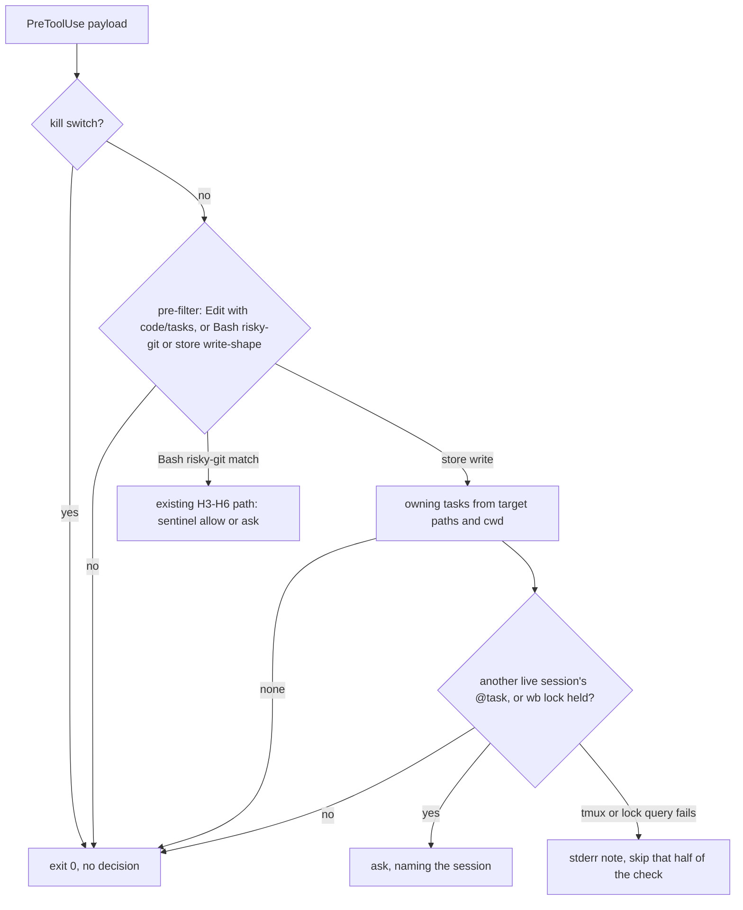

# Task-Store Write Guard Asks Only on Contention - Plan

## Goal Capsule

- **Objective:** Jet is prompted about a write into `~/code/tasks` only when another live session owns the task being written, or a `wb` command is writing that task at that moment. The prompt names the other session wherever one is known. An ordinary session writing its own task file or dossier sees no prompt.
- **Means:** the store guard (`pretooluse-guard.sh`) maps each write target to its owning task and checks live tmux sessions' `@task` options plus that task's `wb` side-car lock (KTD1, KTD2). Phase 1 covers Edit/Write/MultiEdit. Phase 2 extends the same check to Bash commands that look like writes (KTD5).
- **Authority:** this plan, then the task file `~/code/tasks/dotfiles--feat-tasks-store-guard-ask-only-on-contention.md` (its Plan section and the 2026-10-27 Decisions entry), then `docs/plans/2026-07-11-001-feat-tasks-dir-concurrency-safety-plan.md` for the original H-rules this plan amends.
- **Stop conditions:** stop and ask if a hook process turns out not to inherit `TMUX`/`TMUX_PANE` from the Claude pane, since the caller's own identity depends on it. Also stop and ask if sourcing `wb-locks.sh` from the guard has any top-level side effect.
- **Execution profile:** one session and one PR against `development`. Phase 1 (U1-U3) lands and gets a `/wb-save` checkpoint before Phase 2 (U4-U5).

---

## Product Contract

### Summary

The guard stops asking on every Edit/Write/MultiEdit under `~/code/tasks`. It asks only when the target's owning task belongs to another live tmux session, or when that task's `wb` lock is held at that moment. Phase 2 applies the same rule to Bash commands that write into the store, which are not checked today. The guard's risky-git-command check is unchanged.

### Problem Frame

Over the 14 days to 2026-10-27, the guard prompted 526 times on Edit/Write and 5 times on risky git commands. That covered 103 sessions, 64 prompts on 2026-10-27 alone. None was rejected. 84% targeted dossier files.

A rough measure of contention found few real clashes. A different session also got a prompt for the same task within 30 minutes in 21 cases. A different session also got one for the same file in 0 cases.

The prompt adds little protection. Claude Code already refuses an Edit to a file that changed since the session read it, and refuses a Write over an existing file the session has not read. That stopped a lost update in the 2026-10-12 coordinator session.

Meanwhile, roughly 900 write-shaped Bash calls (`sed -i`, redirects, python heredocs) touched store paths in the same window. They had no stale-read check and no prompt. Prompts that are always approved also train people to approve the rare one that matters.

### Requirements

**Edit/Write/MultiEdit (Phase 1)**

- R1. An Edit/Write/MultiEdit under `~/code/tasks` produces no decision, so normal permissions apply, unless R2 or R3 holds.
- R2. When the target's owning task is the `@task` of a live tmux session other than the caller's own, the guard asks. The prompt names that session.
- R3. When the target's owning task has its `wb` side-car lock held at check time, the guard asks. The prompt names the holder's tmux session when the lock records one. A lock whose recorded holder session is the caller's own does not count, such as a background `wb done` the caller started.
- R4. A target with no owning task never prompts. Examples are `README.md`, `INDEX*`, `weeks/`, `context/` and the store root.
- R5. Prompts no longer tell the agent to use `wb append` instead.

**Bash writes (Phase 2)**

- R6. A Bash command that looks like a write and names a store path, or runs from a store directory, follows R2-R4 for every owning task it names.
- R7. Bash commands that only read are never checked. `wb` verb invocations (`wb append`, `wb set`, …) are never checked.
- R8. The risky-git-command check (H3-H6), the `wb unsafe-rewind` sentinel and the git-side `reference-transaction` hook behave exactly as today.

**Unchanged guarantees**

- R9. The guard never returns `deny`. It fails open on any internal error, such as missing jq, a failed tmux query or an unsourceable `wb-locks.sh`, with one stderr line. The kill switch at `~/.local/state/wb/disable-agent-hook` still turns it into a no-op.

### Key Decisions

- **Ask only on contention, instead of on every write.** (session-settled: user-approved — chosen over keeping the always-ask: 0 rejections in 530 prompts shows it is a rubber stamp, and Edit/Write's own stale-read refusal is the real lost-update protection.) Governs R1-R4, R6.
- **On contention, ask; don't refuse.** (session-settled: user-approved — chosen over a refusal: it keeps the guard's never-deny posture, and a coordinator editing a child task's dossier on purpose is a real case.) Governs R2, R3, R9.
- **Shared files never prompt.** A file with no single owning task has no session to clash with. Governs R4.
- **Drop the `wb append` nudge from prompts.** Agents need Edit for anything other than an end-of-section append, so the nudge belongs in docs and skills. Governs R5.

### Scope Boundaries

- Not built: a "written by another session in the last N minutes" rule. It needs a write log, and the live-`@task` check plus Edit's stale-read refusal cover the same cases. Revisit if a lost update shows up between sessions that are not both live in tmux.
- Not built: a family exemption that would let a coordinator write a child's files silently. That write is the contention this guard exists to surface. Revisit if coordinator prompts become most of the remaining volume.
- Not built: closing the gap where an Edit lands inside another session's `wb append` read-modify-write. The window is milliseconds, and R3 narrows it. Revisit if a lost Edit is ever traced to it.
- Not built: Claude Code permission allowlists for `wb` verbs, or batching store writes into one approval. In auto mode neither is a prompt source.
- Not covered: sessions outside tmux, such as headless `claude -p` children launched with `env -u TMUX -u TMUX_PANE`. They have no own session, so any live owner counts as another session. That is still fewer prompts than today.

#### Deferred to Follow-Up Work

- Who commits other sessions' store writes (gap 4 in the task file). This gets its own task.
- `wb append` refusing on task files with duplicated `##` headings. It is a reason agents bypass the verb, but separate from the guard.

---

## Planning Contract

### Key Technical Decisions

- KTD1. **The caller's own session is the tmux session of `$TMUX_PANE`; owners come from one `list-sessions` call.** The hook inherits the pane environment, so subagents in that pane count as the caller. When `TMUX` or `TMUX_PANE` is unset, the caller has no session (see Scope Boundaries). One `tmux list-sessions -F '#{session_name}<TAB>#{@task}'` gives every live owner. This mirrors `_wb_refuse_if_live_session` in `wb.sh` without sourcing `wb.sh`: sourcing it set `CODE_DIR` globally and caused the 2026-07-10 deletion incident.
- KTD2. **Lock check: source `wb-locks.sh` and probe without waiting.** Resolve `wb-locks.sh` from the guard's real path, `../wb-locks.sh`, since the stowed guard is a symlink. Use its path helper so the lock path cannot drift from `wb`'s own. Probe only if the lock file exists, using a non-blocking `flock -n` that releases immediately. Read the holder's `tmux_session` with `wb_task_lock_holder_field`; when it equals the caller's own session, the lock is not contention (R3). If sourcing fails, the lock check fails open and the `@task` check still runs.
- KTD3. **Owning task is derived from the path alone.** `$TASKS_DIR/<name>.md` at top level → `<name>`. `$TASKS_DIR/dossiers/<name>/…` → `<name>`. Anything else has no owner (R4). The comparison is against `$TASKS_DIR/<name>.md`, using the same `realpath -m` canonicalisation `path_under_tasks_dir` already applies, because `@task` holds an absolute task-file path.
- KTD4. **tmux is queried only after a store path has matched.** The Edit pre-filter (substring `code/tasks`) and the Bash pre-filter stay pure grep. Calls that don't touch the store never spawn tmux.
- KTD5. **Phase 2 detects writes by pattern and accepts misses.** The Bash pre-filter widens from DANGEROUS_RE to DANGEROUS_RE or (a write-shape regex and either the `code/tasks` substring in the command or a payload cwd under the store). The cwd half matters because an agent that has already `cd`ed into a dossier writes with relative paths that never mention `code/tasks`; it is still a string comparison, so KTD4 holds. Write shapes are: `sed -i`, `>`/`>>` redirects, `tee`, `cp`/`mv`/`rm`/`touch`, and python `open(…, 'w'|'a')`, `write_text` or `.write(`. File-descriptor and `/dev/null` redirects (`2>&1`, `2>/dev/null`, `>/dev/null`) are not writes and must not match. Store paths are collected from the whole command text, including variable assignments such as `D=~/code/tasks/dossiers/x`. A store-directory cwd from the payload or a tracked `cd` also counts. Every owning task found is checked. Misses only cost a prompt that should have fired under contention. False matches only matter under contention too.
- KTD6. **One decision path for both tools.** A shared helper takes the owning tasks, runs the two checks and emits the ask. The risky-git branch keeps first priority. If a Bash command is both risky and a contended write, the risky-git ask wins, unchanged (R8).

### High-Level Technical Design

### Assumptions

- Hook processes inherit `TMUX` and `TMUX_PANE` from the Claude pane. This is a stop condition if false.
- `wb-locks.sh` is side-effect-free on source, as its header and the handoff.sh precedent state. This is a stop condition if false.

---

## Implementation Units

### U1. Owner resolution and contention check

- **Goal:** the guard can map a path to its owning task and decide whether another live session or a held lock contends for it.
- **Requirements:** R2, R3, R4, R9.
- **Dependencies:** none.
- **Files:** `scripts/.config/scripts/tmux/tasks-git-hooks/pretooluse-guard.sh`, `scripts/.config/scripts/tmux/tests/tasks-agent-hook.test.sh`.
- **Approach:**
  1. Add owner resolution per KTD3.
  2. Add the caller-session and live-owner lookups per KTD1.
  3. Add the lock probe per KTD2.
  4. Add the shared decision helper per KTD6. It returns the first contending session name, or nothing.
  5. Any tmux error, or `wb-locks.sh` failing to source, goes through `fail_open` or skips that check, never to an ask.
- **Execution note:** write the tmux stub first. It must be a PATH-shimmed `tmux` script that prints canned `list-sessions` and `display` output from fixture files and never contacts a real server. See the 2026-10-25 kill-server incident.
- **Patterns to follow:** `_wb_refuse_if_live_session` in `scripts/.config/scripts/tmux/wb.sh` for the scan. The existing `fail_open`, `expand_path` and `path_under_tasks_dir` in the guard. The `NOJQ_BIN` PATH-shim idiom in the test file.
- **Test scenarios:** covered through U2's and U4's entry points, since these helpers have no entry point of their own.
- **Verification:** U2's tests pass with the stub in place.

### U2. Edit/Write/MultiEdit ask only on contention

- **Goal:** `handle_edit` emits an ask only when U1 finds contention, and the prompt text names the session without mentioning `wb append`.
- **Requirements:** R1-R5, R9.
- **Dependencies:** U1.
- **Files:** `scripts/.config/scripts/tmux/tasks-git-hooks/pretooluse-guard.sh`, `scripts/.config/scripts/tmux/tests/tasks-agent-hook.test.sh`.
- **Approach:**
  1. Replace the unconditional ask with the owner lookup plus the U1 decision helper.
  2. Rewrite the header comment's H24 paragraph to describe the contention rule.
  3. Replace the H24 tests that assert an unconditional ask.
- **Test scenarios:**
  - Edit to `$TASKS/foo.md`, no live sessions → exit 0, no stdout.
  - Edit to `$TASKS/foo.md`, stub shows the caller's own session with `@task=$TASKS/foo.md` → no stdout.
  - Edit to `$TASKS/foo.md`, stub shows session `other` with `@task=$TASKS/foo.md` → `ask`, and the reason contains `other`.
  - Write to `$TASKS/dossiers/foo/page.html`, session `other` owns `foo.md` → `ask` naming `other`.
  - MultiEdit to `$TASKS/dossiers/foo/page.html`, session `other` owns `bar.md` → no stdout.
  - Edit to `$TASKS/README.md`, `$TASKS/weeks/x.md` and `$TASKS/context/y.md`, with session `other` owning `foo.md` → no stdout for each.
  - Edit with `TMUX`/`TMUX_PANE` unset, session `other` owns `foo.md` → `ask` naming `other`.
  - Lock file for `foo.md` held by a background `flock` holder in the fixture state dir, no live owner → `ask`. The reason names the recorded `tmux_session` when present.
  - Lock file for `foo.md` held, recording `tmux_session` equal to the caller's own session, no other live owner → no stdout.
  - Lock file present but not held → no stdout.
  - tmux stub exits non-zero → exit 0, one stderr line, no stdout.
  - No ask reason contains `wb append`.
  - Existing kill-switch and outside-store cases keep passing.
- **Verification:** `tasks-agent-hook.test.sh` reports no FAIL lines. On the live machine, an Edit to this task's own file from this session produces no prompt.

### U3. Docs and settings text for Phase 1

- **Goal:** the guide and in-repo references describe the contention rule instead of always-ask.
- **Requirements:** R1-R5.
- **Dependencies:** U2.
- **Files:**
  - `docs/guides/tasks-store-guards.md`: the coverage-matrix row "Two writers hit the same task file", plus the H24 description.
  - `scripts/.config/scripts/tmux/instructions.md`: the `tasks-git-hooks/` entry.
  - `claude/README.md`: only if it describes the Edit ask.
  - The regenerated `docs/guides/tasks-store-guards.html` via docgen.
- **Approach:** state the rule once in the guide and link it from the other two. Commit the docs edit separately from code, because the docgen pre-commit stages pending `docs/*.md` edits.
- **Test expectation:** none, docs only.
- **Verification:** docgen regenerates cleanly and the guide's matrix row matches R1-R3.

### U4. Bash writes follow the same rule

- **Goal:** write-shaped Bash commands that touch store paths go through the U1 decision.
- **Requirements:** R6, R7, R8, R9.
- **Dependencies:** U1, plus the Phase 1 `/wb-save` checkpoint.
- **Files:** `scripts/.config/scripts/tmux/tasks-git-hooks/pretooluse-guard.sh`, `scripts/.config/scripts/tmux/tests/tasks-agent-hook.test.sh`.
- **Approach:**
  1. Widen the Bash pre-filter per KTD5. Keep the risky-git path first and unchanged (KTD6).
  2. Split the command into segments on `&&`, `||`, `;`, `|` and newlines, as the risky-git path already does. Drop every segment whose command word is `wb`, including its heredoc body (R7).
  3. Run the write-shape match and collect store paths from the remaining segments only, plus the payload cwd or a tracked `cd`. Resolve each owning task, then call the U1 helper.
- **Test scenarios:**
  - `sed -i 's/a/b/' ~/code/tasks/foo.md`, session `other` owns `foo.md` → `ask` naming `other`.
  - Same command, no live owner other than the caller → no stdout.
  - `D=~/code/tasks/dossiers/foo; echo x > $D/n.md`, `other` owns `foo` → `ask`.
  - `cd ~/code/tasks/dossiers/foo && python3 - <<'EOF'` containing `open('x.json','w')`, `other` owns `foo` → `ask`.
  - Payload cwd `~/code/tasks/dossiers/foo`, command `sed -i s/a/b/ n.md` (no `code/tasks` text), `other` owns `foo` → `ask`.
  - `ls ~/code/tasks 2>/dev/null >/dev/null`, `other` owns a task → no stdout (fd and `/dev/null` redirects are not writes).
  - `cat ~/code/tasks/foo.md`, `other` owns `foo` → no stdout (read only).
  - `wb append foo Decisions - <<'EOF'`, `other` owns `foo` → no stdout.
  - `cd ~/code/tasks/dossiers/foo && wb append foo Decisions - <<'EOF'` with `->` and a store path in the body, `other` owns `foo` → no stdout.
  - `wb status foo doing; sed -i 's/a/b/' ~/code/tasks/foo.md`, `other` owns `foo` → `ask` (the `sed` segment is still checked).
  - `echo x > ~/code/tasks-worktrees/foo/a.md`, a separate checkout outside the store → no stdout.
  - `git -C ~/code/tasks reset --hard` → `ask` with the existing risky-git reason, unaffected by contention state.
  - An ordinary Bash call with no `code/tasks` text never invokes the tmux stub. Assert with a marker the stub writes.
- **Verification:** `tasks-agent-hook.test.sh` reports no FAIL lines, including every pre-existing risky-git case.

### U5. Docs for Phase 2

- **Goal:** the guide states that Bash store writes are checked under contention, and lists what the pattern match misses.
- **Requirements:** R6, R7.
- **Dependencies:** U4.
- **Files:** `docs/guides/tasks-store-guards.md` (coverage matrix and "What this deliberately doesn't do"), with the regenerated `docs/guides/tasks-store-guards.html`.
- **Approach:** add a matrix row for Bash writes and one non-goal line on pattern-match misses. Commit separately from code.
- **Test expectation:** none, docs only.
- **Verification:** docgen regenerates cleanly.

---

## Verification Contract

| Check | Command or action | Proves |
|---|---|---|
| Guard tests | `bash scripts/.config/scripts/tmux/tests/tasks-agent-hook.test.sh` | U1, U2, U4 |
| Hook install check | `bash scripts/.config/scripts/tmux/tests/wb-install-hooks.test.sh` | the guard's settings entry is still recognised |
| Live, Phase 1 | Edit this task's own file from this session, then have a second live session Edit it | R1 silent, R2 asks naming the session |
| Live, Phase 2 | `sed -i` on a dossier file owned by another live session | R6 asks |
| Docs regen | `docgen.sh` after U3 and U5 | the guide's HTML stays in step |

Judge each test file by its own FAIL lines. The full Docker suite has known environment-dependent failures and is not the gate.

## Definition of Done

- U1-U5 landed, and both test files report no FAIL lines.
- A single session writing its own task file and dossier gets no prompt, through either Edit or Bash.
- A second live session writing the same task's files gets an ask naming the first.
- The PR has a `checks.md` in the task dossier for the live checks, plus a short hands-on test guide.
- This task's `## Decisions` records the Phase 2 write-shape list as built.
- No leftover experimental code, debug output or temporary tmux shims in the diff.
