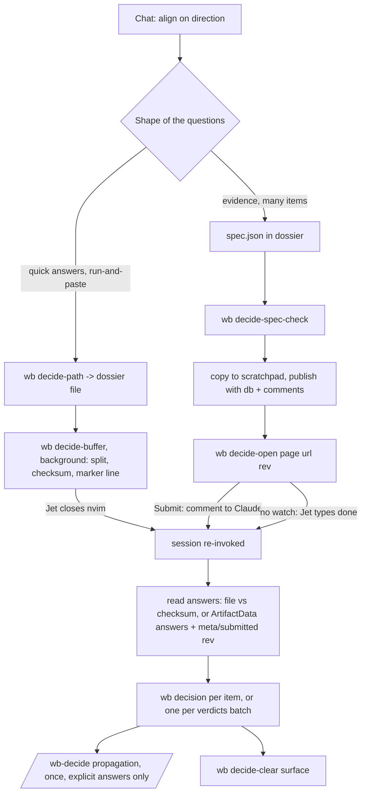

# Port the /decide skill - Plan

---

## Goal Capsule

- **Objective:** Jet has one way to be asked a batch of questions on this machine: one skill that picks an nvim buffer or a claude.ai page, wakes the session when he's done, and records each answer in the task. A page shows each item calmly (no colour until he picks, evidence one click away), and nothing the three old skills learned that still applies is lost.
- **Means:** port the Mac's `/decide` (JetNoLi/dotfiles `development` @ `cfc033606a`) onto this machine's wb, dossier layout and picker, keep the fixed-template page and extend it (KTD1, KTD6), and retire `decision-buffer`, `decision-page` and `review-page` (KD1).
- **Authority:** the task file `~/code/tasks/dotfiles--port-decide.md` (Plan section) is the requirement source; this plan's Product Contract restates it with IDs. Where the two disagree, the task file wins and this plan is corrected.
- **Stop conditions:** stop and ask Jet if a unit would need to change `wb.sh` beyond the edits KTD9 lists, if a caller of the old skills turns up that this plan doesn't name, or if the first live page publish shows `db` or `comments` unavailable on this account.
- **Execution profile:** one dotfiles branch (`port-decide`), one PR to `development`, path-limited commits per unit. Tests run in the `wb-tests` Docker image and on the host, never on the default tmux socket.
- **Who finishes:** the building session builds and commits; a fresh-context code review runs after `/clear` (memory "Code review in a fresh context"); Jet merges and re-stows.

---

## Product Contract

### Summary

Add a `/decide` skill and the wb verbs it calls, ported from the Mac, adapted to dossier recording and the local picker. Rebuild its page around what claude.ai pages do now (saved answers, comment wake-up), with Jet's review-page fix built in. Move every caller of the three old skills over, keep the shared buffer script and page kit they carry, and retire the three skills.

### Problem Frame

Putting several questions to Jet is split across three skills that each answer differently. `decision-buffer` waits on an nvim split. `decision-page` builds a local HTML file whose answers come back by a Copy-answers paste. `review-page` runs a local server whose Submit unblocks the agent. Each has its own spec format, close rules and learnings file. The Mac replaced all three with one `/decide` on 30 Oct 2026 (Mac plan `docs/plans/2026-10-30-1353-feat-wb-handoff-and-decide-plan.md`), and Jet agreed on 14 Nov to bring it here.

Two things make a straight copy wrong. The Mac's wb is a different codebase (no dossier layout, its own lock and state dir, `wb checkpoint`/`wb pickup` verbs this machine doesn't have), and this machine's skills learned rules the Mac never did (the interview shape, per-decision Questions/Notes, the triage shape, silent close applies nothing). On the page side, Jet said on 13 Nov that the review page's green is jarring and each card shows too much. He also asked (this planning session) for a fresh look at how the page is built, given what artifact pages can now do.

### Key Decisions

- KD1. **One `/decide` replaces the three skills, ported now.** (session-settled: user-approved — chosen over keeping three separate skills: they serve one need, asking several things at once; agreed 14 Nov.) Governs R1, R22, R23.
- KD2. **Keep this machine's interview shape, per-decision Questions/Notes, and code-review triage with Defer and Skip.** (session-settled: user-approved — chosen over the Mac's two shapes only: these were agreed on 6 Nov after use.) Governs R6, R7.
- KD3. **Fold in the review-page UI fix.** (session-settled: user-directed — chosen over porting the Mac page's look unchanged: Jet, 13 Nov, "the green is jarring and each card shows too much".) Governs R13.
- KD4. **Private org-only claude.ai pages are allowed for work content on this machine; the skill's own files carry no work details.** (session-settled: user-directed — chosen over the Mac's "pages on the Mac only" rule: private work pages are already normal here, and dotfiles will become public.) Governs R11, R24.
- KD5. **Rethink the page's structure, not just copy it.** (session-settled: user-directed — added by Jet at scoping, over a straight port of the Mac page.) Governs R12–R16.
- KD6. **A corrected answer supersedes the earlier same-title decision; the old one stays, marked superseded.** (session-settled: user-approved — chosen over the Mac's overwrite: the dossier keeps its history.) Governs R17.
- KD7. **"Needs you" is a per-task marker file the picker reads.** (session-settled: user-approved — chosen over the `@claude_blocked` pane option: the Stop hook overwrites it, and a page outlives the pane.) Governs R19.
- KD8. **After a restart, `/wb-save` lists open surfaces and `/wb-resume` reopens them.** (session-settled: user-approved — chosen over porting the Mac's `wb checkpoint`/`wb pickup` verbs.) Governs R20.
- KD9. **`/weekly-review` and `/wb-breakdown` move to the page; the local server and Copy answers go away.** (session-settled: user-approved — chosen over keeping review-page for its two callers.) Governs R22, R25.
- KD12. **`/wb-breakdown`'s large proposals move to the page in this PR, with editable fields.** (session-settled: user-directed — chosen over keeping them in nvim and deferring the page version: Jet, 14 Nov, "let's do it now as well".) Governs R25.
- KD13. **The "accept the remaining suggestions" box starts unticked.** (session-settled: user-directed — chosen over review-page's ticked default: Jet agreed 14 Nov.) Governs R15.
- KD10. **Retire by deleting the skill folders and folding their learnings into `/decide`, with no redirect stubs.** (session-settled: user-approved — chosen over leaving stubs.) Governs R23. Shared files inside those folders move rather than die (KTD10, KTD11).
- KD11. **Family messaging stays a separate step: `/decide` calls `/wb-decide`'s propagation after recording.** (session-settled: user-approved — chosen over building messaging into `/decide`; agreed in the task brief.) Governs R18.

### Requirements

**Choosing and opening a surface**
- R1. `/decide` agrees the direction in chat before opening anything, keeps a single question in chat, and picks buffer, page or both from the questions' shape; "a buffer" or "a page" in Jet's words overrides that.
- R2. Alignment follows the local three-outcome rule: Jet waves it through, Jet asks a question (answer it, then re-check), or Jet is silent (not aligned; don't open).
- R3. Outside a wb task, both surfaces still work inside tmux, keyed by the tmux session; outside tmux too, the questions go to chat.

**The buffer**
- R4. The buffer opens in a split of the task's tmux session as a background command, and the session is re-invoked when Jet closes it.
- R5. Re-running the buffer for a file whose split is still open waits on that split instead of opening a second editor.
- R6. Four buffer shapes: Questions (options with pros and cons, a Recommendation, a stated default, and a Questions/Notes part under every question), Interview (free text, why it matters, default if blank), Code-review triage (Recommendation, recommended fix first, real alternatives, then Defer and Skip, one box per line), and Run and paste. Findings-review and confirm-facts fold into Questions.
- R7. No option is ever pre-ticked.
- R8. A buffer closed unchanged applies nothing. When Jet answered some items, a blank item with a stated default takes it, recorded as "default taken"; an item with no stated default, or only a note, is unanswered.

**The page**
- R9. The page is a private claude.ai artifact that saves each answer as Jet clicks, so he can stop and finish on his phone.
- R10. Submit wakes the waiting session through a comment sent to Claude; when it can't, the page says to type "done", and the session reads the saved answers either way.
- R11. The page's source (its spec) lands in the task's dossier before publishing, and only a copy goes to the scratchpad for the publish (global rule "HTML artifacts → durable landing path first").
- R12. Two layouts: `items` (each item has its own options) and `verdicts` (every item takes one of a shared list). An `items` item may be a code-review triage item, which has a recommended fix, real alternatives, then Defer and Skip.
- R13. Review UI: a neutral main colour, a verdict's colour shown only once chosen; each card collapsed to title, suggested verdict and one line of reason, with evidence behind a click; answered counts per area. The verdict buttons stay on the collapsed card, so a row is answered without opening it.
- R14. The page carries what the local pages had and the Mac's lacks: area grouping, a global note, already-decided items, a previous-round callout, collapsible sections (glossary, directions), and links to evidence pages such as a compare page.
- R15. On a `verdicts` page a suggestion counts only when Jet accepts it, either item by item or by ticking one "accept the remaining suggestions" box at Submit. The box starts unticked. Submit with nothing accepted or chosen applies nothing.
- R15a. On an `items` page Submit is always allowed. The tally names unanswered items first. A blank item follows the buffer rule in R8.
- R16. Any change to a published page that affects answers (an item's question or options) gets new item ids or a new page, so old answers never attach to a changed question.

**Recording**
- R17. Each answer is recorded in the task's Decisions through `wb`, under the lock.
  - Recording the same title again supersedes the live entry.
  - Recording an identical body again writes nothing.
  - A "default taken" record never supersedes an answer Jet gave.
  - Every supersede is reported back to Jet by title.
- R18. After recording, decisions Jet made explicitly are passed once per batch to `/wb-decide`'s family propagation. "Default taken" entries and suggestions accepted through the box are not propagated.

**Waiting and picking up**
- R19. While a buffer or page waits on Jet, the picker shows the task (or tmux session) as needing him, whether or not a Claude pane is live. The mark clears when:
  - every open surface is recorded;
  - a surface is replaced or abandoned;
  - the task is done.
- R20. After a `/clear` or restart, `/wb-save`'s Handoffs entry lists the open surfaces and `/wb-resume` reopens each one.

**Callers and retirement**
- R21. Every skill, wb function, test and doc that names the three skills either moves to `/decide` or keeps working through the shared files that move.
- R22. `/weekly-review` uses the `/decide` page.
- R25. `/wb-breakdown` can put a large proposal on the `/decide` page. Each child is a row whose slug, goal, size and depends_on Jet can edit. His answers become the exact proposal `wb breakdown --apply` reads, and nothing is applied if the parent task changed after the page was published.
- R23. `decision-buffer`, `decision-page` and `review-page` are removed, their learnings folded into `/decide`'s, and the global CLAUDE.md section "Design decisions → decision-buffer" plus the memory notes that name them point to `/decide`.
- R24. The skill states this machine's page rule (KD4), and no file added to dotfiles carries work content.

### Acceptance Examples

- AE1. **Covers R5, R20.** Given a buffer open in a split and the session `/clear`ed, when `/wb-resume` reopens the listed buffer, then no second split opens and closing the first one re-invokes the session.
- AE2. **Covers R8.** Given a three-question buffer, when Jet saves and quits without changing anything, then nothing is recorded and the session asks in chat. Given he ticks question 1 only, then question 1 is recorded as chosen, question 2 (which states a default) as "default taken", and question 3 (an interview item with no default) is named as unanswered.
- AE3. **Covers R15.** Given a 30-row verdicts page, when Jet picks verdicts on 4 rows and leaves "accept the remaining suggestions" unticked, then only those 4 are recorded and the other 26 are carried over. When he ticks it, all 30 are recorded, with the 26 marked "suggestion accepted". When he presses Submit having touched nothing, nothing is recorded.
- AE6. **Covers R8, R20.** Given a buffer Jet answered and closed while the session was `/clear`ed, when `/wb-resume` re-runs it, then no split opens and the answers are recorded.
- AE4. **Covers R17.** Given a live decision titled "Fixture format", when `wb decision "Fixture format"` records a different body, then a new file supersedes the old one, which stays marked superseded; when the same body is recorded again, nothing is written.
- AE5. **Covers R19.** Given a page marked open for a task whose session has no live Claude pane, then the picker row shows "needs you", the needs-you count includes it, and `u` jumps to it.

### Scope Boundaries

- No change to `/wb-decide`'s background drafting or its shelf of drafts.
- `/decide` does not replace the buffers wb opens for itself: `wb done --review`, `/wb-jira-create` proposals, and `/wb-breakdown` proposals below the page threshold. They keep `open-buffer.sh` (KTD10).
- The status-line count (`claude-status.sh`) and the `ca` dashboard stay blind to marker-only needs; only the wb picker reads the marker.
- Considered and not built:
  - **A page written fresh per batch on a shared runtime.** KTD1 says why.
  - **Keyboard navigation and a sidebar on the page.** It's phone-first use and nobody asked. Revisit if Jet misses them on a long page.
  - **Converting old HTML-field specs to the new format.** No reuse is planned, and old pages keep their own HTML.
  - **Tying a session-keyed marker to the tmux session's creation time.** This would catch a later session reusing the name. It's rare, and the stale row is visible and cleared by `wb decide-clear --all`. Revisit if it shows up.

#### Deferred to Follow-Up Work

- Moving `wb done --review`, `/wb-breakdown` and `/wb-jira-create` from `open-buffer.sh` onto `wb decide-buffer`, so one buffer mechanism remains.
- Marker-aware status line and `ca` dashboard.

### Sources

- Mac sources at `cfc033606a`: `claude/.claude/skills/decide/{SKILL.md,references/buffer-shapes.md,references/page-spec.md,page/page.html}`, `scripts/.config/scripts/tmux/wb-lib/decide.sh`, `scripts/.config/scripts/tmux/tests/{decide-buffer,decide-page}.test.sh`.
- Local: `scripts/.config/scripts/tmux/wb.sh` (recording at `_wb_record_write_file`, `cmd_decide_supersede`; picker rows at `wb_live_session_row`; teardown at `cmd_done`; buffer shim at `wb_open_buffer`), `scripts/.config/scripts/tmux/wb-locks.sh`, `claude/.claude/skills/{decision-buffer,decision-page,review-page}/`.
- Artifact runtime contract 0.2.96 (`artifact-capabilities` skill): `db`, `comments` (`sendToClaude` needs the viewer's recent gesture; one thread per send), watches held by main-loop sessions only.

---

## Planning Contract

### Key Technical Decisions

- KTD1. **The page stays one fixed template that draws a `spec.json`, extended with safe evidence blocks (text, code, table, svg, mermaid, links) and no model-written script.** A page written per batch was compared and rejected. Its code can break and lose answers, a checker can't test it, and it costs hundreds of lines per batch. The comparison used the real past batches in the dossiers: no past decision-page spec used anything beyond inline code, collapsed evidence, groups and link chips, all of which the template draws. A bake-off wasn't needed, because both shapes were concrete enough to judge. Truly interactive evidence goes in its own linked page, as compare-page does today. Instantiates KD5.
- KTD2. **The new wb verbs live in `scripts/.config/scripts/tmux/wb-decide.sh`, sourced lazily inside each dispatch arm, like `wb-migrate.sh`.** wb.sh is stowed file by file, so a top-level `source` of a new file breaks every wb command between merge and re-stow. The file defines functions only, and calls wb.sh's own helpers at run time.
- KTD3. **`wb decision "<title>"` repeats `cmd_decide_supersede`'s post-lock steps inside its own locked section rather than calling it.** The task lock is not re-entrant, so the title lookup, the write and the supersede flip must share one acquisition. The body is written with a `### <date> <HH:MM> — <title>` header so `_wb_record_write_file` takes the title from it. Only `in-force` decisions whose `# ` title matches exactly count, and the newest one wins. On a legacy (non-dossier) task it appends a new entry that says it supersedes the earlier one. With `--default` (an item recorded as "default taken"), it never supersedes a live record that wasn't itself a default. Instead it writes a new entry naming that record. Governs R17 with KD6.
- KTD4. **The needs-you marker is `${XDG_STATE_HOME:-$HOME/.local/state}/wb/needs-you/<key>`, with one line per surface (`buffer <file> <pane> <sha>` or `page <url> <rev>`), written under its own lock key (`needs-you-<key>`) rather than the task lock.** A separate lock keeps marker writes from timing out against task-file writers on the 1-second flock. `<key>` is the task stem, or the tmux session name outside a task. Instantiates KD7.
- KTD5. **The picker reads the marker in `wb_live_session_row`, right after the urgency split: rank 0 and label "needs you", with the agent count left alone.** The count also decides whether a task's per-agent sub-rows are drawn, so forcing it to 1 would hide them. One clause in `wb_format_for_display`'s needs-you test counts a marked owner row even when the task has several agents. That's one more wb.sh function than KTD9 lists. (session-settled: user-directed — chosen over forcing the agent count to 1, which hid agent rows: Jet allowed the extra function, 14 Nov.) One stat per row reuses the colour, the needs-you count, the `u` key and the opening cursor, and it works for a session with no live Claude pane. `wb done` removes the marker under the marker's own lock, after printing the surfaces it drops. `wb down` doesn't, because a page outlives its session. Governs R19.
- KTD6. **Page behaviour changes from the Mac's page.html:**
  1. Submit sends the comment first, while the click still counts as Jet's gesture, with the spec's `rev` and the answered/total counts in its text. It then writes `meta/submitted` with the same `rev`, and shows any rejection code.
  2. Resubmits reuse the first thread, whose id is kept in `meta/submitted`.
  3. The `<title>` is a fixed two-to-four-word name built from the task, and the sentence goes in the artifact description.
  4. `<details>` open state survives re-renders.

  The session accepts a rev-matched comment or a rev-matched `meta/submitted` as the submit signal. On a comment wake it re-reads `meta/submitted` for a few seconds before treating the page as not submitted. If the `answers` it reads fall short of the stated count, it asks Jet to press Submit again rather than recording a partial set. The page uses the `db` and `comments` calls exactly as contract 0.2.96 defines them. `/decide` publishes and watches from the main session only: a subagent can't hold an artifact watch, so a page published by a delegated helper could never wake anyone. Governs R10, R16.
- KTD7. **The verdicts layout keeps review-page's "accept the remaining suggestions" box at Submit, unticked by default, with the tally naming both counts ("12 chosen, 18 carried over; tick to take their suggestions").** Untouched rows count only through that box. Each recorded row says whether it was "chosen" or "suggestion accepted". Instantiates KD13. Governs R15.
- KTD8. **Answer files and page specs land in the task's dossier, under `decision-records/<stamp>-decide.md` for a buffer and `decision-records/<stamp>-<slug>/spec.json` for a page.** `wb decide-path` creates the stamped name. The page folder is copied to the scratchpad only to publish, because the Artifact tool publishes from the working directory or the scratchpad. Outside a wb task they go to `${XDG_STATE_HOME}/wb/decide/<session>/`, and the skill says where. Governs R11.
- KTD9. **wb.sh edits are limited to:**
  - the dispatch arms and their header usage lines;
  - the marker read in `wb_live_session_row`;
  - the marker removal and listing in `cmd_done`;
  - a one-line marker-path helper;
  - `wb_open_buffer`'s path, with a fallback to the checkout copy (KTD10).

  (session-settled: user-approved — chosen over editing wb.sh freely, so #144, W12's `wb page` PR, and W4, the deletion PR, rebase cleanly.) Conflict call-out: the settled scope said dispatch only, but research showed the picker read, the teardown and the buffer path can't live outside wb.sh. Each is a few lines in a function the other PRs don't touch.
- KTD10. **`open-buffer.sh` and its `mechanism.md` move into the decide skill (`decide/scripts/open-buffer.sh`, `decide/references/open-buffer.md`) and stay the buffer for wb's own verbs.** `wb_open_buffer`, `/wb-breakdown`, `/wb-jira-create`, `/artifact-summary` and two tests point at the new path. `wb_open_buffer` tries the new stowed path first. It then falls back to the moved script inside the checkout that wb.sh itself resolves to (`readlink -f` on wb.sh, then the repo-relative path), as `compare-page.py` already does. The old stowed link can't be the fallback, because it dangles from the moment the main checkout pulls the move. This keeps `wb done --review` working between pull and re-stow. The two skill texts need the re-stow.
- KTD11. **`decision-page/kit/` moves to `compare-page/kit/`.** compare-page is the only remaining importer.
- KTD12. **The page gains an editable `fields` list per item, and a script turns breakdown answers into `wb breakdown --apply`'s proposal grammar.** This instantiates KD12 and governs R25. The pieces:
  - **Fields:** an item carries `fields[{key, label, value, placeholder, wide}]`, ported from review-page. Edited values save into the item's answer doc as `fields` with `fields_changed`, and editing a field marks the row touched.
  - **Proposal script:** `claude/.claude/skills/wb-breakdown/scripts/answers-to-proposal.sh` (jq) reads the spec and the answers and writes `logs/breakdowns/<parent-stem>.md` in the strict grammar the skill already documents.
    - Rows with "create" (or the accepted suggestion) become children with their edited fields.
    - "Skip" rows are left out.
    - A row with a note that asks for more information stops the conversion, and the script names the row.
  - **Staleness:** the spec records the parent task file's checksum at publish as `base`. The script refuses, naming the change, when the parent's checksum now differs, so an approval never applies over edits made since.
  - **Apply:** `--apply` itself is unchanged.

  The nvim buffer stays for proposals under the size threshold.
- KTD13. **`wb decide-buffer` writes the file's checksum to its marker line once, at the first open, and a re-run never replaces it.** On a re-run:
  - a recorded pane still running nvim on that file is waited on, not split again;
  - a recorded pane that's gone or reused, with the file changed from the checksum, opens nothing. The command prints the file as changed and exits 0, so the answers are read.
  - only a file that still matches its checksum is split again.

  The checksum lets the skill tell an unchanged close from an answer, even when Jet answered while the session was gone. The split turns `remain-on-exit` off in the same tmux command, because the agent window has it on and the split would inherit it. It also sets `WB_REVIEW_BUFFER=1` as the local buffers do, to skip format-on-save. Governs R4, R5, R8.
- KTD14. **The `verdicts` layout records one summary decision per round, titled `<batch title> (round N)`, listing each verdict as "chosen" or "suggestion accepted"; the `items` layout and buffers record one decision per item.** The round in the title keeps a later round from superseding an earlier one whose verdicts still stand. A verdict a later round changes says which round it replaces. A caller skill such as `/weekly-review` can instead take the answers back and record in its own shape. Dozens of per-row decision files, each propagated, would bury the Decisions view.
- KTD15. **The page's script keeps a DOM-free core** (layout tallies, grouping and counts, acceptance logic, spec normalising, svg sanitising) that a node test runs, following `decision-page.test.sh`'s pattern. The DOM wiring is checked by hand in the test guide.

### High-Level Technical Design

How a batch moves through the skill, the wb verbs and the two surfaces:



Life of one surface's marker line:

```mermaid
stateDiagram-v2
  [*] --> Open: decide-buffer or decide-open
  Open --> Open: wb down, /clear, restart (line kept; /wb-save lists it)
  Open --> Answered: Jet closes buffer or presses Submit
  Answered --> Open: items unanswered or a note asks for more
  Answered --> Cleared: all items recorded, decide-clear
  Open --> Cleared: wb done (prints what it drops)
  Open --> Cleared: replaced by a new page, or abandoned (decide-clear)
  Cleared --> [*]
```

### Output Structure

```text
claude/.claude/skills/decide/
  SKILL.md
  learnings.md                 # merged from the three retired skills
  page/page.html               # fixed template (KTD1, KTD6)
  references/buffer-shapes.md  # Questions, Interview, Code-review triage, Run and paste
  references/page-spec.md
  references/open-buffer.md    # moved mechanism.md (KTD10)
  scripts/open-buffer.sh       # moved (KTD10)
  scripts/page-core.test.sh    # node test of the page's core (KTD15)
  fixtures/{items,verdicts,triage}.json
scripts/.config/scripts/tmux/
  wb-decide.sh
  tests/{wb-decide-buffer,wb-decide-spec,wb-decision}.test.sh
```

### Sequencing

U1 → U2 → U3 → U4 → U10 → U5 → U6 → U7 → U8 → U9. U5 depends on U4 for the page and on U1/U2 for the verbs. U10 depends on U4's fields. U8 depends on everything it repoints.

### System-Wide Impact

- **The picker and `wb done`:**
  - every live row pays one extra stat;
  - `wb done` gains one locked `rm` and a printed line;
  - `wb down`, `wb pause` and the status line don't change (KTD5).
- **Shared buffer users:** `wb done --review` reaches the moved `open-buffer.sh` through the checkout fallback until the re-stow (KTD10). `/wb-breakdown` and `/wb-jira-create` name the new stowed path in their text, so the re-stow should follow the pull right away.
- **Skills that route decisions:** `/weekly-review`, `/pragmatic-review`, `/handoff`, `/quick-wins`, `/compare-page` and `/artifact-summary` change what they call. The global CLAUDE.md, which every session in every repo loads, changes its routing section.
- **Other sessions in the family:** `/wb-decide` propagation now also fires after `/decide`, once per batch (KD11). Sessions in the family receive `[wb-propagate]` messages for buffer and page answers as they do today for `/wb-decide` records.
- **Merge order:** #144 (W12, `wb page`) and W4, the deletion PR, also edit `wb.sh`. Whichever merges later rebases. KTD9 keeps this PR's wb.sh edits to functions those PRs don't touch.
- **Stow:** a new skill folder and a new `wb-decide.sh` need `stow --no-folding -t "$HOME" claude` and a `scripts` re-stow after merge. The deleted skill folders leave dead links under `~/.claude/skills/` to clear (memory "Stow after dotfiles merge").

---

## Implementation Units

| Unit | Title | Key files | Depends on |
|---|---|---|---|
| U1 | Surface verbs and the needs-you marker | `scripts/.config/scripts/tmux/wb-decide.sh`, `wb.sh` dispatch | none |
| U2 | `wb decision` recording | `wb-decide.sh` | U1 |
| U3 | Picker reads the marker; `wb done` clears it | `wb.sh` | U1 |
| U4 | The page, its spec and its check | `claude/.claude/skills/decide/page/page.html`, `references/page-spec.md` | U1 |
| U10 | `/wb-breakdown` proposals on the page | `claude/.claude/skills/wb-breakdown/scripts/answers-to-proposal.sh` | U4 |
| U5 | The `/decide` skill and buffer shapes | `claude/.claude/skills/decide/SKILL.md` | U1, U2, U4 |
| U6 | Move the buffer script and page kit | `decide/scripts/open-buffer.sh`, `compare-page/kit/` | U5 |
| U7 | `/wb-save` and `/wb-resume` carry open surfaces | `wb-save/SKILL.md`, `wb-resume/SKILL.md` | U1, U5 |
| U8 | Move callers, retire the three skills | callers' `SKILL.md`, `claude/.claude/CLAUDE.md`, `docs/guides/` | U4–U7, U10 |
| U9 | Live check, test guide, records outside the repo | dossier `test-guide.md`, `checks.md`, port record | U1–U8, U10 |

### U1. Surface verbs and the needs-you marker

- **Goal:** `wb decide-path`, `decide-buffer`, `decide-open` and `decide-clear` work on this machine.
- **Requirements:** R3, R4, R5, R8, R11, R19; KTD2, KTD4, KTD8, KTD13.
- **Dependencies:** none.
- **Files:**
  - create `scripts/.config/scripts/tmux/wb-decide.sh` and `scripts/.config/scripts/tmux/tests/wb-decide-buffer.test.sh`;
  - modify `scripts/.config/scripts/tmux/wb.sh` (dispatch arms, header usage lines, marker-path helper).
- **Approach:**
  1. Port the Mac's `decide.sh` functions, replacing its helpers with local equivalents:
     - a `_wb_decide_target` that reads `--task` through `_wb_append_resolve_task`, or else `wb_session_task_file` on `tmux display -p -t "$TMUX_PANE" '#S'`, falling back to the session name;
     - `basename` for the stem;
     - a task-to-session loop modelled on `_wb_refuse_if_live_session`;
     - `wb_task_lock_acquire_guarded` and `wb_task_lock_release` on the marker's lock key.
  2. `decide-path` returns the dossier path from KTD8.
  3. `decide-buffer` adds the attach path and checksum from KTD13, releases the lock before the pane poll, and prints the file and its open-time checksum.
  4. Each new verb `exit`s like the other `cmd_*` verbs and is errexit-safe.
- **Patterns to follow:** the Mac `decide.sh`; `cmd_decide_supersede` for lock and trap use; the `migrate)` dispatch arm; `wb_layout_session` for the agent window.
- **Test scenarios:**
  - `decide-path` inside a dossier task gives a fresh `decision-records/<stamp>-decide.md` path; outside a task, inside tmux, a path under the state dir keyed by session; outside both, exit 1 with "neither a wb task nor in tmux".
  - `--task nope` fails with "no task 'nope'".
  - `decide-buffer` with a fake nvim opens one split, writes `buffer <file> <pane> <sha>` to the marker, waits while the pane lives, exits 0 printing the file once it closes, and leaves the line in place.
  - Covers AE1. Re-running `decide-buffer` on the same file while its pane is alive opens no second split and returns when that pane closes.
  - Covers AE6. Open, edit the file, kill the pane, re-run: no split opens, the command prints the file as changed, exits 0, and the marker line keeps its original checksum.
  - A recorded pane that's gone, or now runs something other than nvim, with the file unchanged, gets a fresh split on re-run, and the marker line keeps the first checksum.
  - With no caller pane, the split opens in the `agent` window found by exact name; an `agent-logs` window doesn't match. The split doesn't inherit `remain-on-exit`, so the waiter returns.
  - A split that can't open (a 2x2 session) exits 1 and marks nothing.
  - A held marker lock (a real flock holder) makes `decide-open` and `decide-buffer` exit 75 and write nothing.
  - `decide-open page <url> <rev>` adds a line, `decide-clear <file>` drops only that line, clearing the last line removes the file, and `decide-clear --all` removes it.
  - `wb help` lists every new verb (the existing `wb-help.test.sh` check).
- **Verification:** the new test passes in the `wb-tests` image on a private tmux socket, and `wb-help.test.sh` still passes.

### U2. `wb decision`: recording with supersede

- **Goal:** answers are recorded into the dossier, replacing by title without losing history.
- **Requirements:** R17; KTD3.
- **Dependencies:** U1 (shares `wb-decide.sh` and target resolution).
- **Files:** modify `scripts/.config/scripts/tmux/wb-decide.sh` and `scripts/.config/scripts/tmux/wb.sh` (dispatch arm, header line); create `scripts/.config/scripts/tmux/tests/wb-decision.test.sh`.
- **Approach:**
  1. Read the body from stdin; an empty body is an error.
  2. Take the task lock once.
  3. Find the live same-title record (KTD3). An identical live body ends with "unchanged".
  4. Write the new record, then flip the old one to superseded and render the views.
  5. Print the new id and any id it superseded.
  6. On a legacy task, append under `## Decisions` as KTD3 says.
- **Patterns to follow:** `cmd_decide_supersede` (WB around line 5065), `_wb_record_write_file`, `_wb_record_parse`'s header form.
- **Test scenarios:**
  - A first record on a dossier task writes one `decisions/` file with `status: in-force` and the title on its `# ` line, not repeated.
  - Covers AE4. A second record with the same title and a new body writes a new file whose `supersedes` names the old one; the old one gets `status: superseded` and `superseded_by`.
  - A third record supersedes the second, not the first, which is already superseded.
  - Recording an identical body again writes nothing and says "unchanged".
  - A `--default` record whose title matches a live answer Jet gave writes a new entry naming it and leaves it in force.
  - Every supersede prints the superseded record's id and title.
  - Two rounds of one verdicts batch (`<title> (round 1)`, `<title> (round 2)`) both stay in force.
  - A title differing only in case or trailing space is matched as specified (exact after trailing-space trim) and documented in the help line.
  - A legacy task gets an appended `### <date> — <title>` entry noting it supersedes the earlier one.
  - A held task lock gives exit 75 with nothing written.
- **Verification:** the test passes, and `wb-append.test.sh` and `wb-decide-supersede` coverage are unchanged.

### U3. Picker reads the marker; `wb done` clears it

- **Goal:** the picker shows a task waiting on a buffer or page as needing Jet, even when no Claude pane is live.
- **Requirements:** R19; KTD5.
- **Dependencies:** U1.
- **Files:**
  - modify `scripts/.config/scripts/tmux/wb.sh` (`wb_live_session_row`, the needs-you clause in `wb_format_for_display`, `cmd_done`) and `scripts/.config/scripts/tmux/instructions.md` (needs-you text);
  - test in `scripts/.config/scripts/tmux/tests/wb-decide-buffer.test.sh`, plus an assertion each in the existing picker-row and `wb-done` tests.
- **Approach:**
  1. In `wb_live_session_row`, override the rank and label (not the count) for a non-empty marker keyed by the task stem, or by the session name for a plain session.
  2. In `wb_format_for_display`'s needs-you test, count a marked owner row even when it has several agents (KTD5).
  3. In `cmd_done`, take the marker's own lock, print the open surfaces, then remove the marker.
  3. `cmd_down` leaves the marker alone.
- **Patterns to follow:** the `nd` awk clause in `wb_format_for_display`, and `_next_needs`.
- **Test scenarios:**
  - Covers AE5. A task session with a marker and no Claude pane renders "needs you" at rank 0, is counted in "N need you", and `_next_needs` selects it.
  - A multi-agent task with a marker is counted once, and its per-agent sub-rows still show.
  - `wb done` while another process holds the marker lock exits 75 and leaves the marker in place.
  - A plain (non-task) session with a session-keyed marker shows "needs you".
  - `wb down` leaves the marker; `wb done` prints "open /decide surfaces dropped: page <url>" and removes it.
  - Without a marker, rows are unchanged (no new forks per row).
- **Verification:** the existing picker and done tests pass unchanged apart from the added assertions.

### U4. The page: template, spec and check

- **Goal:** a phone-friendly page that renders a spec in either layout, saves answers, wakes the session, and looks like Jet asked on 13 Nov.
- **Requirements:** R9, R10, R12–R16; KTD1, KTD6, KTD7, KTD15.
- **Dependencies:** U1 (dispatch for `decide-spec-check`).
- **Files:**
  - create `claude/.claude/skills/decide/page/page.html`, `claude/.claude/skills/decide/references/page-spec.md`, `claude/.claude/skills/decide/fixtures/{items,verdicts,triage}.json`, `claude/.claude/skills/decide/scripts/page-core.test.sh` and `scripts/.config/scripts/tmux/tests/wb-decide-spec.test.sh`;
  - modify `scripts/.config/scripts/tmux/wb-decide.sh` (`decide-spec-check`).
- **Approach:**
  1. Start from the Mac page.html.
  2. Tokens and controls:
     - make the accent neutral ink, with a per-verdict palette used only on a chosen verdict, and keep the amber "suggested" style for unchosen suggestions;
     - a chosen verdict also shows a check mark and the word "chosen", so colour never carries the state alone;
     - the palette meets 4.5:1 text contrast in both themes;
     - the controls are real buttons with visible focus and at least a 44px touch height;
     - on a desktop the content uses about 80–85% of the viewport width (memory "HTML docs use wide layout").
  3. Build the collapsed card in `renderItem`: title, suggested verdict, `reason` line, and the verdict or option buttons, wrapping at 360px. The context, evidence blocks and note go inside `<details>`.
  4. Group items by `area`, keeping spec order, with collapsible areas and an "x of y" heading per area. Area chips in the sticky bar jump to their heading and scroll sideways on a phone, and a "Next unanswered" button scrolls to the first open row.
  5. Add these spec fields:
     - `rev`, `area`, `reason` and verdict `tone`;
     - `decided[]`, `prior`, `sections[]` and `links[]`;
     - `kind: "triage"` on an items-layout item;
     - `fields[]` per item and `base` at the top (KTD12);
     - `global_note` (a db doc `meta/global`);
     - mermaid blocks, which the artifact host renders natively with no library.
  6. Apply KTD6's Submit, thread, title and details-state changes, KTD7's accept box, and R15a for unanswered items.
  7. Document the page's states in `page-spec.md`:
     - saving and saved;
     - save failed (the item is marked and retried, and Submit waits until it clears);
     - a capability unavailable (a banner names it);
     - submitted and waiting (answers stay editable, a banner says it was sent, and resubmitting is allowed).
  8. Make the spec check reject:
     - unknown block types;
     - svg with script or event attributes;
     - a triage item without exactly one recommended option plus Defer and Skip;
     - a verdicts item that has a `suggested` but no `reason`.

     Given `--previous <spec>`, it also rejects an item id whose question text or option ids changed (R16). The skill keeps each published rev's spec beside the next one in the dossier page folder.
  9. Build the fixtures from dotfiles samples only, and synthesise a 90-row verdicts fixture for scale.
- **Patterns to follow:** the Mac page.html; the artifact page contract (tokens on `:root`, the dark-mode triple, 16px gutters, no horizontal scroll); `decision-page.test.sh`'s node-core extraction.
- **Test scenarios:**
  - The spec check passes the three fixtures, and fails a missing item id, a duplicate id, a suggestion that isn't a verdict, an unknown block type, an svg carrying `onload`, and a triage item without Defer, naming each.
  - With `--previous`, the check fails an item whose id stayed the same but whose options changed, and passes one whose only change is its context text.
  - Covers AE3. Core tally: on a verdicts spec, 4 chosen rows with the accept box off counts 4 answered and 26 carried over. With the box on, it counts 30 answered, 26 of them by suggestion. With zero chosen and the box off, it counts nothing answered.
  - On an items spec with one item answered, a blank item with a stated default counts as "default taken", and a blank item with no default is listed as unanswered.
  - The per-area counts sum to the header tally.
  - The svg sanitiser strips `<script>`, `foreignObject` and `on*` attributes.
  - Answers whose item id is not in the spec are ignored by the tally.
  - The inline scripts pass `node --check`.
- **Execution note:** the DOM wiring (Submit order, thread reuse, details state, phone layout in light and dark) can't run in the test image. Check it in the first live publish (U9), with one `ArtifactData list` of `answers` and one read of `meta/submitted`.
- **Verification:** both tests pass on the host (node) and the spec test passes in the image (`jq`).

### U10. `/wb-breakdown` proposals on the page

- **Goal:** a large breakdown proposal is reviewed and edited on the page, and the approved version is exactly what `wb breakdown --apply` applies.
- **Requirements:** R25; KD12, KTD12.
- **Dependencies:** U4 (`fields` and `base` in the page and the spec check).
- **Files:**
  - create `claude/.claude/skills/wb-breakdown/scripts/answers-to-proposal.sh`, `claude/.claude/skills/wb-breakdown/scripts/answers-to-proposal.test.sh` and fixtures beside it;
  - modify `claude/.claude/skills/wb-breakdown/SKILL.md` (the "Large proposals" paragraph and step 5).
- **Approach:**
  1. The skill builds a verdicts spec (create / merge into another child / skip), one row per child, with the Plan body in a collapsed text block and `fields` for slug, goal, size and depends_on.
  2. The parent-file edits (migration, plan rewrite, follow-up moves) go in the spec's intro. The skill sets `base` to the parent's checksum.
  3. On Submit, the skill fetches the answers (`ArtifactData`, paged) into a JSON file in the dossier page folder and runs the script. It then hands the proposal file to `wb breakdown --apply` unchanged.
  4. A refusal from the script (stale base, a row asking for more) goes back to Jet in chat, and the skill publishes a fresh round.
- **Patterns to follow:** the grammar in `wb-breakdown/SKILL.md` step 5; review-page's `fields` and `fields_changed` contract; the existing `wb-breakdown.test.sh` sandbox store for parsing a proposal.
- **Test scenarios:**
  - A three-child spec with one slug edited and one row skipped produces a proposal with two children, the edited slug and the untouched goals, matching the expected fixture byte for byte.
  - That proposal is accepted by `wb breakdown --apply` in a sandbox store and creates the two children with the edited slug.
  - A changed parent checksum makes the script exit non-zero naming the parent, and write no proposal.
  - A row whose note asks for more information stops the conversion and names the row.
  - With the accept box unticked, an untouched row with a suggested "create" is reported as carried over, not created.
- **Verification:** the script test passes in the image (`jq`), and the existing `wb-breakdown.test.sh` still passes.

### U5. The `/decide` skill and its buffer shapes

- **Goal:** the skill text a session follows, adapted to this machine.
- **Requirements:** R1–R3, R6–R8, R11, R17, R18, R24; KTD8, KTD13, KTD14.
- **Dependencies:** U1, U2, U4.
- **Files:** create `claude/.claude/skills/decide/SKILL.md`, `claude/.claude/skills/decide/references/buffer-shapes.md` and `claude/.claude/skills/decide/learnings.md`.
- **Approach:**
  1. Port the Mac SKILL.md's five sections and replace:
     - the alignment step with the local three-outcome rule;
     - the page rule with KD4's;
     - the scratchpad page folder with KTD8's dossier path plus a publish copy;
     - the Mac's two shapes with the four in R6, with templates taken from the local `choice.md`, `interview.md` and `code-review-triage.md`;
     - "a blank takes its default" with R8, using the checksum.
  2. Recording follows KTD14, with `--default` for "default taken" items. The one-line summary after recording names every decision `wb decision` reports it superseded.
  3. After recording, the skill calls `/wb-decide` step 6 once, for "chosen" answers only (KD11, R18).
  4. Reading a page's answers follows KTD6's submit signal and pages `ArtifactData list` until it returns no `next_cursor`.
  5. After a restart it re-arms the page watch as best effort. When the watch listing doesn't show auto-replies armed, it tells Jet to type "done" after Submit.
  6. When a page is replaced (R16) or Jet abandons a batch, the skill runs `wb decide-clear` for that surface.
  7. Publishing and watching happen in the main session only (KTD6).
  8. Merge the three learnings files into one dated ledger, keeping the 39 rules the inventory found, minus the ones artifact pages make obsolete (Copy answers, the local server, spec_hash pastes, snap-Chromium file:// guards).
- **Patterns to follow:** the Mac SKILL.md; the local `decision-buffer/SKILL.md` sections on alignment, parse rules and rewrite-fresh; the memory notes on per-decision notes, triage options, one readable reply per turn, and identifiers with descriptions.
- **Test expectation:** none -- skill prose; behaviour is covered by U1–U4 tests and the U9 live run.
- **Verification:** every wb verb the skill names exists in `wb help`; every rule in the inventory's KEEP list maps to a line in SKILL.md, buffer-shapes.md or learnings.md.

### U6. Move the shared buffer script and the page kit

- **Goal:** retiring the old folders breaks nothing that still needs their shared files.
- **Requirements:** R21; KTD10, KTD11.
- **Dependencies:** U5 (the decide folder exists).
- **Files:**
  - move `claude/.claude/skills/decision-buffer/scripts/open-buffer.sh` to `claude/.claude/skills/decide/scripts/open-buffer.sh`;
  - move `claude/.claude/skills/decision-buffer/references/mechanism.md` to `claude/.claude/skills/decide/references/open-buffer.md`;
  - move `claude/.claude/skills/decision-page/kit/` to `claude/.claude/skills/compare-page/kit/`;
  - modify `scripts/.config/scripts/tmux/wb.sh` (`wb_open_buffer`), `claude/.claude/skills/compare-page/scripts/compare-page.py`, `claude/.claude/skills/compare-page/references/spec.md`, `scripts/.config/scripts/tmux/tests/wb-open-buffer.test.sh` and `scripts/.config/scripts/tmux/tests/decision-buffer-open.test.sh`.
- **Approach:** use `git mv` so history follows. `wb_open_buffer` tries the new stowed path, then the checkout copy found from wb.sh's resolved location (KTD10), and names both in its error. Leave the script's internals unchanged.
- **Test scenarios:**
  - `wb-open-buffer.test.sh` passes against the new stowed path.
  - With no stowed `open-buffer.sh` at either path, it runs the checkout copy.
  - `decision-buffer-open.test.sh` passes unchanged apart from its path.
  - compare-page's generator test passes with the moved kit.
- **Verification:** the three tests pass in the image; the moved files have no content changes.

### U7. `/wb-save` and `/wb-resume` carry open surfaces

- **Goal:** a `/clear` or restart never loses an open buffer or page.
- **Requirements:** R20.
- **Dependencies:** U1, U5.
- **Files:** modify `claude/.claude/skills/wb-save/SKILL.md` and `claude/.claude/skills/wb-resume/SKILL.md`.
- **Approach:**
  - `/wb-save` reads the marker and adds an optional trailing `**Open /decide surfaces:**` field after `**Received:**`, one line per surface with a plain description, omitted when empty.
  - `/wb-resume` reopens each listed surface:
    - a buffer: re-run `wb decide-buffer <file>` in the background. Per KTD13 it attaches, reopens, or reports the file changed, and a changed file is recorded straight away.
    - a page: `ArtifactComments watch`, then read `meta/submitted`.
    - a surface whose buffer file or page no longer exists: offer to drop it with `wb decide-clear`.

    It does this even when an automatic entry follows the rich one, and says so. Both skills read the marker live as well, so a surface opened after the last save isn't missed.
- **Test expectation:** none -- skill prose; covered by the live run in U9.
- **Verification:** the shape examples in both skills include the new field.

### U8. Move the callers and retire the three skills

- **Goal:** nothing names a retired skill, `/weekly-review` uses the page, and the three folders are gone.
- **Requirements:** R21, R22, R23; KD9, KD10.
- **Dependencies:** U4, U5, U6, U7, U10.
- **Files:**
  - **skill callers to modify:** `claude/.claude/skills/{weekly-review,wb-breakdown,wb-jira-create,pragmatic-review,handoff,quick-wins,compare-page,artifact-summary}/` (SKILL.md and the named references);
  - **repo files to modify:** `claude/.claude/CLAUDE.md` (the "Design decisions" section), `claude/README.md`, `scripts/.config/scripts/tmux/{lib.sh,claude-sessions.sh,handoff.sh,wb-board.sh}` comments, `scripts/.config/scripts/tmux/tests/parked-items-retirement.test.sh` (`LIVE_FILES`), `install.sh` and `.gitignore` comments;
  - **docs:** create `docs/guides/decide.md`; add a retirement banner naming `/decide` to `docs/guides/{decision-buffer,decision-page,review-page}.md` and drop them from the hub links; update `docs/where-we-are.md`, `docs/glossary.md`, `docs/guides/weekly-review.md` and `docs/guides/pragmatic-review.md`;
  - **delete:** what remains of `claude/.claude/skills/{decision-buffer,decision-page,review-page}/`.
- **Approach:**
  1. `/weekly-review` builds a verdicts spec and reads `answers` plus `meta/submitted` through `ArtifactData`, with "carried over" meaning not accepted (KTD7).
  2. `/wb-breakdown`'s page path was rewritten in U10. Here only its `open-buffer.sh` path references change (KTD10).
  3. `wb-migrate.sh`'s parsing of historic `decision-page <slug> rN:` entries stays as it is.
  4. Commit the doc `.md` edits separately from code (memory "docgen hook stages docs md"). The docgen pre-commit hook regenerates `docs/INDEX.md`, `docs/HUB.html` and the guide HTML.
- **Patterns to follow:** commit `c65a944`, which retired the wb-done skill: `git rm`, the replacing skill absorbing the behaviour, callers updated, generated docs, `LIVE_FILES`.
- **Test scenarios:**
  - `parked-items-retirement.test.sh` passes without the review-page entry.
  - A grep for `decision-buffer|decision-page|review-page` outside history, plans, archive, fixtures and `wb-migrate.sh` finds only retirement banners and moved-path notes.
  - The full `wb-tests` suite's per-file FAIL set matches a clean-room baseline of `development` (memory "wb test sandbox known failures").
- **Verification:** the suite comparison is clean, and docgen regenerates without hand edits.

### U9. Live check, test guide and the records outside the repo

- **Goal:** the port is proven live and recorded where the family looks.
- **Requirements:** R9, R10, R19, R23, R24.
- **Dependencies:** U1–U8, U10.
- **Files:** none in the repo. Outside it:
  - `~/code/tasks/dossiers/dotfiles--port-decide/test-guide.md` (built to HTML with the dossier's `tools/build.sh` and published) and `checks.md`;
  - a row and a "differences" section in `~/code/tasks/dossiers/dotfiles--feat-macos-cross-platform/port-record.md`;
  - after merge and re-stow, at close-out: the memory notes `decision-buffer-per-decision-notes`, `decision-buffer-companion-html`, `decision-buffer-rewrite-fresh` and `code-review-triage-needs-options`, plus the `MEMORY.md` index lines, repointed to `/decide`. Repointing them earlier would send every session to a skill that isn't live yet.
- **Approach:**
  1. Run the live checks against a temporary stow of this worktree's `claude` and `scripts` packages:
     - dry-run it with `stow -n` first;
     - note the link targets;
     - restore the main-checkout stow afterwards;
     - record both steps in `checks.md` (memory "Live scripts stowed from a worktree").

     Then, in a throwaway task, run one real buffer (three questions; check the picker mark, close, record, clear).
  2. Run one real page in each layout, answering one on the phone. Run one breakdown proposal through the page, editing a slug, into `wb breakdown --apply` on a throwaway parent. Check Submit wakes the session, and that "done" works when the watch is off.
  3. Check that `/wb-save` → `/clear` → `/wb-resume` reattaches a still-open buffer. Check that a Submit after `/clear` and `/wb-resume` either wakes the session or gets the "type done" prompt.
  4. The guide's steps go into the PR's "How to test" section.
- **Test expectation:** none -- this unit is the live verification itself.
- **Verification:** `checks.md` lists the live checks with outcomes, and the port record row says "in review" with the PR number.

---

## Verification Contract

| Gate | How | Applies to |
|---|---|---|
| wb verb tests | `wb-decide-buffer`, `wb-decision` and `wb-decide-spec` `.test.sh` in the `wb-tests` image (repo mounted read-only), private `-L` tmux socket, fake nvim on PATH | U1, U2, U3, U4 |
| Page core | `claude/.claude/skills/decide/scripts/page-core.test.sh` on the host with node (skips with a message when node is missing) | U4 |
| Moved files | `wb-open-buffer`, `decision-buffer-open` and compare-page tests | U6 |
| Breakdown proposal | `answers-to-proposal.test.sh` and `wb-breakdown.test.sh` in the image | U10 |
| Full suite | every `*.test.sh` in the image, per-file FAIL set compared to a clean-room run of `development` under `~/.cleanroom/port-decide-baseline/` | U8 |
| awk under both | the picker and decision tests under host mawk and image gawk | U2, U3 |
| shellcheck | `koalaman/shellcheck` image on `wb-decide.sh`, the changed wb.sh regions and the moved `open-buffer.sh` | U1, U2, U3, U6 |
| Live | the U9 runs, recorded in `checks.md` | U9 |
| Review | `/ce-code-review` in a fresh context after `/clear`, then `wb reviewed` | all |

---

## Definition of Done

- Every unit's verification holds, and the gates above pass (full suite equal to the baseline FAIL set).
- `wb help` lists `decide-path`, `decide-buffer`, `decide-open`, `decide-clear`, `decide-spec-check` and `decision`.
- No file under `claude/.claude/skills/` names a retired skill except the moved-path notes, and the three folders are gone.
- The global CLAUDE.md section points to `/decide`, and the port record is updated. The memory notes are repointed at close-out, after merge and re-stow.
- No work content added to dotfiles: fixtures come from dotfiles' own dossiers or are synthetic.
- No abandoned-attempt code remains in the diff.
- The PR body carries the test guide's steps and the attribution line, and the follow-ups in "Deferred to Follow-Up Work" are filed as tasks.
