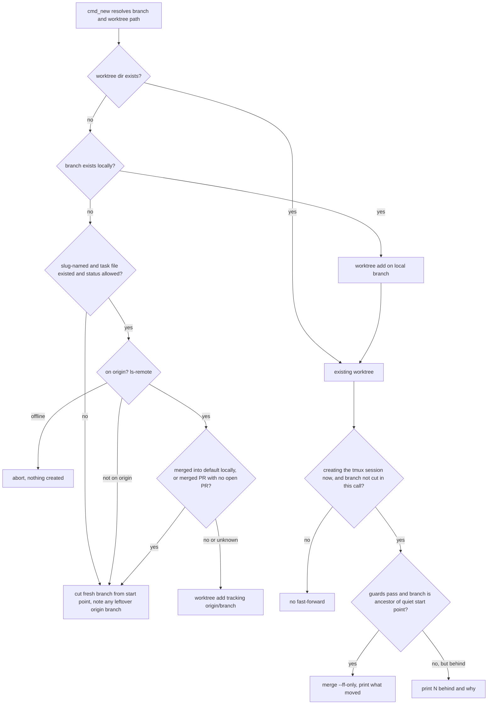

# wb Bash Fixes After W4 - Plan

## Goal Capsule

- **Objective:** Jet's wb sessions start on the right code and come back cleanly after a crash. `wb new`/`wb resume` pick up a task's own pushed branch instead of cutting a divergent one, and a stale idle worktree is brought up to date on reattach. One command restores a set of sessions. The context card shows the right session and keeps its recap. Decision capture drafts fewer throwaway entries, and no task's drafts go unreviewed because its session ended with `wb down`. The wb scripts are easier to review and are fully checked by shellcheck.
- **Means:** eight small fixes, landed in dependency order, in `scripts/.config/scripts/tmux/` (wb.sh, claude-card.sh, claude-reply-log.sh, wb-capture-sweep.sh), landed as one branch and one PR with one commit or more per unit (KTD1).
- **Authority:** this plan, then the task file `~/code/tasks/dotfiles--wb-bash-fixes.md` (its Plan section and its in-force decision files of 14 Nov), then each child task file named in Sources.
- **Stop conditions:**
  - Stop and ask if the shellcheck findings grow past about 120 once wb.sh parses with the new code; that would justify a second PR.
  - Stop and ask if a headless `claude -p` run turns out to write a `~/.claude/sessions/<pid>.json` entry with a `tmux` field (it changes U5's filter decision).
- **Execution profile:** one session, branch `wb-bash-fixes`, PR against `development`. Code review runs in a fresh context after `/wb-save`, never in the build session.

---

## Product Contract

### Summary

Build the six fixes the 14 Nov backlog triage held back until W4 (dotfiles PR #147, which removed wb's old section-based write path) merged.
In order: move the `wb done` sweep classifier into its own file, attach `wb new` to the task's own origin-only branch, fast-forward stale commit-less worktrees on reattach, add `wb restart`, harden the context card, tighten the decision-capture sweep prompt, make `wb down` warn about unreviewed decision drafts, and make shellcheck parse all of wb.sh and clear its findings.
The two capture fixes joined on 14 Nov from the decision-capture graduation review (`dotfiles--capture-graduation-review`), which filed them under this task.

### Problem Frame

Each fix was found during earlier work and parked because it touched wb.sh regions W4 was rewriting.
The cost of leaving them: a task resumed on another machine cuts a branch that diverges from its pushed PR and later needs a force-push; an idle worktree created before the start-point fix stays dozens of commits behind; restoring sessions after a reboot runs a one-off script from a dossier; the card can drop the recap or name the wrong session; and shellcheck has never analysed all of wb.sh, so "no new findings" checks prove nothing.

### Key Decisions

- **Attach rule for an origin-only slug-named branch.** Attach only when the task file existed before this `wb new`, its status is `doing`, `paused` or `review`, and the branch is not merged; an unknown PR state attaches with a note. Governs R3, R4. (session-settled: user-directed — chosen over a status-only check and over allowing any status except `done`: `planned` task files are often created ahead of time by handoff or `wb new --planned`, so a reused slug's unmerged leftover branch would be attached on first start.)
- **The stale-worktree fast-forward is automatic.** Governs R6. (session-settled: user-directed — chosen over a prompt or flag: a prompt blocks `wb resume` and `--agent`/handoff launches that run without a terminal.)
- **`wb restart` takes a list file and a `--crashed` mode.** Governs R8, R9. (session-settled: user-approved — chosen over list files only: after a crash the list should come from the store, not be hand-written.)
- **The shellcheck clean-up stays in this PR.** 78 findings once the file parses is reviewable in batches. Governs R15.

### Requirements

**Sweep classifier file**

- R1. The `wb done` sweep classifier lives in its own file, `wb-done-sweep.sh`, and `wb done` behaves exactly as before.
- R2. Between a merge and the next re-stow, every wb command except `wb done` keeps working, and `wb done` stops before any teardown with a message saying to re-stow.

**`wb new` and the task's own branch**

- R3. When a task's slug-named branch is missing locally but exists on origin, `wb new`/`wb resume` attach to `origin/<branch>` with tracking under the attach rule in Key Decisions, printing which branch it attached.
- R4. A branch that does not meet the attach rule gets a fresh branch as today, with a note naming the leftover `origin/<branch>` and how to pick another name; a fresh task never makes a network call it does not make today.
- R5. When the remote can't be checked, `wb new` aborts before creating anything, both for adopted names (as today) and for a slug-named branch that has passed the attach rule's offline checks; a slug-named branch that fails those checks never reaches the remote check.

**Reattach fast-forward**

- R6. When `wb new`/`wb resume` creates the session for an existing worktree or local branch that is clean, has no commits of its own and is an ancestor of its start point, the branch is fast-forwarded to that start point and wb prints what moved.
- R7. A branch that is behind but does not qualify is left alone and wb prints one line saying how far behind it is and why it was not moved.

**`wb restart`**

- R8. `wb restart [--dry-run] <list-file>` restores each listed task's session, pre-typing `claude "/wb-resume"` in its agent window without Enter, and returns the client to the starting session.
- R9. `wb restart [--dry-run] --crashed` builds the list from the store: tasks with status `doing` or `review`, an existing worktree directory, no tmux session, and a newest handoff that is not a session-closing `wb down` (KTD7), and asks for confirmation before launching when a terminal is attached.
- R10. Each list entry resolves to exactly one task by its exact stem; ambiguous or missing entries are skipped with a reason.

**Context card**

- R11. The card keeps an `away_summary` recap even when 30 or more repo-origin tool results follow it in the transcript.
- R12. The card and the reply view (`prefix+v`) always name the same session for a pane, including after a pid is reused.
- R13. A pane whose Claude has exited shows no card (only when the registry directory exists), instead of a stale "state unknown" exchange.
- R16. The card's pane input paths (tmux-target resolution, the `@claude_session_id` and `task_of_pane` fallbacks) and its status-line cache edge cases (an hours-old cache, a non-numeric `ts`) are covered by tests.

**Decision capture**

- R17. The sweep stops drafting the short-lived operational steps Jet dismisses (candidate shapes: merge or go-live order, "rebase the stack", "re-run the tests before merging", "don't fix X in this PR"; the prompt names only the shapes U8's measurement shows are dismissed clearly more often than accepted) and decisions already recorded in the task's `decisions/`. *Measured 14 Nov 2026 (U8): no shape is dismissed clearly more often than accepted, and no duplicate came from a decision recorded before the draft, so R17 needs no sweep change; the draft-first duplicates move to `dotfiles--wb-decide-dismiss-matching-draft`.*
- R18. When the task's shelf still holds drafts, `wb down` (and `wb pause`, which calls it) prints one line naming the number of shelved decision drafts and the command to list them (`wb-capture.sh shelved --task <stem>`) before it writes or closes anything. With a terminal attached it then waits for one key: any key continues the close, Ctrl-C leaves the session open with nothing written. Without a terminal it prints the line and continues. It never refuses the close.

**shellcheck**

- R14. shellcheck parses all of wb.sh.
- R15. Every finding is fixed or disabled with a one-line reason, real bugs in their own commit ahead of the noise.

### Scope Boundaries

- Not in this PR: the picker render speed-up (`dotfiles--perf-wb-picker-render`) and restoring the queue file on resume (`dotfiles--wb-resume-restore-queue`).
- No change to how the task store is written; that waits for v2's Go writes (`dotfiles--wb-after-v1`).
- No shellcheck fixes inside the feature commits (U1-U5, U8, U9).
- Not changed: `wb done`'s shelf check. It already refuses to close while drafts remain unless `--leave-shelved` is passed (wb.sh, `cmd_done`), which answers the graduation review's "should `wb done` also refuse" question.
- Not in this PR: measuring the sweep's accuracy after the prompt change (a week or two of drafts, then the review's `tools/review.py`), and reviewing the drafts already orphaned; both are post-merge checks in `checks.md`.
- Not built: a launch cap or delay between launches for `wb restart`. The 8 Nov restart brought back 13 sessions without trouble, and each Claude starts only when Jet presses Enter, so the memory spike the cap guards against never happens at launch. Revisit if `--crashed` lists far more than 13 tasks.
- Not built: a `kind == "interactive"` filter in the card's registry walker, unless the U5 check finds headless runs register with a `tmux` field. *It did (14 Nov 2026): a headless run registers with the pane's `tmux` field and `kind: "interactive"`; only `entrypoint` differs (`sdk-cli` vs `cli`). Jet chose a deny-list: `registry_live`'s pane match skips entrypoints starting with `sdk`, so a renamed interactive entrypoint still works; a session-id lookup is unfiltered.*
- Not changed: the identical `"origin":{` pattern in `claude-reply-log.sh` (line ~208). It feeds the reply view, not the card's recap cap; out of scope for the card hardening.

#### Deferred to Follow-Up Work

- Clearing the stale `wb new --agent` warm-resume open item on `dotfiles--ceremonies` is the v1 coordinator's job; it was messaged on 14 Nov.

---

## Planning Contract

### Key Technical Decisions

- KTD1. **One branch, one PR, commits per unit, in the order U1-U5, U8, U9, U6, U7.** The move goes first so later diffs don't straddle it; U2 and U3 touch the same functions and go back to back; shellcheck goes last so its fixes see the final code, including U9's `wb down` change. (session-settled: user-approved — chosen over separate PRs per fix: Jet's standing rule ships reviewed pieces that build on each other as one PR in personal repos.)
- KTD2. **`wb-done-sweep.sh` is sourced at the top of wb.sh only if present.** `SCRIPT_DIR` does not resolve symlinks and stow links scripts one file at a time, so an unconditional `source` would break every wb command between merge and re-stow (the comment above the `migrate)` case says the same). `_wb_done_classify` and `_wb_done_print_unknowns` check `declare -F wb_sweep_classify` first and stop with a re-stow message; a missing function would otherwise surface as rc 127 inside `$(...)` and read as a classifier error. Lazy sourcing inside `cmd_done` was rejected: `tests/wb-done-sweep.test.sh` calls `wb_sweep_classify` directly after sourcing wb.sh and must pass unchanged.
- KTD3. **The attach check runs cheapest-first and offline-safe.** In `_wb_new_add_worktree`, for a slug-named branch: (1) task file existed (`[ -f "$own_file" ]` before seeding, which happens later in `cmd_new`), (2) status is `doing`, `paused` or `review` (Key Decisions), (3) the existing bounded `ls-remote`/fetch block, (4) a local check that `origin/<branch>` is an ancestor of `origin/<default>` (fully merged, no gh call), (5) `wb_pr_merge_status`, where `merged` with an open PR (`wb_branch_has_open_pr`) counts as not merged. Steps 1-2 failing skip the network entirely, so a new task stays offline-safe (R4). The ref checked is the exact `branch`, never its sanitized form. Implements R3-R5.
- KTD4. **The fast-forward runs only when `cmd_new` is about to create the tmux session, and never right after `_wb_new_add_worktree` cut the branch.** A live session may have an agent mid-edit, and a freshly cut branch is already at its start point. Skip, with one warning line, when: HEAD in the worktree is detached or is not `refs/heads/<branch>`; a merge, rebase, cherry-pick, revert or bisect is in progress; tracked files are modified; `origin/<branch>` exists and is not an ancestor of the target (pull first). Use `merge --ff-only` so git itself refuses if an untracked file would be overwritten; surface that refusal as a warning, not a failure. For a local branch with no worktree, add the worktree first, then fast-forward inside it. Implements R6, R7.
- KTD5. **`_wb_new_start_point` gets a quiet, non-interactive mode for reattach.** Today it opens a menu when stdin and stderr are terminals, prints notes, and calls gh per blocker. Reattach needs the same choice (first usable blocker, else `origin/<default>`) without the menu or notes, and returning only remote-tracking refs, so it never fast-forwards onto another session's unpushed local branch. One fetch of the default branch per reattach is acceptable; gh calls stay. A separate resolver was rejected: two copies of the blocker rules would drift.
- KTD6. **`wb restart` is a wb verb that runs `wb resume` per stem as a subprocess.** `cmd_resume` exits on error, so a subprocess keeps one failure from ending the loop. Exact resolution (R10): `wb restart` skips any entry without an exact `<stem>.md` task file, and `_wb_resolve_task_fuzzy` learns to prefer an exact stem match before substring matching, so the `wb resume` it calls picks that same file; this also fixes the known limit where a parent whose stem prefixes its children could not be resumed. Prompt readiness is polled from `#{pane_current_command}` (a shell, with a bounded timeout) rather than matching a themed prompt; on timeout the command is printed for Jet to type, never sent blind. The `C-u` before typing stays, because the layout may already have pre-typed `claude --resume <id>`. Refuses to run outside tmux, as the dossier script does.
- KTD7. **`--crashed` = status `doing` or `review`, worktree directory exists, no tmux session, and the newest file in the task's `handoffs/` is not a session-closing `wb down`.** `wb down` leaves status `doing` (or flips to `review` with an open PR), so without the handoff check every deliberately closed task would be relaunched. Both `wb down` variants write `source: wb down`; only the closing one's body reads "Session closed via `wb down`", while `--keep-session` writes "session left open" and must not exclude the task (its session was live when the machine went down).
- KTD8. **One registry walker, in `claude-reply-log.sh`, with the start-time check.** It matches on pane or session id (the card's need), checks `kill -0` and, when the entry has a `procStart`, that it equals the process's start time; an entry without `procStart` is accepted on `kill -0` alone, so existing reply-log fixtures and older Claude Code versions keep working. It emits the fields the card needs; `pane_session` becomes a thin wrapper. `registry_entry` in the card is deleted.
- KTD9. **The shellcheck parse fix moves the `# shellcheck source=wb-migrate.sh` directive inside the `migrate)` item, directly above its `source` command.** Findings then go in two commits: real defects (SC1087, SC2178/SC2128/SC2179 array-vs-string, SC2010/SC2045 `ls` parsing, SC2120/SC2119, SC2094), then noise (SC2034 unused variables, SC2016 single quotes). A disable gets a one-line reason; an unused variable that is really unused is deleted, not disabled.

- KTD10. **The duplicate-decision cause is found before the prompt is changed.** The sweep already builds its "already recorded" list from the task's `decisions/` files on each run (`decisions_section` in wb-capture-sweep.sh), and already re-snapshots that list after the model answers, re-running the model once if it changed and marking a later change with a `.stale` sidecar (the `rerun`/`stale` handling, wb-capture-sweep.sh header). So a race between snapshot and shelving is already handled. For each of the ~10 dismissed duplicates, compare the draft's `draft_shelved` log time with the decision file's creation time. Decision first: the model ignored a listed decision, so fix with prompt wording and by leaving out decision files whose frontmatter says `status: superseded`. Draft first: the sweep cannot prevent it; record a follow-up for `/wb-decide` to dismiss a matching shelved draft when it records, and make no sweep change for those.
- KTD11. **`wb down` warns and pauses at a terminal, and never refuses.** (session-settled: user-directed — chosen over writing the count into the `wb down` handoff entry, and over both: `wb resume`'s own automatic entry displaces the task file's one handoff and `wb resume` prints none, so in the match-mode spike case (`wb down` 8 Nov 23:09, `wb resume` 23:50, drafts first reviewed 6 days later) a recorded count would never have been seen. A line printed before `tmux kill-session` is lost with the pane (`detach-on-destroy off`), and the picker's `p` redraws over it, so the line must hold the terminal.) The count and pause run at the start of `cmd_down`, before the snapshot, the task lock and the Handoffs write, so Ctrl-C at the prompt leaves nothing written and the session open. The pause runs only when stdin is a terminal (`[ -t 0 ]`), so `/close-out` running `wb down` through Claude's Bash tool never waits; the picker's fzf `execute` gives the command the terminal, so `p` pauses. The picker's current-session path (`_down` with `--keep-session`) already pauses once; fold the two into one prompt there. It asks `wb-capture.sh shelved --count --task <stem>` through the existing `_wb_capture_verb` wrapper, so a missing capture script prints nothing. The count ignores the capture kill switch (as `wb done`'s shelf check does): drafts on the shelf still need review when capture is off. A refusal was rejected: `wb down` is the routine way to end a session (and the picker's `_down` path), and `wb done` already refuses at the point where drafts would be lost.

### High-Level Technical Design

Reattach and attach decisions inside `cmd_new` (U2, U3):

### Sequencing

U1 → U2 → U3 → U4 → U5 → U8 → U9 → U6 → U7 (KTD1). U5 and U8 are independent of the units before them and may move earlier if review needs it.

---

## Implementation Units

### U1. Move the sweep classifier into wb-done-sweep.sh

- **Goal:** `wb_sweep_lists`, every `_wb_sweep_*` helper and `wb_sweep_classify` live in `wb-done-sweep.sh`, unchanged.
- **Requirements:** R1, R2; KTD2.
- **Dependencies:** none.
- **Files:**
  - Create: `scripts/.config/scripts/tmux/wb-done-sweep.sh`
  - Modify: `scripts/.config/scripts/tmux/wb.sh`
  - Test (unchanged, must pass): `scripts/.config/scripts/tmux/tests/wb-done-sweep.test.sh`, `scripts/.config/scripts/tmux/tests/wb-done.test.sh`
- **Approach:**
  1. Cut the block that runs from the `wb_sweep_lists` header comment to the end of `wb_sweep_classify` (currently wb.sh ~5722-6075) into the new file, byte for byte, with the file header used by `wb-board.sh`.
  2. Add the guarded `source` after `wb-board.sh` in wb.sh's source block, with its `# shellcheck source=` line.
  3. Add the `declare -F` check to `_wb_done_classify` and `_wb_done_print_unknowns`.
  4. Commit the move (step 1-2) apart from the guard (step 3) so the move diff reviews as pure.
- **Execution note:** confirm the move is byte-identical by diffing the removed and added hunks before committing.
- **Patterns to follow:** `wb-board.sh` sourcing at wb.sh ~172; the `migrate)` comment about stow.
- **Test scenarios:**
  - The existing sweep and done suites pass unchanged under gawk (image) and mawk (awk shim).
  - `wb_sweep_lists` still finds `wb-done-sweep.list` when called from the moved file (its `BASH_SOURCE[0]` now names the new file in the same directory).
  - With `wb-done-sweep.sh` absent beside wb.sh, `wb help` (any non-done verb) runs normally.
  - With `wb-done-sweep.sh` absent, `wb done` on a task stops before teardown with the re-stow message and exit status non-zero.
- **Verification:** the two suites' per-file results match the clean-room baseline; the two absent-file checks behave as above.

### U2. Attach `wb new` to the task's own origin-only branch

- **Goal:** a slug-named branch that exists only on origin is attached when it belongs to the live task.
- **Requirements:** R3, R4, R5; Key Decisions (attach rule); KTD3.
- **Dependencies:** U1.
- **Files:**
  - Modify: `scripts/.config/scripts/tmux/wb.sh` (`_wb_new_add_worktree` and its header comment)
  - Test: `scripts/.config/scripts/tmux/tests/wb-new-start-point.test.sh`
- **Approach:**
  1. Extend the origin block in `_wb_new_add_worktree` to slug-named branches behind the KTD3 gates; the adopted-name path keeps today's behaviour.
  2. Pass whatever `cmd_new` already knows (task file path) so the gate reads status before seeding.
  3. Print `wb new: attaching <slug> to existing origin/<branch>` on attach, and a note naming the leftover origin branch on a refused attach.
  4. Rewrite the header comment's "Not done for a slug-named branch" bullet to the new rule.
  5. Keep the "slash-slug re-entry … must NOT be resurrected" test as is (its task is `planned`, so it is still refused), and add the attach cases below.
- **Patterns to follow:** the existing bare-origin/seed/proj fixture and the `wb_pr_merge_status` override in the same test file.
- **Test scenarios:**
  - Task file exists with status `doing`, `origin/<slug>` exists, not merged → worktree tracks `origin/<slug>`, tip equals the remote tip, attach line printed.
  - Same, but `wb_pr_merge_status` returns `unknown` → attaches and prints the unknown-state note.
  - `origin/<slug>` is an ancestor of `origin/development` → fresh branch from the start point, leftover note printed, gh override not called.
  - `wb_pr_merge_status` returns `merged` and there is no open PR → fresh branch, leftover note.
  - `merged` but an open PR exists → attaches.
  - Task file status `done` → fresh branch, no `ls-remote` attempted.
  - Task file status `paused` or `review`, unmerged `origin/<slug>` → attaches.
  - No task file before this `wb new` → fresh branch, no `ls-remote` attempted (offline-safe).
  - Origin unreachable with the gates passed → aborts before creating a worktree or branch.
  - `origin/<slug>` deleted on origin but still cached locally → not attached (existing stale-ref test still passes).
  - Planned task with an unmerged leftover branch → fresh branch, leftover note, no `ls-remote` attempted.
- **Verification:** all scenarios pass under gawk and mawk; the adopted-name tests are unchanged.

### U3. Fast-forward a stale, commit-less worktree on reattach

- **Goal:** reattaching to an idle branch brings it to its start point automatically; otherwise wb says how far behind it is.
- **Requirements:** R6, R7; Key Decisions (automatic); KTD4, KTD5.
- **Dependencies:** U2.
- **Files:**
  - Modify: `scripts/.config/scripts/tmux/wb.sh` (`_wb_new_start_point`, `cmd_new` near the `is_new` check, a new small helper for the fast-forward)
  - Test: `scripts/.config/scripts/tmux/tests/wb-new-start-point.test.sh` (or a new `tests/wb-reattach-ff.test.sh` if the file grows unwieldy)
- **Approach:**
  1. Add the quiet mode to `_wb_new_start_point` (KTD5): no menu, no stderr notes, remote-tracking refs only.
  2. Record in `cmd_new` whether `_wb_new_add_worktree` ran in this call.
  3. When `is_new` is set and the branch was not just cut, run the fast-forward helper against the quiet start point with the KTD4 guards.
  4. Print `wb new: fast-forwarded <branch> <old>..<new> (<n> commits) to <start>` on a move, the "behind" line otherwise, nothing when already at the start point.
- **Patterns to follow:** `_wb_new_interactive` override in the start-point tests to force terminal and non-terminal paths.
- **Test scenarios:**
  - Existing worktree, clean, branch 3 commits behind `origin/development`, no own commits, no live session → fast-forwarded, message names 3 commits.
  - Same with a live tmux session for the task → not touched.
  - Branch has one commit of its own → not moved, "behind" line printed.
  - Tracked file modified → not moved, warning names the dirty tree.
  - Untracked file that the fast-forward would overwrite → git refuses, wb warns and continues to create the session.
  - HEAD detached in the worktree → not moved, warning.
  - Worktree checked out on a different branch than `branch:` → not moved, warning.
  - Rebase in progress → not moved.
  - `origin/<branch>` has commits the local branch lacks → not moved, "pull first" warning.
  - Stacked task whose blocker branch exists on origin → fast-forwarded to `origin/<blocker>`, never to the blocker's local branch.
  - Terminal attached with two usable blockers → no menu appears during reattach.
  - Local branch exists, no worktree → worktree added, then fast-forwarded.
  - Branch just cut by `_wb_new_add_worktree` in this call → no fast-forward attempt.
- **Verification:** scenarios pass under gawk and mawk; existing start-point menu tests still pass.

### U4. `wb restart`

- **Goal:** one command brings back a set of sessions after a reboot or crash.
- **Requirements:** R8, R9, R10; Key Decisions (`wb restart`); KTD6, KTD7.
- **Dependencies:** U3 (restart triggers reattach on every task, so the fast-forward must already be safe).
- **Files:**
  - Modify: `scripts/.config/scripts/tmux/wb.sh` (`cmd_restart`, dispatch line, `#   wb restart` header lines, `_wb_resolve_task_fuzzy` exact-stem precedence)
  - Modify: `docs/wb-guide.md` (verb table row and a short "after a crash" note)
  - Test: `scripts/.config/scripts/tmux/tests/wb-restart.test.sh` (new); `scripts/.config/scripts/tmux/tests/wb-help.test.sh` must still pass
- **Approach:**
  1. Port the dossier script's loop into `cmd_restart`: skip missing, ambiguous or live stems with a reason; run `wb resume` as a subprocess; clear and pre-type the agent window; switch back to the starting session at the end and on an aborted loop.
  2. Add the prompt wait per KTD6.
  3. Add `--crashed` per KTD7, printing the list and asking y/N when stdin is a terminal; `--dry-run` prints what it would do for either mode.
  4. Add exact-stem precedence to `_wb_resolve_task_fuzzy`.
- **Patterns to follow:** `cmd_pr_open` and `cmd_family` for verb shape; the tmux shim on a private `-L` socket used by existing wb tests (never the default socket).
- **Test scenarios:**
  - List with two valid stems and no live sessions → both sessions exist, each agent window holds `claude "/wb-resume"` unsent, client back on the starting session.
  - List entry with no task file → skipped with reason, others still run, exit status reflects only failures.
  - Entry whose session is live → skipped.
  - Entry `dotfiles--parent` where `dotfiles--parent-child` also exists → resolves to the parent exactly.
  - `--dry-run` → prints planned actions, creates no session.
  - Run outside tmux without `--dry-run` → refuses with the "run inside tmux" message.
  - `--crashed` store fixture: a `doing` task with worktree, no session, newest handoff from `wb resume` → listed; same but newest handoff from a closing `wb down` → not listed; newest handoff from `wb down --keep-session` → listed; a `paused` task → not listed; worktree directory missing → not listed.
  - List entry that is only a substring of one task's stem → skipped as missing, not resolved fuzzily.
  - `--crashed` with a terminal and answer "n" → nothing launched.
  - Agent pane never reaches a shell within the timeout → command printed for Jet, nothing typed.
  - `wb resume` with an exact stem that is also a substring of another stem → resumes the exact one (regression for the resolver change).
- **Verification:** new suite and `wb-help.test.sh` pass; `wb help` lists `wb restart`.

### U5. Context card hardening

- **Goal:** the card keeps its recap, names the same session as the reply view, and shows nothing for an exited Claude.
- **Requirements:** R11, R12, R13, R16; KTD8.
- **Dependencies:** none (ordered after U4 per KTD1).
- **Files:**
  - Modify: `scripts/.config/scripts/tmux/claude-card.sh`, `scripts/.config/scripts/tmux/claude-reply-log.sh`
  - Test: `scripts/.config/scripts/tmux/tests/claude-card.test.sh`, `scripts/.config/scripts/tmux/tests/claude-reply-log.test.sh`, fixtures under `scripts/.config/scripts/tmux/tests/fixtures/reply-log/card/`
- **Approach:**
  1. Narrow the recap grep in `recap()` to `"origin":\{"kind"`.
  2. Make the reply-log walker canonical per KTD8, delete `registry_entry`, point the card at the shared walker.
  3. Use the `@claude_session_id` fallback only when the registry directory is missing.
  4. Before deciding on a `kind` filter, run one headless `claude -p` from a tmux pane on a private socket and check whether it writes a registry entry with a `tmux` field; record the result in the commit message.
- **Patterns to follow:** the card test's `env -u TMUX -u TMUX_PANE TMUX_TMPDIR=<private dir>` isolation and its registry JSON built against a real `sleep` pid with `procStart` from `/proc`.
- **Test scenarios:**
  - Transcript fixture with an `away_summary` followed by 30 tool results carrying `"origin":{"host":...}` → recap appears on the card.
  - Registry entry whose pid is alive but whose `procStart` differs (pid reused) → no session for that pane in both the card and `pane_session`.
  - Registry entry with no `procStart` and a live pid → accepted by both.
  - Pane with no registry entry, registry directory present, stale `@claude_session_id` set → no card.
  - Registry directory missing, `@claude_session_id` set → card falls back to it.
  - Card given a tmux target (not a pane id) → resolves to the pane's session.
  - Card with no task file for the pane → falls back to `task_of_pane`.
  - Status-line cache 3 hours old → the model/context/cost line carries `as of 3h`.
  - Cache record with a non-numeric `ts` → card renders the rest of the card without error and prints no bogus age.
- **Verification:** both suites pass; the reply-log suite's existing fixtures pass without edits.

### U8. Stop the capture sweep drafting short-lived steps and recorded decisions

- **Goal:** the sweep drafts fewer entries that get dismissed.
- **Requirements:** R17; KTD10.
- **Dependencies:** none (ordered after U5 per KTD1).
- **Files:**
  - Modify: `scripts/.config/scripts/tmux/wb-capture-sweep.sh` (the prompt heredoc and, if KTD10 finds it, `decisions_section`)
  - Test: `scripts/.config/scripts/tmux/tests/wb-capture-sweep.test.sh`
- **Approach:**
  1. Measure before writing the prompt: classify both accepted and dismissed drafts in the resolved archive (`~/.local/state/wb/capture/resolved/`) by the R17 candidate shapes, and record each shape's accept and dismiss counts in the commit message. A first keyword pass on 14 Nov found 16 accepted against 11 dismissed across these shapes (for example, "Linear merge order for the whole lib--algorithms stack" was accepted), so topic alone does not separate them; look for what does (for example, steps the agent sequenced on its own versus orders Jet chose or confirmed).
  2. Find the duplicate cause per KTD10: for the dismissed duplicates listed in `~/code/tasks/dossiers/dotfiles--capture-graduation-review/findings.md`, compare each draft's `draft_shelved` log time and `rerun` flag with its decision file's creation time. Fix the decision-first cases (prompt wording, leave out `status: superseded` files); record the draft-first cases as a `/wb-decide` follow-up.
  3. Add to the prompt a short "do not draft" list naming only the shapes step 1 shows are dismissed clearly more often than accepted, with one example each, beside the existing "already drafted" and "already rejected" sections. If no shape qualifies, add no list and say so in the commit message.
- **Patterns to follow:** the existing `shelf_context` "do not draft these again" sections; the sweep test's model stub.
- **Test scenarios:**
  - The built prompt contains the short-lived-steps guidance for the shapes step 1 selected (assert on the prompt the stubbed model receives); skipped if no shape qualified.
  - Whatever KTD10's cause turns out to be has a scenario that failed before the fix (for example, a superseded decision is not listed as in force).
- **Verification:** the sweep suite passes under gawk and mawk; the post-merge accuracy check is listed in `checks.md`.
- **Outcome (14 Nov 2026, Jet chose the no-change option):** measured, nothing built. Step 1: the four shapes together were 24 accepted against 16 dismissed (40% dismissed, against 33% for all other drafts; "re-run tests" alone is 1/2, too few to act on), so step 3 adds no list. Step 2: of 12 dismissed duplicates, 7 were shelved before the decision file existed, 0 after, 5 cannot be ordered (migrated files carry no time of day), so no prompt wording change and no `status: superseded` filter. The draft-first fix, `/wb-decide` dismissing a matching shelved draft when it records a decision, is its own task, `dotfiles--wb-decide-dismiss-matching-draft`. The accuracy check is dropped, since the sweep did not change. Evidence: `u8-measurement.md` in that task's dossier.

### U9. `wb down` warns about unreviewed decision drafts

- **Goal:** a session ended with `wb down` no longer leaves drafts silently unreviewed.
- **Requirements:** R18; KTD11.
- **Dependencies:** U4 (both touch the `wb down` handoff path; U4 reads it, U9 adds to it).
- **Files:**
  - Modify: `scripts/.config/scripts/tmux/wb.sh` (`cmd_down`, and its header line if the help text mentions the warning)
  - Test: the existing `wb down` suite under `scripts/.config/scripts/tmux/tests/` (found at implementation; add a case beside its handoff assertions)
- **Approach:** at the start of `cmd_down`, after the session and task file are resolved and before the snapshot, lock and Handoffs entry, count the task's shelved drafts through `_wb_capture_verb`. When the count is above zero, print the one-line warning; when stdin is a terminal, follow it with `read -rn1 -p "… press any key to close, Ctrl-C to keep the session "`. In `_down`'s current-session branch, skip its own "not closing" pause when the warning already paused (one prompt carrying both messages).
- **Patterns to follow:** `wb_shelved_counts` and `cmd_done`'s shelf check for calling the capture verbs.
- **Test scenarios:**
  - Task with 2 shelved drafts, no terminal → `wb down` prints a line naming 2 drafts and `wb-capture.sh shelved --task <stem>`, does not wait, then closes the session as usual.
  - Same with a terminal (run under `script` or a pty helper) and a key sent → the prompt appears before any Handoffs entry is written, then the close completes.
  - Same with a terminal and SIGINT at the prompt → no Handoffs entry, no status change, session still alive.
  - `wb pause` on a task with drafts → same warning (it calls `cmd_down`).
  - Task with no drafts → no warning line.
  - Capture script missing → no warning, no error, session closes.
  - Capture kill switch set with 2 drafts on the shelf → warning still printed (same as `wb done`'s shelf check).
  - `wb down --keep-session` with drafts → same warning, session left open.
- **Verification:** the suite passes; `wb down` exit status is unchanged in every scenario.

### U6. Make shellcheck parse wb.sh and fix real defects

- **Goal:** shellcheck analyses all of wb.sh, and every finding that is a real defect is fixed.
- **Requirements:** R14, R15; KTD9.
- **Dependencies:** U1-U5, U8, U9 (runs on the final code).
- **Files:**
  - Modify: `scripts/.config/scripts/tmux/wb.sh`
  - Test: the full wb Docker suite (no new test file unless a fixed defect has observable behaviour, in which case add a scenario to the owning suite)
- **Approach:**
  1. Move the directive (KTD9) and commit alone; re-run shellcheck and record the finding count in the commit message.
  2. Fix the real-defect classes in KTD9, one commit; for each array-vs-string finding, read the code and decide whether it is a bug or a deliberate scalar reuse (rename the variable when deliberate).
- **Execution note:** run shellcheck through the `koalaman/shellcheck:stable` image on a copy under `~/.cleanroom/`, never `/tmp` (snap docker cannot mount `/tmp`).
- **Test scenarios:**
  - shellcheck on wb.sh reports no SC1xxx parse errors.
  - For each fixed array-vs-string defect with reachable behaviour, the owning suite gains a scenario that failed before the fix.
- **Verification:** shellcheck shows only the noise classes left for U7; the Docker suite's per-file results match the baseline.

### U7. Clear the shellcheck noise

- **Goal:** shellcheck reports nothing on wb.sh.
- **Requirements:** R15; KTD9.
- **Dependencies:** U6.
- **Files:**
  - Modify: `scripts/.config/scripts/tmux/wb.sh`
- **Approach:** delete truly unused variables, disable intentional ones (SC2034 for dynamically scoped locals, SC2016 for deliberate literal `$` in messages) with a one-line reason each.
- **Test expectation:** none -- no behaviour change; the Docker suite guards against an accidental deletion.
- **Verification:** shellcheck exits clean on wb.sh; the Docker suite's per-file results match the baseline.

---

## Verification Contract

| Gate | How | Applies to |
|---|---|---|
| Clean-room baseline | Before U1, run the full wb Docker suite on a `git archive` copy of `development` under `~/.cleanroom/wb-bash-fixes-baseline/` and record the per-file FAIL set | all |
| Docker suite | `docker run --rm -v "$(pwd)":/repo:ro -w /repo wb-tests` (whole suite, ~15-20 min), or with a single test path while iterating; judge by per-file FAIL sets against the baseline, never the last line or exit code | U1-U9 |
| mawk | each touched suite also run with the awk shim pointing at host mawk (pattern in `tests/wb-done-sweep.test.sh`) | U1-U5, U8, U9 |
| shellcheck | `koalaman/shellcheck:stable` on a copy under `~/.cleanroom/wb-bash-fixes-sc/`, `-x` | U6, U7 (and no new findings in the regions U1-U5, U8 and U9 touch) |
| Help listing | `tests/wb-help.test.sh` | U4 |
| Live check | after merge and re-stow: `wb restart --dry-run --crashed`, a `wb resume` of an idle stale task, the card on a live pane, and `wb down` on a task with shelved drafts, typed in its own session and via the picker's `p` (the line stays readable until a key is pressed) | PR |
| Accuracy check | dropped 14 Nov 2026: U8 measured no sweep change to check (see U8 Outcome) | — |

## Definition of Done

- U1-U9 each landed as their own commit(s) on `wb-bash-fixes`, in the KTD1 order.
- Docker suite per-file FAIL set equals the clean-room baseline (no new failures; fixed ones noted).
- shellcheck exits clean on wb.sh.
- `docs/wb-guide.md` lists `wb restart`.
- A hands-on test guide (`test-guide.md` built by the dossier's `tools/build.sh`, modelled on `~/code/tasks/dossiers/dotfiles--wb-old-path-deletion/`) exists in `~/code/tasks/dossiers/dotfiles--wb-bash-fixes/`, and its steps are in the PR's "How to test" section.
- A `checks.md` in the same dossier lists the live checks for the verify-behaviour watcher.
- Code review run in a fresh context; `wb reviewed` stamped.
- Each child task closed after merge.
- No abandoned-attempt code left in the diff.

---

## Sources

- Child tasks in `~/code/tasks/`: `dotfiles--wb-sweep-own-file` (U1), `dotfiles--fix-wb-new-origin-only-own-branch` (U2), `dotfiles--fix-wb-reattach-ff-stale-worktree` (U3), `dotfiles--wb-restart-sessions` (U4), `dotfiles--fix-context-card-hardening` (U5), `dotfiles--wb-shellcheck-parse` (U6, U7), `dotfiles--capture-sweep-skip-short-lived-steps` (U8), `dotfiles--capture-shelf-warn-on-down-done` (U9).
- Capture graduation review findings (U8, U9): `~/code/tasks/dossiers/dotfiles--capture-graduation-review/findings.md`.
- Restart script to port: `~/code/tasks/dossiers/dotfiles--wb-future-direction/tools/restart-sessions.sh`.
- Code anchors (post-W4, `d950bdd`): `_wb_new_start_point` wb.sh ~1510, `_wb_new_add_worktree` ~1659, `cmd_new` worktree check ~1964 and `is_new` ~2023, `_wb_resolve_task_fuzzy` ~2086, `wb_pr_merge_status` ~2199, sweep block ~5722-6075, `_wb_done_classify` ~6356, dispatch ~8741-8798, shellcheck parse error ~8765; `claude-card.sh` `registry_entry` ~87, `recap()` ~106, fallback ~241; `claude-reply-log.sh` `pane_session` ~341.
- shellcheck baseline on a copy with the directive removed: 78 findings (1 error SC1087 at ~4655; 58 warnings, mostly SC2034; 19 notes).
