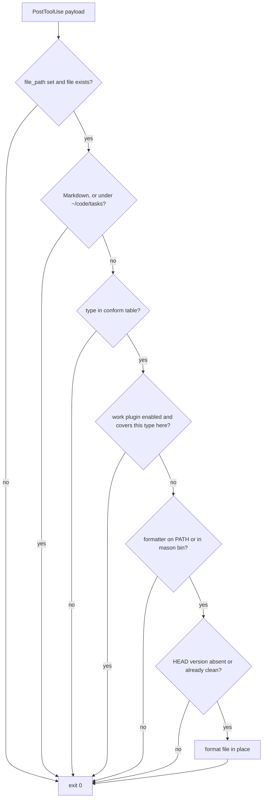
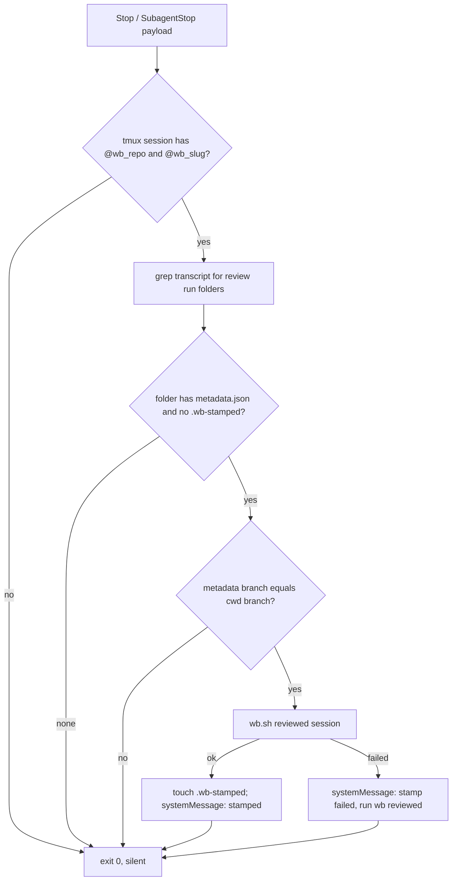
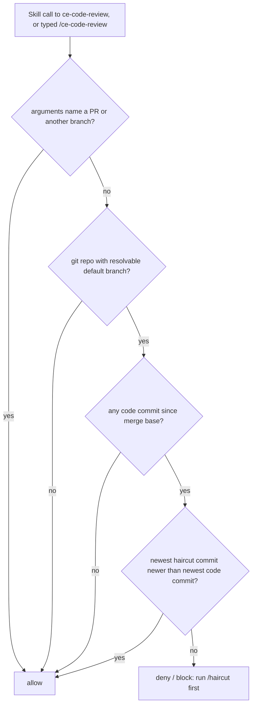

# Hooks for format on edit, review stamping, the haircut gate and terraform deny rules - Plan

## Goal Capsule

- **Objective:** in Jet's agent sessions, files an agent edits come out formatted (except files already unformatted in their last commit and file types the formatter table does not cover), each wb task's review stage on the board is true without a hand-run `wb reviewed`, every `/ce-code-review` of a branch starts from committed work whose comments were trimmed, and no permission mode lets an agent run the direct forms of a terraform, tofu or terragrunt write.
- **Means:** three new Claude Code hook scripts, `permissions.deny` rules, and an shfmt install, all in the dotfiles repo and registered in `claude/.claude/settings.recommended.json` (KTD1, KTD2).
- **Authority:** the task file `dotfiles--hooks-format-stamp-guard` and its four decisions of 14 Nov 2026 win over this plan. This plan wins over the older sub-task files (`dotfiles--feat-format-on-edit-hook`, `dotfiles--feat-auto-stamp-reviewed`, `dotfiles--guard-hardening` rung 1) where they differ.
- **Stop conditions:** stop and ask if any unit seems to need an edit to the live `~/.claude/settings.json`, to `scripts/.config/scripts/tmux/claude-notify-hook.sh`, or to `scripts/.config/scripts/tmux/risky-command-guard.sh`. Stop if a deny-rule form or a hook output shape behaves differently from the Claude Code docs in a way the plan's fallback does not cover.
- **Execution profile:** bash hook scripts with plain-bash tests fed synthetic hook payloads, run on the host (mawk) and in the `wb-tests` Docker image (gawk), plus shellcheck. One live check of the deny rules through `claude -p` against a throwaway settings file.
- **Who ships:** branch `hooks-format-stamp-guard`, one PR against `development` through `pgh` (personal repo). `/haircut` runs before review; the code review runs in a fresh context after `/wb-save` and `/clear`. Going live is Jet's step: paste the new settings entries into `~/.claude/settings.json`, restart sessions, and re-stow the main checkout after the merge.

---

## Product Contract

### Summary

Add a format-on-edit hook that formats each edited file the way Jet's nvim does, without touching files that were not already formatted. Add a Stop hook that runs `wb reviewed` once for each finished `/ce-code-review` in a wb session. Add a review-start gate that sends a review back to `/haircut` when the branch has unswept code. Add deny rules that block terraform, tofu and terragrunt writes in every permission mode, and install shfmt so shell files can be formatted.

### Problem Frame

Four manual habits stand in for automation today.
Agents leave edits unformatted outside the file types the work plugin's format hook covers (Lua, shell, web files in personal repos), so formatting happens by hand or not at all.
`reviewed:` is stamped only when someone remembers `wb reviewed` after a review; the global CLAUDE.md calls it "a convention, not automation", and a missed stamp leaves the board's review stage wrong.
`/haircut` before review is likewise a line in CLAUDE.md that the verification-skill-edits decision of 14 Nov said a hook would enforce "in the hooks session".
Terraform writes are stopped only by `risky-command-guard.sh`; the Claude Code docs say deny rules hold in every mode, including `bypassPermissions`, and hook behaviour there is not documented.

### Requirements

**Terraform deny rules**
- R1. `claude/.claude/settings.recommended.json` denies the terraform, tofu and terragrunt writes: apply, destroy, import, taint, untaint, force-unlock, refresh, state rm/mv/push/replace-provider and workspace delete, including the `-chdir=…` and `env …` forms the docs say a plain rule misses.
- R2. The rules are shown once, against a throwaway settings file in `bypassPermissions` mode, to block a write before it runs.

**Format on edit**
- R3. After a Write, Edit or MultiEdit, the edited file is formatted with the formatter Jet's nvim conform setup uses for its type, with shfmt for shell, which conform does not cover; the hook never blocks and always exits 0.
- R4. A file whose committed version was not already formatter-clean is left alone; a new or untracked file is formatted.
- R5. While the work plugin is enabled, a file its format hook would actually format in that repo is skipped; Markdown files and anything under `~/code/tasks` are never formatted.
- R6. shfmt is installed, and the repo's shell house style is recorded where shfmt reads it, so formatted shell matches the existing scripts.

**Review stamp**
- R7. When a `/ce-code-review` finishes in a wb session, `wb reviewed` runs for that session's task (once per Stop that finds newly finished reviews, never twice for the same review), and the session shows a one-line message saying it was stamped or why stamping failed.
- R8. Only a finished review (its run folder holds `metadata.json`) that this session's transcript names, and that reviewed the session's own branch rather than another PR or branch, triggers a stamp; the hook never writes the task file itself and never fails the turn.

**Haircut gate**
- R9. A `/ce-code-review` of the current branch, started through the Skill tool or typed as a slash command, is stopped with "run /haircut first" when no haircut commit follows the branch's last code commit.
- R10. A `/haircut` run that finds nothing to trim still leaves a commit the gate accepts.
- R11. The gate lets through reviews of another PR or branch, branches with no code commits, and any case it cannot evaluate.

**Hand-off**
- R12. The PR carries the exact settings entries to paste into `~/.claude/settings.json` and a hands-on test guide, and the global CLAUDE.md no longer calls the review stamp and the haircut gate manual or queued.

### Key Decisions

- **Reviews are matched through the session's transcript.** Governs R7, R8. (session-settled: user-approved — chosen over matching any review finished since the last stamp by branch name: a same-named branch in another repo could stamp the wrong task)
- **Format on edit fills the work plugin's gaps and never causes churn.** Governs R3, R4, R5. (session-settled: user-approved — chosen over formatting only where a repo has a formatter config file: that would do nothing in dotfiles today)
- **The haircut review-start gate joins this PR.** Governs R9, R10, R11. (session-settled: user-approved — chosen over a later hooks PR: it sits beside the review stamp at the other end of the review and edits the same settings file)
- **shfmt is installed in this PR.** Governs R6. (session-settled: user-directed — chosen over leaving shell files unformatted until someone installs it)

### Scope Boundaries

- Rung 2 of guard hardening (the gaps in `risky-command-guard.sh`) stays on `dotfiles--guard-hardening`.
- No edit to live settings or live permissions; the repo file and the PR only.
- `claude-notify-hook.sh` is untouched; a later tmux-attention session owns it.
- No Python or Markdown formatting; neither is in Jet's conform setup for this hook's purposes.
- Considered and not built: a kill switch for the haircut gate. A false block shows up at once in the review it stops, and removing the hook entry from settings undoes it; build one if the gate misfires more than once.
- Considered and not built: re-stamping when commits land after a review. `wb reviewed` already accepts that staleness (see `cmd_reviewed` in `scripts/.config/scripts/tmux/wb.sh`).

#### Deferred to Follow-Up Work

- nvim format-on-save for shell with shfmt (conform has no `sh` entry today); worth a line on `dotfiles--feat-format-on-edit-hook` when it closes.

### Sources

- Claude Code permissions docs, code.claude.com/docs/en/permissions: trailing ` *` also matches the bare command; deny matches past leading `VAR=` assignments and the `timeout`, `time`, `nice`, `nohup`, `stdbuf`, `command`, `builtin`, `noglob` wrappers, and inside `&&`, subshells, `$( )` and loops; `env` is not stripped; argument rules are "fragile" and "not a security boundary".
- Claude Code permission modes docs, code.claude.com/docs/en/permission-modes: "Deny rules block in every mode, including `bypassPermissions`."
- compound-engineering 3.30.4, `skills/ce-code-review/references/scope.md` (run folder recipe) and `references/modes-and-output.md` (Run artifacts: `metadata.json` written at the final report with `run_id`, `branch`, `head_sha`, `verdict`, `completed_at`).
- The work plugin's `hooks/scripts/lib/detect-formatter.sh` (work-only; read for its coverage rules, never copied). It picks one formatter per repo, first match wins: `*.tf`/`*.tfvars` → `terraform fmt`; `pyproject.toml` + `uv.lock` + `[tool.ruff]` → ruff; a `go.mod` repo → `go fmt`; `package.json` with a prettier config and a `prettier` dependency → prettier. It runs that formatter on every edited file in the repo, so it only takes effect on the file types that formatter understands.
- bash-language-server (mason, configured in `nvim/.config/nvim/lua/plugins/lsp/config/bash.lua`, empty today) offers document formatting through shfmt, using `shfmt` from PATH by default. conform's `lsp_format = "fallback"` sends shell buffers to it on save.
- `nvim/.config/nvim/lua/plugins/index.lua` (conform `formatters_by_ft`) and `nvim/.config/nvim/lua/plugins/lsp/index.lua` (mason-tool-installer `ensure_installed`).
- `~/code/tasks/dossiers/dotfiles--feat-auto-stamp-reviewed/open-items/2026-11-14-hooks-session-add-the-haircut-review-start-gate-be.md` and `claude/.claude/skills/haircut/SKILL.md` (commit subject `chore: trim comments (haircut)`; "nothing to trim" makes no commit today).

---

## Planning Contract

### Key Technical Decisions

- KTD1. **Hooks are standalone scripts beside the existing guards, registered in `settings.recommended.json`.** They live in `scripts/.config/scripts/tmux/` next to `risky-command-guard.sh` and are referenced as `$HOME/.config/scripts/tmux/<script>`, matching the two PreToolUse guards already in the file. Skill-bundled `hooks/hooks.json` (pane-status, reply-log, wb-capture) was the other option; the brief and the guards both use the settings file, and these hooks belong to no skill.
- KTD2. **The settings file stays reference-only.** `wb install-hooks` already tells Jet to merge settings by hand; the PR body and test guide carry a paste-ready JSON block holding only the new entries (R12).
- KTD3. **Deny rule forms.** For each tool and write subcommand: `Bash(<tool>  *)`, which also matches the bare `<tool> `; `Bash(<tool> -chdir=* *)` for terraform and tofu; `Bash(env * <tool> *)`. Terragrunt also gets `run-all `, `apply-all`, `destroy-all` and the `--all` forms of apply and destroy. A mid-pattern `*` is undocumented, so U1 checks each form live; a form that does not match is dropped and left to the guard hook, never widened into an over-broad rule.
- KTD4. **"Already clean" means the HEAD version passes the formatter unchanged.** The hook formats the committed blob through the formatter's stdin mode and compares it with the original; equal means clean, and only then is the working file formatted in place. The stdin run is given the edited file's real path, so it finds the same config as the in-place run (`.editorconfig`, `stylua.toml`, prettier config and parser, goimports' source dir): shfmt `--filename`, stylua and prettier `--stdin-filepath`, goimports `-srcdir`. A file with no HEAD version (new or untracked) counts as clean. Outside a git repo the hook does nothing.
- KTD5. **The formatter table follows conform, plus shfmt for shell.** `.lua` → stylua; `.go` → goimports then gofumpt; `.js`, `.jsx`, `.ts`, `.tsx`, `.css`, `.html`, `.json`, `.yaml`, `.yml` → prettier. Shell is the one type conform does not cover: `.sh`, `.bash` and extensionless files with a bash or sh shebang → shfmt. Each binary is looked up on PATH, then in `~/.local/share/nvim/mason/bin`; a missing binary is a silent skip. The work plugin counts as enabled when `enabledPlugins["sportable@sportabletech-harness"]` is true in `~/.claude/settings.json`. The skip follows the plugin's first-match order under Sources and applies per file: skip only when the repo's first match is a formatter that handles this file's type (`go fmt` for `.go`, prettier for the prettier types). A `.ts` file in a ruff repo, or a `.lua` file in a `go.mod` repo, is still formatted here.
- KTD6. **Format on edit runs synchronously with a bounded timeout.** An async run would race the agent's next Edit on the same file. The registration sets a timeout (around 15 seconds) so a hung formatter cannot stall the session; prettier's startup of about half a second per edit is the expected cost.
- KTD7. **The review stamp calls `wb.sh` by path and marks each run folder.** `wb` is a shell alias, which hooks cannot see, so the hook runs `$HOME/.config/scripts/tmux/wb.sh reviewed <session>` (overridable by an environment variable for tests). The session comes from `tmux display -p -t "$TMUX_PANE" '#S'` under a timeout, and the hook acts only when that session carries `@wb_repo`/`@wb_slug`, the same check `cmd_reviewed` makes. After a successful stamp it writes a `.wb-stamped` file in the run folder so later Stops skip that run. It reports through the Stop hook's `systemMessage` output.
- KTD8. **A review counts only when it reviewed the session's own branch.** `/ce-code-review` never checks out a PR or branch target, so `metadata.json`'s `branch` is always the session's branch and cannot tell a PR review apart. The hook reads the run's invocation arguments instead: `invocation.arguments` in the run's `finish-input.json` when present (full-depth runs), else the Skill call's `args` or the typed `/ce-code-review …` prompt that the transcript records just before the run folder first appears. Those arguments go through the same target rule as the gate (KTD12, shared helper in U5). A run whose arguments name a PR or another branch is not stamped. The branch-equality check stays as a cheap second guard. This stops a review of someone else's PR, run from inside a wb session, from stamping that session's task, a wrong stamp nothing else would catch.
- KTD9. **Run folders are found by pattern in the transcript.** The hook greps the transcript for `compound-engineering-<uid>/ce-code-review/<YYYYMMDD-HHMMSS-8hex>` and resolves each match to a folder the user owns that is not a symlink. Stop reads `transcript_path`; SubagentStop reads `agent_transcript_path` when present, else `transcript_path`, which covers a review run inside a subagent.
- KTD10. **The haircut gate's rule.** A code commit is a non-haircut commit between the merge base with the default branch and HEAD that changes any file other than `*.md` or under `docs/`. A haircut commit is one whose subject starts with `chore: trim comments (haircut`. The gate passes when there is no code commit, or when the newest haircut commit is newer than the newest code commit. Uncommitted edits are not considered, even though `/ce-code-review` reviews the working tree. `/haircut` deliberately leaves uncommitted code uncommitted, so blocking on a dirty tree would block every review after a haircut; code edited after the last haircut and left uncommitted therefore passes the gate unswept (see Risks & Dependencies).
- KTD11. **"Nothing to trim" leaves an empty commit.** `claude/.claude/skills/haircut/SKILL.md` changes so a run with nothing to trim makes `git commit --allow-empty` with subject `chore: trim comments (haircut, nothing to trim)` (R10). The rejected option was a local git-config marker; it is invisible in the PR and lost in other clones.
- KTD12. **How the gate stops a review.** PreToolUse on the Skill tool (matcher `Skill`, `tool_input.skill` equal to `ce-code-review` or `compound-engineering:ce-code-review`) returns `permissionDecision: deny` with the reason. UserPromptSubmit returns `decision: block` with the reason when the prompt starts with `/ce-code-review` or `/compound-engineering:ce-code-review`. The gate passes when the arguments name a PR number, a PR URL or another branch (R11). Any error, a missing `git` or `jq`, or a repo with no resolvable default branch, also passes.
- KTD14. **The review-target rule, shared by the gate and the review stamp.** Real arguments are often prose, such as `base:page-fixes — review branch road-view` or `Review branch X against origin/development`. Drop `key:value` tokens (`base:`, `plan:`, `mode:`, `depth:`, `apply:`) and `--flags`. In what remains, the review targets something else only when a token is a PR number (`#?[0-9]+`), a GitHub PR URL, or the name of an existing local or remote branch other than the current branch, its upstream and the default branch. An `a...b` range counts as its right-hand side. The rule lives in one sourced helper so the two hooks cannot drift.
- KTD13. **Tests use PATH shims, not real formatters or a live tmux.** The `wb-tests` image has no formatters, so fake `stylua`, `prettier`, `shfmt`, `gofumpt`, `goimports`, `tmux` and `wb.sh` record their calls and apply a known transform. Each test file follows `scripts/.config/scripts/tmux/tests/risky-command-guard.test.sh`: a fixture HOME from `mktemp`, an executable-bit check, `decide`/`expect`-style helpers. A tmux shim follows the tmux-shim rules in `tasks-agent-hook.test.sh` and never contacts a real server.

### High-Level Technical Design

Format on edit, per Write/Edit/MultiEdit:

Review stamp, per Stop or SubagentStop:

Haircut gate, per review start:

### Assumptions

- Claude Code picks up a file a PostToolUse hook rewrote before the agent's next edit of it. The work plugin's hook already does this in every session, so the pattern is in daily use.
- In a `go.mod` repo the work plugin runs `go fmt` on every edited file; on a `.lua` or `.sh` file that fails without writing, so it cannot race this hook's formatter on those types.

### Risks & Dependencies

- **The review stamp depends on compound-engineering's run-folder layout (3.30.4).** If a plugin update moves the folder or drops `metadata.json`, stamping stops silently. The missing "stamped" message is the signal, and the U4 tests pin the pattern so a fix is one place. Accepted; no version check built.
- **A headless `claude -p` started inside a wb pane inherits `TMUX_PANE`.** If that child runs a review of the same branch, it stamps the parent session's task. That is the right task, because KTD8's branch check holds. Accepted.
- **Deny-rule forms with a mid-pattern `*` are undocumented.** U1's live check decides each form; a form that fails is dropped and stays covered only by `risky-command-guard.sh`. U1 also records whether that guard blocks each dropped form in `bypassPermissions` mode, so the PR states plainly which forms are covered in every mode. Indirect forms (`bash -c '…'`, scripts, `make`) were never in reach of deny rules.
- **Uncommitted code passes the haircut gate unswept** (KTD10). Accepted: reviews in this workflow follow a commit, and `/haircut`'s own report covers the working tree when it runs.
- **The work plugin's coverage is copied as rules, not read live** (KTD5). If a plugin update starts formatting a type this hook also formats, both hooks write the same file at once and nothing signals it. Accepted; recheck the plugin's detector when it updates.

---

## Implementation Units

### U1. Terraform, tofu and terragrunt deny rules

- **Goal:** `settings.recommended.json` blocks every listed write in every permission mode, and a test keeps the list complete.
- **Requirements:** R1, R2; KTD2, KTD3.
- **Dependencies:** none.
- **Files:**
  - `claude/.claude/settings.recommended.json` (modify: `permissions.deny`)
  - `scripts/.config/scripts/tmux/tests/settings-deny-rules.test.sh` (create)
  - `~/code/tasks/dossiers/dotfiles--hooks-format-stamp-guard/deny-rules-live-check.md` (create; outside the repo, records the live check)
- **Approach:**
  1. Write the rules in the KTD3 forms for each tool and subcommand.
  2. Add the coverage test: it reads the JSON with `jq` and checks every tool × subcommand pair has its required forms, and that no rule denies a read-only subcommand (`plan`, `init`, `validate`, `fmt`, `show`, `output`, `state list`, `state show`, `state pull`).
  3. Run the live check: a temp directory, a settings file holding only the deny list, a fake `terraform` (and `tofu`, `terragrunt`) first on PATH that appends its argv to a log, and `claude -p --output-format json` in `bypassPermissions` mode. Run it under `env -u TMUX -u TMUX_PANE`, isolated from the user settings so the guard hook cannot be what blocks it. Ask it to run a handful of commands covering each form. A form counts as blocking only when the JSON's `permission_denials` lists that exact command and the log is empty. A command the model declined to attempt (the global CLAUDE.md tells it not to run terraform writes) is unproven: re-run it, never count it as blocked. Drop any form that did not block, per KTD3.
  4. For every dropped form, plus `terragrunt run apply` and `terragrunt run --all apply`, run a second `bypassPermissions` pass with only `risky-command-guard.sh` registered and no deny rules, and record whether the guard blocks each one.
  5. Record the commands, the JSON denial entries and the log for both passes in the dossier note.
- **Execution note:** write the coverage test first and see it fail against the current file.
- **Patterns to follow:** `scripts/.config/scripts/tmux/tests/risky-command-guard.test.sh` (fixture layout, `ok`/`FAIL` lines, `fail` flag).
- **Test scenarios:**
  - `terraform apply`, `tofu destroy` and `terragrunt state rm` each have a ` *` rule in the deny list.
  - `terraform -chdir=* apply*` and `env * terraform apply*` are present; the same holds for tofu.
  - Every subcommand in R1 appears for all three tools, each two-word subcommand (`state rm`, `workspace delete`, `force-unlock`) included.
  - No deny rule matches `terraform plan`, `terraform init`, `terraform state list` or `terragrunt plan`.
  - The file is valid JSON and the existing `allow` entry and `hooks` block are unchanged.
- **Verification:** the coverage test passes on the host and in Docker. The dossier note shows each kept form in `permission_denials` in `bypassPermissions` mode with an empty fake-terraform log, and says for each dropped form whether the guard alone blocks it.

### U2. Install shfmt and record the shell house style

- **Goal:** shfmt is available to the format hook, configured so its output matches how the repo's shell scripts are already written.
- **Requirements:** R6.
- **Dependencies:** none.
- **Files:**
  - `nvim/.config/nvim/lua/plugins/lsp/index.lua` (modify: add `shfmt` to the mason-tool-installer list beside `stylua` and `prettier`)
  - `nvim/.config/nvim/lua/plugins/lsp/config/bash.lua` (modify: turn off bash-language-server's shfmt formatting)
  - `.editorconfig` (create: a `[*.{sh,bash}]` section and shfmt's `[[bash]]` language section, both with the shfmt keys)
- **Approach:**
  1. Turn off bash-language-server's shfmt formatting (an empty `bashIde.shfmt.path` setting) before shfmt lands. Otherwise nvim's format-on-save LSP fallback starts reformatting whole shell files on every save, the churn the no-churn decision rules out (R4). nvim format-on-save for shell stays deferred.
  2. Add `shfmt` to `ensure_installed` with a comment matching its neighbours, then install it with a headless nvim run of the mason installer so it lands in `~/.local/share/nvim/mason/bin`.
  3. Measure the house style: run shfmt in diff mode over the tracked shell files (`*.sh` and the extensionless shebang scripts) under a few candidate settings (indent 2 and 4, with and without case-indent and binary-next-line), and pick the setting under which the most files are already clean.
  4. Record that setting in `.editorconfig`. Use both the extension section and the `[[bash]]` section, so extensionless shebang scripts such as `.githooks/pre-commit` get the same style. Report how many scripts are clean under it; the rest stay untouched by KTD4.
- **Execution note:** mostly install and config; prove it with an install smoke check, not unit tests.
- **Patterns to follow:** the existing `vim.list_extend(ensure_installed, { … })` entries.
- **Test expectation:** none. This is install and config; U3's tests cover shfmt's use through a shim.
- **Verification:** `~/.local/share/nvim/mason/bin/shfmt --version` runs. shfmt in diff mode reports no change on the files the measurement counted as clean, and so does a stdin run with `--filename .githooks/pre-commit`. Saving a not-yet-clean `.sh` file in nvim leaves it byte-identical.

### U7. Capture real hook payloads as test fixtures

- **Goal:** the hook tests use the payload shapes Claude Code actually sends, so a wrong guess about a field fails a test rather than leaving a fail-open hook silently idle.
- **Requirements:** R3, R7, R9 (supports their tests).
- **Dependencies:** none; runs before U3, U4 and U5's tests are written.
- **Files:**
  - `scripts/.config/scripts/tmux/tests/fixtures/hook-payloads/` (create: one captured JSON per event, with home paths and session ids replaced by placeholders)
- **Approach:**
  1. In a temp directory, register one throwaway hook that writes its stdin to a file, for PostToolUse on Write/Edit, PreToolUse on Skill, UserPromptSubmit, Stop and SubagentStop.
  2. Drive it with `claude -p` under `env -u TMUX -u TMUX_PANE` and throwaway settings: one file write, one prompt starting `/ce-code-review` (blocked by the capture hook before any review runs), one Skill call, one Task subagent.
  3. Scrub and commit the payloads. Note any field the plan assumed that is absent (`agent_transcript_path`, `hook_event_name`, a typed command arriving raw in `prompt`), and adjust U3 to U5 to the real shape.
- **Test expectation:** none. The captures feed U3 to U5's tests.
- **Verification:** each of the five events has a captured fixture, and U3 to U5's test files each load at least one of them.

### U3. Format-on-edit hook

- **Goal:** each Write/Edit/MultiEdit leaves the edited file formatted when R3 to R5 allow it, and never otherwise.
- **Requirements:** R3, R4, R5; KTD4, KTD5, KTD6, KTD13.
- **Dependencies:** U7; U2 for real shfmt use, which the tests do not need.
- **Files:**
  - `scripts/.config/scripts/tmux/format-on-edit-hook.sh` (create, executable)
  - `scripts/.config/scripts/tmux/tests/format-on-edit-hook.test.sh` (create)
  - `claude/.claude/settings.recommended.json` (modify: PostToolUse entry, matcher `Write|Edit|MultiEdit`, with a timeout)
- **Approach:**
  1. Read the payload once with `jq`; take `tool_input.file_path`; exit 0 on anything missing or malformed.
  2. Apply the skip rules in the order of the format-on-edit flowchart under High-Level Technical Design: Markdown and `~/code/tasks`, unknown type, work-plugin coverage, missing binary, unclean HEAD version.
  3. Format in place; on formatter failure, exit 0 with nothing on stdout, so a broken formatter never surfaces as a hook error.
- **Execution note:** test-first; the shims make every branch reachable without real formatters.
- **Patterns to follow:** `scripts/.config/scripts/tmux/risky-command-guard.sh` (payload parsing, fail-open), `tests/risky-command-guard.test.sh` (fixture HOME), and `tests/tasks-agent-hook.test.sh` (PATH shims).
- **Test scenarios:**
  - A tracked `.lua` file whose HEAD version is clean is edited out of format: the stylua shim is called and the file ends formatted.
  - A tracked `.lua` file whose HEAD version is not clean: no formatter call, file unchanged.
  - A new untracked `.ts` file: the prettier shim runs on it.
  - A `.sh` file and an extensionless file with a `#!/usr/bin/env bash` shebang both go to the shfmt shim.
  - A `.go` file runs goimports, then gofumpt.
  - A formatter missing from PATH but present in the fixture's mason bin folder is used from there; missing in both is a silent skip.
  - With the work plugin enabled in the fixture settings: a `.go` file in a `go.mod` repo, and a `.json` and a `.ts` file in a prettier-configured `package.json` repo, are skipped. A `.lua` file in a `go.mod` repo, a `.ts` file in a repo with no prettier config, and a `.ts` file in a uv+ruff repo that also has a prettier config are still formatted.
  - With the plugin disabled, a `.go` file in a `go.mod` repo is formatted.
  - Each formatter shim exits non-zero unless the clean-check call carries the file's real path (`--filename`, `--stdin-filepath` or `-srcdir`), so a check that drops the path fails the test.
  - A `.md` file and a file under the fixture `~/code/tasks` are never formatted.
  - A file outside any git repo, an empty payload, a payload without `file_path`, and a deleted file all exit 0 with no output.
  - A formatter shim that exits non-zero leaves the hook exiting 0 with empty stdout.
  - The script is executable.
- **Verification:** the test file passes on the host and in Docker; shellcheck is clean.

### U5. Haircut review-start gate

- **Goal:** a review of the current branch cannot start until `/haircut` has swept the branch's latest code.
- **Requirements:** R9, R10, R11; KTD10, KTD11, KTD12, KTD13, KTD14.
- **Dependencies:** U7.
- **Files:**
  - `scripts/.config/scripts/tmux/lib-review-target.sh` (create; the KTD14 rule, sourced by this hook and by U4)
  - `scripts/.config/scripts/tmux/haircut-gate-hook.sh` (create, executable; one script handling both events by payload shape)
  - `scripts/.config/scripts/tmux/tests/haircut-gate-hook.test.sh` (create)
  - `claude/.claude/skills/haircut/SKILL.md` (modify: "nothing to trim" makes the empty commit, and its test-case list says so)
  - `claude/.claude/settings.recommended.json` (modify: PreToolUse entry with matcher `Skill`, and a UserPromptSubmit entry)
- **Approach:**
  1. Tell the two events apart by `hook_event_name`; pull the skill name and arguments, or the typed prompt.
  2. Exit 0 silently for any other skill or prompt.
  3. Resolve the default branch the way `/haircut` does, then the merge base, then the newest code commit and the newest haircut commit (KTD10).
  4. Emit the event's block shape (KTD12) with a reason naming the newest unswept code commit and telling the agent to run `/haircut`, then retry.
- **Execution note:** test-first against throwaway git repos built in the fixture dir.
- **Patterns to follow:** PreToolUse deny output in `scripts/.config/scripts/tmux/risky-command-guard.sh`; default-branch resolution in `claude/.claude/skills/haircut/SKILL.md`.
- **Test scenarios:**
  - Skill call `compound-engineering:ce-code-review` on a branch with a code commit and no haircut commit: the output is `permissionDecision: deny`, and the reason mentions `/haircut`.
  - The same branch after a `chore: trim comments (haircut)` commit: allowed with no output.
  - A code commit after the haircut commit: denied again.
  - A haircut commit followed only by a `docs/`-only commit, or a `*.md`-only commit: allowed.
  - An empty `chore: trim comments (haircut, nothing to trim)` commit after the last code commit: allowed. This covers R10.
  - A branch with only docs commits, and a branch with no commits ahead of the default branch: allowed.
  - A typed prompt `/ce-code-review` on an unswept branch: the output is `decision: block` with the reason. `/compound-engineering:ce-code-review base:development` behaves the same.
  - Skill args naming a PR number (`123`), a PR URL, or another existing branch: allowed.
  - Skill args in prose, `Review branch <current> against origin/development`, and a range `origin/development...<current>`, on an unswept branch: denied.
  - Skill call for another skill (`haircut`, `ce-plan`), and a prompt that only mentions code review in prose: no output.
  - Not a git repo, a detached HEAD, or a repo with no resolvable default branch: allowed.
  - The script is executable.
- **Verification:** the test file passes on the host and in Docker; shellcheck is clean; the haircut SKILL.md diff touches only the nothing-to-trim behaviour and its test case.

### U4. Review-stamp hook

- **Goal:** a finished `/ce-code-review` in a wb session stamps that session's task exactly once and says so.
- **Requirements:** R7, R8; KTD7, KTD8, KTD9, KTD13, KTD14.
- **Dependencies:** U5 (the shared review-target helper), U7.
- **Files:**
  - `scripts/.config/scripts/tmux/review-stamp-hook.sh` (create, executable)
  - `scripts/.config/scripts/tmux/tests/review-stamp-hook.test.sh` (create)
  - `claude/.claude/settings.recommended.json` (modify: Stop and SubagentStop entries, short timeout)
- **Approach:**
  1. Leave quickly and silently unless `TMUX_PANE` is set and the session carries `@wb_repo`/`@wb_slug`.
  2. Collect run folders from the transcript (KTD9). Keep those with `metadata.json` and no `.wb-stamped` whose invocation arguments target the session's own branch and whose branch matches (KTD8, KTD14).
  3. If any remain, call `wb.sh reviewed <session>` once. On success, mark every eligible folder found in this pass, since one stamp per task per day covers them all. Emit a `systemMessage` naming the task. On failure, the message says stamping failed, carries the first line of `wb.sh`'s stderr, and tells Jet to run `wb reviewed`.
  4. A `stop_hook_active` payload flag is irrelevant here, because the hook never blocks.
- **Execution note:** test-first, with a fake `tmux` (session options), a fake `wb.sh` that logs its argv, and fixture run folders under a fixture TMPDIR.
- **Patterns to follow:** session lookup with timeout in `scripts/.config/scripts/tmux/tasks-git-hooks/pretooluse-guard.sh`; `cmd_reviewed` in `wb.sh` for what "wb session" means.
- **Test scenarios:**
  - A transcript naming one finished run (with `metadata.json`) on the session's branch: `wb.sh reviewed <session>` is called once, `.wb-stamped` appears, and stdout carries a `systemMessage` naming the stamp.
  - The same payload a second time: no call, no output.
  - A run folder without `metadata.json` (the review died partway): no call.
  - A finished run whose `finish-input.json` arguments are `123` (a PR review), and one whose transcript Skill call `args` name another existing branch: no call, even though `metadata.json`'s branch equals the session's branch.
  - A finished run with arguments `base:origin/development` and prose naming the current branch: stamped.
  - A finished run whose `metadata.json` branch differs from the cwd branch: no call.
  - A finished run folder that exists but is not named in the transcript: no call.
  - A non-wb tmux session (no `@wb_slug`), and no `TMUX_PANE` at all: no call, no output.
  - SubagentStop with `agent_transcript_path` naming the run: the stamp happens.
  - A fake `wb.sh` that exits non-zero with a stderr line: no marker written, and the `systemMessage` says stamping failed, includes that stderr line, and says to run `wb reviewed`; the hook still exits 0.
  - A run-folder path that is a symlink: ignored.
  - An empty or malformed payload: exit 0, no output.
- **Verification:** the test file passes on the host and in Docker; shellcheck is clean.

### U6. Hand-off: global instructions, paste block and test guide

- **Goal:** Jet can switch everything on from the PR alone, and the global instructions describe what the hooks now do.
- **Requirements:** R12; KTD2.
- **Dependencies:** U1, U3, U4, U5.
- **Files:**
  - `claude/.claude/CLAUDE.md` (modify: the "wb sessions → stamp reviews immediately" and "Before any code review → run `/haircut` first" sections)
  - `~/code/tasks/dossiers/dotfiles--hooks-format-stamp-guard/test-guide.md` (create), built to `test-guide.html` with a `tools/build.sh` copied from `~/code/tasks/dossiers/dotfiles--verification-skill-edits/tools/`
- **Approach:**
  1. CLAUDE.md, stamp section: the Stop hook stamps after a finished review once the settings entries are live; if no "stamped" message appears, run `wb reviewed` by hand.
  2. CLAUDE.md, haircut section: replace "will enforce this later (queued for the hooks session)" with the gate's behaviour, and keep the rule to run `/haircut` first.
  3. Test guide: the paste block (only the new `permissions.deny`, PostToolUse, Stop, SubagentStop, PreToolUse `Skill` and UserPromptSubmit entries), the restart note, and hands-on steps for each hook. Its steps go into the PR's "How to test".
  4. Commit the CLAUDE.md edit on its own, because the docgen pre-commit stages pending `docs/*.md` edits into unrelated commits.
- **Test expectation:** none. These are instruction and guide text; the hands-on guide is their check.
- **Verification:** the docgen pre-commit passes; the guide's paste block merges cleanly into a copy of the live settings shape (`jq -s` merge of the two files gives valid JSON with both guard entries still present).

---

## Verification Contract

| Gate | Command | Applies to |
|---|---|---|
| Host tests (mawk) | `bash scripts/.config/scripts/tmux/tests/<name>.test.sh` for `settings-deny-rules`, `format-on-edit-hook`, `review-stamp-hook`, `haircut-gate-hook` | U1, U3, U4, U5 |
| Sandbox tests (gawk) | `docker build -t wb-tests -f scripts/.config/scripts/tmux/tests/Dockerfile .`, then `docker run --rm -v "$(pwd)":/repo:ro -w /repo wb-tests bash scripts/.config/scripts/tmux/tests/<name>.test.sh` for the same four | U1, U3, U4, U5 |
| Existing guard tests still pass | `risky-command-guard.test.sh` and `tasks-agent-hook.test.sh` on host and in Docker | all units touching `settings.recommended.json` |
| Shellcheck | `docker run --rm -v "$(pwd)":/mnt -w /mnt koalaman/shellcheck:stable` on the three new hook scripts, `lib-review-target.sh` and the four new test files | U1, U3, U4, U5 |
| Settings JSON valid | `jq empty claude/.claude/settings.recommended.json` | U1, U3, U4, U5 |
| Fail-first | each new test file run once before its script or rule exists, and seen to fail | U1, U3, U4, U5 |
| Live deny check | `claude -p` in `bypassPermissions` against the throwaway settings file, recorded in the dossier note | U1 |
| shfmt installed | mason `shfmt --version` | U2 |

Judge Docker runs by the per-file `ok`/`FAIL` lines, not only the exit code (the full suite has known environment-dependent failures; these four files must be all `ok`).

---

## Definition of Done

- All four new test files pass on the host and in the `wb-tests` image, and each hook's tests include a captured real payload (U7). The existing guard tests are unchanged and passing, and shellcheck is clean.
- `settings.recommended.json` holds the deny rules and the five new hook registrations, and it is valid JSON.
- The live deny check is recorded in the dossier, and every kept rule form was shown blocking in `bypassPermissions` mode.
- shfmt is installed through mason and `.editorconfig` records the measured shell style.
- `claude/.claude/CLAUDE.md` and `claude/.claude/skills/haircut/SKILL.md` reflect the new behaviour; the test guide is built to HTML and published, and its steps are in the PR's "How to test".
- No experimental or abandoned code is left in the diff, and nothing outside the listed files changed.
- Per unit: U1 to U5 are done when their Verification line holds. U6 is done when the paste block merges cleanly and the guide is published.
