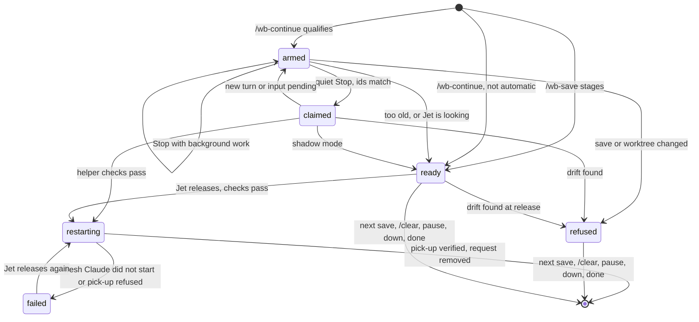
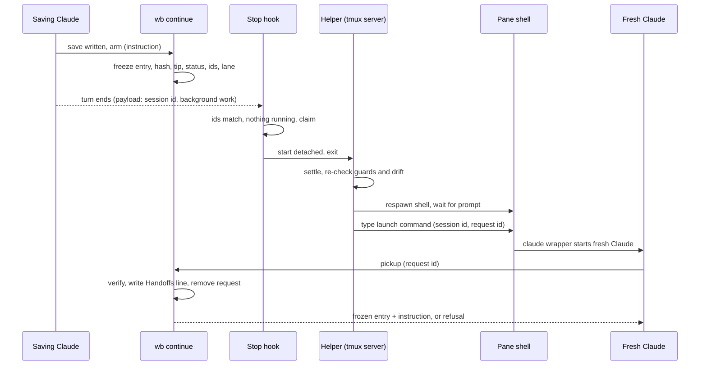

# wb Continue, a Saved Session Carries On in a Fresh Context - Plan

## Goal Capsule

- **Objective:** A wb session that has saved its work and knows its next step carries on in a fresh context without Jet visiting the pane to type `/clear` and `/wb-resume`, and it never picks up the wrong save.
- **Means:** A Stop hook restarts the same pane with a fresh Claude that is handed a script-verified copy of the save (KTD1, KTD5).
- **Authority:** The seven decision files in the task store dossier `~/code/tasks/dossiers/dotfiles--auto-clear-resume/decisions/` (ruled by Jet on 15 Nov 2026) outrank this plan. This plan outranks the Mac script it ports.
- **Stop conditions:** Stop and ask Jet if U1 shows a settled decision cannot work: the fresh Claude cannot be started through the pane's shell, a typed prompt cannot be told from other prompt sources and no fail-safe default holds, or the Stop payload stops listing background work.
- **Execution profile:** One branch, one PR, phased units. The automatic lane ships in shadow mode.
- **Finish:** `ce-work` builds and verifies. The code review runs in a fresh context. Jet merges, re-stows, and turns shadow mode off after the live checks pass.

---

## Product Contract

### Summary

Add `/wb-continue <instruction>`, which saves the session and restarts its pane with a fresh Claude that carries out the instruction. Saves that should not restart by themselves wait in a release list in the picker, and one key starts them. A tmux key does the same for the current pane. Script-checked guards decide which save a fresh Claude receives, and output Jet has not seen before a restart is flagged.

### Problem Frame

A wb session that needs a fresh context stops and waits for Jet to type `/clear` and `/wb-resume`. With seven or more sessions in parallel, most of those visits decide nothing: the save already records what is done and what comes next. Since 1 Nov 2026 Jet typed `/wb-save` 47 times, 33 with a note, and 25 of those notes say what to do "on resume". 19 of the 25 were resumed within 30 minutes. Each wait holds a session idle until he gets there.

A Claude cannot clear its own context. In July 2026 Claude Code's auto-mode check twice refused an agent typing `/clear` into its own pane, and no hook, CLI call or SDK call clears a running session. Something outside the conversation has to start the fresh Claude, at a moment when nothing is still running, and the fresh Claude has to get exactly the save that asked for it. A restarted agent that picks the wrong save, or reads the right save after the worktree moved, acts on its own in auto mode with nobody watching.

### Key Decisions

- KD1. **A Stop hook restarts the same pane, one Claude per tmux session.** (session-settled: user-approved — chosen over an agent-started helper with no hook and over a new window with the old Claude kept: only the Stop payload shows background work, and two Claudes per session need a write lock) Governs R6, R7.
- KD2. **Scripts choose and verify the save, not the model.** (session-settled: user-approved — chosen over the fresh Claude finding the save by id and re-checking it: a restarted agent ignored a prose guardrail on 20 Jul 2026) Governs R8.
- KD3. **A release lane in the picker.** (session-settled: user-approved — chosen over automatic restart as the only path: one keypress replaces several pane visits and Jet still sees each save first) Governs R11.
- KD4. **A session that continues by its own choice restarts automatically only for a code review.** (session-settled: user-approved — chosen over any recorded command: a wrong review builds nothing, a wrong build produces wrong code) Governs R3.
- KD5. **The automatic lane may end the old Claude without asking, under four guards.** (session-settled: user-approved — chosen over release-only: release-only costs idle time while Jet is away) Governs R3, R7.
- KD6. **The trigger is a separate command, `/wb-continue`, plus a tmux key.** (session-settled: user-directed — chosen over matching "on resume" inside a `/wb-save` note, a keyword on `/wb-save`, restart-by-default, and the name `/wb-fresh`: a command at the start of the prompt is checked at a fixed position) Governs R1, R2, R12.
- KD7. **Unseen output is flagged through the reply log.** (session-settled: user-directed — Jet asked for a way to see messages missed because of a restart; chosen over feeding the old session's last message to the fresh Claude: the flag is for Jet and display only) Governs R13.
- KD8. **Shadow mode first.** (session-settled: user-approved — chosen over going live at merge: a few days of logged would-restart decisions are checked against what Jet did by hand) Governs R14.

### Requirements

**Commands and lanes**

- R1. `/wb-continue <instruction>` saves the session as `/wb-save` does, then requests a restart. `/wb-save` keeps its meaning: save and stay.
- R2. When Jet typed `/wb-continue`, any instruction qualifies for the automatic restart, and the fresh Claude receives his words verbatim.
- R3. When a session calls `/wb-continue` by itself, the restart is automatic only if the recorded command is a code review and Jet is not looking at or scrolling the pane. Otherwise the save goes to the release lane.
- R4. The saving session may decline to request a restart. It cannot widen what qualifies: a script decides the lane.
- R5. A session started by a restart cannot request another automatic restart by itself. A `/wb-continue` Jet types there counts as typed.

**Restart behaviour**

- R6. The restart keeps the pane, starts a fresh context, and leaves one Claude in the tmux session. The fresh Claude runs in its systemd memory scope, quitting it returns to a shell prompt, and it keeps the old session's model, effort and permission mode.
- R7. Nothing restarts while background work other than monitors is running, a scheduled wakeup exists, a new turn has started, text or a dialog is on the input line, or a `/decide` surface is open. A request blocked this way waits for the next quiet turn end. When it can no longer run automatically, including when it has waited past the age limit, it moves to the release lane with the reason.
- R8. The fresh Claude receives exactly the save that was armed. The restart is refused when the save entry or its command changed, a newer Handoffs entry landed, the branch tip or working tree changed, or the task or session does not match. These are checked before the old Claude is ended and again at pick-up.
- R9. Every refusal or failure leaves the save untouched, shows a lasting reason on the pane and in the picker, and leaves manual `/clear` then `/wb-resume` working as today.
- R10. Each restart writes one line to the task's Handoffs naming the save and the old session id, so `claude --resume <id>` can reopen the old conversation.

**Release lane**

- R11. The picker lists saved sessions that are ready to continue, each with its save's Done line and next command. One key releases the selected row and another releases all of them. A refused request shows its reason. A row disappears when its save is superseded, the session is cleared, or the task is paused, taken down or done.
- R12. A tmux key releases the current pane after any save.

**Unseen output**

- R13. Turns of the old session that Jet has not seen are counted at restart. The pane and its picker row carry a lasting mark until Jet opens the reply viewer, which opens at a divider before the first unseen turn. The mark accumulates across restarts.

**Rollout and record**

- R14. The automatic lane ships in shadow mode: every check runs and logs "would restart" or the refusal reason, and nothing restarts. A file switch turns shadow mode off, and another disables the feature.
- R15. Every restart, refusal and failure is logged with its reason, in a form the behaviour watcher's live checks can match.

### Acceptance Examples

- AE1. **Covers R2, R6, R8, R10.** Given Jet types `/wb-continue tell me where things stand on the entrypoint PR` in an idle session, when the turn ends, then the same pane shows a fresh Claude that states the save it received and answers that instruction, and Handoffs gains one line naming the old session id.
- AE2. **Covers R3.** Given a build session calls `/wb-continue` with `/ce-code-review` while Jet is in another session, when the turn ends, then the pane restarts into the review. Given the same call with `/ce-work`, then nothing restarts and the picker shows the row as ready to continue.
- AE3. **Covers R7.** Given a background test is still running when the turn ends, then nothing restarts. When the test finishes and the next turn ends with no file changed, then the pane restarts.
- AE4. **Covers R8, R9.** Given a commit lands on the branch between the save and the turn end, then nothing restarts, the pane and picker show "branch moved since the save", and `/clear` then `/wb-resume` behaves as today.
- AE5. **Covers R12.** Given a plain `/wb-save`, when Jet presses the continue key in that pane, then the pane restarts and the fresh Claude carries on from the save's Next.
- AE6. **Covers R13.** Given a session finished two turns while Jet was elsewhere and then restarted, then its picker row shows 2 unseen, and the reply viewer opens at a divider above those two turns and clears the mark.
- AE7. **Covers R14.** Given shadow mode is on and AE1's conditions hold, then the log gains a "would restart" line, the pane is untouched, and the save can still be released with the key.

### Scope Boundaries

- No agent types `/clear` or anything else into a Claude's input line.
- The Mac script's background-session branch is not ported: Linux wb has no background Claude jobs.
- No write lock for two Claudes in one tmux session. A second Claude's turn end never claims a request, and that is the whole of its handling.
- Considered and not built: a dwell time before a focused pane counts as seen. Focus already acknowledges a pane's done mark, and the unseen flag uses the same rule. Evidence that would change this: Jet reports marks clearing on panes he only passed through.
- Considered and not built: recovering cross-session messages sent in the seconds between the old Claude ending and the fresh one starting. The sender's own task file still records the decision. Evidence that would change this: a `[wb-propagate]` message shown lost in the restart log.

#### Deferred to Follow-Up Work

- Widening the session-initiated automatic lane beyond code review (to `/ce-work`, say), once the release list shows Jet releasing those rows without reading them.
- Reconciling this with the Mac's `/handoff` auto-clear when the two dotfiles repos merge (`dotfiles--feat-macos-cross-platform`).
- Changing the standing rule that a build saves with `/wb-save` for its review to use `/wb-continue`, once shadow mode is off.

### Sources

- Decisions: the seven files dated 2026-11-15 in the task store dossier named under Authority.
- Compare page spec: `2026-11-15-continue-options.json` in the same dossier.
- Mac implementation: `scripts/.config/scripts/tmux/claude-autoclear.sh` and the `/handoff` skill in `jetnoli/dotfiles`.
- Stop payload: `scripts/.config/scripts/tmux/tests/fixtures/hook-payloads/Stop.json` on `development`, and a live capture with a running background shell on Claude Code 2.1.325 (`background_tasks: [{id, type: "shell", status: "running", description, command}]`, a second Stop with an empty list when the shell finished).
- Claude Code docs: `background_tasks` and `session_crons` in Stop input since 2.1.145; `CLAUDE_CODE_SESSION_ID` set for Bash and hook subprocesses; no field marks a prompt as typed.

---

## Planning Contract

### Key Technical Decisions

- KTD1. **The helper restarts the pane's shell, waits for a prompt, and types a fixed launch command.** (session-settled: user-approved — chosen over `tmux respawn-pane -k "claude …"`: that skips the zsh `claude` wrapper, so the fresh Claude loses its memory scope and quitting it closes the pane) This is how `cmd_restart` and `wb_layout_session` already start Claude. The typed command carries only a pre-chosen session id, the request id, and model, effort and permission flags. Jet's instruction never reaches a command line. Serves R6.
- KTD2. **One request per task, with an explicit state.** It lives under `${XDG_STATE_HOME:-~/.local/state}/wb/continue/<stem>/` and holds the request fields, a frozen copy of the save entry, and the instruction. States: `armed`, `claimed`, `restarting`, `ready`, `refused`, `failed`. Every transition happens under the lock key `continue-<stem>`, taken with `wb_task_lock_acquire_guarded` as the needs-you marker does. Arming again replaces the request. Serves R7, R9, R11.
- KTD3. **Identity is the Stop payload's `session_id` and `$TMUX_PANE`, matched against the request.** (session-settled: user-approved — chosen over the pane's `@claude_session_id`: a headless child Claude overwrites it) `wb continue` records `CLAUDE_CODE_SESSION_ID` and `$TMUX_PANE` when arming. Before the helper ends anything it confirms through the session registry lookup the reply log already uses (`pane_session`) that the pane's live Claude is still that session. Serves R8.
- KTD4. **"Typed by Jet" means the prompt that opened the current turn is the `/wb-continue` command itself, typed by a person. It defaults to not typed.** The hook payload has no such field, so `wb continue` reads the transcript's record of that prompt: its `origin` object, which the reply log already reads, and its command name. A `/wb-continue` the session calls through the Skill tool inside a turn Jet opened with another prompt is session-initiated. So is anything in a restart-born session's first turn, which opens with the launch command's prompt. For a typed request the script takes the instruction from that prompt record, not from the saving model, so the words stay Jet's. U1 fixes the exact fields by testing each prompt source. An unknown or unreadable source is treated as session-initiated, which is the safe direction. Serves R2, R3, R5.
- KTD5. **`wb continue pickup` is the only chooser and verifier of the save.** (session-settled: user-approved — see KD2) The fresh Claude starts as `/wb-resume --continue <request-id>`, and the skill relays what that one command prints: the frozen entry and the instruction, or a refusal. The command is single-use, runs under the task lock, checks that the caller's session id is the pre-chosen one, and writes the Handoffs line itself after the checks pass, so its own line is never the "newer entry" it refuses on. Serves R8, R10.
- KTD6. **The script picks the lane, from one command.** A request's command is its instruction when one is given, otherwise the frozen entry's run block. The skill passes a session-initiated instruction and, optionally, a decline. `wb continue` decides `armed` or `ready` from the typed bit (KTD4), the allow-list applied to that one command (KD4) and the restart-born marker, and the Stop hook re-checks at claim time. `pickup` prints the same command as the one to carry out, and the fresh Claude runs no other run block from the frozen entry. Serves R3, R4, R5.
- KTD7. **Every `/wb-save` stages a `ready` request.** It records the entry hash, branch tip and working-tree hash at save time, so the key and the picker can verify a plain save later. The picker lists only requests that have a next command. Serves R11, R12.
- KTD8. **Release uses the last Stop's snapshot.** When a request exists, every Stop of that session records whether background work or wakeups were present. A release needs a clean snapshot from the latest turn, no turn in progress, and nothing on the input line. Serves R7, R11.
- KTD9. **The hooks ship as a hooks-only plugin beside `pane-status`, `reply-log` and `wb-capture`.** They are never also wired in `settings.json`: plugin and settings hooks both run. Serves R14.
- KTD10. **Restart-born is a file keyed by the fresh session id.** The helper pre-chooses the id with `claude --session-id`, so it also stamps the pane's `@claude_session_id` itself instead of waiting for the first prompt. Serves R5.
- KTD11. **Shadow mode and the kill switch are files in the wb state dir**, the convention `wb/disable-capture` already follows. Shadow covers the automatic lane only: the key and the picker release are Jet's own actions and are live from merge. Serves R14.

### High-Level Technical Design

Request states:

The automatic restart, end to end:

Which lane a request takes:

| Caller | Command | Other condition | Lane |
|---|---|---|---|
| Jet typed `/wb-continue` | any | none | armed |
| Session, by itself | code review | Jet not looking, session not restart-born | armed |
| Session, by itself | code review | Jet looking, or session restart-born | ready |
| Session, by itself | anything else | none | ready |
| Session declines | any | none | ready |
| `/wb-save` | any or none | none | ready (listed only with a next command) |

### Assumptions

These are bets Jet has not ruled on.

- The fresh Claude starts in the old session's permission mode, as a manual `/clear` keeps it.
- An open `/decide` surface blocks a release by key or picker as well as the automatic restart. The row says it waits on those answers.
- A pane's output counts as seen up to the last moment the pane had focus.
- An armed request may be claimed for up to 30 minutes, so background work can finish. After that it becomes `ready`.
- "Jet is looking" means the pane is in copy mode, or it is the active pane of a client that was active in the last 60 seconds.
- A code review is a recorded command that starts with `/ce-code-review`, `/compound-engineering:ce-code-review` or `/code-review`.
- Shadow mode is on when the feature is first stowed.
- If the old session's model cannot be determined, the fresh Claude starts on the default model and its first line says so.

### Risks & Dependencies

| Risk | Mitigation |
|---|---|
| Typing the launch command races the shell's startup | Wait for `pane_current_command` to be a shell, as `cmd_restart` does; U1 measures it; a missed start becomes `failed`, never a silent loss |
| The old Claude is ended and the fresh one fails | Everything checkable runs before the respawn; the request becomes `failed` and stays releasable; the save is untouched |
| Claude Code changes the input-line glyph the pending-text check reads | Fail closed: an unreadable input line counts as pending |
| The transcript does not yet hold the turn's opening prompt at arm time | Unknown counts as not typed; U1 measures the lag |
| A headless child Claude in the pane fires its own Stop | Its session id does not match the request; tested with and without `TMUX_PANE` stripped |
| The picker gets slower | Row state is one inline file test per row, the pattern the needs-you marker uses; no fork per row |
| The branch is two commits behind `development` (PRs #155, #156 added hook scripts, payload fixtures and `prefix+H`) | U1 rebases first |

Depends on: jq, tmux 3.x, zsh as the pane shell, Claude Code 2.1.145 or later for `background_tasks`.

---

## Implementation Units

### Phase 0: prove the mechanics

### U1. Rebase, then characterize launch and hook behaviour

- **Goal:** Settle the four open facts with captured evidence before anything depends on them.
- **Requirements:** R2, R6, R13.
- **Dependencies:** none.
- **Files:** `scripts/.config/scripts/tmux/tests/fixtures/hook-payloads/` (new captures and README notes), `scripts/.config/scripts/tmux/tests/wb-continue-launch.test.sh` (new).
- **Approach:**
  1. Rebase the branch onto `development`.
  2. In a throwaway tmux server, restart a pane's shell and type the launch command. Record whether the old Claude's process has exited, whether the wrapper's systemd scope applies, whether quitting returns to a prompt, whether `claude --session-id <uuid> "/wb-resume …"` runs the skill and fires UserPromptSubmit, and how long the shell takes to accept input.
  3. Capture what the transcript and the UserPromptSubmit payload record for each way a `/wb-continue` can arise: typed as the turn's opening prompt, a Skill-tool call inside a turn Jet opened with another prompt, the launch command's opening prompt in a restart-born session, a peer message, a task notification, a scheduled wakeup. Record where the typed command's arguments appear.
  4. Capture a Stop payload with a monitor, a subagent and a scheduled wakeup present, to confirm the element shapes.
  5. Record what each SessionEnd consumer (the reply log's final fill-in, wb-capture's end hook and sweep) does when the pane's shell is respawned, and where the old session's model id can be read.
- **Execution note:** Probes that start a Claude from a hook, or drive a live Claude, are handed to Jet as `! bash <runner>`; the auto-mode check blocks an agent from running them. Use one fixed `-L` test socket with `-f /dev/null`.
- **Patterns to follow:** the payload-capture README on `development`; `scripts/.config/scripts/tmux/tests/wb-claude-wrapper.test.sh` for extracting and exercising the zsh wrapper.
- **Test scenarios:**
  - The launch command typed into a fresh shell runs the stub `claude` through the wrapper with the scope arguments.
  - Typed before the shell is ready, the helper's wait loop holds until `pane_current_command` is a shell.
  - Each captured prompt source maps to typed or not typed as KTD4 states: only the typed opening prompt is typed, and an unrecognized shape maps to not typed.
- **Verification:** Fixtures and README notes exist for every item above, and each open fact is recorded as an answer or as a stop condition for Jet.

### Phase 1: the restart

### U2. Request store and the `wb continue` verbs

- **Goal:** A request that can be staged, armed, inspected, dropped and picked up, with every state change locked.
- **Requirements:** R4, R5, R8, R9, R10, R15.
- **Dependencies:** U1.
- **Files:** `scripts/.config/scripts/tmux/wb-continue.sh` (new), `scripts/.config/scripts/tmux/wb.sh` (header block, dispatch arm, drops in `cmd_pause`, `cmd_down`, `cmd_done`, `cmd_restart`), `scripts/.config/scripts/tmux/tests/wb-continue.test.sh` (new), `scripts/.config/scripts/tmux/tests/wb-help.test.sh`.
- **Approach:**
  1. Verbs: `stage`, `arm`, `status`, `drop`, `pickup`, and `release` (U5 adds its callers). The dispatch arm sources the new file lazily, as the `decide-*` arm does, because wb.sh is stowed file by file.
  2. `stage` and `arm` read the live Handoffs entry under the task lock, freeze it, and record its hash, the branch tip, a working-tree hash, the session id, the pane id, the command and the lane (KTD2, KTD6, KTD7). For a typed request `arm` takes the instruction from the prompt record (KTD4); stdin carries it only for a session-initiated request.
  3. `pickup` follows KTD5. A refusal sets `refused` with the reason and prints it.
  4. The lifecycle verbs drop a task's request with a small function kept in wb.sh itself, so they never depend on the new file.
  5. Every state change appends one line to `wb/continue.log` (R15).
- **Patterns to follow:** `wb-decide.sh` (function-only module, own lock key), `wb_handoff_write` (caller holds the task lock), `tests/wb-append.test.sh` and `tests/wb-locks.test.sh`.
- **Test scenarios:**
  - `arm` after a save writes a request whose frozen entry equals the Handoffs entry byte for byte.
  - `arm` twice leaves one request, holding the second instruction.
  - An instruction containing quotes, newlines and a leading slash command round-trips unchanged through `pickup`.
  - `pickup` with the right session id prints the entry and instruction, writes one Handoffs line naming the old session id, and removes the request.
  - `pickup` a second time fails and writes nothing.
  - `pickup` refuses, each with its own reason, on: a changed entry, a newer Handoffs entry, a moved branch tip, a changed working tree, another task's request id, a caller whose session id is not the pre-chosen one.
  - A session-initiated `arm` from a restart-born session yields `ready`; a typed one yields `armed`.
  - A session-initiated `arm` with `/ce-work` yields `ready`; with `/ce-code-review` it yields `armed`.
  - A turn Jet opened with "build X", in which the session then calls `/wb-continue /ce-work` through the Skill tool, yields `ready`.
  - A typed `/wb-continue <text>` arms with exactly `<text>` from the prompt record, whatever the skill passes on stdin.
  - A request with an instruction and a different run block in its frozen entry has the instruction as its command, and `pickup` prints only that command as the one to carry out.
  - `wb pause`, `wb down`, `wb done` and `wb restart` each remove the task's request.
  - `wb help` lists the new verb.
- **Verification:** The new test file passes under the Docker image with both mawk and gawk, and `wb-help.test.sh` passes.

### U3. Stop hook, helper, and shadow mode

- **Goal:** A quiet turn end with an armed request restarts the pane, and every other case ends in a visible, logged state.
- **Requirements:** R3, R6, R7, R8, R9, R14, R15.
- **Dependencies:** U1, U2.
- **Files:** `scripts/.config/scripts/tmux/wb-continue.sh`, `claude/.claude/skills/wb-continue-hook/.claude-plugin/plugin.json` (new), `claude/.claude/skills/wb-continue-hook/hooks/hooks.json` (new), `scripts/.config/scripts/tmux/tests/wb-continue-hook.test.sh` (new).
- **Approach:**
  1. `hook-stop` exits at once when no request exists. Otherwise it records the snapshot KTD8 needs, and for an `armed` request it applies R7 and KTD3, then claims and starts the helper with `tmux run-shell -b` so the helper outlives the pane.
  2. `hook-session-start` drops a request whose session was cleared by hand (`source` is `clear`). It matches on the request's pane id and the pane's task, never on session id: a `/clear` gives the session a new id.
  3. The helper waits for the pane to settle, repeats R7's checks and R8's drift checks, confirms the pane's live Claude (KTD3), runs the reply log's final fill-in for the old session if U1 showed it is needed, then restarts as KTD1 says. It stamps the restart-born file and the pane's session id (KTD10).
  4. A new turn or pending input returns the request to `armed` for the next Stop; drift sets `refused`; a fresh Claude that never reaches pick-up within a timeout sets `failed`. A `failed` request keeps the old session id, and its lasting reason and log line give the `claude --resume <id>` command, because the Handoffs line is only written at pick-up.
  5. In shadow mode the helper stops before the respawn, logs "would restart", and sets `ready` (KTD11).
  6. Refusal and failure reasons are written to a pane option that the status line shows, not a transient message.
- **Technical design:** Directional. The guard order is cheapest first: request state, ids, age, payload lists, needs-you marker, then the tmux and git checks in the helper. The final input-line check sits immediately before the respawn.
- **Patterns to follow:** the Mac `claude-autoclear.sh` for guard order and the input-line check; `claude-notify-hook.sh` for stdin handling, the always-exit-0 rule and `-t "$TMUX_PANE"` targeting; `cmd_restart` for the wait-then-type sequence.
- **Test scenarios:**
  - Covers AE1. A Stop payload matching an armed request, with empty lists, leads to one respawn of that pane id and one typed launch command naming the request id.
  - Covers AE3. A payload with a running shell task leaves the request armed and starts no helper; a later clean payload claims it.
  - A payload whose only background task is a monitor claims.
  - A payload with a scheduled wakeup does not claim.
  - A payload with another session id, or from another pane, exits without touching the request.
  - A headless child's Stop in the same pane does not claim, with and without `TMUX_PANE` in its environment.
  - Covers AE4. A commit between arm and Stop sets `refused` with "branch moved since the save" and respawns nothing.
  - Text on the input line at the first or the final check returns the request to `armed`.
  - A turn that starts during the settle wait returns the request to `armed`.
  - Two Stops in quick succession start one helper.
  - A session-initiated review request with the pane in copy mode becomes `ready`.
  - A non-empty needs-you marker blocks the claim.
  - A request older than the limit becomes `ready`.
  - A stub `claude` that exits at once ends in `failed`, with the save entry unchanged and the old session id in the pane's reason and the log.
  - Covers AE7. With the shadow file present, the log gains a "would restart" line, no respawn happens, and the request is `ready`.
  - With the kill-switch file present, the hook exits without reading the request.
  - A `SessionStart` payload with `source: clear` and a session id different from the request's removes the pane's request.
- **Verification:** The hook test passes against real captured payloads, and a manual run in a throwaway tmux server restarts a pane into a stub pick-up.

### U4. Skills: `/wb-continue`, `/wb-save` staging, `/wb-resume --continue`

- **Goal:** The three skills use the verbs and state the rules in one place each.
- **Requirements:** R1, R2, R4, R8.
- **Dependencies:** U2.
- **Files:** `claude/.claude/skills/wb-continue/SKILL.md` (new), `claude/.claude/skills/wb-save/SKILL.md`, `claude/.claude/skills/wb-resume/SKILL.md`.
- **Approach:**
  1. `/wb-continue` runs `/wb-save`'s procedure by reference, then `wb continue arm`, and ends the turn with one line. A session calling it by itself passes its instruction on stdin; a typed instruction is read by the script (KTD4). It states when to decline (the note asks for a manual step first, such as a model switch).
  2. `/wb-save` gains one step, `wb continue stage`, and its "never touch tmux" rule is reworded: the skill still types nothing, and the restart belongs to the hook.
  3. `/wb-resume --continue <request-id>` runs `wb continue pickup` first and acts only on its output: the frozen entry as context and the one command it names (KTD6). It skips the skill's own search and gap check, which stay as they are for a plain `/wb-resume`.
- **Patterns to follow:** the Mac `/handoff` skill's section 3; `/wb-save`'s compose and write steps.
- **Test expectation:** none -- skill text has no test harness in this repo; U2 and U3 test the commands the skills call, and the test guide in U7 exercises the skills by hand.
- **Verification:** The docgen pre-commit hook accepts the new skill folder, and a hand run of each skill in a throwaway session produces the documented request state.

### Phase 2: the release lane

### U5. Picker rows, release keys, and the tmux key

- **Goal:** Jet can see what is ready and start it from the picker or from the pane.
- **Requirements:** R9, R11, R12.
- **Dependencies:** U2, U3.
- **Files:** `scripts/.config/scripts/tmux/wb.sh` (`wb_live_session_row`, `wb_status_line`, picker binds and dispatch), `scripts/.config/scripts/tmux/wb-continue.sh` (`release`), `tmux/.config/tmux/tmux.conf`, `scripts/.config/scripts/tmux/claude-status.sh`, `scripts/.config/scripts/tmux/tests/wb-picker-rows.test.sh`, `scripts/.config/scripts/tmux/tests/wb-continue.test.sh`.
- **Approach:**
  1. `release <stem>` and `release --all` run the helper's checks with KTD8's snapshot in place of a Stop payload, then restart. A `failed` request may be released again.
  2. The row builder reads one small per-task marker file, written on each state change, holding the state, reason, Done line and command.
  3. Two picker keys: release this row, release all ready rows. One tmux prefix key releases the current pane. Pick keys that `tmux list-keys` on a live server and the picker's `navkeys` show free.
  4. The status line shows a pane's refusal or failure reason until the next save.
- **Patterns to follow:** the needs-you marker in `wb_live_session_row`; the `u` key's bind and dispatch verb; `bind P` in tmux.conf for a `run-shell -b` binding with a failure message.
- **Test scenarios:**
  - A task with a `ready` request and a next command renders a ready-to-continue row with its Done line and command.
  - A `ready` request with no next command renders no ready marker.
  - A `refused` request renders its reason and is not released by the key.
  - Covers AE5. `release` on a staged plain save restarts the pane and pick-up succeeds.
  - `release` while a turn is in progress, or with a dirty snapshot, refuses with the reason and leaves the request `ready`.
  - `release --all` with one drifted row releases the others and marks the drifted one `refused`.
  - Pressing release twice on the same row restarts once.
  - After a manual `/clear` the row is gone.
- **Verification:** The picker row test passes, and the picker's key-hint line still fits its 120-column budget.

### Phase 3: unseen output

### U6. Seen-at stamp, unseen count, and the viewer divider

- **Goal:** Output Jet missed because of a restart is marked and one key away.
- **Requirements:** R13.
- **Dependencies:** U3.
- **Files:** `tmux/.config/tmux/tmux.conf` (`pane-focus-in` and `pane-focus-out`, appended with `set-hook -ga`), `scripts/.config/scripts/tmux/wb-continue.sh`, `scripts/.config/scripts/tmux/claude-reply-log.sh` (`view`), `nvim/.config/nvim/lua/claude-tmux/replies.lua`, `scripts/.config/scripts/tmux/wb.sh` (row mark), `scripts/.config/scripts/tmux/tests/claude-reply-log.test.sh`, `scripts/.config/scripts/tmux/tests/wb-continue-hook.test.sh`.
- **Approach:**
  1. Gaining and losing focus both stamp a seen-at time on the pane, so the stamp marks when Jet last left it.
  2. Before the respawn, the helper reads the old session's reply file and counts turns whose anchor time is later than the stamp. A pane Jet is looking at (the Assumptions' rule) counts as seen up to that moment. With no stamp, every turn of the old session since its start counts.
  3. The count and the first unseen turn's id are appended to a per-task unseen file, one line per restarted session, so a second restart adds to it.
  4. `view` passes the unseen turn ids to the viewer, which draws a divider before the first and opens there instead of at the bottom. Opening the viewer removes the file and the marks.
- **Patterns to follow:** `chain_for_task` for ordering reply files across sessions; the `@verify_alert` status segment for an idempotent status marker.
- **Test scenarios:**
  - Covers AE6. A reply file with two turns after the stamp yields a count of 2 and the first of them as the divider turn.
  - A stamp later than every turn yields no unseen file.
  - Turns that finish between a focus-in and the following focus-out are not counted.
  - A restart of the pane Jet is looking at yields no unseen file.
  - No stamp at all counts every turn.
  - Two restarts leave two lines, and the row shows their sum.
  - `view` with an unseen file passes the turn ids and removes the file.
  - The final turn of the old session appears in the reply file after the restart.
- **Verification:** The reply-log test passes, and a hand check in nvim shows the divider at the first unseen turn.

### Phase 4: rollout

### U7. Docs, live checks, and the test guide

- **Goal:** Jet can read how it works, try it, and have the behaviour watched in shadow mode.
- **Requirements:** R14, R15.
- **Dependencies:** U2, U3, U4, U5, U6.
- **Files:** `docs/wb-guide.md`, `docs/glossary.md`, `docs/guides/wb-continue.md` (new), `docs/guides/wb-save.md`, `docs/guides/wb-resume.md`; in the task store dossier: `checks.md`, `test-guide.md`, `tools/`.
- **Approach:**
  1. wb-guide: the session lifecycle section, the picker's rows and keys, the command table. Glossary: release lane, restart-born session, unseen output.
  2. `checks.md` in the watcher's format, with `live_since` left empty: a would-restart line is followed by Jet's manual `/clear` and `/wb-resume` of the same save; no restart ever follows a refusal line; no pick-up refusal follows a restart.
  3. A hands-on test guide built with the dossier's `build.sh`, its steps copied into the PR's "How to test".
  4. Commit doc edits separately from code: the pre-commit docgen stages pending `docs/*.md` into whatever commit is running.
- **Test expectation:** none -- documentation and store files; docgen's pre-commit run is the check.
- **Verification:** The pre-commit hook regenerates `docs/INDEX.md` and the page HTML without error, and the test guide's steps pass when Jet runs them.

---

## Verification Contract

| Check | Command or method | Applies to |
|---|---|---|
| Build the test image | `docker build -t wb-tests -f scripts/.config/scripts/tmux/tests/Dockerfile .` | all units |
| One test file | `docker run --rm -v "$(pwd)":/repo:ro -w /repo wb-tests bash scripts/.config/scripts/tmux/tests/<file>.test.sh` | U1, U2, U3, U5, U6 |
| awk under both implementations | Run each new test with mawk and with gawk as `awk` | U2, U3, U5, U6 |
| Whole suite | Default image command; compare per-file FAIL sets against a clean `development` run, not the last line | before review |
| shellcheck | `docker run --rm -v <dir>:/s:ro koalaman/shellcheck -f gcc /s/<file>`; no new findings against the base | `wb-continue.sh`, `wb.sh` |
| tmux in tests | One fixed `-L` socket with `-f /dev/null`; never the default socket; never `kill-server` without a literal `-L` | U1, U3, U5 |
| Help text | `wb-help.test.sh` | U2 |
| Hand run | The test guide's steps in a throwaway tmux server | U3, U4, U5, U6 |
| Docs | The docgen pre-commit hook on commit | U4, U7 |

---

## Definition of Done

- Every acceptance example passes, AE1 to AE6 by hand in a throwaway tmux server and AE7 against the live shadow log.
- Each unit's test scenarios exist and pass under the Docker image, and the whole suite shows no FAIL set beyond the clean-`development` baseline.
- With the kill-switch file present, a session behaves exactly as it does today.
- No path types into a Claude's input line, and no test touches the default tmux socket.
- Probe scripts, abandoned approaches and debug logging from U1 are removed from the diff; only fixtures and their README notes remain.
- `/haircut` has run and its result is committed, and the code review ran in a fresh context.
- `checks.md` and the test guide exist in the task store dossier, and the PR's "How to test" carries the guide's steps.
