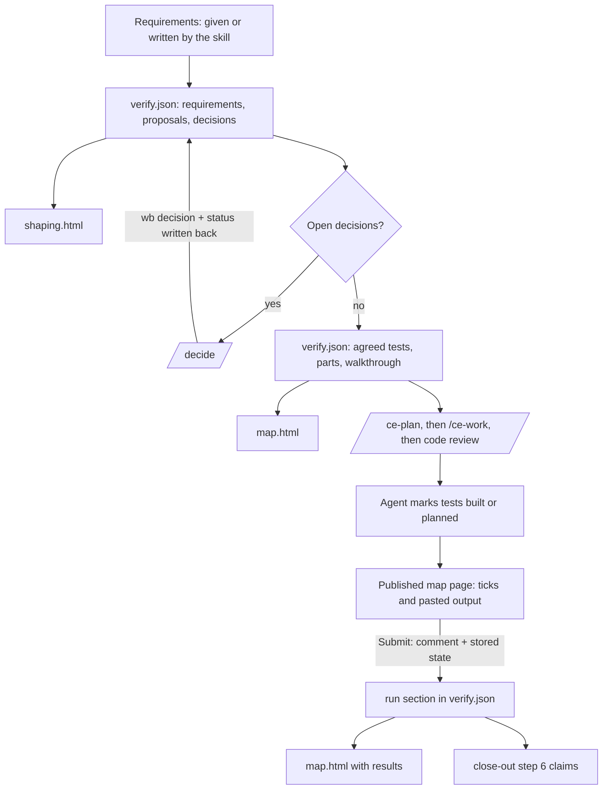

# Verify-Plan Skill - Plan

## Goal Capsule

- **Objective:** Before a non-trivial task is planned, Jet has shaped how it will be proven, and before it is called done he has run a walkthrough himself and its results are on record.
- **Means:** A `/verify-plan` skill that keeps one verification document per task in the task's dossier and generates its pages from that source (KTD1, KTD2).
- **Authority:** The Product Contract's requirements win on behaviour. The approved mockups win on look and layout (KTD3). This plan wins over the older design text in the task file.
- **Execution profile:** One PR in the dotfiles repo, built unit by unit, code review in a fresh context.
- **Stop conditions:** Stop and ask if the `/decide` Submit protocol cannot be reused from a second template (KTD5), or if a fixture or doc would need real work content to be useful (R23).
- **Who finishes:** `/ce-work` builds and verifies U1 to U7. Jet runs the first real use in U8 and merges.

---

## Product Contract

### Summary

Add a skill, `/verify-plan`, that runs before `/ce-plan`. It writes one verification document for the task and takes it through four stages: shape the strategy, the agreed coverage map and walkthrough, run the walkthrough, results. It folds in the unused `spec-doc` skill and replaces the dotfiles test-guide habit.

### Problem Frame

Passing tests only prove what they were built to check, and nothing today shows Jet what that is or where it stops. The hands-on check arrives late, as a test guide written at PR time, only for dotfiles, with no say in the plan. Real use on the competition-family verification work showed the cost: a planned test nearly passed for the wrong reason, a "cheap to reuse" test harness was not reachable, and a local login route assumed to be expensive was one `curl`. Each was caught by review or by luck, not by a step that looks for it.

### Requirements

**Shaping the strategy**

- R1. The skill starts from numbered requirements. It accepts an existing list (a brainstorm's requirements, a task brief) and writes one itself, with the test seam agreed first, when none exists.
- R2. For each requirement the shaping page states why it matters and how it could be wrong while tests pass.
- R3. The shaping page proposes how the work will be proven: a draft coverage grid, a list of proposed tests, and an outline of the walkthrough. Each proposed item is marked firm or tentative by the decision it rests on.
- R4. Choices that are Jet's are put to him as decisions with options, cost, what each proves, and a recommendation. They are answered and changed only through `/decide`. The page shows them read-only with their status and a visible route to answer or change each one.
- R5. The page lists what the agent checked before proposing and what it could not check.

**The map**

- R6. The map shows, per requirement, the proof in four lanes: Unit, Integration (real dependency), End-to-end, Your walkthrough. Each lane header carries a one-line explanation.
- R7. A cell lists every test in that lane for that requirement. A cell with none is shown as a gap.
- R8. Every test is named in plain words and carries what is real, what is faked, and what passing tells you. A bare test id is never the label.
- R9. The automated proof has two views of the same tests: by requirement (the grid) and by system part (which parts each test runs for real, which it fakes, and which nothing automated reaches).
- R10. The grid has a Detail density and an Overview density. Overview shows the whole matrix as slim rows with the worst status per cell and per-lane totals.
- R11. A requirement is defined once, in its card. Elsewhere it appears as its id and short label, linking to the card.

**The walkthrough**

- R12. Each walkthrough step states where to run it, why, the command with a copy control, the literal expected result, and what would mean it is wrong.
- R13. Each step shows its risk and an access level (local only, touches cloud, changes cloud, could affect prod, needs permission). Anything beyond local only is prominent, and the walkthrough opens with a summary of it.
- R14. Steps collapse, and each can be marked passed, failed or skipped, with a reason for a skip. A step whose output is worth keeping has a paste box.

**Run and results**

- R15. Jet runs the walkthrough after code review. Submitting sends his step outcomes and pasted output to the session, which records them in the task's dossier. He can submit a partial run and continue or repeat it later.
- R16. The results stage shows each step as passed, failed, skipped or not run, and each test as planned or built, so a gap between the agreed strategy and what was built is visible.
- R17. Close-out treats the recorded results as completion claims to prove.
- R18. A requirement that states lasting behaviour can be marked as such, and the skill offers a draft live check for the task's `checks.md` from it.

**Fit with the workflow**

- R19. The skill hands off to `/ce-plan` with the document's path. What the walkthrough needs becomes planned work, and each agreed test becomes proof-first work that cites its requirement.
- R20. Every page is generated from the document's source in the dossier. Generating twice from the same source gives the same page.
- R21. The skill replaces the dotfiles test guide. A PR's "How to test" section is taken from the walkthrough.
- R22. The `spec-doc` skill is removed and its requirement-writing step lives in this skill.
- R23. Nothing committed to the repo (fixtures, examples, docs) contains work content.
- R24. All pages share one design system, work in light and dark, use the wide layout, and have no nested vertical scrolling.

### Key Decisions

- **The skill informs the plan and does not write tests.** `/ce-work` already writes and observes the failing test. (session-settled: user-directed — chosen over a skill that generates failing tests per requirement: a second test writer would duplicate `/ce-work`.) Governs R3, R19.
- **One document with four stages.** (session-settled: user-approved — chosen over a separate shaping doc: the reasoning stays attached to the result.) Governs R3, R15, R16.
- **Decisions are answered through `/decide`, never on the page.** (session-settled: user-directed — chosen over an on-page form: one way to answer, one place answers are recorded.) Governs R4.
- **Detail opens under the clicked row, with no side panel.** (session-settled: user-directed — chosen over a side panel and a master-detail strip: less overwhelming, and it stays next to the row at any table length.) Governs R6, R10.
- **It replaces the test guides.** (session-settled: user-directed — chosen over keeping both: Jet does not like the test guides.) Governs R21.
- **`spec-doc` is folded in and removed.** (session-settled: user-approved — chosen over building around an unused skill or dropping its seam step.) Governs R1, R22.
- **Ticks and pasted output return through a published page's Submit.** (session-settled: user-approved — chosen over a local page with results pasted into chat.) Governs R15.
- **First version leaves out the filter row and multi-select.** (session-settled: user-approved — chosen over building every mockup feature first: no real task needs them yet.) Governs R10.

### Scope Boundaries

- Not building: test generation, the spec-interrogate skill, stack detection. The skill names the nearest existing test file and reads the repo's own test command.
- Not changing the compound-engineering plugin. The hand-off to `/ce-plan` is prose.
- Considered and not built: a schema migration path for the source file. There is one writer and no stored documents yet. Evidence that would change it: a second version of the format with documents in the store.
- Considered and not built: a stamp on each page recording which version of the source it was built from. Nothing would read it; rebuilding is cheap and the skill rebuilds after every source change. Evidence that would change it: a stale page misleading someone in real use.
- Considered and not built: automatic refresh of planned-versus-built from the test runner. The agent updates the source at review time. Evidence that would change it: results drifting from reality in real use.

#### Deferred to Follow-Up Work

- The filter row and selecting several requirements on the map page (mocked in the dossier, `mockups/p2-map.html`).
- Copying a family-wide rule into the family's `concepts.md`.
- Tier test checks (`dotfiles--feat-family-dag-view-tier-test-checks`), which wait on this skill.

### Success Criteria

- The skill is used on one real task with a user-facing surface, and the strategy, tests and walkthrough it produced held up through review.
- Jet can say from the Overview alone which requirements rest on him.

---

## Planning Contract

### Key Technical Decisions

- KTD1. **The source is one JSON file, `verify/verify.json`, in the task's dossier.** A grid of requirements, tests, steps and decisions is data, and the task-store rule allows a generator plus its data in place of Markdown. Covers R20.
- KTD2. **A Python generator inside the skill renders the pages**, following `claude/.claude/skills/compare-page/` (JSON spec, `check` then `build`, a `.test.sh` beside the script). It writes `verify/shaping.html` and `verify/map.html` beside the source. The source is embedded through `script_safe` in `claude/.claude/skills/compare-page/kit/pagekit.py`, so text containing a closing script tag is safe and never refused. Covers R20.
- KTD3. **The templates are fixed and draw the JSON; no model-written script runs in a page.** The drawing code is pure functions that take the data and return markup, kept between `CORE` markers so a node test can load them without a browser, as `claude/.claude/skills/decide/page/page.html` does. Both templates include one shared stylesheet and one shared script holding the design tokens and the card component. They are ported from the approved mockups in the task dossier (`mockups/q2-shaping.html`, `mockups/p2-map.html`). This is the rule `/decide`'s page already follows (`claude/.claude/skills/decide/references/page-spec.md`). Covers R24.
- KTD4. **Decisions live in `verify.json` and are asked through `/decide`.** The skill builds the `/decide` items from the document's `decisions`, records each answer with `wb decision`, writes the answer and status back into the source, and regenerates. Firm or tentative is derived from decision status, never stored. Covers R3, R4.
- KTD5. **The run stage publishes the map page as a private page that reuses `/decide`'s Submit protocol**: one comment sent inside Jet's click, plus database documents for the state (`claude/.claude/skills/decide/references/page-spec.md`, Submit section). `/decide`'s own template cannot carry ticks and pasted output, so this is a second template speaking the same protocol, not a new `/decide` layout. The session exports the stored documents into `verify/run-state/` in the dossier with the page-database tool's folder export, and "done" typed in chat is the fallback when the send is rejected or the watch was not re-armed after a `/clear`. Every stored document carries the walkthrough's revision number, which the source bumps whenever a step is added, removed or renumbered; state from an older revision is shown as such and not counted. Opened as a local file, the page is view-only. (session-settled: user-approved — chosen over a local page with results pasted into chat.) Covers R15.
- KTD6. **Results are written back into `verify.json` under a `run` section by a generator subcommand** that takes the exported state folder and replaces the section each time, so a partial run can be continued or repeated. The results stage is the same map page rendered with `stage` set to results; Submit stays available until then. Covers R15, R16.
- KTD7. **Close-out gains one claim source.** When `verify/verify.json` has a `run` section, each walkthrough step and each agreed test is a claim in step 6, and a failed step is a false claim of `claude/.claude/skills/close-out/SKILL.md`. A missing run section on a task that has a verification document is itself listed as unproven. Covers R17.
- KTD8. **`spec-doc`'s template and seam step move to a reference file in this skill** and the `spec-doc` folder is deleted. Its example file is not carried over. Covers R1, R22.
- KTD9. **The system-part view is driven by a short `parts` list in the source**, with each test naming the parts it runs for real and the parts it fakes. A document without `parts` renders the grid only. Covers R9.
- KTD10. **Fixtures use an invented, neutral example.** The mockups' sample is real work content and stays in the task dossier. Covers R23.
- KTD11. **The store's page metadata is kept in the source and written into each page as the comment block the dossier index reads** (an HTML comment in the first five lines, per `_wb_page_meta` in `scripts/.config/scripts/tmux/wb.sh`): `tags: [verify-plan]`, `retire_when: task:<stem> done`, and the published URL once there is one. The `test-guide` tag stays valid for existing pages. Covers R21.

### High-Level Technical Design



### Output Structure

```text
claude/.claude/skills/verify-plan/
  SKILL.md
  learnings.md
  references/
    spec.md            the verify.json contract
    requirements.md    writing numbered requirements and agreeing the seam
    shaping.md         what to check before proposing; decision shapes
  fixtures/
    example-verify.json
    example-run-state/     one file per stored document
  templates/
    shared.css
    shared.js
    shaping.html
    map.html
  scripts/
    verify-plan.py
    verify-plan.test.sh
    page-logic.test.sh
```

### Assumptions

- Publishing a private page for a work-repo task is acceptable, as it already is for `/decide` pages.
- Python 3 and node are present on the host, as the `compare-page` and `/decide` page tests already require.

### Sequencing

U1 first, because the pre-commit doc generator refuses every commit while a skill folder lacks `SKILL.md`. U2 before U3 and U4. U5 after U4. U6 after U2. U7 last among the build units, since it removes `spec-doc` only once its content has moved. Commit `docs/` edits separately: the pre-commit doc generator stages pending `docs/*.md` edits into whatever commit runs it.

---

## Implementation Units

### U1. Skill skeleton and registration

- **Goal:** The skill folder exists with a real `SKILL.md` and is listed where skills are listed.
- **Requirements:** R21 (registration only).
- **Dependencies:** none.
- **Files:** `claude/.claude/skills/verify-plan/SKILL.md`, `claude/.claude/skills/verify-plan/learnings.md`, `claude/README.md`, `docs/guides/verify-plan.md`.
- **Approach:** Frontmatter `name` and a description with trigger phrases and not-for clauses, in the shape of `compare-page`. Body sections are stubs that U6 fills. Add the README line. The guide is a short page the docs generator maps to the skill.
- **Patterns to follow:** `claude/.claude/skills/compare-page/SKILL.md`, `docs/guides/decide.md`.
- **Test scenarios:** Test expectation: none -- scaffolding; the pre-commit doc generator is the check.
- **Verification:** A commit containing only this unit passes the pre-commit hook, and the regenerated docs index lists the skill.

### U2. The document contract and its checker

- **Goal:** `verify.json` has a written contract, an example, and a `check` command that rejects a malformed document with a message naming the field.
- **Requirements:** R1, R3, R4, R6, R7, R8, R9, R12, R13, R18, R20, R23.
- **Dependencies:** U1.
- **Files:** `claude/.claude/skills/verify-plan/references/spec.md`, `claude/.claude/skills/verify-plan/fixtures/example-verify.json`, `claude/.claude/skills/verify-plan/scripts/verify-plan.py`, `claude/.claude/skills/verify-plan/scripts/verify-plan.test.sh`.
- **Approach:**
  1. Top-level keys: `task`, `page` (KTD11), `stage`, `requirements`, `lanes`, `parts`, `tests`, `walkthrough`, `decisions`, `checked`, `unchecked`, `needs`, `run`.
  2. A requirement has id, short label, sentence, why it matters, how it could be wrong, optional `lasting`.
  3. A test has a plain name, the real test name, lane, requirements proven, real parts, faked parts, "passing tells you", status (proposed, planned, built), and the decision it rests on.
  4. A walkthrough step has id, title, where, why, command or plain instruction, expected, wrong-if, risk, access levels, paste flag, requirements. The walkthrough has a revision number (KTD5).
  5. A decision has id, question, options (cost, proves), recommended option, answer, note, status.
  6. `check` enforces: unique ids; every reference resolves; lanes limited to the four; access levels limited to the five; a test never has an empty plain name; a requirement with no test and no walkthrough step is allowed only while an open decision names it or once it carries an accepted-gap reason.
- **Execution note:** Write the checker test-first from the scenarios below.
- **Patterns to follow:** `claude/.claude/skills/compare-page/scripts/compare-page.py` and its test; `scripts/.config/scripts/tmux/tests/wb-decide-spec.test.sh` for the fixture-plus-mutated-copies style.
- **Test scenarios:**
  - The example fixture passes `check` with exit 0 and no output.
  - A test citing a requirement id that does not exist fails, and the message names the test and the id.
  - Two requirements sharing an id fail.
  - A step with an access level outside the five fails, and the message lists the allowed values.
  - A requirement with no test, no walkthrough step, no open decision naming it and no accepted-gap reason fails as uncovered.
  - The same requirement passes when an open decision names it, and when it carries an accepted-gap reason.
  - A test with a blank plain name fails.
  - A document with no `parts` passes.
  - A document with no `run` section passes; one with a `run` entry for an unknown step id fails, as does a step outcome outside passed, failed, skipped, not run.
- **Verification:** The test file passes, and the fixture contains no real project, company or person names.

### U3. Shaping page

- **Goal:** `build` renders `shaping.html` from the source, matching the approved shaping mockup.
- **Requirements:** R2, R3, R4, R5, R11, R20, R24.
- **Dependencies:** U2.
- **Files:** `claude/.claude/skills/verify-plan/templates/shaping.html`, `claude/.claude/skills/verify-plan/templates/shared.css`, `claude/.claude/skills/verify-plan/templates/shared.js`, `claude/.claude/skills/verify-plan/scripts/verify-plan.py`, `claude/.claude/skills/verify-plan/scripts/verify-plan.test.sh`, `claude/.claude/skills/verify-plan/scripts/page-logic.test.sh`.
- **Approach:**
  1. Port the mockup into a template with one data slot; the page's render functions (KTD3) draw from the embedded JSON. This unit creates the shared stylesheet and script.
  2. Sections in order: stage bar, purpose line, requirement cards, draft grid with firm and tentative styling, proposed tests list, walkthrough outline, decisions, checked and could-not-check.
  3. Cards are equal size; the chevron stays in place and rotates; detail opens under the card row.
  4. Decision options are flat rows, not boxed buttons. An unanswered decision has an "Answer in /decide" control and an answered one a "Change in /decide" control; both copy `/verify-plan`, which resumes the skill at the document's open decisions.
  5. The stage bar marks the stage named by the source's `stage`. Stage 1 links to `shaping.html` and stages 2 to 4 link to `map.html`.
  6. Escape every string from the source when drawing it.
  7. Every control is a real button or checkbox: reachable by keyboard, with its expanded state exposed. Copy confirms with a brief "Copied", and when the clipboard is unavailable it selects the text instead.
- **Patterns to follow:** the task dossier's `mockups/q2-shaping.html` for layout; `claude/.claude/skills/decide/page/page.html` and its `scripts/page-core.test.sh` for testable render functions.
- **Test scenarios:**
  - Build (generator test): building the fixture twice gives byte-identical output.
  - Build: a source containing `</script` builds, and the built file has exactly one closing script tag per script block.
  - Build: the page-metadata comment block sits within the first five lines and carries the tag and `retire_when`.
  - Build: the output has both colour blocks (light and dark) and no vertical-scroll container rules.
  - Render (node test): the requirement cards markup contains each requirement's sentence exactly once.
  - Render: a decision with status answered renders its chosen option and note; one with status open renders the waiting state and the answer control.
  - Render: a proposed test resting on an open decision is marked tentative, and becomes firm when the fixture's decision is answered.
  - Render: a requirement sentence containing `<b>` and `&` appears escaped.
  - Render: the stage bar marks the stage named by `stage` and no other.
- **Verification:** The fixture's page, opened in a browser, matches the mockup's layout and behaviour in light and dark.

### U4. Map page

- **Goal:** `build` renders `map.html`: the summary band, requirement cards, both proof views, the all-tests list and the walkthrough.
- **Requirements:** R6, R7, R8, R9, R10, R11, R12, R13, R14, R20, R24.
- **Dependencies:** U2, U3 (shared styles and card component).
- **Files:** `claude/.claude/skills/verify-plan/templates/map.html`, `claude/.claude/skills/verify-plan/scripts/verify-plan.py`, `claude/.claude/skills/verify-plan/scripts/verify-plan.test.sh`, `claude/.claude/skills/verify-plan/scripts/page-logic.test.sh`.
- **Approach:**
  1. Port the mockup, leaving out the sample-size switch, the filter row and multi-select.
  2. Keep the page's pure logic (worst status per cell, per-lane totals, summary-band counts, the cloud and prod summary line) in functions a node test can load, as `/decide` does with `scripts/page-core.test.sh`.
  3. Overview rows get a little more height and a gap under the header than the mockup has.
  4. Use U3's shared stylesheet and script; add nothing page-local that the shaping page also needs.
  5. Without `parts`, hide the view toggle and the system strip.
  6. Worst status in an automated lane, worst first: gap, proposed, planned, built. The walkthrough lane shows a neutral "you" marker before a run and, after one, the worst of failed, not run, skipped, passed.
  7. Controls follow U3's keyboard and copy rules.
- **Patterns to follow:** the task dossier's `mockups/p2-map.html`; `claude/.claude/skills/decide/scripts/page-core.test.sh`.
- **Test scenarios:**
  - A cell with two tests, one built and one planned, reports planned as its worst status.
  - A cell with no tests reports a gap, and the lane total excludes it.
  - A walkthrough cell with one passed and one failed step reports failed after a run, and the neutral marker before one.
  - Per-lane totals for the fixture match hand-counted values.
  - The access summary for a fixture with one cloud-read step and no prod step reads as one step touching the cloud and none affecting prod.
  - A step with no command renders its instruction as text with no copy control.
  - Every test in the rendered grid is labelled by its plain name, and no cell label equals a bare id.
  - A fixture without `parts` renders no view toggle.
  - Building twice gives byte-identical output (generator test); the scenarios above run under node against the render functions.
- **Verification:** The fixture's page matches the mockup in a browser at 4 requirements, and a 12-requirement copy of the fixture stays readable in Overview with no horizontal scroll at 1400px.

### U5. Run stage and results

- **Goal:** A published map page sends ticks and pasted output to the session, the session records them, and the page then shows results.
- **Requirements:** R14, R15, R16.
- **Dependencies:** U4.
- **Files:** `claude/.claude/skills/verify-plan/templates/map.html`, `claude/.claude/skills/verify-plan/scripts/verify-plan.py`, `claude/.claude/skills/verify-plan/fixtures/example-run-state/`, `claude/.claude/skills/verify-plan/scripts/verify-plan.test.sh`, `claude/.claude/skills/verify-plan/scripts/page-logic.test.sh`, `claude/.claude/skills/verify-plan/references/spec.md`.
- **Approach:**
  1. In a published page, each step's outcome and paste is saved as stored state as it happens, so a reload keeps it. A failed save shows an inline error on that step and keeps the value in memory.
  2. Submit follows KTD5: one comment and a `submitted` record carrying the counts per outcome. After Submit the page says the run was sent and is waiting to be recorded; it stays editable and can be submitted again.
  3. A `record-run` subcommand takes the exported state folder and replaces the `run` section: per step, outcome, skip reason, pasted output, note, time. It refuses state whose step ids do not match the source, and ignores state from an older walkthrough revision while reporting how many documents it ignored.
  4. With `stage` set to results, the page shows each step's outcome, a results summary and each test's planned or built status, and has no Submit. With a `run` section but an earlier stage, it shows the recorded outcomes and keeps Submit.
  5. Opened as a local file, the same controls work in memory and the page says results will not be saved.
- **Execution note:** Read `/decide`'s page template and Submit section before writing; the protocol is copied, not reinvented.
- **Patterns to follow:** `claude/.claude/skills/decide/page/page.html` (Submit and state handling), `claude/.claude/skills/decide/references/page-spec.md`.
- **Test scenarios:**
  - `record-run` on the example state writes a `run` section with each step's outcome, and pasted text preserved byte for byte.
  - State naming a step id absent from the source is refused, and the source is unchanged.
  - Running `record-run` twice with the same state leaves the source unchanged the second time.
  - A second `record-run` with two more steps passed replaces the section; the earlier five outcomes are kept and the two are added.
  - State from an older walkthrough revision is ignored, and the command reports the count.
  - A source whose pasted output contains HTML and a closing script tag builds, and the render function returns it escaped.
  - The Submit summary for 5 passed, 1 failed and 1 not run reads those three counts.
  - A source with a `run` section and stage 3 renders Submit; the same source at stage results does not.
- **Verification:** On a published page for the fixture, marking steps (one of them failed), pasting output and pressing Submit wakes the session, and after the export and `record-run` the rebuilt page shows those results.

### U6. The skill's process

- **Goal:** `SKILL.md` and its references tell an agent how to take a task through the four stages.
- **Requirements:** R1, R2, R3, R4, R5, R18, R19, R21.
- **Dependencies:** U2.
- **Files:** `claude/.claude/skills/verify-plan/SKILL.md`, `claude/.claude/skills/verify-plan/references/requirements.md`, `claude/.claude/skills/verify-plan/references/shaping.md`, `docs/guides/verify-plan.md`.
- **Approach:**
  1. Requirements step (KTD8): use what exists; otherwise write numbered behaviour and confirm the test seam before writing.
  2. Shaping checks, each from the competition-family notes: how a local caller gets the tested identity; what the real client sends; whether a "cheap because we reuse it" layer is reachable; for every gating test, what else could make it pass, preferring one subject with one variable toggled; whether every wiring of a gate is covered.
  3. Standard decisions to consider: how Jet sees it working, where the main automated proof sits, what to do about an untested requirement.
  4. `/decide` loop per KTD4, including changing an answered decision.
  5. Hand-off per R19, and the review-time step: mark tests built or planned, publish the run page, record the run.
  6. Lasting requirements per R18: offer the draft live check at the results stage.
  7. The PR's "How to test" comes from the walkthrough.
- **Patterns to follow:** `claude/.claude/skills/decide/SKILL.md` for stage-by-stage instructions; `claude/.claude/skills/spec-doc/SKILL.md` for the content being moved.
- **Test scenarios:** Test expectation: none -- instructions; proven by U8's real use.
- **Verification:** A fresh agent given only the skill and a task brief produces a document that passes `check` and a shaping page with at least one decision.

### U7. Workflow hooks and retirements

- **Goal:** Close-out reads the results, `spec-doc` is gone, and the test-guide habit points at this skill.
- **Requirements:** R17, R21, R22.
- **Dependencies:** U5, U6.
- **Files:** `claude/.claude/skills/close-out/SKILL.md`, `claude/.claude/skills/spec-doc/` (delete), `claude/README.md`, `claude/.claude/skills/pragmatic-review/SKILL.md`, `docs/guides/pragmatic-review.md`, `docs/where-we-are.md`, `docs/wb-guide.md`.
- **Approach:**
  1. Close-out step 6 per KTD7, with one added edge case in its list.
  2. Delete the `spec-doc` folder and repoint its four references.
  3. Outside the repo, update the memory entry that mandates a test guide per dotfiles PR so it names this skill.
  4. Record in the PR the live-removal cleanup for a deleted skill: after the re-stow, remove the broken `SKILL.md` link and its folder.
- **Patterns to follow:** the close-out edit in `docs/plans/2026-11-14-1840-feat-verification-skill-edits-plan.md`.
- **Test scenarios:**
  - `scripts/.config/scripts/tmux/tests/skill-usage.test.sh` still passes with `spec-doc` gone.
  - A search of tracked, non-generated files finds no remaining instruction to use `spec-doc`.
- **Verification:** The docs index regenerates without the removed skill, and close-out's step 6 names the verification document as a claim source.

### U8. First real use and PR

- **Goal:** The skill has been used once for real, and the PR carries its own walkthrough.
- **Requirements:** Success Criteria; R21.
- **Dependencies:** U1 to U7.
- **Files:** `claude/.claude/skills/verify-plan/learnings.md`.
- **Approach:** Run the skill on this task itself to produce the PR's walkthrough, then on one task with a user-facing surface that Jet picks. Record what the template or process missed in the learnings file.
- **Test scenarios:** Test expectation: none -- usage.
- **Verification:** The PR's "How to test" section is taken from a generated walkthrough, and the learnings file has at least one dated entry from the real use.

---

## Verification Contract

| Check | Command or evidence | Applies to |
|---|---|---|
| Generator and checker | `bash claude/.claude/skills/verify-plan/scripts/verify-plan.test.sh` | U2, U3, U4, U5 |
| Page logic | `bash claude/.claude/skills/verify-plan/scripts/page-logic.test.sh` | U4, U5 |
| Skill counting | `bash scripts/.config/scripts/tmux/tests/skill-usage.test.sh` | U7 |
| Docs generation | the pre-commit hook passes on every commit | all |
| Shell lint for the test scripts | shellcheck through the `koalaman/shellcheck` image | U2 to U5 |
| Pages render | fixture pages opened in a browser, light and dark | U3, U4 |
| Submit round trip | one published fixture page, ticked, submitted, recorded | U5 |

The full wb Docker suite is not a gate for this plan; it fails on a clean checkout for unrelated, environment-dependent files.

---

## Definition of Done

- Every requirement R1 to R24 is met or listed under Deferred to Follow-Up Work.
- The Verification Contract's checks pass, with the browser and Submit checks done by hand and noted in the PR.
- `/haircut` has run on the branch diff before code review, and the review ran in a fresh context.
- No fixture, example or doc in the repo contains work content.
- No abandoned-attempt code or unused template remains in the diff.
- The task's `depends_on:` on the unbuilt spec-interrogate skill is cleared, and the coordinator session has been told the agreed scope and that `spec-doc` is removed.
